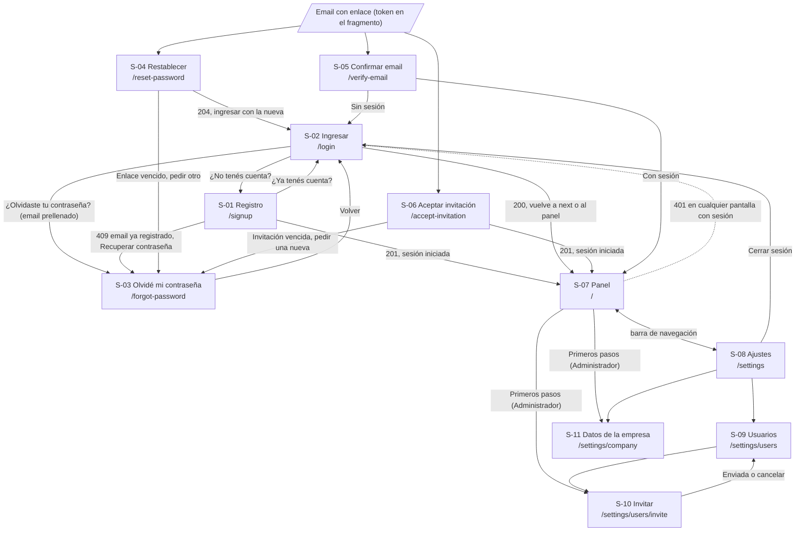
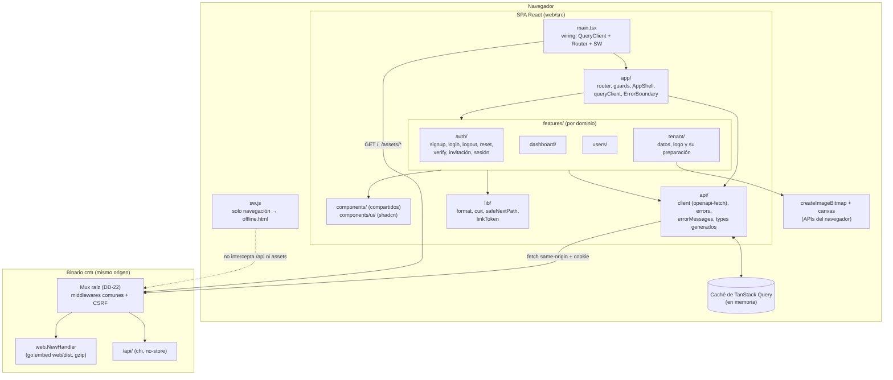
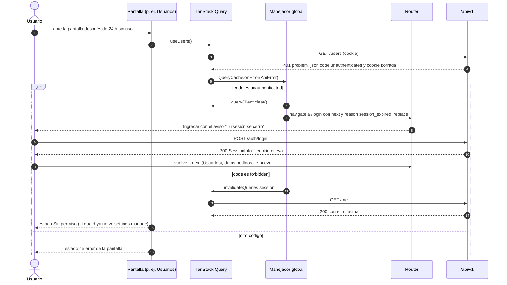
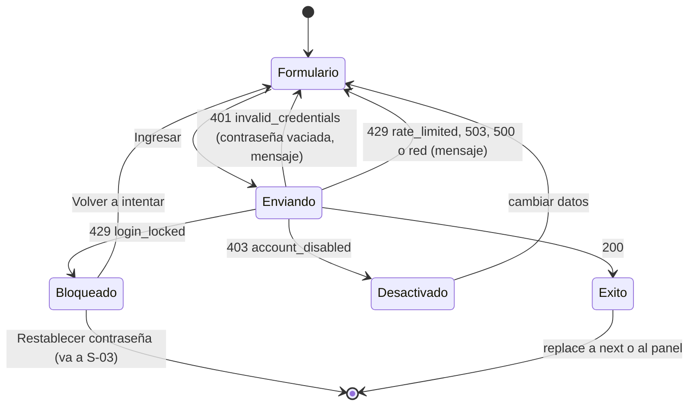
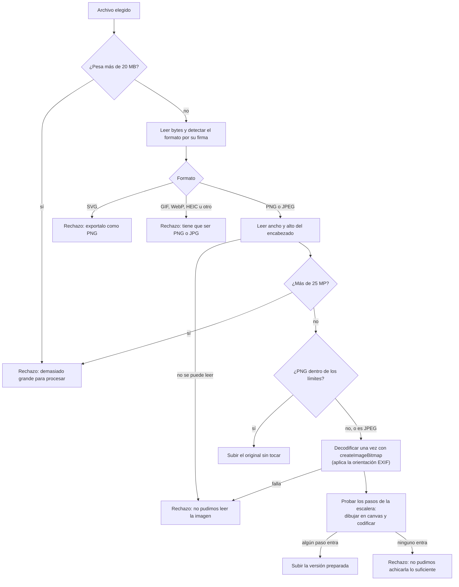
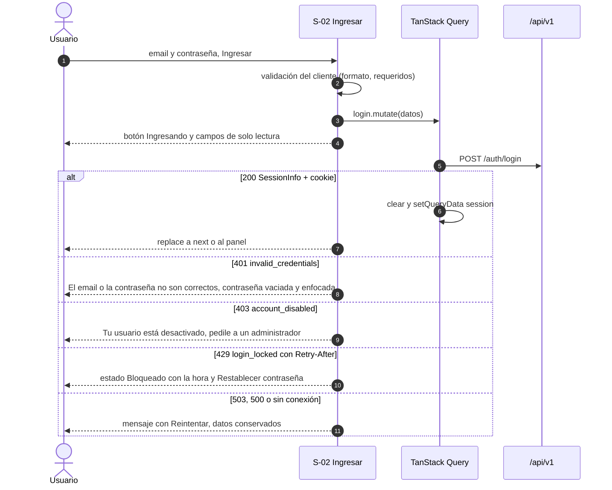
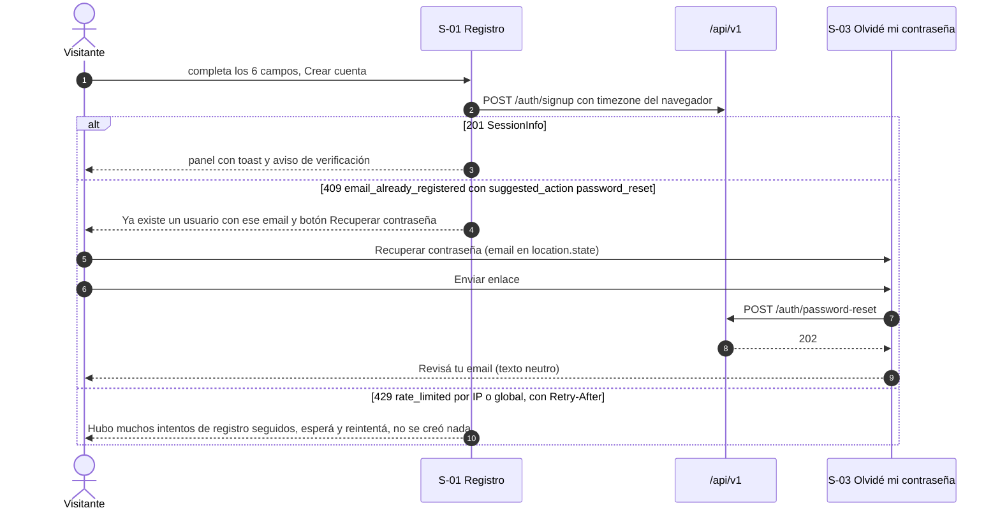
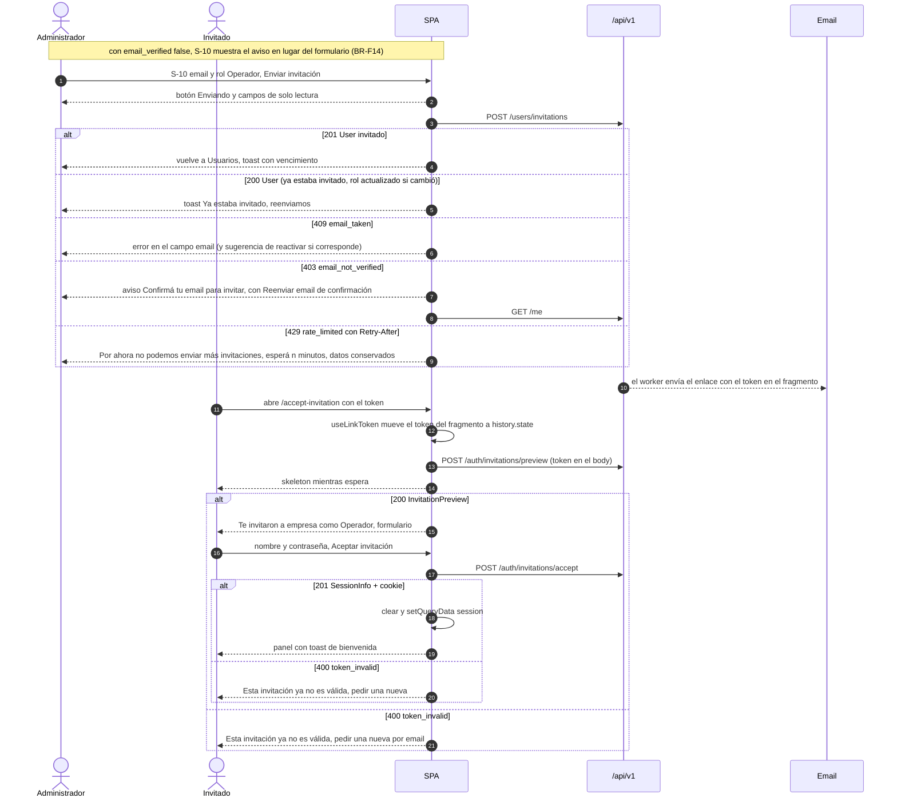

# UI (frontend): Empresas, usuarios y roles

**Spec**: [`spec.md`](spec.md) · **Rama**: `001-empresas-usuarios` · **Fecha**: 2026-09-29
**Autor**: `frontend-architect` · **Estado**: Revisión 3 aprobada por el usuario el 2026-10-12; Revisión 4 aprobada por el usuario el 2026-10-13 (P-F10: sí; P-F11: no); enmienda H-16 a la Revisión 4 aprobada por el usuario el 2026-10-13; enmienda DD-F31 *Accepted*, aprobada por el usuario el 2026-10-14; enmienda de versiones del 2026-10-15: React Router 8 por decisión del usuario, regla de versiones y excepción de TypeScript confirmadas por el usuario el 2026-10-15 (P-F12); enmienda de F0 del 2026-10-15: P-F13, P-F14 y P-F15 aprobadas por el usuario el 2026-10-16; enmienda de F1 del 2026-10-16: P-F16 y P-F17 aprobadas por el usuario el 2026-10-16
**Contrato consumido**: [`contracts/openapi.yaml`](contracts/openapi.yaml) **v0.5.0** (**canónico**; el diseño original se hizo contra v0.3.1; la Revisión 3, contra v0.4.3)
**Revisión 1 (2026-09-29)**: respuestas del usuario a P-F1 a P-F5 (§26) y resolución de los
hallazgos H-1 a H-9 por el backend (`plan.md` §18, DD-22 a DD-30, §10.7, contrato v0.3.0). Cambios:
el logo grande se achica en el navegador (§13.11.1, DD-F11, DD-F20, DD-F21); el registro ya no
reintenta sin zona horaria (DD-F10); el `403` de CSRF entra al mapa de errores (§12.2);
invitación vencida, rol de invitados y reinvitación con otro rol (§13.9, §13.10); distribución
alineada con el mux raíz y la tabla de cabeceras del plan (§21); piso de Chrome 112 (NFR-F02).
En esa revisión se reportaron H-10 (cookie `__Host-` en `http://localhost`) y H-11 (tamaño exacto
del límite del logo).
**Revisión 2 (2026-09-29)**: decisiones del usuario sobre H-10 (**HTTPS local con mkcert** en
desarrollo y E2E), H-11 (**2 MiB = 2 097 152 bytes del archivo**) y P-F6 (**todo JPEG se vuelve a
codificar**), ya incorporadas por el backend (`plan.md` DD-24 reescrita, DD-31, INV-23, INV-24,
§10.5.1, §18 segunda tanda; contrato v0.3.1). Cambios: desarrollo y E2E sobre HTTPS, sin
recomendar un navegador (§17, §21.3, DD-F23); sin HSTS en modo local (§21.2);
`LOGO_TARGET_MAX_BYTES` = 2 097 152, el límite exacto (§13.11.1, DD-F22); errores `422`/`400` del
logo por campo `file` (§12.2, §12.3); DD-F21 confirmada (§24); S-F3, P-F6, H-10 y H-11 cerrados
(§25–§27). **Hallazgo nuevo** H-12 (la prueba en un celular real necesita un origen HTTPS accesible
desde el teléfono), en §27.2.
**Revisión 3 (2026-10-12)**: realineación con el backend implementado (Fases 0 a 9 en `main`,
`b945373`; plan §18, tandas 3 a 15; contrato **v0.4.3**). Análisis completo en
[`ui-revision-3.md`](ui-revision-3.md). Ninguna operación ni esquema cambió de forma. Cambios:
`method_not_allowed` en el mapa de errores (§12.1, §12.2); `Retry-After` en el `503` del registro y
esperas cortas en segundos (§12.2, §13.1, DD-F25); tabla de límites de tasa con sus cupos
compartidos (§11.1); semántica de `PATCH /tenant` de DD-43 (§11.1, §13.11, INV-F15); `COMMIT`
incierto del logo de DD-42 resuelto releyendo la empresa (§10.3, §13.11, §14.4, DD-F26); mensajes
de campo según los códigos que el servidor emite de verdad (§12.3, DD-F24); zona guardada siempre
en el selector (DD-F27, S-F11). Sistema visual sin cambios. H-12 sigue abierto; nuevos H-13 a H-15
(§27.2). Preguntas P-F7 a P-F9 y lista de pantallas **dependientes de la revisión 16 del backend**
en §26.
**Revisión 4 (2026-10-13)**: addendum al contrato **v0.5.0** (decimosexta revisión del backend,
aprobada el 2026-10-12: DD-44 a DD-49, [`revision-16-auditoria.md`](revision-16-auditoria.md)).
Cierra la lista "Dependiente de la revisión 16" de la Revisión 3 y aplica P-F8 con el default
aprobado. Cambios: invitar exige el email confirmado (BR-F05, BR-F14 nueva; S-07, S-09 y S-10;
DD-F28; INV-F16); `email_not_verified` en el mapa de errores, distinto de `forbidden` (§12.2,
§12.4); `429` con `Retry-After` en invitar, reenviar invitación y reactivar, y cupos de DD-48 y
DD-49 en la tabla de límites (§11.1, DD-F29); el `429` del registro no distingue el cupo por IP del
global (§13.1, DD-F29); el reenvío de la confirmación tiene cupo por usuario y responde `202` sin
enviar (§13.5, §13.13, DD-F30); confirmar un restablecimiento también confirma el email (BR-F05).
Sistema visual sin cambios (el aviso nuevo reutiliza `FormAlert`). Preguntas nuevas P-F10 y P-F11
con default (§26); hallazgo H-16 (§27.2).
**Revisión 4, enmienda H-16 (2026-10-13)**: aprobada por el usuario el 2026-10-13. El backend
adoptó H-16 como enmienda de la decimosexta revisión ([`revision-16-auditoria.md`](revision-16-auditoria.md)
§3.7; plan DD-46 (3) y DD-9). El contrato sigue en v0.5.0 y los tipos generados no cambian: el
`429` del reenvío ya estaba declarado. Sin cupo por usuario (3 de ráfaga y 1 cada 20 min), el
reenvío de la confirmación responde `429 rate_limited` con `Retry-After` (hasta 1200 s) en lugar
de `202` sin enviar, y un `202` siempre envía (salvo con el email ya confirmado). Cambios: DD-F30
reemplazada, así que sale la línea "Si lo pediste varias veces, esperá unos 20 minutos." de C-01,
S-05 y el aviso W (§13.5, §13.9, §13.13); el `429` del reenvío viene del cupo por IP o del cupo por
usuario, y con los dos agotados el reintento puede traer una segunda espera, que la UI no promete
evitar (§11.1, §12.2, DD-F29); H-16 resuelto (§27.2). Sin cambios en P-F7 (el reset sigue con
`202`), DD-F25 (ya formatea 1200 s como "20 minutos") ni el sistema visual.
**Revisión 4, enmienda DD-F31 (2026-10-14, *Accepted*: aprobada por el usuario el 2026-10-14)**: el reenvío de la confirmación a un email
ya confirmado responde `202` sin enviar (contrato v0.5.0; `ResendEmailVerification`), y con un
`/me` viejo C-01, el aviso W y S-05 decían "Listo, te lo reenviamos". Tras el `202` se vuelve a
pedir `/me` y el texto sale de esa lectura; S-05 no ofrece reenviar si el email ya está confirmado
(DD-F31, INV-F17; §10.3, §11.1, §13.5, §13.9, §13.13, §15). Sin cambios en el backend ni en el
contrato. Además, el backend tiene las Fases 0 a 10 en `main` (`c7692bd`): §0, §11.1, §26, §27.1 y
RF-16 dejan de decir que la Fase 10 falta.
**Enmienda de versiones (2026-10-15)**: al arrancar la Fase F0, la regla "la última estable de
cada librería" chocó con dos *peer dependencies*. (1) **React Router 8** (8.4.0): el usuario
decidió adoptarlo en lugar de v7 (nota 2026-10-15 de ADR-017). Es la misma librería y el mismo
modo *data*, con las mismas APIs que usa este documento (`createBrowserRouter`, `lazy`,
`ErrorBoundary`, `useBlocker`, `<ScrollRestoration />`, `createMemoryRouter`). `RouterProvider` se
importa de `react-router/dom` y `react-router-dom` ya no existe. El middleware siempre activo y el
`context` nuevo de los loaders no tocan este diseño, que no usa `loader`, `action` ni `middleware`.
Pide React ≥ 19.2.7, Node ≥ 22.22.0 y `lib` ES2022, y el stack los cumple. (2) **TypeScript 5.9.3**
en lugar de 7.0.2: `openapi-typescript` 7.13.0 pide `typescript ^5.x` y `typescript-eslint` 8.71.2
pide `>=4.8.4 <6.1.0`. La regla pasa a "la última estable compatible con las *peer dependencies*
del conjunto, sin `--force` ni `--legacy-peer-deps`", con la excepción registrada en `tasks.md`
(Frontend, convenciones). Cambian §0, §22, §26 (P-F12, con default), §28 (RF-1), §29 y §30.
Ninguna pantalla, estado, regla ni caso de test cambia; T-F001 y T-F006 suman verificaciones.
Sistema visual sin cambios.
**Enmienda de F0 (2026-10-15; P-F13, P-F14 y P-F15 aprobadas por el usuario el
2026-10-16)**: tres pendientes de la implementación y
la revisión de F0 (`main` en `de4d951`). (1) **Vulnerabilidades de npm** (ADR-027 nuevo; resuelve la
fila T-F009 ↔ ADR-026): `make web-vuln` corre `npm audit` en dos pasadas. La de producción bloquea
desde `low`; la del árbol completo bloquea solo `critical` y lista el resto. Corre como job
`make web-vuln` del workflow `vulncheck` (PR, `main` y corrida diaria), obligatorio en el ruleset
de `main` una vez mergeado. Las excepciones van al registro de ADR-026. Las 7 altas de la cadena de
`shadcn` (`braces`, sin versión corregida) quedan informadas en el log y no bloquean. (2) **`401`
con cambios sin guardar** (DD-F32, INV-F18): el aviso de salida de S-11 nunca frena la navegación de
sesión vencida. Todo bloqueo de salida pasa por `useUnsavedChangesGuard`, y el login avisa que se
perdieron los cambios. (3) **Log del `503` de la SPA sin compilar** (H-17, para el
`backend-architect`): propuesta de bajarlo a `WARN` desde `internal/app`, sin tocar `web` ni
`depguard`. Cambian §5, §9.2, §12.4, §13.2, §13.11, §15.4, §21, §24, §25, §26, §27.2, §28, §29 y §30.
Tareas: T-F010 y T-F011 nuevas; cambian T-F103, T-F105, T-F301, T-F602 y T-F605. Sistema visual
sin cambios (la línea nueva del login reutiliza la zona C).
**Enmienda de F1 (2026-10-16; P-F16 aprobada por el usuario el 2026-10-16)**: dos huecos que
aparecieron al implementar T-F101/T-F102 (`api/errorMessages.ts`). (1) **`token_invalid` sin
variante de contexto**: §12.2 solo tenía los textos del restablecimiento, la verificación y la
invitación. Para `generic` y cualquier contexto sin variante propia: "Este enlace ya no sirve." /
"Pedí uno nuevo."; los tres textos específicos no cambian. (2) **`formatRetryAt` en F1**: el texto
de `login_locked` (§12.2) necesita la hora de §13.2 y el mapa de mensajes es de F1, pero el helper
estaba en T-F302 (F3). Pasa a T-F102, con la firma de §15.4 y las reglas de §13.2; T-F302 lo usa y
no lo reimplementa. Cambian §12.2, §15.4 y §26. Tareas: cambian T-F101, T-F102 y T-F302. Sistema
visual sin cambios.
**Enmienda de F1, P-F17 (2026-10-16; aprobada por el usuario el 2026-10-16)**: cuatro puntos de
`login_locked` que dejó abiertos P-F16. (1) Sin `Retry-After`, el texto va sin hora: "…Podés volver
a intentar en unos minutos o restablecer tu contraseña ahora." (2) `minutes` de `formatRetryAt` son
minutos de reloj entre ahora truncado al minuto y la hora mostrada, mínimo 1, así la hora y los
minutos no se contradicen; con 1, "(en 1 minuto)". (3) `LockedNotice` recibe `title` y
`description` ya armados por `messageForError(error, 'login')`, no una `Date`: una sola fuente del
texto. (4) INV-F12 se alinea con ADR-023: sin sesión se usa la zona del navegador. Cambian §9.2,
§12.2, §13.2, §15.1, §15.4 y §26. Tareas: cambian T-F101, T-F301 y T-F302. Sistema visual sin
cambios.
**Enmienda de F1, P-F18 (2026-10-16; aprobada por el usuario el 2026-10-16)**: cuatro puntos de la
revisión de código de F1 (vuelta 2). (1) **Refetch fallido de `/me` con la sesión en caché**:
`RequireSession` muestra el error a pantalla completa solo sin sesión en caché (`isLoadingError`);
si falla un refetch (`isRefetchError`), el shell y la pantalla siguen montados, sin aviso. (2) **Hora
estable de `login_locked`**: `ApiError` registra el instante de recepción (`receivedAt`) y
`messageForError` calcula la hora con ese instante, no con el reloj del render. (3) **DropdownMenu y
chunks**: DropdownMenu entra con el shell (menú del usuario) y `AppShell` se carga con `lazy` (grupo
2 de §23): `/login` no descarga Radix DropdownMenu. (4) **Título de la pantalla de error de
render**: "Algo salió mal al mostrar esta pantalla · CRM" y foco en su `<h1>`, también si falla el
chunk de la primera pantalla; sin sesión, toda pantalla termina en "· CRM", como ya decía §13.
Cambian §6.4, §11.3, §12.1, §13, §13.2, §15.4, §23 y §26. Tareas: cambian T-F005, T-F101, T-F102,
T-F104, T-F105, T-F106, T-F107, T-F301 y T-F302. Sistema visual sin cambios.

| Archivo | Contenido |
|---|---|
| `ui.md` (este) | Pantallas, navegación, rutas, modelo de estado, matriz de estados de UI, errores, componentes, accesibilidad, sistema visual, PWA, distribución, `DD-F…` |
| [`research.md`](research.md) §Frontend | Alternativas evaluadas (`R-F01…`) |
| [`tasks.md`](tasks.md) §Frontend | Plan TDD del frontend (`T-F…`) |
| [`docs/adr/`](../../docs/adr/README.md) | ADR-015 a ADR-023: decisiones base del frontend |

---

## 0. Contexto y validación del stack

**Greenfield en frontend**: no hay código ni `package.json`. El backend de 001 está
**implementado** (Fases 0 a 10 en `main` al 2026-10-14, `c7692bd`; ADR-001 a ADR-014, ADR-024 y
ADR-025, y las dieciséis tandas del §18 del plan: la decimosexta, con la enmienda H-16, es la Fase
10, que entró con el PR #20, `e8112b7`) y su contrato OpenAPI (v0.5.0) es la restricción más dura
de este diseño.

Diseño sobre este stack (decisiones del usuario marcadas con **(u)**; el resto son defaults
propuestos, cada uno con su ADR):

| Aspecto | Decisión | ADR |
|---|---|---|
| Lenguaje | React + TypeScript (constitución). TypeScript **5.9.3**, excepción a la regla de versiones mientras `openapi-typescript` y `typescript-eslint` no acepten TS ≥ 6 (enmienda de versiones, 2026-10-15; `tasks.md`, Frontend, convenciones) | — |
| Build | Vite (última estable, ≥ 8), SPA sin SSR, código en `web/` | ADR-015 |
| Componentes y estilos | **shadcn/ui (sobre Radix) + Tailwind CSS v4 (u)** | ADR-016 |
| Router | **React Router v8 en modo SPA/librería (u)**, variante *data* (`createBrowserRouter`; `RouterProvider` de `react-router/dom`). v8 desde el 2026-10-15 (u); el diseño original era sobre v7 | ADR-017 (nota 2026-10-15) |
| Server state y cliente | **TanStack Query v5 + openapi-fetch, tipos con openapi-typescript (u)** | ADR-018 |
| Distribución | **SPA embebida en el binario Go (`go:embed`), mismo origen que `/api/v1`; proxy de Vite en desarrollo (u)**; montaje, cabeceras y gzip aprobados (plan DD-22, DD-29); **desarrollo y E2E sobre HTTPS local con mkcert (u, H-10, plan DD-24)** | ADR-019 |
| PWA | Manifest + service worker mínimo escrito a mano, sin offline | ADR-020 |
| Formularios | React Hook Form + Zod | ADR-021 |
| Tests | Vitest + Testing Library + MSW; Playwright para E2E (Chromium en cada PR, WebKit antes de liberar) | ADR-022 |
| Idioma y formato | es-AR sin librería de i18n; `Intl` con la zona horaria de la empresa; dinero en centavos formateado sin `float` | ADR-023 |

**Arquetipo**: *SPA con sesión* (rutas protegidas, server state, navegación) con un componente de
*flujos por enlace* (reset, verificación, invitación: la pantalla arranca desde un email con un
token de un solo uso). El panel inicial de 001 es mínimo: las specs siguientes lo llenan.

---

## 1. Resumen ejecutivo

Una SPA React servida por el mismo binario Go que la API, desde el mismo origen, así la cookie de
sesión (`HttpOnly`) viaja sola y el cliente nunca toca un token. Todo dato del servidor vive en la
caché de TanStack Query y se obtiene con un cliente tipado (openapi-fetch) cuyos tipos se generan
del contrato canónico; no hay store global. Un único manejador convierte cualquier `401
unauthenticated` en "tu sesión se cerró" y vuelve al login recordando la pantalla. Cada `code` de
error del contrato tiene su mensaje en español rioplatense y su comportamiento, y el compilador
obliga a cubrir los códigos nuevos. La interfaz es mobile-first (barra de navegación inferior en el
celular, lateral en escritorio), accesible (WCAG 2.2 AA) e instalable como PWA, con un service
worker que **nunca** cachea la API y solo muestra una página de "sin conexión". El logo se prepara
en el navegador (se achica si hace falta y se le quitan los metadatos de la foto) antes de subirlo;
los límites del servidor siguen siendo la autoridad. Desarrollo y E2E corren sobre HTTPS local, así
la cookie es la misma que en producción en cualquier navegador.

---

## 2. Constitution Check (frontend)

| Principio | Estado | Cómo se cumple |
|---|:---:|---|
| **I. Simplicidad** | ✅ | Registro y aceptación de invitación en **una pantalla** cada uno. Sin store global, sin i18n, sin SSR, sin librería de PWA ni de imágenes (el logo se procesa con APIs nativas del navegador). Invitar es una página simple (no un modal). Mensajes en lenguaje de negocio ("Tu sesión se cerró", no "401"). |
| **II. Genérico por configuración** | ✅ | El rubro se elige de `GET /industry-templates` (datos). Ninguna pantalla tiene texto o lógica de un rubro. |
| **III. Aislamiento** | ✅ (N/A cliente) | El cliente no decide nada de aislamiento. Al cerrar o perder la sesión se **vacía toda la caché** (INV-F03). El logo usa una URL versionada y el backend lo revalida siempre con un `ETag` por objeto (DD-23 del plan), así un celular compartido no muestra el logo de otra empresa. |
| **IV. Integridad del dinero** | ✅ (N/A en 001) | 001 no muestra importes. ADR-023 fija para las specs siguientes: centavos enteros + moneda, formateo sin aritmética de punto flotante, nunca se suman monedas distintas en el cliente. |
| **V. SDD** | ✅ | Diseño derivado de `spec.md` + `plan.md` + contrato. Escenarios Dado/Cuando/Entonces trazados a tareas `[T]`. |
| **VI. Tests primero** | ✅ | Todas las fases del frontend son TDD; los tipos del cliente se derivan del contrato y el lint falla si están desactualizados. |
| **VII. Mobile-first / PWA** | ✅ | Diseño base 360×640, mínimo 320 px; objetivos táctiles ≥ 44 px; PWA instalable; **sin offline**; el logo acepta fotos del celular y las achica. |

---

## 3. Usuarios y contexto de uso

| Perfil | Dispositivo y situación | Consecuencia de diseño |
|---|---|---|
| Dueño que se registra (Administrador) | Celular, a veces en el taller, atención parcial; quiere entrar "ya" (SC-001: < 3 min) | Un solo formulario, 6 campos, teclado adecuado por campo, gestores de contraseñas y pegado permitidos |
| Administrador que gestiona usuarios y datos | Celular o PC de oficina | Listas como tarjetas en el celular; acciones con confirmación; lateral en escritorio; el logo puede ser una foto sacada con el celular |
| Operador invitado | Abre la invitación desde el email o WhatsApp en el celular | La invitación abre una pantalla que explica a qué empresa y con qué rol entra; define nombre y contraseña ahí mismo |
| Cualquiera en obra | Señal intermitente, sol, manos ocupadas | Aviso de "sin conexión", botones grandes, alto contraste, sin gestos obligatorios |

### Lenguaje de la interfaz (alineado con `docs/glosario.md`)

| Concepto (glosario) | Texto en la UI | No usar |
|---|---|---|
| Empresa (`Tenant`) | "empresa", "Datos de la empresa" | "tenant", "organización" |
| Usuario (`User`) | "usuario" | "cuenta" (salvo "cuenta" en "¿Ya tenés cuenta?") |
| Rol `admin` / `operator` | "Administrador" / "Operador" | "admin", "operator" |
| Estado `invited` / `active` / `disabled` | "Invitado" / "Activo" / "Desactivado" | "pendiente", "bloqueado" |
| Invitación | "invitación" | "link de acceso" |
| Sesión | "sesión" ("Cerrar sesión", "Tu sesión se cerró") | "token", "login" |
| Plantilla de rubro | Etiqueta "Rubro de tu empresa" + ayuda "Precargamos la configuración típica de tu rubro" | "template" |
| Moneda base | "Moneda base" + ayuda | "moneda funcional" |
| Verificación de email | "Confirmá tu email" | "verificar la dirección" |

---

## 4. Inventario de pantallas

| ID | Pantalla | Ruta | Acceso | Propósito | Historia |
|---|---|---|---|---|---|
| S-01 | Registro | `/signup` | Solo sin sesión | Crear empresa + primer Administrador eligiendo rubro y moneda base | US-1 |
| S-02 | Ingresar (incluye el estado **bloqueo temporal** y el de usuario desactivado) | `/login` | Solo sin sesión | Iniciar sesión | US-2.1, US-2.2 |
| S-03 | Olvidé mi contraseña | `/forgot-password` | Solo sin sesión | Pedir el enlace de restablecimiento (o la reemisión de la invitación, DD-20) | US-2.3 |
| S-04 | Restablecer contraseña | `/reset-password#token=…` | Público | Definir una contraseña nueva con el enlace del email | US-2.3 |
| S-05 | Confirmar email | `/verify-email#token=…` | Público | Verificar el email con el enlace | US-1.3 |
| S-06 | Aceptar invitación | `/accept-invitation#token=…` | Público | Ver a qué empresa invitan y definir nombre y contraseña | US-3.2 |
| S-07 | Panel inicial | `/` | Sesión | Bienvenida, empresa, rubro y primeros pasos | US-1 (prueba independiente) |
| S-08 | Ajustes | `/settings` | Sesión | Menú de ajustes según permisos + cerrar sesión | US-2 (cerrar sesión), FR-007 |
| S-09 | Usuarios | `/settings/users` | Sesión + `settings.manage` | Listar, cambiar rol, desactivar, reactivar, reenviar invitación | US-3, FR-005 |
| S-10 | Invitar usuario | `/settings/users/invite` | Sesión + `settings.manage` | Invitar (o reinvitar) un email con un rol | US-3.1 |
| S-11 | Datos de la empresa | `/settings/company` | Sesión + `settings.manage` | Editar datos fiscales y de contacto, zona horaria y logo | US-4 |
| S-12 | No encontrado | `*` | Público | Ruta inexistente | Casos borde |
| C-01 | Aviso "Confirmá tu email" (parte del shell) | — | Sesión | Recordar la verificación y reenviar el email (solo bloquea invitar, DD-46; P-2) | US-1.3 |
| C-02 | Aviso "Sin conexión" (parte del shell y de las pantallas públicas) | — | Todos | Avisar que no hay internet | VII |

"Sin permiso" no es una ruta: es un **estado** que muestra el guard de permiso en la misma URL
(caso borde de la spec: "recibe un error de permiso"). "Bloqueo temporal" tampoco: es un estado de
S-02 (DD-F17).

---

## 5. Mapa de navegación



**Botón atrás del navegador**:

- Todas las pantallas son rutas reales: atrás siempre vuelve a la pantalla anterior, con
  `<ScrollRestoration />` restaurando la posición.
- Tras registro, login y aceptación de invitación se navega con `replace`: atrás **no** vuelve al
  formulario.
- Tras cerrar sesión o perderla, `replace` al login; la caché ya está vacía, así que "atrás" hacia
  una pantalla con sesión vuelve a pedir `/me`, recibe `401` y redirige al login.
- En Invitar (S-10), "Cancelar" y el éxito vuelven a Usuarios con `navigate(-1)` si se llegó desde
  ahí, o con `replace` a `/settings/users` si se entró directo por URL.
- Datos de la empresa (S-11) con cambios sin guardar: al intentar salir se pide confirmación
  (`useUnsavedChangesGuard`, BR-F10, DD-F32). Mientras se prepara o sube el logo, salir también pide confirmación. Un `401` no la pide: va al login (§12.4).

---

## 6. Rutas

### 6.1 Árbol

```text
/                                   RootLayout            (toasts, aviso sin conexión, foco al cambiar de ruta, ErrorBoundary raíz)
├── [PublicOnly]                                          (con sesión → redirige a next o a "/")
│   ├── login                       LoginPage             ?next=<ruta interna>&reason=session_expired|password_changed|logged_out
│   ├── signup                      SignupPage
│   └── forgot-password             ForgotPasswordPage    (state: { email? })
├── reset-password                  ResetPasswordPage     #token=<token>   (APP_LINK_RESET)
├── verify-email                    VerifyEmailPage       #token=<token>   (APP_LINK_VERIFY)
├── accept-invitation               AcceptInvitationPage  #token=<token>   (APP_LINK_INVITATION)
├── [RequireSession] → AppShell                           (sin sesión → /login?next=<ruta actual>)
│   ├── (index)                     DashboardPage
│   ├── settings                    SettingsPage
│   └── [RequirePermission settings.manage]               (sin permiso → estado "Sin permiso" en la misma URL)
│       ├── settings/company        CompanyPage
│       ├── settings/users          UsersPage
│       └── settings/users/invite   InviteUserPage
└── *                               NotFoundPage
```

### 6.2 Enlaces de email (DD-14 del plan; rutas confirmadas por el usuario, P-F3)

| Variable del backend | Valor (default de la configuración) | Enlace completo que arma el backend |
|---|---|---|
| `APP_LINK_RESET` | `/reset-password` | `{APP_BASE_URL}/reset-password#token={token}` |
| `APP_LINK_VERIFY` | `/verify-email` | `{APP_BASE_URL}/verify-email#token={token}` |
| `APP_LINK_INVITATION` | `/accept-invitation` | `{APP_BASE_URL}/accept-invitation#token={token}` |

- El token es base64url (`A-Z a-z 0-9 - _`), así que no necesita codificarse en el fragmento.
- El fragmento **no viaja al servidor** ni en `Referer`: al pedir `/reset-password` el backend
  sirve `index.html` sin ver el token (DD-14).
- **Manejo en la SPA** (`useLinkToken`, DD-F2): al montar la pantalla se lee `token` del
  fragmento, se reemplaza la entrada del historial por la misma ruta **sin** fragmento y con el
  token en `history.state` (`navigate(pathname, { replace: true, state: { linkToken } })`). El token
  deja de verse en la barra de direcciones y en el historial, no se puede copiar por error al
  compartir la URL, y sobrevive a una recarga en la misma pestaña. Se envía **solo** en el body de
  un `POST` (contrato). Nunca se loguea ni se guarda en `localStorage`/`sessionStorage`.

### 6.3 Parámetros y reglas

| Parámetro | Dónde | Regla |
|---|---|---|
| `next` | query de `/login` | Ruta interna a la que se vuelve tras ingresar. Solo se acepta si empieza con `/`, no empieza con `//` ni `/\`, y no contiene esquema (`safeNextPath`, INV-F07: evita *open redirect*). Si no es válida, se usa `/`. |
| `reason` | query de `/login` | `session_expired` (401 global), `password_changed` (tras restablecer), `logged_out` (tras cerrar sesión). Solo elige un aviso; valores desconocidos se ignoran. |
| `state.email` | `location.state` de `/forgot-password` | Email prellenado desde Ingresar o desde el `409` del Registro. **Nunca** por query string: la URL de la SPA se pide al servidor y quedaría el email en logs de acceso (DD-F9). |
| `state.linkToken` | `location.state` de las pantallas de enlace | Ver §6.2. |

### 6.4 Guards (UX, no seguridad)

> **La autorización real la hace el servidor en cada endpoint** (ADR-013). Los guards solo evitan
> mostrar pantallas que igual fallarían. Un usuario que manipule el cliente para ver una pantalla
> de Administrador recibe `403` del backend y no ve datos.

| Guard | Lee | Mientras carga | Sin sesión / sin permiso | Error de red o `5xx` |
|---|---|---|---|---|
| `RequireSession` | `['session']` | Pantalla de arranque (marca + spinner con `aria-busy`), sin parpadeo del login | `<Navigate to="/login?next=<ruta actual>" replace>` | Sin sesión en caché (primera carga, `isLoadingError`): estado de error a pantalla completa con "Reintentar". Con la sesión en caché (falla un refetch, `isRefetchError`; en TanStack Query v5 `isError` es `true` en los dos casos): el shell y la pantalla siguen montados, sin aviso, y el próximo refetch (foco, montaje) vuelve a intentar (§12.5, P-F18) |
| `PublicOnly` | `['session']` | Renderiza el formulario (el `GET /me` anónimo es rápido; no se bloquea la pantalla) | Con sesión → `<Navigate to={safeNextPath(next)} replace>` | Renderiza el formulario (el error de sesión no impide ingresar) |
| `RequirePermission` | `session.permissions` | — (ya hay sesión) | Estado **Sin permiso** en la misma URL: "No tenés acceso a esta sección" + "Pedile a un administrador si lo necesitás" + botón "Volver al inicio" | — |

Si `['session']` pasa de un usuario a `null` (por ejemplo, un refetch al volver a la pestaña
después de 24 h), se trata igual que el `401` global (§12.4): caché vacía y login con
`reason=session_expired`.

---

## 7. Reglas de UI (`BR-F`)

| ID | Regla | Fuente |
|---|---|---|
| BR-F01 | Acciones por usuario en S-09 según su estado (tabla de §13.9). | FR-005, plan §4.6, DD-26 |
| BR-F02 | Si el usuario es el **único Administrador activo** (se cuenta en la lista: `role=admin` y `status=active`; los invitados no cuentan), "Cambiar a Operador" y "Desactivar" aparecen **deshabilitadas** con el motivo visible ("Tiene que quedar al menos un administrador activo"). Es UX: el servidor responde `409 last_admin` igual. | US-3.4, INV-10 |
| BR-F03 | La fila del usuario actual dice "(vos)". Bajarse a Operador o desactivarse a uno mismo pide una confirmación con advertencia explícita ("Vas a perder el acceso a Ajustes" / "Se va a cerrar tu sesión"). | US-3.3 |
| BR-F04 | La navegación muestra solo lo que el rol puede usar (`session.permissions`). En Ajustes, el Operador ve su nombre, email y rol, y "Cerrar sesión". | FR-007, ADR-013 |
| BR-F05 | *(Revisión 4)* Con `user.email_verified = false` se muestra el aviso C-01 en todas las pantallas con sesión; se puede ocultar hasta cerrar el navegador. Lo único que bloquea es **invitar** (BR-F14, DD-46); el resto de la aplicación no depende de la confirmación. El aviso desaparece cuando `/me` trae `email_verified = true`: al confirmar desde el enlace (S-05) y también después de restablecer la contraseña, porque confirmar un restablecimiento confirma el email (DD-46 (2), contrato v0.5.0). | P-2, DD-4, DD-13, DD-46 |
| BR-F06 | Tras registrarse o aceptar una invitación se entra directo al panel (la sesión viene en la respuesta). Tras restablecer la contraseña se va al login con aviso (el backend no inicia sesión y cierra las demás). | DD-4, plan §4.5 |
| BR-F07 | `next` solo acepta rutas internas (§6.3). | INV-F07 |
| BR-F08 | Invitar un email que ya estaba invitado en la empresa (respuesta `200`) muestra "Ya estaba invitado: le reenviamos la invitación"; si el rol elegido era otro, el mensaje lo dice ("…como Administrador"), porque el backend también cambia el rol. | DD-5, DD-26 |
| BR-F09 | La moneda base se muestra en Datos de la empresa como **solo lectura** ("No se puede cambiar"). | DD-15 |
| BR-F10 | Todo botón de envío queda deshabilitado y con texto de progreso mientras la operación está en curso (sin doble envío). Salir de Datos de la empresa con cambios sin guardar, o mientras se prepara o sube el logo, pide confirmación. | Casos borde |
| BR-F11 | Si el email de una invitación rechazada con `409 email_taken` coincide con un usuario **desactivado** de la lista, se sugiere "Es de {nombre}, que está desactivado. Podés reactivarlo desde la lista". | DD-21 |
| BR-F12 | Al aceptar una invitación con otra sesión abierta en el navegador se avisa: "Tenés una sesión abierta como {email}. Si aceptás, se va a cerrar." | Casos borde |
| BR-F13 | Un logo que supera los límites del servidor (tamaño o dimensiones) se achica en el navegador antes de subirlo; un JPEG siempre se vuelve a codificar para aplicar la orientación y quitar los metadatos de la foto (ubicación GPS, modelo del celular). El usuario ve "Preparando la imagen…" y, si se achicó, "Lo achicamos para que pese menos". El servidor sigue siendo quien acepta o rechaza. | P-F2, P-F6, DD-11, DD-31, DD-F20, DD-F21 |
| BR-F14 | *(Revisión 4, P-F8)* Con `user.email_verified = false`, todo lo que emite una invitación aparece **deshabilitado con el motivo visible** ("Confirmá tu email para invitar a tu equipo.") y el botón "Reenviar email de confirmación" al lado (aviso W, `VerifyToInviteNotice`): "+ Invitar" y el "Invitar" del estado vacío (S-09), "Invitá a tu equipo" (S-07), "Reenviar invitación" de un invitado y "Reactivar" de un desactivado que nunca aceptó (S-09); S-10 muestra el aviso en lugar del formulario. Mismo patrón que BR-F02. Es UX: el servidor decide (`403 email_not_verified`, §12.2) y la UI maneja su rechazo (INV-F06). | DD-46, INV-37 (plan), DD-F28 |

---

## 8. Requisitos no funcionales del frontend (`NFR-F`)

| ID | Requisito | Valor | Cómo se mide |
|---|---|---|---|
| NFR-F01 | Viewport | Diseño base 360×640; sin scroll horizontal desde **320 CSS px** (WCAG 1.4.10) | Playwright a 320 px en cada pantalla (T-F702) |
| NFR-F02 | Navegadores mínimos | Chrome/Edge ≥ **112**, Safari/iOS ≥ 16.4, Firefox ≥ 128. El piso lo fijan Tailwind v4 (Chrome 111, Safari 16.4, Firefox 128) y `createImageBitmap` con orientación EXIF (`imageOrientation: 'from-image'`: Chrome 112, Firefox 111, Safari 16) para el logo. Samsung Internet basado en Chromium ≥ 112 (supuesto S-F4) | `build.target` explícito; E2E en Chromium y WebKit |
| NFR-F03 | LCP | ≤ 2,5 s (p75) en `/login` y `/` | Lighthouse *mobile* (red y CPU simuladas) sobre el binario, T-F704 |
| NFR-F04 | INP / CLS | INP ≤ 200 ms; CLS ≤ 0,1 | Lighthouse + inspección manual en un Android de gama media |
| NFR-F05 | Presupuesto de JS (gzip) | Ruta pública (`/login`): ≤ 200 KB. Hasta ver el panel: ≤ 250 KB acumulados. Cada chunk de ruta de Ajustes: ≤ 40 KB (incluida la preparación del logo). **Objetivos, no mediciones** | Reporte de `vite build` (tamaños gzip) en T-F704 |
| NFR-F06 | Accesibilidad | WCAG 2.2 AA | axe en E2E por pantalla + checklist manual (T-F702, T-F705) |
| NFR-F07 | Objetivos táctiles | ≥ 44×44 CSS px, separados ≥ 8 px (WCAG 2.5.8 pide 24) | Revisión visual + tokens |
| NFR-F08 | Texto | Cuerpo 16 px; inputs ≥ 16 px (evita el zoom automático de iOS); zoom del navegador nunca bloqueado | Tokens + E2E |
| NFR-F09 | Almacenamiento local | Ningún dato de negocio ni token en `localStorage`, `IndexedDB` ni Cache Storage. `sessionStorage` solo para marcas de UI (aviso ocultado, recarga por versión nueva) | Revisión + test de SW (T-F703) |
| NFR-F10 | Seguridad del documento | CSP con `script-src 'self'` sin scripts inline (ADR-019, plan §10.7) | E2E sin violaciones de CSP (T-F702) |
| NFR-F11 | Instalable | Chrome Android: "Instalar app"; iOS: "Agregar a inicio" con ícono y nombre "CRM" (provisorios, P-F1) | T-F703 + prueba manual (necesita un origen HTTPS accesible desde el teléfono, H-12) |
| NFR-F12 | SC-001 | Registro en una pantalla, 6 campos, 1 request | E2E cronometrado (< 10 s automatizado) + prueba con un usuario real (< 3 min) |
| NFR-F13 | Preparación del logo | Una foto de celular de 12 MP (≈ 4000×3000, 3–6 MB) queda lista para subir en ≤ 3 s en un Android de gama media; el procesamiento nunca decodifica imágenes de más de 25 MP. **Objetivo, no medición** | E2E con fixture (T-F706) + prueba manual en el celular (checkpoint F6, H-12) |

---

## 9. Arquitectura

### 9.1 Capas y módulos



Reglas de dependencia (se verifican con `no-restricted-imports` de ESLint, T-F001):

- `components/ui/` (shadcn) y `components/` no importan `api/`, `features/` ni `app/`: son
  **presentación pura** (todo por props).
- `features/X` no importa `features/Y` salvo `features/auth/session` (sesión y permisos, que son
  transversales). Si otra feature necesita algo de una hermana, se mueve a `components/` o `lib/`.
- Solo `api/` llama a `fetch`/openapi-fetch (excepción: la subida del logo en
  `features/tenant/api.ts`). Los componentes usan hooks de su feature.
- Solo `features/tenant/logo/canvas.ts` usa `createImageBitmap` y `<canvas>` (el adaptador que se
  sustituye en jsdom, §13.11.1).
- `api/generated/` es derivado: nunca se edita a mano.

### 9.2 Invariantes del diseño (`INV-F`)

Propiedades que se rompen **sin que falle la compilación**. Cada una tiene un test que la vigila.

| ID | Invariante | Test |
|---|---|---|
| INV-F01 | Ningún dato del servidor se copia a un store, Context, `useState` ni almacenamiento del navegador: se lee de la caché de TanStack Query. (Los formularios copian valores **iniciales** a React Hook Form; eso es estado de edición, no una segunda fuente de verdad.) | Revisión + T-F104 |
| INV-F02 | Todo `401` con `code = unauthenticated` en cualquier query o mutación dispara el mismo manejador global; `401 invalid_credentials` (login) **nunca** lo dispara. | T-F104, T-F301 |
| INV-F03 | Cerrar sesión, perderla (401) o iniciar una sesión nueva (login, registro, aceptar invitación) ejecuta `queryClient.clear()` **antes** de mostrar la pantalla siguiente. | T-F104, T-F303, T-F505 |
| INV-F04 | Toda mutación actualiza o invalida las queries que afecta (tabla §10.3). Ninguna pantalla muestra un dato que la mutación dejó viejo. | Tests de cada pantalla |
| INV-F05 | Los tipos de requests y responses salen de `api/generated/` (derivados del contrato). No hay interfaces de API escritas a mano. El mapa de mensajes es `Record<ErrorCode, …>`: si el contrato agrega un `code`, **no compila** hasta tener mensaje. | `npm run typecheck`, T-F004, T-F101 |
| INV-F06 | Ocultar una opción por permiso es UX: ninguna regla de autorización vive solo en el cliente; toda acción la valida el servidor y la UI maneja su `403`. | T-F104, T-F502 |
| INV-F07 | `next` solo redirige a rutas internas. | T-F103 |
| INV-F08 | El token de un enlace de email solo existe en el fragmento al llegar, luego en `history.state` y en el body del `POST`; nunca en query string, logs, `console`, `localStorage` ni en claves de caché persistentes. | T-F401 |
| INV-F09 | El service worker no intercepta ni cachea `/api/*` ni los assets de la app; su única caché es la página `offline.html`. | T-F703 |
| INV-F10 | Al cerrar un diálogo o menú, el foco vuelve al control que lo abrió; al cambiar de ruta, el foco va al `<h1>` de la pantalla nueva. | T-F106, T-F503 |
| INV-F11 | Todo campo tiene `<label>` asociado; todo error de campo está enlazado con `aria-describedby`; los errores generales se anuncian (`role="alert"`). | Tests por rol/nombre accesible + axe |
| INV-F12 | Ningún componente formatea fechas o dinero por su cuenta: usa `lib/format` con la zona horaria de la empresa (ADR-023). Sin sesión no hay empresa: S-02 (hora de reintento, `formatRetryAt`) y la vista previa de una invitación usan la zona del navegador, como dice ADR-023 (enmienda de F1, P-F17). | Revisión + T-F501, T-F101 |
| INV-F13 | Lo que la UI sube como logo es PNG o JPEG, ≤ 2000 px por lado y ≤ `LOGO_TARGET_MAX_BYTES` (2 097 152 bytes, el límite exacto del archivo en el servidor, DD-31); un JPEG subido nunca conserva metadatos EXIF (se vuelve a codificar). El cliente usa los mismos límites que el servidor, que igual decide (INV-24 del plan). | T-F604, T-F706 |
| INV-F14 | El logo se muestra siempre con la URL versionada `/api/v1/tenant/logo?v={id}-{updated_at}` (parámetro `v` del contrato, ignorado por el servidor): al cambiar el logo o la empresa, cambia la URL. | T-F603 |
| INV-F15 | *(Revisión 3)* El body de `PATCH /tenant` solo lleva claves de `TenantUpdate` que cambiaron; `name` y `timezone` nunca van como `null`; `base_currency` nunca va (DD-43; el servidor responde `400` ante una clave desconocida o un `null` en esos campos). | T-F602 |
| INV-F16 | *(Revisión 4)* El manejador global de `403` (§12.4) dispara **solo** con `code = forbidden`. El `403 email_not_verified` (DD-46) lo maneja la pantalla que invitó: nunca muestra "Sin permiso" ni "No tenés permiso para hacer esto.". Se rompe sin que falle la compilación si el manejador pasa a mirar `status === 403`. | T-F104, T-F504 |
| INV-F17 | *(Enmienda DD-F31)* Ningún texto dice que se reenvió la confirmación sin una lectura de `/me` posterior al `202` que traiga `email_verified = false`. Se rompe sin que falle la compilación si el hook vuelve a resolver con el `202` solo o lee `/me` de la caché. | T-F404, T-F405, T-F502 |
| INV-F18 | *(Enmienda de F0, DD-F32)* Ninguna navegación de sesión vencida (§12.4, §6.4) queda frenada por un aviso de cambios sin guardar. La URL sale siempre de `sessionExpiredLoginPath`, y todo bloqueo de salida usa `useUnsavedChangesGuard`: `useBlocker` no se importa en ningún otro archivo (`no-restricted-imports`). Se rompe sin que falle la compilación si un formulario usa `useBlocker` directo o si el manejador arma la URL a mano. | T-F103, T-F602, lint (T-F605) |

---

## 10. Modelo de estado

### 10.1 Clasificación de cada pieza

| Pieza | Categoría | Dónde vive | Notas |
|---|---|---|---|
| Sesión: usuario, empresa resumida, permisos (`SessionInfo`) | Server state | Query `['session']` (`GET /me`; también se siembra con la respuesta de signup, login y accept) | `null` = anónimo (el `401` de esta query se mapea a `null`, DD-F4) |
| Datos de la empresa (`Tenant`) | Server state | Query `['tenant']` | Encabezado (nombre, logo), panel y S-11 |
| Lista de usuarios (`User[]`) | Server state | Query `['users']` | Solo Administrador |
| Plantillas de rubro | Server state | Query `['industry-templates']` | Pública; cambia muy poco |
| Vista previa de invitación | Server state | Query `['invitation-preview', token]` | `POST` de solo lectura (el token viaja en el body); `gcTime` corto |
| Permiso "¿puede X?" | Derivado | `useCan(p)` lee `['session']` | No se guarda |
| ¿Es el único admin activo? | Derivado | `countActiveAdmins(users)` | No se guarda |
| ¿Puede invitar? (revisión 4, BR-F14) | Derivado | `useInviteBlockedReason()` lee `session.user.email_verified` | No se guarda |
| `next`, `reason` | URL state | Query string de `/login` | |
| Email prellenado, token del enlace | Estado de navegación | `location.state` | No es URL: no debe quedar en logs |
| Valores de formularios, errores de campo | Client local | React Hook Form dentro de la pantalla | |
| Diálogo de confirmación abierto, acción pendiente | Client local | `useState` del contenedor | |
| Preparación del logo en curso (`processing`), error del cliente | Client local | `useState` de `CompanyPage` | El archivo preparado no se guarda: se sube y se descarta |
| Mostrar/ocultar contraseña | Client local | `PasswordInput` | |
| Hay conexión | Client global (del navegador) | `useOnlineStatus()` sobre `online`/`offline` | No es un store: se lee del navegador |
| Aviso de verificación ocultado | Client local persistido | `sessionStorage` (`crm.verifyBanner.dismissed`) | Solo una marca booleana |
| Toasts | Client global | `sonner` (`<Toaster/>` en `RootLayout`) | Librería traída por shadcn |

**No hay store global** (ni Context propio de datos): la única información que varias ramas
necesitan (sesión, permisos, empresa) es server state y ya la comparte la caché (ADR-018).

### 10.2 Configuración de TanStack Query

| Opción | Valor | Por qué |
|---|---|---|
| `staleTime` por defecto | 30 s | Datos que cambian poco; evita refetch en cada montaje |
| `['session']` | `staleTime` 60 s; `refetchOnWindowFocus`: `'always'` mientras `user.email_verified = false`, `true` después (función de la query, TanStack Query v5) | Detecta sesiones vencidas al volver a la app. *(Revisión 4, DD-F28)* Con el email sin confirmar, cada vuelta a la pestaña pide `/me` aunque no hayan pasado los 60 s: si el usuario lo confirmó en otra pestaña, "Invitar" se habilita sin recargar |
| `['tenant']` | `staleTime` 5 min | Cambia solo desde S-11 (que actualiza la caché) |
| `['industry-templates']` | `staleTime` 1 h | Catálogo estático |
| `['invitation-preview', token]` | `retry: false`, `gcTime` 0, `refetchOnWindowFocus: false` | Un token inválido no mejora reintentando |
| `retry` de queries | Hasta 2 reintentos **solo** si el error es de red o `503`; nunca en `4xx`, `429` ni `500` | Reintentar un rechazo definitivo no sirve (ADR-009) |
| `retry` de mutaciones | 0 | Los `POST` no son idempotentes |
| `networkMode` de queries | `online` (por defecto) | Sin conexión se pausan y se reanudan solas al volver |
| `networkMode` de mutaciones | `always` | Sin conexión fallan enseguida con un mensaje claro, en vez de quedar "enviando" indefinidamente (DD-F19) |
| `QueryCache.onError` / `MutationCache.onError` | Manejador global de `401 unauthenticated` y de `403 forbidden` (§12.4) | Un único lugar (INV-F02) |

Toda respuesta de `/api/v1` llega con `Cache-Control: no-store` (DD-28 del plan): la única caché
de datos del servidor en el cliente es la memoria de TanStack Query.

### 10.3 Claves de caché e invalidación

```ts
// src/api/queryKeys.ts — contrato de claves (la única fuente de nombres de claves)
export const queryKeys = {
  session: ['session'] as const,
  tenant: ['tenant'] as const,
  users: ['users'] as const,
  industryTemplates: ['industry-templates'] as const,
  invitationPreview: (token: string) => ['invitation-preview', token] as const,
};
```

| Mutación | Endpoint | Efecto en la caché |
|---|---|---|
| Registrarse | `POST /auth/signup` | `clear()` → `setQueryData(session, respuesta)` |
| Ingresar | `POST /auth/login` | `clear()` → `setQueryData(session, respuesta)` |
| Aceptar invitación | `POST /auth/invitations/accept` | `clear()` → `setQueryData(session, respuesta)` |
| Cerrar sesión | `POST /auth/logout` | `clear()` (tras el `204`) |
| Restablecer contraseña | `POST /auth/password-reset/confirm` | `clear()` (el backend cerró todas las sesiones de ese usuario) |
| Confirmar email | `POST /auth/email-verification/confirm` | `invalidateQueries(session)` |
| Reenviar verificación | `POST /auth/email-verification/resend` | Tras el `202`, vuelve a pedir `/me` (ignora el `staleTime`) y espera la respuesta: el resultado sale de esa lectura (DD-F31) |
| Pedir restablecimiento | `POST /auth/password-reset` | — |
| Editar empresa | `PATCH /tenant` | `setQueryData(tenant, respuesta)` + `invalidateQueries(session)` (nombre en `TenantSummary`). Si nada cambió de verdad, la respuesta trae el mismo `updated_at` (DD-43 (4)) y la URL del logo no cambia |
| Subir / quitar logo | `PUT` / `DELETE /tenant/logo` | `PUT`: `setQueryData(tenant, respuesta)` (nuevo `updated_at` → nueva URL del logo); `DELETE`: `invalidateQueries(tenant)`; ambos `invalidateQueries(session)` (`has_logo`) |
| Invitar / reenviar | `POST /users/invitations` | Reemplaza o agrega el `User` devuelto en `['users']` + `invalidateQueries(users)` |
| Cambiar rol / desactivar / reactivar | `PUT …/role`, `POST …/deactivate`, `POST …/reactivate` | Reemplaza el `User` devuelto en `['users']` + `invalidateQueries(users)`; si el afectado es el usuario actual, `invalidateQueries(session)` |
| Cualquier `404`/`409 invalid_state` en acciones de usuario | — | `invalidateQueries(users)` (la lista estaba vieja) |
| `403 email_not_verified` al invitar o al reenviar una invitación (revisión 4) | — | `invalidateQueries(session)`: si `/me` confirma `email_verified = false`, la pantalla pasa al estado de BR-F14 (DD-46, DD-F28) |
| `429 rate_limited` al invitar, reenviar o reactivar (revisión 4) | — | Nada: no cambió ningún dato (el cupo de DD-48 corta antes de leer el body) |
| `5xx` o error de red en `PUT`/`DELETE /tenant/logo` (revisión 3) | — | `invalidateQueries(tenant)` + `invalidateQueries(session)`, y la pantalla decide por lo que lee (DD-42, DD-F26) |

---

## 11. Contrato de consumo del API

**Canónico**: `specs/001-empresas-usuarios/contracts/openapi.yaml` **v0.5.0** (el diseño original se
hizo contra v0.3.1; diferencias hasta v0.4.3 en [`ui-revision-3.md`](ui-revision-3.md) §2; las de
v0.5.0, en §11.1 y en la Revisión 4 de la cabecera). Los tipos del
cliente se **generan** de él (ADR-018); si este documento y el YAML difieren, manda el YAML y este
documento quedó desactualizado. Convención de los ejemplos: el valor es el tipo.

### 11.1 Endpoints consumidos

| Método | Ruta (`/api/v1`) | Pantallas | Hook | Tipo de respuesta |
|---|---|---|---|---|
| GET | `/industry-templates` | S-01, S-07 | `useIndustryTemplates` | `{ items: IndustryTemplate[] }` |
| POST | `/auth/signup` | S-01 | `useSignup` | `SessionInfo` (201) |
| POST | `/auth/login` | S-02 | `useLogin` | `SessionInfo` (200) |
| POST | `/auth/logout` | S-08, menú de escritorio | `useLogout` | — (204) |
| POST | `/auth/password-reset` | S-03 | `useRequestPasswordReset` | — (202) |
| POST | `/auth/password-reset/confirm` | S-04 | `useConfirmPasswordReset` | — (204) |
| POST | `/auth/email-verification/confirm` | S-05 | `useConfirmEmailVerification` | — (204) |
| POST | `/auth/email-verification/resend` | C-01 | `useResendEmailVerification` | — (202) |
| POST | `/auth/invitations/preview` | S-06 | `useInvitationPreview` | `InvitationPreview` |
| POST | `/auth/invitations/accept` | S-06 | `useAcceptInvitation` | `SessionInfo` (201) |
| GET | `/me` | Guards, shell, todas las pantallas con sesión | `useSession` | `SessionInfo` |
| GET | `/tenant` | Shell (nombre y logo), S-07, S-11 | `useTenant` | `Tenant` |
| PATCH | `/tenant` | S-11 | `useUpdateTenant` | `Tenant` |
| GET | `/tenant/logo?v={id}-{updated_at}` | Shell, S-11 (como ``) | — (lo pide el navegador; `logoUrl()` arma la URL) | `image/png` o `image/jpeg` (`200`) o `304` |
| PUT | `/tenant/logo` | S-11 | `useUploadLogo` | `Tenant` |
| DELETE | `/tenant/logo` | S-11 | `useDeleteLogo` | — (204) |
| GET | `/users` | S-09, S-10 (para BR-F11) | `useUsers` | `{ items: User[] }` |
| POST | `/users/invitations` | S-10, S-09 (reenviar) | `useInviteUser` | `User` (201 nuevo / 200 reemitida, con el rol pedido) |
| PUT | `/users/{userId}/role` | S-09 | `useChangeUserRole` | `User` (vale para `invited` y `active`; `disabled` → `409 invalid_state`) |
| POST | `/users/{userId}/deactivate` | S-09 | `useDeactivateUser` | `User` |
| POST | `/users/{userId}/reactivate` | S-09 | `useReactivateUser` | `User` |

No se consumen `/healthz` ni `/readyz`.

**Límites de tasa** (plan DD-9; los cupos por IP se verificaron en `internal/app/api.go` el
2026-10-12; los de DD-48, DD-49 y DD-46 (3) son de la decimosexta revisión y del contrato v0.5.0, y
los implementó la Fase 10 del backend: verificados en `internal/app/api.go` el 2026-10-14). Son constantes del backend, no configuración. Cada cupo es
una ráfaga más una reposición; excedido → `429 rate_limited` con `Retry-After` en segundos. Los
cupos compartidos limitan un **flujo**: un pedido en una pantalla gasta cupo de la otra. Cuando una
ruta tiene dos cupos (por IP y global, por empresa y por IP, o por IP y por usuario en el reenvío
de la confirmación), **el contrato no dice cuál se agotó** y la UI tampoco lo distingue: la acción
del usuario es la misma y `Retry-After` ya trae cuánto esperar (DD-F29). Si se agotaron los dos,
responde uno con su espera y, al reintentar, puede llegar el `429` del otro con la suya:
`Retry-After` significa "no antes de", no promete éxito. Por eso cada `429` muestra su propia
espera y ningún texto promete que el reintento funcione: dicen "Esperá {espera} y probá de nuevo."
(enmienda H-16).

| Cupo (clave) | Ráfaga y reposición | Rutas que lo comparten | `Retry-After` típico | Qué ve la UI |
|---|---|---|---|---|
| Registro (por IP; /64 en IPv6) | 5, 1 cada 12 min (cuenta éxitos y rechazos) | `POST /auth/signup` | hasta 720 s | "Hubo muchos intentos de registro seguidos." + minutos (DD-F29) |
| Registro, global (todas las IPs; revisión 4) | 30, 1 por minuto; corre después del de IP y un `429` por IP no lo gasta (DD-49) | `POST /auth/signup` | hasta 60 s | El mismo texto, con "unos segundos" o "1 minuto" (DD-F25). Durante un ataque puede frenar registros legítimos (R-21 del plan): lo cargado se conserva |
| Ingreso (por IP) | 20, 1 cada 3 s | `POST /auth/login` | hasta 3 s | "Esperá unos segundos…" (DD-F25). Distinto de `login_locked` (15 min por email) |
| Contraseña (por IP) | 5, 1 cada 12 min | `POST /auth/password-reset` y `…/confirm` (S-03 y S-04) | hasta 720 s | Minutos |
| Contraseña, por email | 3, 1 cada 20 min | `POST /auth/password-reset` | — (no hay `429`: responde `202` igual y no envía; DD-9, DD-39) | La línea de P-F7 en S-03 |
| Verificación (por IP) | 20, 1 cada 3 min | `…/email-verification/confirm` y `…/resend` (S-05, C-01 y el aviso W de S-07, S-09 y S-10) | hasta 180 s | Reenvío: "Ya te lo mandamos hace poco." + minutos. Confirmación: "Hiciste muchos intentos seguidos." |
| Reenvío de la verificación, por usuario (revisión 4; enmienda H-16) | 3, 1 cada 20 min (DD-46 (3)); corre después del de IP y de autenticar, y un `429` por IP no lo gasta | `POST …/email-verification/resend` | hasta 1200 s | El mismo texto que la fila anterior: "Ya te lo mandamos hace poco." + la espera, hasta "20 minutos" (DD-F25). Con los dos cupos agotados responde primero el de IP (≤ 180 s) y, al reintentar, puede llegar este con su espera. Un `202` siempre envía, salvo con el email ya confirmado, caso que la UI distingue releyendo `/me` (DD-F31; DD-F30 reemplazada) |
| Invitación, lado invitado (por IP) | 20, 1 cada 3 min | `POST /auth/invitations/preview` y `…/accept` (S-06: una aceptación gasta 2) | hasta 180 s | Minutos |
| Invitación, lado Administrador, por empresa (revisión 4) | 10, 1 cada 6 min; cuenta éxitos y rechazos y lo comparten **todos** los Administradores de la empresa (DD-48) | `POST /users/invitations` y `POST /users/{userId}/reactivate` (S-10, y "Reenviar invitación" y "Reactivar" de S-09) | hasta 360 s | "Por ahora no podemos enviar más invitaciones." + minutos (DD-F29) |
| Invitación, lado Administrador, por IP (revisión 4) | 20, 1 cada 3 min (DD-48) | Las mismas dos rutas | hasta 180 s | El mismo texto |
| Sin cupo | — | `GET /industry-templates` (el contrato declara `429`; el código no limita, H-14), `/me`, `/tenant*`, `GET /users`, `PUT /users/{userId}/role`, `POST /users/{userId}/deactivate`, `POST /auth/logout` | — | Un `429` igual se maneja con el texto general |

Cambios de contrato posteriores a v0.3.1 que el cliente consume: `method_not_allowed` en
`ErrorCode` (v0.4.0; `405` con `Allow`, regla global); `Retry-After` opcional en los `5XX` (v0.4.0;
el registro lo manda con `2`, DD-33); `413 payload_too_large` declarado en toda operación con body
JSON de más de 65 536 bytes (v0.4.1; la SPA no llega a ese tamaño); texto del cupo del registro
(v0.4.2); semántica de `PATCH /tenant` (v0.4.3, abajo). *(Revisión 4)* v0.5.0: `email_not_verified`
en `ErrorCode` (`403` propio de `POST /users/invitations`, con `code` ∈ {`forbidden`,
`email_not_verified`}); `429` en `POST /users/invitations` y `POST /users/{userId}/reactivate`;
descripciones del cupo global del registro, del cupo por usuario del reenvío, de que confirmar un
restablecimiento confirma el email y de que `email_verified = false` deshabilita invitar (`getMe`).
Ningún esquema de request ni de response cambió, y `SuggestedAction` sigue igual. *(Enmienda
H-16, sin cambio de versión)* La descripción de `resendEmailVerification` pasa a decir que sin cupo
por usuario responde `429` con `Retry-After`, y que con los dos cupos agotados responde el de IP. El
`429` (`RateLimited`) ya estaba declarado, así que los tipos generados no cambian.

**Logo y caché** (contrato v0.4.3, sin cambios desde v0.3.1; DD-23, DD-42): `GET /tenant/logo` responde `Cache-Control: private,
no-cache` con un `ETag` distinto por objeto (y por empresa); el navegador revalida en cada uso y
recibe `304` sin cuerpo si no cambió. El parámetro de query `v` (string, máx. 100 caracteres) lo
ignora el servidor: la UI lo arma como `encodeURIComponent(`${tenant.id}-${tenant.updated_at}`)`
(≈ 64 caracteres) para que el `` cambie de URL apenas cambia el logo. `If-None-Match` lo
maneja el navegador solo; la UI no lo envía a mano. Si el objeto del logo falta, el servidor
responde `404` (DD-42 (6)); si el almacenamiento está caído, `503`: en los dos casos el ``
falla y se muestran las iniciales, sin mensaje de error (§13.11).

**Subida del logo** (contrato v0.4.3, sin cambios desde v0.3.1; plan DD-31): `PUT /tenant/logo` con `multipart/form-data`
y **una sola parte** `file`. El archivo puede pesar hasta **2 097 152 bytes** (2 MiB, medidos
sobre el contenido de la parte `file`) y medir hasta 2000×2000 px; el cuerpo completo, hasta
2 162 688 bytes (el margen de 64 KiB es para el *boundary* y los encabezados de la parte). Errores:
`413 payload_too_large` si se supera cualquiera de los dos límites; `415 unsupported_media_type`
si no es PNG ni JPEG; `422 validation_failed` con `field: file` y `code: required` (falta la parte
o está vacía) o `code: invalid_value` (la imagen no se puede leer o supera 2000×2000);
`400 malformed_request` si el multipart está mal formado o trae partes extra. El servidor guarda
los bytes sin modificarlos y **no** quita EXIF (INV-24 del plan): eso lo hace la SPA (DD-F21).

**Resultado incierto de la subida** (plan DD-42, revisión 3): si la confirmación en la base queda en
duda (se cortó la conexión esperando el `COMMIT`), el servidor relee la empresa y responde `200` si
el logo quedó guardado; si no puede saberlo, devuelve el error original (`5xx`) aunque el logo
pueda haber quedado guardado. Por eso, ante un `5xx` o un error de red en `PUT` o
`DELETE /tenant/logo`, la UI vuelve a pedir `GET /tenant` y decide por lo que lee (DD-F26).
`DELETE` sin logo responde `204` sin escribir nada (idempotente).

**Edición de la empresa** (contrato v0.4.3, plan DD-43, revisión 3): solo se modifican los campos
presentes; en los opcionales, `null` o un texto vacío borran el dato; `name` y `timezone` **no**
admiten `null` (`400 malformed_request`); una clave que no está en `TenantUpdate` (por ejemplo
`base_currency`) también da `400`, porque el servidor rechaza campos desconocidos; los textos se
guardan sin los espacios de los extremos; una zona vacía o `Local` responde
`422 invalid_timezone`; si nada cambia, la respuesta es `200` con la empresa tal cual y **sin**
tocar `updated_at` (la URL del logo no cambia). Para la UI: reintentar un `PATCH` es seguro
(INV-F15, §13.11).

**¿El API manda algo que el cliente no debería ver?** Revisado: `User` no incluye hashes, tokens
ni sesiones; `InvitationPreview` muestra nombre de empresa, email y rol solo a quien tiene el token
(correcto: es el destinatario); el `409 email_already_registered` no trae datos de la cuenta
(INV-20). Sin hallazgos de filtración.

### 11.2 Tipos derivados

```ts
// src/api/types.ts — alias de los tipos generados; nunca se escriben a mano
import type { components } from './generated/001';
type S = components['schemas'];

export type SessionInfo = S['SessionInfo'];
export type CurrentUser = S['CurrentUser'];
export type TenantSummary = S['TenantSummary'];
export type Tenant = S['Tenant'];
export type TenantUpdate = S['TenantUpdate'];
export type User = S['User'];
export type UserStatus = S['UserStatus'];         // 'invited' | 'active' | 'disabled'
export type Role = S['Role'];                     // 'admin' | 'operator'
export type Permission = S['Permission'];
export type IndustryTemplate = S['IndustryTemplate'];
export type Currency = S['Currency'];             // 'ARS' | 'USD'
export type InvitationPreview = S['InvitationPreview'];
export type Problem = S['Problem'];
export type ValidationProblem = S['ValidationProblem'];
export type FieldError = S['FieldError'];
export type FieldErrorCode = FieldError['code'];
export type ErrorCode = S['ErrorCode'];
export type SuggestedAction = S['SuggestedAction'];
export type SignupRequest = S['SignupRequest'];
export type LoginRequest = S['LoginRequest'];
export type PasswordResetRequest = S['PasswordResetRequest'];
export type PasswordResetConfirmRequest = S['PasswordResetConfirmRequest'];
export type InvitationAcceptRequest = S['InvitationAcceptRequest'];
export type InvitationRequest = S['InvitationRequest'];
export type TokenRequest = S['TokenRequest'];             // revisión 3: confirmar email (antes escrito a mano)
export type RoleChangeRequest = S['RoleChangeRequest'];
```

Ejemplo de forma (el valor es el tipo):

```json
{
  "user": { "id": "string (uuid)", "name": "string", "email": "string (email)", "role": "admin | operator",
            "status": "invited | active | disabled", "email_verified": "boolean" },
  "tenant": { "id": "string (uuid)", "name": "string", "base_currency": "ARS | USD",
              "timezone": "string (IANA)", "has_logo": "boolean" },
  "permissions": ["string (Permission)"]
}
```

### 11.3 Cliente HTTP y normalización de errores

```ts
// src/api/client.ts — firma (openapi-fetch)
import type { paths } from './schema';
export const api: import('openapi-fetch').Client<paths>;
// baseUrl = `${window.location.origin}/api/v1` (absoluta: funciona también en jsdom/MSW, supuesto S-F2)
// credentials: 'same-origin' (por defecto de fetch): el navegador manda la cookie sola.

// src/api/errors.ts — firmas
export type ApiErrorKind = 'problem' | 'network' | 'unexpected';

export interface ApiError extends Error {
  readonly kind: ApiErrorKind;          // problem: problem+json válido; network: sin respuesta; unexpected: respuesta no problem+json (p. ej. 502 HTML de un proxy)
  readonly status: number | null;       // null si no hubo respuesta
  readonly code: ErrorCode | null;      // null si kind ≠ 'problem'
  readonly problem: Problem | null;
  readonly fieldErrors: FieldError[];   // [] salvo validation_failed
  readonly suggestedAction: SuggestedAction | null;
  readonly retryAfterSeconds: number | null; // cabecera Retry-After (legible: mismo origen): 429 y, desde v0.4.0, algunos 503 (registro, DD-33)
  readonly requestId: string | null;    // problem.instance, para soporte
  readonly receivedAt: number;          // Date.now() al normalizar (respuesta recibida o fetch rechazado); base de Retry-After en login_locked (P-F18)
}

export function toApiError(input: { response?: Response; body?: unknown; cause?: unknown }): ApiError;
export function isApiError(value: unknown): value is ApiError;
/** Devuelve data o lanza ApiError. Todas las queryFn/mutationFn pasan por acá. */
export function unwrap<T>(result: { data?: T; error?: unknown; response: Response }): T;
/** true para errores de red y 503 (se reintentan); false para el resto. */
export function isRetryable(error: unknown): boolean;
```

Subida del logo (`PUT /tenant/logo`, `multipart/form-data`): función `putTenantLogo(file: File):
Promise<Tenant>` en `features/tenant/api.ts`. Si el tipo generado del body (`file: string`) no
acepta un `File`, esa única función usa `fetch` nativo con `FormData` (sin fijar `Content-Type`,
para que el navegador ponga el *boundary*) y la misma normalización `toApiError`. El `FormData`
lleva **solo** la parte `file` (cualquier otra parte da `400`, DD-31). El archivo que recibe es
siempre el resultado de `prepareLogo` (§13.11.1), nunca el original sin revisar.

### 11.4 Paso de *bundle* multi-spec (DD-17 del plan)

A partir de 002, cada spec tiene su contrato y referencia los componentes compartidos de 001 con
`$ref` externo. El frontend genera **un archivo de tipos por spec** y los combina por
intersección:

1. `web/redocly.yaml` declara una entrada `apis` por spec (`root: ../specs/NNN-…/contracts/openapi.yaml`,
   `x-openapi-ts.output: ./src/api/generated/NNN.ts`).
2. `npm run gen:api` corre `openapi-typescript`, que lee `redocly.yaml` y resuelve los `$ref`
   externos (supuesto S-F1, se valida en T-F004 con un contrato de prueba que referencia a 001).
   **Si no los resolviera**, el mismo script agrega un paso previo `redocly bundle` a
   `web/.api-bundle/NNN.yaml` (ignorado por git) y las entradas apuntan ahí.
3. `src/api/schema.ts` combina: `export type paths = Paths001 & Paths002 & …`. Los componentes
   compartidos se importan siempre desde `generated/001`.
4. Un test de tipos (`schema.test-d.ts`) afirma que las claves de `paths` de cada spec son
   **disjuntas** (una ruta en dos specs sería un error del contrato) y que los tipos clave
   (`SessionInfo`, `ErrorCode`) son los esperados.
5. Los archivos generados **se versionan** (se revisan en el PR) y `npm run lint` falla si
   regenerarlos produce diferencias.

Agregar una spec = una entrada en `redocly.yaml` + un `&` en `schema.ts`.

---

## 12. Errores

### 12.1 Taxonomía y comportamiento general

| Clase | Detección | Qué ve el usuario | ¿Se reintenta solo? |
|---|---|---|---|
| Sin conexión | `navigator.onLine = false` o `fetch` rechaza (`kind: 'network'`) | Aviso C-02 arriba ("Sin conexión. Revisá tu internet.") + en la acción: "No hay conexión. Revisá tu internet y probá de nuevo." | Queries: se pausan y reanudan al volver la conexión. Mutaciones: no, botón "Reintentar" |
| `4xx` de validación (`422`) | `code = validation_failed` | Error debajo de cada campo (`fieldErrors`) + foco en el primero | No |
| `401 unauthenticated` | Manejador global | Login con "Tu sesión se cerró. Ingresá de nuevo para seguir." | No |
| `403 forbidden` | Manejador global + pantalla | Mensaje de permiso; se refresca la sesión (el rol pudo cambiar). También lo usa el backend para rechazar un request de origen cruzado (CSRF, DD-30); con la SPA en el mismo origen no debería ocurrir | No |
| `403 email_not_verified` | Por pantalla (revisión 4; nunca el manejador global, INV-F16) | Solo al invitar o reenviar una invitación con el email sin confirmar (DD-46): aviso "Confirmá tu email para invitar a tu equipo." con "Reenviar email de confirmación"; se refresca la sesión | No |
| `404` | Por pantalla | Recurso de lista: "Ese usuario ya no está en tu empresa" + refresco. Ruta: S-12 | No |
| `405` | `method_not_allowed` (contrato v0.4.0) | Como `malformed_request`: "No pudimos procesar el pedido." + `requestId`. Es un bug del cliente (método equivocado); con los tipos generados no debería ocurrir | No |
| `409` | Por `code` | Mensaje específico (§12.2) | No |
| `429` | `login_locked` / `rate_limited` + `Retry-After` | Hora a partir de la cual se puede reintentar | No (el usuario decide) |
| `503` | `service_unavailable` | "El servicio no está disponible…" + "Reintentar"; con `Retry-After` corto (registro con muchos pedidos simultáneos, DD-33), "Probá de nuevo en unos segundos" (DD-F25) | Queries: hasta 2 veces con *backoff*. Mutaciones: no (tampoco el registro, DD-F25) |
| `500` | `internal` | "Algo salió mal de nuestro lado…" + código de referencia (`requestId`) | No |
| Respuesta no problem+json | `kind: 'unexpected'` | Mensaje genérico según status (5xx como `503`, 4xx como `internal`) | Según status |
| Error del cliente al preparar el logo | `prepareLogo` devuelve `{ ok: false, reason }` | Mensaje en el control del logo (§13.11.1); no hay request | No |
| Error de render | `ErrorBoundary` de la ruta raíz | "Algo salió mal al mostrar esta pantalla" + "Recargar" + "Ir al inicio"; `document.title` = "Algo salió mal al mostrar esta pantalla · CRM" y foco en su `<h1>`, también si falla el chunk de la primera pantalla (reemplaza a `RootLayout`, que no está montado; P-F18) | No |
| Chunk inexistente tras un deploy | `vite:preloadError` | Recarga automática una vez por sesión (marca en `sessionStorage`); si vuelve a fallar, "Hay una versión nueva de la app" + "Actualizar" | Una vez |

### 12.2 Mapa `code` → mensaje (es-AR) → comportamiento

Se implementa como `Record<ErrorCode, …>` (INV-F05). El texto depende del **contexto** de la
pantalla cuando hace falta; la tabla muestra el texto por defecto y las variantes.

| `code` | HTTP | Título (y descripción) | Comportamiento |
|---|---|---|---|
| `malformed_request` | 400 | "No pudimos procesar el pedido." / "Recargá la página y probá de nuevo." · Logo: "No pudimos subir el logo." / "Recargá la página y probá de nuevo." | Error general del formulario (logo: en el control del logo). Es un bug del cliente (en el logo, un multipart mal armado o con partes extra, DD-31; en `PATCH /tenant`, un `null` en `name`/`timezone` o una clave fuera de `TenantUpdate`, DD-43 e INV-F15): muestra `requestId` |
| `validation_failed` | 422 | "Revisá los datos marcados." | `fieldErrors` → `setError` por campo (nombres = propiedades del contrato, `snake_case`) + foco en el primero. Campos desconocidos → error general. Logo: el error de `field: file` va al control del logo con el texto de §12.3 |
| `unsupported_media_type` | 415 | Logo: "El logo tiene que ser una imagen PNG o JPG." · Resto: como `malformed_request` | Logo: error en el control de archivo |
| `payload_too_large` | 413 | Logo: "La imagen sigue pesando más de lo permitido. Probá con otra imagen del logo." · Resto (body JSON de más de 65 536 bytes, declarado en toda operación desde el contrato v0.4.1; ningún formulario de 001 llega a ese tamaño): como `malformed_request` | Idem. No debería pasar: el cliente nunca sube más de 2 097 152 bytes (DD-F22); si pasa, los límites del cliente y del servidor se desalinearon (RF-6) |
| `unauthenticated` | 401 | En el login: "Tu sesión se cerró. Ingresá de nuevo para seguir." + ayuda "Las sesiones se cierran solas después de 24 horas sin uso o a los 7 días." | **Global** (§12.4) |
| `invalid_credentials` | 401 | "El email o la contraseña no son correctos." | En S-02: se conserva el email, se vacía la contraseña y se enfoca. **No** dispara el manejador global |
| `account_disabled` | 403 | "Tu usuario está desactivado." / "Pedile a un administrador de tu empresa que lo reactive." | En S-02: aviso persistente; no es "sin permiso" (no invalida sesión: no hay) |
| `forbidden` | 403 | "No tenés permiso para hacer esto." / "Si lo necesitás, pedíselo a un administrador." | Global: `invalidateQueries(session)`; la pantalla muestra el mensaje o el guard pasa a "Sin permiso". Mismo tratamiento si el origen fue el rechazo de CSRF (DD-30): la UI no los distingue y no hace falta (§27, H-9 resuelto). Solo con `code = forbidden`: el `403 email_not_verified` de invitar no es falta de permiso y no pasa por acá (INV-F16, revisión 4) |
| `not_found` | 404 | Acciones de usuario: "Ese usuario ya no está en tu empresa. Actualizamos la lista." · Logo (`GET`): sin mensaje (se muestran iniciales) · Resto: "No encontramos lo que buscás." | Refresca la lista afectada |
| `method_not_allowed` | 405 | "No pudimos procesar el pedido." / "Recargá la página y probá de nuevo." | Error general del formulario o de la sección, con `requestId`. Es un bug del cliente (la ruta existe con otro método; la respuesta trae `Allow`). Agregado en la revisión 3 (contrato v0.4.0) |
| `email_already_registered` | 409 | "Ya existe un usuario con ese email." / "¿Querés recuperar la contraseña?" | Si `suggested_action = password_reset`: botón **"Recuperar contraseña"** → `/forgot-password` con el email en `location.state` (DD-F18). Botón secundario "Usar otro email" enfoca el campo email |
| `email_taken` | 409 | "Ese email ya tiene un usuario en el sistema." / "Usá otro email." | Error en el campo email de S-10; BR-F11 si es un desactivado de la empresa |
| `email_not_verified` | 403 | "Confirmá tu email para invitar a tu equipo." / "Te mandamos un enlace cuando te registraste. Si no lo encontrás, pedí uno nuevo." | *(Revisión 4, contrato v0.5.0, DD-46)* Solo `POST /users/invitations` (invitar en S-10 y "Reenviar invitación" en S-09). **No** es `forbidden`: no dispara el manejador global ni el estado "Sin permiso" (INV-F16). S-10: `FormAlert` de advertencia con "Reenviar email de confirmación" (el aviso W), y lo cargado se conserva; S-09: toast con el mismo texto. En los dos, `invalidateQueries(session)`: si `/me` confirma `email_verified = false`, la pantalla pasa al estado de BR-F14. Con BR-F14 no debería ocurrir (la UI ya deshabilita): llega con la caché vieja o con un cliente manipulado |
| `last_admin` | 409 | "Tiene que quedar al menos un administrador activo." / "Nombrá a otra persona como administrador antes de hacer este cambio." | Cierra el diálogo, toast de error, refresca la lista |
| `invalid_state` | 409 | "El estado de este usuario cambió mientras tanto. Actualizamos la lista." | Refresca la lista |
| `token_invalid` | 400 | Reset: "Este enlace ya no sirve." / "Vence a la hora o ya se usó. Pedí uno nuevo." · Verificación: "Este enlace de confirmación ya no sirve." / "Vence a las 48 horas o ya se usó." · Invitación: "Esta invitación ya no es válida." / "Venció, ya se usó o la reemplazó una más nueva." · *(Enmienda de F1, P-F16)* `generic` y cualquier contexto sin variante propia: "Este enlace ya no sirve." / "Pedí uno nuevo." | Estado de "enlace inválido" de la pantalla con su salida (§13). En 001 solo lo devuelven el restablecimiento, la verificación y la invitación: el texto genérico es el respaldo del `Record` (INV-F05) |
| `login_locked` | 429 | "Por seguridad, pausamos el ingreso con este email." / "Hubo varios intentos fallidos. Podés volver a intentar a las {HH:MM} (en {n} minutos) o restablecer tu contraseña ahora." (con `n` = 1, "(en 1 minuto)") · *(Enmienda de F1, P-F17)* Sin `Retry-After` (o con un valor que no es un entero): "Hubo varios intentos fallidos. Podés volver a intentar en unos minutos o restablecer tu contraseña ahora." | S-02 pasa al estado Bloqueado (DD-F17) y `LockedNotice` muestra este texto (§15.1). `{HH:MM}` y `{n}` salen de `formatRetryAt` (§15.4) con las reglas de §13.2 (enmienda de F1, P-F16 y P-F17) |
| `rate_limited` | 429 | "Hiciste muchos intentos seguidos." / "Esperá {espera} y probá de nuevo." · *(Revisión 4, DD-F29)* Registro (`signup`): "Hubo muchos intentos de registro seguidos." / "Esperá {espera} y probá de nuevo. No se creó nada: podés reintentar con los mismos datos." · Invitar, reenviar invitación y reactivar (`invite`, `userAction`): "Por ahora no podemos enviar más invitaciones." / "Hay un límite de invitaciones y reactivaciones seguidas para cuidar el envío de emails. Esperá {espera} y probá de nuevo." · Reenvío de la confirmación (`resendVerification`): "Ya te lo mandamos hace poco." / "Esperá {espera} y probá de nuevo." | Error general (S-10: `FormAlert`, y lo cargado se conserva; S-09: toast, el diálogo de "Reactivar" se cierra y la lista no se vuelve a pedir, porque nada cambió). Sin reintento automático ni botón bloqueado durante la espera (DD-F25). `{espera}` según `Retry-After` (DD-F25): menos de 60 s → "unos segundos"; 60 s → "1 minuto"; más → "{n} minutos" con `n = ceil(s / 60)`; sin cabecera → "unos minutos". Los cupos (algunos compartidos entre pantallas o entre Administradores) están en §11.1; el texto no dice cuál se agotó porque el contrato no lo distingue. Con dos cupos agotados, el reintento puede traer otro `429` con otra espera (reenvío de la confirmación: primero ≤ 180 s del cupo por IP y después hasta 1200 s del cupo por usuario; enmienda H-16). Cada `429` muestra su propia espera y ningún texto promete que el reintento funcione |
| `service_unavailable` | 503 | "El servicio no está disponible en este momento." / "Probá de nuevo en unos minutos." · Con `Retry-After` menor de 60 s: "Probá de nuevo en unos segundos." (en el registro, además: "No se creó nada: podés reintentar con los mismos datos.") | Botón "Reintentar"; conserva lo cargado en el formulario; sin reintento automático de mutaciones (DD-F25) |
| `internal` | 500 | "Algo salió mal de nuestro lado." / "Probá de nuevo. Si sigue pasando, avisanos con este código: {requestId}." | Botón "Reintentar"; conserva lo cargado |
| (sin respuesta) | — | "No hay conexión." / "Revisá tu internet y probá de nuevo." | Botón "Reintentar"; conserva lo cargado |

### 12.3 Errores de campo (`FieldError.code`) → texto

| Código | Texto por defecto | Variantes por campo |
|---|---|---|
| `required` | "Completá este campo." | `industry_template_code`: "Elegí el rubro de tu empresa." · `base_currency`: "Elegí la moneda base." · `file` (logo): "Elegí una imagen para el logo." (no debería pasar: la UI nunca sube un archivo vacío) |
| `invalid_format` | "El formato no es válido." | `email`: "Ingresá un email válido, por ejemplo nombre@empresa.com" · `tax_id`: "El CUIT tiene 11 números (podés escribirlo con o sin guiones)." |
| `too_short` | "Es demasiado corto." | `password`: "La contraseña tiene que tener al menos 10 caracteres." |
| `too_long` | "Es demasiado largo (máximo {n} caracteres)." | `n` sale de las constantes del contrato por campo (`name`/`company_name` 120, `legal_name` 200, `address` 300, `phone` 50, `email` 254, `password` 128). `password`: "La contraseña puede tener hasta 128 caracteres." El servidor solo lo emite para `password` (en los textos usa `invalid_value`, abajo); el cliente lo usa en todos (Zod) |
| `invalid_value` | "Revisá este dato." (revisión 3; antes "Elegí una opción de la lista.") | DD-F24, según el campo: `name`, `company_name` → "Tiene que tener entre 1 y {n} caracteres." (el servidor usa este código para vacío y para largo) · `legal_name`, `address`, `phone` → "Es demasiado largo (máximo {n} caracteres)." · `base_currency` → "Elegí la moneda base." · `role` → "Elegí un rol." · `password` (solo Ingresar) → "Ingresá tu contraseña (hasta 128 caracteres)." · `file` (logo) → "No pudimos leer la imagen o mide más de 2000 × 2000 px. Probá con otra imagen del logo." |
| `invalid_tax_id` | "El CUIT no es válido. Revisá los números." | |
| `same_as_email` | "La contraseña no puede ser igual a tu email." | |
| `unknown_template` | "Elegí un rubro de la lista." | Además se refresca `['industry-templates']` |
| `invalid_timezone` | "Elegí una zona horaria de la lista." | Solo en S-11 (`PATCH /tenant`), también para una zona vacía o `Local` (DD-43). En el registro no existe: una zona desconocida se reemplaza por la default sin error (DD-27 del plan) |

**Qué código emite el servidor por campo** (verificado en el código el 2026-10-12; el contrato no lo
documenta, H-13): `name` y `company_name` del registro y `name` de la aceptación → `invalid_value`
si están vacíos, pasan el máximo o tienen `NUL`; `base_currency` faltante → `invalid_value`;
`industry_template_code` faltante → `unknown_template`; `password` →
`too_short`/`too_long`/`same_as_email` (en Ingresar, `invalid_value`); emails → `invalid_format`;
`role` → `invalid_value`; en `PATCH /tenant`, `name` vacío → `required` y largo → `invalid_value`,
opcionales largos → `invalid_value`, CUIT → `invalid_format`/`invalid_tax_id`. Tabla completa en
[`ui-revision-3.md`](ui-revision-3.md) §4.1. El cliente valida antes de enviar, así que estos `422`
solo aparecen si cliente y servidor se desalinean (RF-6).

### 12.4 Sesión vencida (`401`) y permisos (`403`) globales



Detalles:

- El manejador se inyecta al crear el `QueryClient` (`createAppQueryClient({ onUnauthenticated,
  onForbidden })`), así no depende de importar el router y se prueba solo.
- Dispara con **cualquier** query o mutación salvo la propia `['session']` (que mapea `401` a
  `null`) y salvo los endpoints públicos (`/auth/login`, `/auth/signup`, etc.), cuyos `401`
  tienen otro `code`.
- *(Revisión 4)* El manejador de `403` dispara solo con `code = forbidden` (INV-F16).
  `POST /users/invitations` también responde `403` con `code = email_not_verified` (DD-46): no es
  falta de permiso, lo muestra la pantalla que invitó (§12.2) y no pasa por `onForbidden`. Un
  `401` en una acción de administración porque al actor lo desactivaron mientras tanto (DD-44) es
  un `401 unauthenticated` más: vuelve al login.
- Si varias queries fallan a la vez, la navegación ocurre una sola vez (la segunda llamada ve que
  ya está en `/login`).
- `next` = ruta + query de la pantalla actual (sin fragmento).
- **Lo que se pierde** (DD-F5): si el `401` llega al **enviar** un formulario, lo cargado se
  pierde en 001 (formularios de ≤ 7 campos); `next` devuelve a la misma pantalla. Las specs con
  formularios largos (005 presupuestos, 007 operaciones) definen en su `ui.md` un borrador en
  `sessionStorage`; ADR-006 pedía definirlo acá: para 001 se acepta la pérdida.
- *(Enmienda de F0, DD-F32, INV-F18)* **Con cambios sin guardar**: el aviso "Tenés cambios sin
  guardar" de S-11 no frena esta navegación. Sería un aviso sobre una sesión muerta, y con
  "Quedarme" cada query que se vuelve a pedir traería otro `401`. La URL sale de
  `sessionExpiredLoginPath` y el guard la reconoce con `isSessionExpiredRedirect`. Si había un guard
  activo (`hasUnsavedChanges()`, que se lee **antes** de navegar), la navegación lleva `state: {
  unsavedChangesLost: true }` y el login suma "Los cambios que no habías guardado se perdieron.".
  Si el aviso estaba abierto, se cierra. `next` es la pantalla actual, no el destino que el aviso
  había frenado.

### 12.5 Límites de error (*error boundaries*)

- Uno en la ruta raíz (`ErrorBoundary` de React Router): errores de render y de carga de chunks.
- Los errores de datos **no** van a boundaries: cada pantalla los muestra en su matriz de estados
  (queries sin `throwOnError`).

---

## 13. Pantallas

Convenciones de todas las pantallas:

- Un solo `<h1>` por pantalla (en `PageHeader`), foco al `<h1>` al llegar (INV-F10) y
  `document.title` = "{Pantalla} · {Empresa o 'CRM'}": `{Pantalla}` es el texto del `<h1>`, y sin
  sesión en caché va "CRM". La pantalla de error de render (§12.1) usa siempre "· CRM": el
  *boundary* raíz reemplaza a `RootLayout`, así que fija su título y su foco sin leer la caché (P-F18).
- Formularios: validación del cliente **al enviar** y, después del primer intento, al cambiar cada
  campo (`mode: 'onSubmit'`, `reValidateMode: 'onChange'`), ADR-021. Errores debajo del campo con
  `aria-describedby`; error general en un `FormAlert` con `role="alert"` arriba del botón.
- Botón primario a lo ancho en el celular, alto 44 px, texto de progreso mientras envía
  ("Creando cuenta…").
- Leyenda de los wireframes: `[___]` campo, `( )`/`(•)` opción, `[ Botón ]`, `⋮` menú de acciones,
  letras = zonas descritas debajo.

### 13.1 S-01 Registro (`/signup`) · US-1, FR-001, FR-002, SC-001

```text
┌──────────────────────────────────┐
│ A  [ícono app]                   │
│ B  Creá tu cuenta                │
│    Registrá tu empresa y empezá  │
│    a usar el sistema.            │
│ C  ── Tus datos ──────────────── │
│    Tu nombre                     │
│    [____________________________]│
│    Email                         │
│    [____________________________]│
│    Contraseña          [Mostrar] │
│    [____________________________]│
│    Mínimo 10 caracteres.         │
│ D  ── Tu empresa ─────────────── │
│    Nombre de la empresa          │
│    [____________________________]│
│    Rubro de tu empresa           │
│    Precargamos la configuración  │
│    típica de tu rubro.           │
│    ( ) Carpintería de aluminio   │
│    ( ) Genérico                  │
│    Moneda base                   │
│    (•) Pesos (ARS)  ( ) Dólares  │
│    La usamos para totales y      │
│    reportes. No se puede cambiar │
│    después.                      │
│ E  [! Aviso de error general   ] │
│ F  [        Crear cuenta        ]│
│ G  ¿Ya tenés cuenta? Ingresá     │
└──────────────────────────────────┘
```

A: ícono de la app. B: `<h1>` y bajada. C y D: `<fieldset>` con `<legend>`. E: `FormAlert`
(solo si hay error general). F: botón primario. G: enlace a `/login`.

| Campo | Propiedad del contrato | Control | Reglas en el cliente (replican el contrato) | `autocomplete` |
|---|---|---|---|---|
| Tu nombre | `name` | `input` | requerido, trim, 1–120 | `name` |
| Email | `email` | `input type=email` | requerido, trim + minúsculas, formato email, ≤ 254 | `email` |
| Contraseña | `password` | `PasswordInput` | 10–128, distinta del email (sin reglas de composición, DD-6) | `new-password` |
| Nombre de la empresa | `company_name` | `input` | requerido, trim, 1–120 | `organization` |
| Rubro de tu empresa | `industry_template_code` | `RadioGroup` con `items` de `/industry-templates` | requerido (sin opción preseleccionada) | — |
| Moneda base | `base_currency` | `RadioGroup` | `ARS` (preseleccionada) o `USD` | — |
| (oculto) | `timezone` | — | `Intl.DateTimeFormat().resolvedOptions().timeZone`, sin validar en el cliente: si el backend no la conoce, usa `America/Argentina/Buenos_Aires` sin error (DD-27); se corrige después en S-11 | — |

| Estado | Qué ve el usuario |
|---|---|
| Carga | Formulario visible de inmediato; el grupo "Rubro" muestra 2 *skeletons* de opción mientras llega `/industry-templates`; "Crear cuenta" deshabilitado hasta que carguen |
| Vacío | `items` vacío (no debería pasar): en el grupo Rubro "No pudimos cargar los rubros." + "Reintentar" |
| Error | Rubros: error en línea en el grupo con "Reintentar" (el resto del formulario sigue usable). Envío: §12.2 (`409` con "Recuperar contraseña", `422` por campo (§12.3: el servidor usa `invalid_value` en nombre y empresa), `429` con "Hubo muchos intentos de registro seguidos. Esperá {espera} y probá de nuevo. No se creó nada: podés reintentar con los mismos datos." (revisión 4: cupo por IP de 5 y 1 cada 12 min, o cupo global de 30 y 1 por minuto, DD-49; el contrato no dice cuál, y el texto sirve para los dos, DD-F29), `503` con `Retry-After` (registros simultáneos, DD-33) con "Probá de nuevo en unos segundos. No se creó nada: podés reintentar con los mismos datos." (DD-F25), `503`/`500`/red con "Reintentar" conservando lo cargado). Ningún `429` ni `503` se reintenta solo |
| Enviando | Botón "Creando cuenta…" deshabilitado; campos `readOnly` |
| Éxito | `201` → caché con la sesión → `replace` a `/` + toast "¡Listo! Tu empresa quedó creada." + aviso C-01 de verificación |
| Sin permiso | N/A |
| Sesión vencida | N/A (con sesión vigente, `PublicOnly` redirige al panel) |

### 13.2 S-02 Ingresar (`/login`) · US-2.1, US-2.2, FR-003

```text
┌──────────────────────────────────┐        Estado Bloqueado (misma ruta)
│ A  [ícono app]                   │        ┌──────────────────────────────────┐
│ B  Ingresá a tu cuenta           │        │ Por seguridad, pausamos el       │
│ C  [i Tu sesión se cerró. …    ] │        │ ingreso con este email.          │
│    Email                         │        │ Hubo varios intentos fallidos.   │
│    [____________________________]│        │ Podés volver a intentar a las    │
│    Contraseña          [Mostrar] │        │ 14:35 (en 15 minutos) o          │
│    [____________________________]│        │ restablecer tu contraseña ahora. │
│    ¿Olvidaste tu contraseña?     │        │ [ Restablecer contraseña       ] │
│ D  [! El email o la contraseña…] │        │ [ Volver a intentar            ] │
│ E  [          Ingresar          ]│        └──────────────────────────────────┘
│ F  ¿No tenés cuenta? Registrá tu │
│    empresa                       │
└──────────────────────────────────┘
```

C: aviso según `reason` (`session_expired`: "Tu sesión se cerró. Ingresá de nuevo para seguir.", más "Los cambios que no habías guardado se perdieron." si `location.state.unsavedChangesLost` es `true` (DD-F32);
`password_changed`: "Listo, cambiaste tu contraseña. Ingresá con la nueva."; `logged_out`:
"Cerraste sesión."). D: error general. "¿Olvidaste tu contraseña?" lleva el email escrito en
`location.state`.



| Estado | Qué ve el usuario |
|---|---|
| Carga | Formulario inmediato (la comprobación de sesión no bloquea la pantalla) |
| Vacío | N/A |
| Error | §12.2: `invalid_credentials` (mensaje único, nunca dice si el email existe), `account_disabled` (aviso persistente), `rate_limited`, `503`/`500`/red |
| Bloqueado | Panel de la derecha. Hora = ahora + `Retry-After`, en la zona del navegador, redondeada al minuto siguiente (una hora exacta no se mueve). Minutos = los de reloj entre ahora truncado al minuto y esa hora, mínimo 1 (14:20:30 + 900 s → "a las 14:36 (en 16 minutos)"). El texto se arma con el instante en que llegó el `429` (`ApiError.receivedAt`), no con el reloj del render: un re-render posterior muestra la misma hora (P-F18); sin `Retry-After`, va sin hora (§12.2; enmienda de F1, P-F17). "Volver a intentar" siempre habilitado (reintentar durante el bloqueo no lo extiende, DD-7). "Restablecer contraseña" lleva el email (el reset levanta el bloqueo) |
| Enviando | "Ingresando…" |
| Éxito | `clear()` + sesión en caché → `replace` a `safeNextPath(next)` |
| Sin permiso / Sesión vencida | N/A (el aviso de sesión vencida es la zona C) |

### 13.3 S-03 Olvidé mi contraseña (`/forgot-password`) · US-2.3, FR-004, DD-20

```text
┌──────────────────────────────────┐   Estado Enviado
│ ← Volver                         │   ┌──────────────────────────────────┐
│ Recuperá tu contraseña           │   │ Revisá tu email                  │
│ Te mandamos un enlace para crear │   │ Si {email} tiene un usuario, en  │
│ una nueva.                       │   │ unos minutos te llega un enlace  │
│ Email                            │   │ para crear una contraseña nueva  │
│ [____________________________]   │   │ (o tu invitación, si todavía no  │
│ [ Enviar enlace ]                │   │ la aceptaste). El enlace vence   │
└──────────────────────────────────┘   │ en 1 hora.                       │
                                       │ Revisá también el correo no      │
                                       │ deseado.                         │
                                       │ [ Volver a Ingresar ]            │
                                       │ ¿No llegó? Pedilo de nuevo       │
                                       └──────────────────────────────────┘
```

| Estado | Qué ve el usuario |
|---|---|
| Carga / Vacío | N/A (el email puede venir prellenado desde `location.state`) |
| Error | `422` email inválido en el campo; `429` "Hiciste muchos intentos…" (el cupo por IP es el mismo que el de S-04: 5 y 1 cada 12 min, §11.1; la revisión 16 no lo cambió); `503`/`500`/red con "Reintentar" |
| Enviando | "Enviando…" |
| Éxito | Siempre el mismo texto neutro ante `202` (el backend responde igual exista o no el email, INV-13); el foco va al título "Revisá tu email". "Pedilo de nuevo" vuelve al formulario con el email cargado. La respuesta puede tardar distinto según la cuenta (DD-39): la UI no mide ni muestra ese tiempo, y nada de lo que muestra depende de él. Después de 3 pedidos del mismo email el backend sigue respondiendo `202` pero no envía hasta pasados 20 min (DD-9): por eso el estado Enviado suma "Si ya lo pediste varias veces, esperá unos 20 minutos antes de pedirlo de nuevo." (P-F7, aprobada el 2026-10-12) |
| Sin permiso / Sesión vencida | N/A |

### 13.4 S-04 Restablecer contraseña (`/reset-password#token=`) · US-2.3

```text
┌──────────────────────────────────┐
│ Creá una contraseña nueva        │
│ Nueva contraseña       [Mostrar] │
│ [____________________________]   │
│ Mínimo 10 caracteres.            │
│ Al guardarla se cierran tus      │
│ sesiones abiertas en otros       │
│ dispositivos.                    │
│ [ Guardar contraseña ]           │
└──────────────────────────────────┘
```

Sin campo "repetir contraseña": el control de mostrar/ocultar cumple esa función con un campo menos
(DD-F16). `autocomplete="new-password"`.

| Estado | Qué ve el usuario |
|---|---|
| Sin token en la URL ni en `history.state` | "Este enlace está incompleto." / "Abrilo de nuevo desde el email o pedí uno nuevo." + "Pedir un enlace nuevo" (→ S-03) |
| Carga | N/A (no hay vista previa: el token se valida al enviar) |
| Error | `token_invalid` → estado Enlace inválido: "Este enlace ya no sirve. Vence a la hora o ya se usó." + "Pedir un enlace nuevo". `422` (`too_short`, `too_long`, `same_as_email`) en el campo; `429` (mismo cupo por IP que S-03, §11.1), `503`, `500`, red |
| Enviando | "Guardando…" |
| Éxito | `204` → `clear()` → `replace` a `/login?reason=password_changed` |
| Sin permiso / Sesión vencida | N/A (si había una sesión del mismo usuario, el backend la cerró; por eso `clear()`) |

### 13.5 S-05 Confirmar email (`/verify-email#token=`) · US-1.3, DD-13

```text
┌──────────────────────────────────┐   Éxito
│ Confirmá tu email                │   ┌──────────────────────────────────┐
│ Tocá el botón para confirmar     │   │ ¡Listo! Tu email quedó           │
│ que este email es tuyo.          │   │ confirmado.                      │
│ A Si no creaste una cuenta con   │   │ [ Ir al inicio ] / [ Ingresar ]  │
│   este email, no lo confirmes:   │   └──────────────────────────────────┘
│   confirmarlo le daría acceso a  │
│   quien la creó.                 │
│ [ Confirmar mi email ]           │
└──────────────────────────────────┘
```

Confirmación con **botón** y no automática al abrir (DD-F3). A: párrafo de texto (revisión 4,
P-F10) que repite el aviso que DD-46 (4) agrega al email de confirmación (T-B1010). Como confirmar
pide un toque, esta pantalla es la última oportunidad de no confirmar una cuenta que creó otra
persona.

| Estado | Qué ve el usuario |
|---|---|
| Sin token | "Este enlace está incompleto." + con sesión y el email sin confirmar: "Reenviar email de confirmación"; con sesión y el email ya confirmado: "Tu email ya está confirmado. No hace falta otro enlace." + "Ir al inicio" (DD-F31); sin sesión: "Ingresar" |
| Inicial (con token) | Título, bajada, el párrafo A y "Confirmar mi email". Ningún `POST` hasta tocar el botón |
| Error | `token_invalid`: "Este enlace de confirmación ya no sirve. Vence a las 48 horas o ya se usó." + con sesión y el email sin confirmar: "Reenviar email de confirmación" (resultado en la misma pantalla con los textos de C-01, §13.13: `202` con "Listo, te lo reenviamos…" o, si `/me` releído ya trae el email confirmado, el toast de DD-F31, la variante siguiente y el foco al `<h1>`; `429`, del cupo por IP o del cupo por usuario, con "Ya te lo mandamos hace poco." y la espera); con sesión y el email ya confirmado: "Tu email ya está confirmado. No hace falta otro enlace." + "Ir al inicio", sin "Reenviar" (DD-F31); sin sesión: "Ingresá y pedí uno nuevo desde el aviso" + "Ingresar". `429` (cupo por IP compartido con el reenvío, §11.1), `503`, `500`, red |
| Enviando | "Confirmando…" |
| Éxito | `204` → `invalidateQueries(session)`; con sesión "Ir al inicio", sin sesión "Ingresar". No dice "ya podés invitar", porque el `204` no dice de quién era el token: el enlace puede ser de otra cuenta que la de la sesión abierta. El aviso C-01 y BR-F14 se actualizan solos con `/me` |
| Sin permiso / Sesión vencida | N/A (funciona con o sin sesión) |

### 13.6 S-06 Aceptar invitación (`/accept-invitation#token=`) · US-3.2, DD-1, DD-4

```text
┌──────────────────────────────────┐
│ A  Te invitaron a                │
│    Aberturas Norte               │  ← tenant_name
│    como Operador                 │  ← role (el vigente: una reinvitación puede haberlo cambiado)
│    La invitación vence el 6/10.  │  ← expires_at (zona del navegador)
│ B  [! Tenés una sesión abierta …]│  (BR-F12, solo si hay sesión)
│    Email                         │
│    [juan@…          ] (solo lect.)│
│    Tu nombre                     │
│    [____________________________]│
│    Contraseña          [Mostrar] │
│    [____________________________]│
│ C  [    Aceptar invitación     ] │
└──────────────────────────────────┘
```

| Estado | Qué ve el usuario |
|---|---|
| Sin token | "Este enlace está incompleto." / "Abrilo de nuevo desde el email." |
| Carga | *Skeleton* de la zona A y del formulario (`POST /auth/invitations/preview`) |
| Error de vista previa | `token_invalid`: "Esta invitación ya no es válida. Venció, ya se usó o la reemplazó una más nueva." + "Si todavía no la aceptaste, pedí una nueva con tu email" (→ S-03: el backend reemite la invitación, DD-20) + "¿Ya tenés usuario? Ingresá". `429` (cupo por IP compartido con la aceptación, §11.1; sin formulario hasta reintentar), `503`/red con "Reintentar" (la revisión 16 no cambió este cupo) |
| Error al aceptar | `token_invalid` (venció entre la vista previa y el envío) → mismo estado inválido. `422` por campo: `name` llega como `invalid_value` y `password` como `too_short`/`too_long`/`same_as_email` (§12.3; `same_as_email` se valida también en el cliente con el email de la vista previa). `429` (una aceptación gasta 2 pedidos del cupo compartido, §11.1) |
| Enviando | "Aceptando…" |
| Éxito | `201` → `clear()` → sesión en caché → `replace` a `/` + toast "¡Bienvenido/a a {empresa}!" |
| Sin permiso / Sesión vencida | N/A |

### 13.7 S-07 Panel inicial (`/`) · US-1 (prueba independiente)

```text
┌──────────────────────────────────┐
│ H [logo] Aberturas Norte         │  ← shell (encabezado)
│ V [Confirmá tu email: …  Reenviar ×]│ ← C-01 si corresponde
│ B  Hola, Ana                     │
│    ┌──────────────────────────┐  │
│    │ Aberturas Norte          │  │
│    │ Rubro: Carpintería de    │  │
│    │ aluminio                 │  │
│    │ Moneda base: Pesos (ARS) │  │
│    └──────────────────────────┘  │
│ P  Primeros pasos (solo Admin.)  │
│    [> Completá los datos de tu  ]│
│    [  empresa (para los         ]│
│    [  presupuestos)             ]│
│    [> Invitá a tu equipo        ]│
│ N  [ Inicio ]      [ Ajustes ]   │  ← barra inferior (shell)
└──────────────────────────────────┘
```

| Estado | Qué ve el usuario |
|---|---|
| Carga | Saludo con el nombre de `['session']` (ya cargada por el guard); tarjeta de empresa en *skeleton* hasta `['tenant']` y `['industry-templates']` |
| Vacío | N/A. Si el código de rubro no está en el catálogo, se muestra el código tal cual |
| Error | Tarjeta de empresa: "No pudimos cargar los datos de tu empresa." + "Reintentar" (el resto de la pantalla sigue) |
| Éxito | Como el wireframe. El Operador ve la tarjeta sin "Primeros pasos". *(Revisión 4, BR-F14)* Administrador con `email_verified = false`: "Invitá a tu equipo" no es un enlace. Aparece deshabilitado, con el aviso W debajo ("Confirmá tu email para invitar a tu equipo." + "Reenviar email de confirmación", §13.9); "Completá los datos de tu empresa" sigue igual. Cuando `/me` trae `email_verified = true` (por ejemplo, al volver de confirmar en otra pestaña, DD-F28), pasa a ser el enlace normal |
| Sin permiso | N/A (todos los roles ven el panel) |
| Sesión vencida | §12.4 |

### 13.8 S-08 Ajustes (`/settings`) · FR-007, US-2

```text
┌──────────────────────────────────┐
│ Ajustes                          │
│ ┌──────────────────────────────┐ │
│ │ Ana Pérez                    │ │
│ │ ana@… · Administrador        │ │
│ └──────────────────────────────┘ │
│ Tu empresa        (solo Admin.)  │
│ [> Datos de la empresa         ] │
│ [> Usuarios                    ] │
│                                  │
│ ──────────────────────────────── │
│ [  Cerrar sesión               ] │  ← separado, estilo destructivo suave
└──────────────────────────────────┘
```

| Estado | Qué ve el usuario |
|---|---|
| Carga / Vacío | N/A (usa `['session']`) |
| Error | Cerrar sesión con error de red: toast "No pudimos cerrar la sesión. Revisá tu conexión." y se queda (la cookie sigue válida en el servidor: no se finge un cierre) |
| Enviando | "Cerrando sesión…" |
| Éxito | `204` → `clear()` → `replace` a `/login?reason=logged_out` |
| Sin permiso | El Operador no ve la sección "Tu empresa" (BR-F04) |
| Sesión vencida | §12.4 |

En escritorio, "Cerrar sesión" también está en el menú del usuario de la barra lateral.

### 13.9 S-09 Usuarios (`/settings/users`) · US-3, FR-005, FR-008

```text
┌──────────────────────────────────┐
│ ← Ajustes                        │
│ Usuarios              [+ Invitar]│
│ ┌──────────────────────────────┐ │
│ │ Ana Pérez (vos)          [⋮] │ │
│ │ ana@…                        │ │
│ │ Administrador · [Activo]     │ │
│ ├──────────────────────────────┤ │
│ │ juan@…                   [⋮] │ │
│ │ Operador · [Invitado]        │ │
│ │ La invitación vence el 6/10, │ │
│ │ 14:30                        │ │
│ ├──────────────────────────────┤ │
│ │ pedro@…                  [⋮] │ │
│ │ Operador · [Invitado]        │ │
│ │ La invitación venció el 20/9.│ │
│ │ Reenviala para que pueda     │ │
│ │ entrar.                      │ │
│ ├──────────────────────────────┤ │
│ │ Luis Gómez               [⋮] │ │
│ │ luis@…                       │ │
│ │ Operador · [Desactivado]     │ │
│ └──────────────────────────────┘ │
└──────────────────────────────────┘
```

Lista semántica (`<ul>`) de tarjetas en todos los tamaños (una sola estructura; en escritorio se
ensancha). Estado con texto, no solo color. El menú `⋮` es un `DropdownMenu` con nombre accesible
"Acciones para {nombre o email}". Nombres largos y emails largos hacen *wrap*
(`overflow-wrap: anywhere`), sin truncar.

**Email sin confirmar (revisión 4, BR-F14, P-F8)**: con `session.user.email_verified = false` la
pantalla suma, debajo del título, el aviso W. "+ Invitar" queda deshabilitado y descrito por el
aviso (`aria-describedby`):

```text
┌──────────────────────────────────┐
│ ← Ajustes                        │
│ Usuarios              [+ Invitar]│  ← deshabilitado
│ W ! Confirmá tu email para       │
│   invitar a tu equipo.           │
│   Te mandamos un enlace a ana@…. │
│   Si no lo encontrás, pedí uno   │
│   nuevo.                         │
│   [ Reenviar email de          ] │
│   [ confirmación               ] │
│ ┌──────────────────────────────┐ │
│ │ Ana Pérez (vos)          [⋮] │ │
│ │ ana@…                        │ │
│ │ Administrador · [Activo]     │ │
│ └──────────────────────────────┘ │
│ Todavía sos el único usuario.    │
│ [ Invitar ]                      │  ← deshabilitado
└──────────────────────────────────┘
```

W: `VerifyToInviteNotice` (§15.1), un `FormAlert` de advertencia (`role="status"`). Título:
"Confirmá tu email para invitar a tu equipo."; descripción: "Te mandamos un enlace a {email}. Si no
lo encontrás, pedí uno nuevo."; acción: "Reenviar email de confirmación"
(`POST /auth/email-verification/resend`). El resultado se anuncia en el mismo aviso:
- `202` y `/me` releído con `email_verified = false` → "Listo, te lo reenviamos. Revisá también el
  correo no deseado." (enmienda H-16: un `202` siempre envía salvo con el email ya confirmado;
  DD-F30 reemplazada);
- `202` y `/me` con `email_verified = true` (se confirmó en otra ventana o dispositivo; el servidor
  no envió nada) → toast "Tu email ya está confirmado. No hace falta otro enlace."; el aviso
  desaparece, todo se habilita y el foco va al `<h1>` (DD-F31);
- `202` y `/me` falla → "Si todavía no lo confirmaste, te mandamos un enlace nuevo. Revisá también
  el correo no deseado.";
- `429` (cupo por IP o por usuario, §11.1) → "Ya te lo mandamos hace poco. Esperá {espera} y
  probá de nuevo." (hasta "20 minutos", DD-F25);
- red, `503` o `500` → el texto de §12.2 con "Reintentar".

Es el mismo aviso en S-07 y en S-10. Cuando `/me` trae `email_verified = true` (al volver a la
pestaña después de confirmar en otra, DD-F28), el aviso desaparece y todo se habilita sin recargar.

Este es el caso esperable. Con DD-46, el único Administrador sin confirmar es el que registró la
empresa, y todavía no pudo invitar a nadie, así que la lista lo tiene solo a él (T-B1009 V9). Las
acciones deshabilitadas de la tabla siguiente para invitados y desactivados solo aparecen con datos
anteriores a la Fase 10 del backend.

Vencimiento de invitaciones (DD-25 del plan, H-4 resuelto): para un `invited`,
`invitation_expires_at` es el vencimiento de su **última** invitación aunque ya haya pasado. Si es
futuro: "La invitación vence el {fecha}"; si pasó: "La invitación venció el {fecha}. Reenviala para
que pueda entrar." (fechas en la zona de la empresa). Si llegara `null` para un invitado (no
debería, según el contrato), no se muestra vencimiento.

**Acciones por estado (BR-F01 a BR-F03)**, calculadas por la función pura `availableUserActions`:

| Estado del usuario | Acciones | Confirmación |
|---|---|---|
| `active` + `admin` | "Cambiar a Operador", "Desactivar" (ambas deshabilitadas si es el único admin activo, con el motivo) | Sí, ambas |
| `active` + `operator` | "Hacer Administrador", "Desactivar" | Sí |
| `invited` | "Reenviar invitación" (deshabilitada con el motivo de BR-F14 si el email del actor no está confirmado), "Cambiar a Operador"/"Hacer Administrador" (DD-26: vale para invitados; nunca dispara `last_admin`), "Desactivar" (su invitación deja de funcionar) | Reenviar: no. Resto: sí |
| `disabled` | "Reactivar" (cambiar el rol de un desactivado no se ofrece: el backend responde `409 invalid_state`). Si nunca aceptó (`name = null`, S-F12) y el email del actor no está confirmado, queda deshabilitada con el motivo de BR-F14 (P-F8). El servidor no lo exige en `reactivate` (DD-46), pero reactivarlo le enviaría una invitación | Sí ("Si nunca aceptó la invitación, le enviamos una nueva") |

Textos de confirmación (`ConfirmDialog`, `AlertDialog` accesible):

| Acción | Título | Descripción | Botón |
|---|---|---|---|
| Hacer Administrador | "¿Hacer Administrador a {nombre}?" | "Va a poder ver toda la información de la empresa y gestionar usuarios." (invitado: "Cuando acepte la invitación, va a poder…") | "Hacer Administrador" |
| Cambiar a Operador | "¿Cambiar a {nombre} a Operador?" | "Deja de ver finanzas, reportes y ajustes." (propio: "Vas a perder el acceso a Ajustes.") | "Cambiar a Operador" |
| Desactivar | "¿Desactivar a {nombre}?" | "No va a poder ingresar y se cierran sus sesiones abiertas. Podés reactivarlo después." (invitado: "Su invitación deja de funcionar."; propio: "Se va a cerrar tu sesión.") | "Desactivar" (destructivo) |
| Reactivar | "¿Reactivar a {nombre}?" | "Va a poder ingresar de nuevo con su contraseña. Si nunca aceptó la invitación, le enviamos una nueva." | "Reactivar" |

Para un invitado, {nombre} es su email (`name` es `null` hasta que acepta).

| Estado | Qué ve el usuario |
|---|---|
| Carga | 3 tarjetas *skeleton* con `aria-busy` |
| Vacío | Solo está el usuario actual: debajo de su tarjeta, `EmptyState` "Todavía sos el único usuario." / "Invitá a alguien de tu equipo para que cargue clientes y proyectos." + "Invitar" (deshabilitado con el email sin confirmar, BR-F14) |
| Error | `ErrorState` "No pudimos cargar los usuarios." + "Reintentar" (con `requestId` en `500`) |
| Acción en curso | El ítem del menú y el botón del diálogo muestran progreso; el resto de la lista sigue usable |
| Éxito de acción | Diálogo cerrado, foco de vuelta al `⋮` de esa fila, toast: "{nombre} ahora es Administrador" / "…ahora es Operador" / "Desactivaste a {nombre}" / "Reactivaste a {nombre}" o "Le enviamos una invitación nueva a {email}" (si volvió a `invited`) / "Reenviamos la invitación a {email}" |
| Error de acción | `last_admin`, `invalid_state`, `not_found` según §12.2 (con refresco de la lista); `403 forbidden` → Sin permiso. *(Revisión 4)* "Reenviar invitación" o "Reactivar" → `429` (cupo compartido por empresa y por IP, DD-48): toast "Por ahora no podemos enviar más invitaciones." con la espera (DD-F29); el diálogo se cierra y la lista no se vuelve a pedir. "Reenviar invitación" → `403 email_not_verified`: toast con el texto de §12.2 y `/me` pedido de nuevo (nunca "Sin permiso", INV-F16) |
| Sin permiso | Guard: "No tenés acceso a esta sección" (Operador por URL, o Administrador al que le bajaron el rol mientras miraba) |
| Sesión vencida | §12.4. Si el Administrador se desactivó a sí mismo, el siguiente request da `401` y cae acá. También si otro Administrador lo desactivó mientras hacía una acción: el servidor relee al actor bajo el lock de la empresa y responde `401` (DD-44, revisión 4) |

### 13.10 S-10 Invitar usuario (`/settings/users/invite`) · US-3.1, DD-5, DD-21, DD-26

```text
┌──────────────────────────────────┐
│ ← Usuarios                       │
│ Invitar a alguien                │
│ Le mandamos un email para que    │
│ cree su contraseña. La invitación│
│ vence en 7 días.                 │
│ Email                            │
│ [____________________________]   │
│ Rol                              │
│ (•) Operador                     │
│     Carga clientes, proyectos,   │
│     presupuestos y cobros. No ve │
│     finanzas ni ajustes.         │
│ ( ) Administrador                │
│     Ve y gestiona todo.          │
│ [ Enviar invitación ]            │
│ [ Cancelar ]                     │
└──────────────────────────────────┘
```

| Estado | Qué ve el usuario |
|---|---|
| Carga / Vacío | N/A (formulario; `['users']` se usa solo para BR-F11 si ya está en caché) |
| Email sin confirmar (revisión 4, BR-F14) | Con `session.user.email_verified = false`: título y bajada de siempre, el aviso W de §13.9 **en lugar del formulario** (no se ofrece completar algo que no se puede enviar) y "Volver a Usuarios". Ningún `POST /users/invitations`. Cuando `/me` trae `email_verified = true` (DD-F28), aparece el formulario con "Operador" seleccionado, sin mover el foco |
| Error | `409 email_taken` en el campo email (+ BR-F11); `422` por campo (`email`: `invalid_format`; `role`: `invalid_value`, "Elegí un rol."); `429` con "Por ahora no podemos enviar más invitaciones." y la espera (cupo por empresa compartido con "Reactivar" y con los demás Administradores, y cupo por IP, DD-48; DD-F29), con lo cargado conservado; `403 email_not_verified` (la caché decía confirmado): `FormAlert` de advertencia con el texto de §12.2 y "Reenviar email de confirmación", lo cargado se conserva y se pide `/me` de nuevo (si confirma `false`, la pantalla pasa al estado anterior); `403 forbidden` → Sin permiso; `401` → §12.4 (también si al actor lo desactivaron mientras tanto, DD-44); `503`/`500`/red con "Reintentar" |
| Enviando | "Enviando…" |
| Éxito | `201`: vuelve a Usuarios + toast "Invitación enviada a {email}. Vence el {fecha}." · `200` con el mismo rol que tenía: "{email} ya estaba invitado: le reenviamos la invitación." · `200` con otro rol (se compara con `['users']` en caché; si no está, se usa el texto neutro anterior): "{email} ya estaba invitado: le reenviamos la invitación como {Rol}." |
| Sin permiso / Sesión vencida | Guard / §12.4 |

### 13.11 S-11 Datos de la empresa (`/settings/company`) · US-4, DD-11, DD-15, DD-16, DD-31

```text
┌──────────────────────────────────┐
│ ← Ajustes                        │
│ Datos de la empresa              │
│ Se usan en los PDF de tus        │
│ presupuestos.                    │
│ L  ── Logo ───────────────────── │
│    [ imagen 96×96 o iniciales ]  │
│    PNG o JPG. Si la imagen es    │
│    muy grande, la achicamos.     │
│    [ Cambiar logo ] [ Quitar ]   │
│    (i) Preparando la imagen…     │  ← región aria-live
│ F  ── Datos ──────────────────── │
│    Nombre de la empresa *        │
│    [____________________________]│
│    Razón social                  │
│    [____________________________]│
│    CUIT                          │
│    [____________________________]│
│    11 números, con o sin guiones.│
│    Dirección                     │
│    [____________________________]│
│    Teléfono                      │
│    [____________________________]│
│    Email de contacto             │
│    [____________________________]│
│    Zona horaria                  │
│    [ America/Argentina/Buenos_… v]│
│    Moneda base: Pesos (ARS)      │
│    No se puede cambiar.          │
│ S  [ Guardar cambios ]           │
└──────────────────────────────────┘
```

- El logo se sube **al elegir el archivo** (acción independiente del formulario de datos), después
  de prepararlo en el navegador (§13.11.1). El control de archivo tiene `accept="image/png,image/jpeg"`.
- La imagen se muestra con `src` = `logoUrl(tenant)` = `/api/v1/tenant/logo?v={id}-{updated_at}`
  (INV-F14, DD-F12) y `alt="Logo de {empresa}"`; si falla, iniciales de la empresa.
- `PATCH` envía **solo los campos modificados** (`dirtyFields`); un campo opcional vaciado se
  envía como `null` (borra el dato, contrato). `name` y `timezone` nunca se envían como `null` (el
  nombre vacío lo frena la validación del cliente; la zona es un selector) y `base_currency` nunca
  se envía: cualquiera de los dos casos es un `400` (DD-43, INV-F15). Si nada cambió de verdad, el
  servidor responde `200` sin tocar `updated_at` (DD-43 (4)); por eso **reintentar es seguro**.
  CUIT: se valida formato y dígito verificador en el cliente (`isValidCuit`, mismo algoritmo y
  casos que T-B701) y se envía como se escribió, sin espacios en los extremos (el backend
  normaliza). Las formas válidas son las del servidor: 11 dígitos o `NN-NNNNNNNN-N`; guiones en
  otra posición → error de formato.
- Zona horaria: `Select` con las zonas `America/Argentina/*` (y sus alias, si el navegador los
  devuelve) primero y luego el resto de `Intl.supportedValuesOf('timeZone')`; la zona guardada de
  la empresa está **siempre** en la lista, aunque `Intl` no la devuelva (DD-F27, S-F11). Una zona
  desconocida para el backend da `422 invalid_timezone` en el campo.

| Estado | Qué ve el usuario |
|---|---|
| Carga | *Skeleton* de logo y campos |
| Vacío | Campos opcionales vacíos con su ayuda; logo con iniciales y "Todavía no subiste un logo" |
| Error de carga | `ErrorState` "No pudimos cargar los datos de tu empresa." + "Reintentar" |
| Error al guardar | `422` por campo (`invalid_tax_id`, `invalid_format`, `required` e `invalid_value` en el nombre, `invalid_value` en los opcionales largos, `invalid_timezone`; §12.3); `400` (bug del cliente, con `requestId`; INV-F15 lo evita); `503`/`500`/red con "Reintentar" y lo cargado intacto (reintentar es seguro, DD-43) |
| Preparando el logo | "Preparando la imagen…" (`aria-live="polite"`); "Cambiar logo" y "Quitar" deshabilitados |
| Error de logo | Del cliente (§13.11.1, sin request) · Del servidor (en el control del logo, §12.2–12.3): `413`, `415`, `422` con `field: file` (`invalid_value`: "No pudimos leer la imagen o mide más de 2000 × 2000 px…"; `required`), `400` (con `requestId`), `503`/`500`/red: primero se vuelve a pedir `GET /tenant`; si muestra que el logo se guardó (o se quitó), es éxito; si no, mensaje con "Reintentar" (DD-42, DD-F26) |
| Enviando | "Guardando…" / "Subiendo logo…" / "Quitando logo…" |
| Éxito | Toast "Guardamos los datos de la empresa." / "Logo actualizado." (si se achicó: "Logo actualizado. Lo achicamos para que pese menos.") / "Quitamos el logo."; el encabezado se actualiza sin recargar (nueva URL con `v`) |
| Cambios sin guardar | Al salir: "Tenés cambios sin guardar. ¿Salir igual?" (`useUnsavedChangesGuard`, DD-F32); también mientras se prepara o sube el logo. Un `401` no pide confirmación: va al login, que avisa que los cambios se perdieron (§12.4) |
| Sin permiso / Sesión vencida | Guard / §12.4 (DD-F5) |

#### 13.11.1 Preparación del logo en el navegador (P-F2, P-F6, DD-11, DD-31, DD-F11, DD-F20, DD-F21, DD-F22)

**Qué se resuelve**: una foto del logo sacada con el celular (3–6 MB, 4000×3000 px, con EXIF de
orientación y ubicación) tiene que poder subirse aunque el servidor acepte solo PNG/JPEG de hasta
**2 097 152 bytes** (2 MiB, medidos sobre el archivo, DD-31) y 2000×2000 px. Los límites del
servidor **no cambian** y siguen siendo la autoridad (INV-24 del plan); el cliente apunta
exactamente a ellos (DD-F22).

**Constantes** (`features/tenant/logo/limits.ts`):

| Constante | Valor | Por qué |
|---|---|---|
| `LOGO_MAX_SIDE` | 2000 px | Límite del servidor (DD-11), por lado |
| `LOGO_TARGET_MAX_BYTES` | **2 097 152 bytes** (el límite exacto del archivo, igual a `LogoMaxBytes` del backend) | El servidor mide el contenido de la parte `file` (DD-31), que es exactamente el `size` del archivo que prepara el cliente; los encabezados multipart tienen su propio margen de 64 KiB en el límite del cuerpo. Un margen extra no protege de nada y solo baja la calidad o re-codifica un PNG que el servidor aceptaría. Se compara con `≤` (el servidor acepta exactamente 2 097 152, T-B703/T-B705). DD-F22 |
| `LOGO_INPUT_MAX_BYTES` | 20 MB | Por encima no se intenta procesar (memoria del celular) |
| `LOGO_INPUT_MAX_PIXELS` | 25 000 000 (25 MP) | Decodificar más consume > 100 MB de memoria; una foto normal de celular tiene 12 MP |
| Escalera JPEG (`maxSide`, calidad) | (2000, 0,90) → (2000, 0,80) → (1600, 0,80) → (1200, 0,80) → (1000, 0,75) | Primero se baja calidad sin perder resolución; después resolución. A 1000 px y 0,75 un JPEG pesa bastante menos de 1 MB |
| Escalera PNG (`maxSide`) | 2000 → 1600 → 1200 → 1000 → 700 | PNG no tiene calidad. A 700×700 los píxeles sin comprimir (RGBA) ocupan 1 960 000 bytes, menos que el límite, así que el último paso prácticamente siempre entra |

Nunca se agranda una imagen: `maxSide` efectivo = `min(paso, lado mayor original)`.

**Flujo**:



Reglas:

- **Formato por firma, no por extensión ni `file.type`**: PNG `89 50 4E 47 0D 0A 1A 0A`; JPEG
  `FF D8 FF`; GIF `GIF8`; WebP `RIFF….WEBP`; HEIC/AVIF `ftyp` en el byte 4; SVG si el texto (tras
  BOM y espacios) empieza con `<?xml` o `<svg`, o `file.type` es `image/svg+xml`.
- **Dimensiones desde el encabezado**, sin decodificar: PNG del chunk `IHDR`; JPEG del primer
  marcador `SOF0`–`SOF15` (salvo `C4`, `C8`, `CC`). Son las dimensiones crudas: con orientación
  EXIF de 90° ancho y alto se invierten, pero el límite es igual para ambos lados.
- **PNG dentro de los límites** (≤ 2000 px por lado y ≤ 2 097 152 bytes): se sube el archivo
  original, byte a byte (sin pérdida, transparencia intacta).
- **JPEG: siempre se vuelve a codificar** (DD-F21, confirmada por el usuario en P-F6), aunque ya
  cumpla los límites. Así se aplica la orientación EXIF a los píxeles (un logo de foto nunca queda
  de costado en el PDF de 005) y se quitan los metadatos: una foto de celular trae ubicación GPS y
  datos del dispositivo que no deben terminar en un logo que se envía a clientes. El servidor no lo
  hace por su cuenta (guarda los bytes tal cual, INV-24 del plan): si lo sube otro cliente, el
  riesgo queda aceptado del lado del backend (R-13 del plan).
- **PNG que no cumple**: se vuelve a codificar como **PNG** (conserva la transparencia: el canvas
  arranca transparente y no se pinta fondo).
- **JPEG que no cumple**: se codifica como **JPEG** (no tiene transparencia; convertirlo a PNG lo
  haría más pesado).
- **Decodificación**: una sola vez por archivo, con `createImageBitmap(file, { imageOrientation:
  'from-image' })` (Chrome 112, Firefox 111, Safari 16: NFR-F02); cada paso de la escalera dibuja
  ese bitmap en un `<canvas>` del tamaño destino con `imageSmoothingQuality = 'high'` y codifica con
  `canvas.toBlob(tipo, calidad)`. Al terminar se libera (`bitmap.close()`).
- **Un paso "entra"** si el `Blob` resultante pesa ≤ 2 097 152 bytes (y, por construcción, su lado
  mayor es ≤ 2000).
- **Resultado**: un `File` (`logo.png` o `logo.jpg`, el nombre no importa: el servidor genera la
  clave) que va a `putTenantLogo` como única parte `file`. El servidor vuelve a validar tipo,
  tamaño y dimensiones.
- **Sin dependencias**: todo con APIs del navegador (DD-F20). Sin *Web Worker*: `toBlob` ya es
  asíncrono y la UI muestra "Preparando la imagen…".

Mensajes (en el control del logo, `role="alert"`; no hay request):

| Motivo (`LogoRejectReason`) | Texto |
|---|---|
| `svg` | "No podemos usar logos en SVG. Exportalo como PNG desde el programa donde lo tenés y subilo de nuevo." |
| `unsupported_format` | "El logo tiene que ser una imagen PNG o JPG." |
| `unreadable` | "No pudimos leer la imagen. Probá con otro archivo PNG o JPG." |
| `too_large_to_process` | "La imagen es demasiado grande para prepararla en este dispositivo. Probá con una captura de pantalla del logo o con una imagen más chica." |
| `cannot_shrink` | "No pudimos achicar la imagen lo suficiente. Probá con otra imagen del logo." |

**Cómo se prueba**: las funciones puras (firma, dimensiones, plan, escalera, incluidos los bordes
2 097 152 / 2 097 153 bytes) con tablas de bytes en Vitest (T-F604); la pantalla con el adaptador
de canvas sustituido, porque jsdom no tiene `createImageBitmap` ni canvas (T-F603); el adaptador
real con imágenes de verdad en Playwright, Chromium y WebKit (T-F706).

### 13.12 S-12 No encontrado (`*`)

"No encontramos esta página." + "Ir al inicio" (lleva a `/`, que manda al login si no hay sesión).
Sin shell.

### 13.13 Shell (`AppShell`) y avisos

```text
Celular (< 1024 px)                          Escritorio (≥ 1024 px)
┌──────────────────────────────────┐         ┌────────────┬───────────────────────────────┐
│ H [logo] Aberturas Norte         │         │ [logo]     │ V [Confirmá tu email …      ] │
│ O [Sin conexión. Revisá …      ] │         │ Aberturas  │                               │
│ V [Confirmá tu email … Reenviar ×]│        │ Norte      │  <contenido, máx. 768 px>     │
│                                  │         │            │                               │
│   <contenido>                    │         │ > Inicio   │                               │
│                                  │         │ > Ajustes  │                               │
│                                  │         │            │                               │
│ N  [⌂ Inicio]      [⚙ Ajustes]   │         │ Ana Pérez ▾│                               │
└──────────────────────────────────┘         └────────────┴───────────────────────────────┘
```

H: encabezado con logo (o iniciales) y nombre de la empresa (`['tenant']`, con *fallback* a
`session.tenant.name` mientras carga). O: C-02 (`role="status"`). V: C-01. N: barra inferior fija
con íconos **y** texto, respetando `env(safe-area-inset-bottom)`; el contenido reserva ese alto y
`scroll-padding-bottom` para que el foco nunca quede tapado (WCAG 2.4.11). Enlace "Saltar al
contenido" como primer elemento enfocable. El menú del usuario (escritorio) tiene nombre, rol y
"Cerrar sesión".

**C-01 Aviso "Confirmá tu email"** (BR-F05): "Confirmá tu email: te mandamos un enlace a
{email}." + "Reenviar" + botón "Ocultar" con nombre accesible. Resultado de "Reenviar":
- `202`: se vuelve a pedir `/me` ("Enviando…" sigue hasta la respuesta) y el texto sale de esa
  lectura (DD-F31): con `email_verified = false`, "Listo, te lo reenviamos. Revisá también el correo
  no deseado." (enmienda H-16: un `202` siempre envía, salvo con el email ya confirmado; DD-F30
  reemplazada); con `email_verified = true` (confirmado en otra ventana o dispositivo; el servidor no
  envió nada), toast "Tu email ya está confirmado. No hace falta otro enlace.", el aviso desaparece
  y el foco va al `<h1>`; si `/me` falla, "Si todavía no lo confirmaste, te mandamos un enlace
  nuevo. Revisá también el correo no deseado.";
- `429` (cupo por IP o por usuario, §11.1; el contrato no dice cuál): "Ya te lo mandamos hace
  poco. Esperá {espera} y probá de nuevo.". `{espera}` va de "unos segundos" a "20 minutos"
  (DD-F25). Con los dos cupos agotados, el primer `429` trae la espera del cupo por IP (≤ 180 s)
  y, al reintentar, puede llegar otro con la del cupo por usuario: cada uno muestra su espera y
  ninguno promete que el reintento funcione.

El resultado se anuncia en una región `aria-live="polite"`. En S-07, S-09 y S-10 convive con el
aviso W de BR-F14, que tiene su propio "Reenviar email de confirmación" (P-F11). Desaparece solo
cuando `/me` trae `email_verified = true`, también después de restablecer la contraseña
(DD-46 (2)).

**C-02 Aviso "Sin conexión"**: aparece con el evento `offline`, desaparece con `online`.

---

## 14. Secuencias principales

### 14.1 Ingresar con bloqueo por intentos (US-2.1, US-2.2)



### 14.2 Registro con email ya registrado (US-1.2, DD-19, DD-21)



### 14.3 Invitación de punta a punta (US-3.1, US-3.2)



### 14.4 Subir un logo desde una foto del celular (US-4, P-F2)

```mermaid
sequenceDiagram
    autonumber
    actor A as Administrador
    participant P as S-11 Datos de la empresa
    participant L as prepareLogo
    participant C as Canvas del navegador
    participant API as /api/v1

    A->>P: Cambiar logo, elige foto JPEG de 5 MB 4000x3000
    P-->>A: Preparando la imagen (botones deshabilitados)
    P->>L: prepareLogo(file)
    L->>L: firma JPEG, dimensiones del encabezado, plan de re-codificación
    L->>C: createImageBitmap con orientación EXIF
    loop pasos de la escalera hasta que entre en 2097152 bytes
        L->>C: dibujar a maxSide y codificar JPEG con calidad
        C-->>L: blob
    end
    alt algún paso entra en el límite
        L-->>P: ok con File preparado y resized true
        P-->>A: Subiendo logo
        P->>API: PUT /tenant/logo multipart con una sola parte file
        alt 200 Tenant con updated_at nuevo
            P-->>A: toast Logo actualizado, lo achicamos; img con nueva URL v
        else 413, 415, 422 file o 400
            P-->>A: mensaje en el control del logo
        else 5xx o sin red
            P->>API: GET /tenant
            API-->>P: Tenant vigente
            P-->>A: Logo actualizado si updated_at cambio, si no mensaje con Reintentar
        end
    else ninguno entra o no se puede leer
        L-->>P: ok false con el motivo
        P-->>A: mensaje en el control del logo, sin request
    end
```

---

## 15. Componentes

Presentación (sin red, todo por props) en `src/components/`; contenedores (páginas y secciones
que usan hooks) en cada feature. Los componentes de `components/ui/` son los de shadcn tal como los
genera su CLI (se ajustan solo tokens y variantes).

### 15.1 Presentación compartida

```ts
// src/components/PageHeader.tsx
export interface PageHeaderProps {
  title: string;                 // <h1 tabIndex={-1}> que recibe el foco al navegar
  description?: string;
  back?: { to: string; label: string };   // "← Ajustes"
  actions?: React.ReactNode;     // p. ej. botón "Invitar"
}

// src/components/PasswordInput.tsx — controlado por el formulario (ref reenviada)
export interface PasswordInputProps
  extends Omit<React.ComponentProps<'input'>, 'type'> {
  autoComplete: 'current-password' | 'new-password';
  // Estado interno: visible/oculta. Botón "Mostrar"/"Ocultar" con aria-pressed y aria-controls.
}

// src/components/SubmitButton.tsx
export interface SubmitButtonProps {
  pending: boolean;              // deshabilita y muestra pendingLabel + spinner (aria-hidden)
  children: React.ReactNode;     // "Crear cuenta"
  pendingLabel: string;          // "Creando cuenta…"
  variant?: 'default' | 'destructive';
}

// src/components/FormAlert.tsx — role="alert" si variant = error; si no, role="status"
export interface FormAlertProps {
  variant: 'error' | 'warning' | 'info' | 'success';
  title: string;
  description?: string;
  requestId?: string | null;     // "Código: …" para soporte
  action?: { label: string; onClick: () => void };
  secondaryAction?: { label: string; onClick: () => void };
}

// src/components/ErrorState.tsx — error de carga de una sección o pantalla
export interface ErrorStateProps {
  message: UserMessage;          // de messageForError
  onRetry?: () => void;
  retrying?: boolean;
}

// src/components/EmptyState.tsx
export interface EmptyStateProps {
  title: string;
  description?: string;
  action?: { label: string; to: string } | { label: string; onClick: () => void };
}

// src/components/ForbiddenState.tsx — sin props: texto fijo + "Volver al inicio"

// src/components/ConfirmDialog.tsx — AlertDialog de shadcn; controlado desde afuera
export interface ConfirmDialogProps {
  open: boolean;
  onOpenChange: (open: boolean) => void;   // al cerrar, Radix devuelve el foco al disparador
  title: string;
  description: string;
  confirmLabel: string;
  pendingLabel: string;
  destructive?: boolean;
  pending: boolean;                        // deshabilita confirmar y cancelar
  onConfirm: () => void;
}

// src/components/LockedNotice.tsx (S-02)
export interface LockedNoticeProps {
  title: string;                 // login_locked de messageForError(error, 'login'), §12.2 (P-F17)
  description: string;           // con hora y minutos, o sin hora si no llegó Retry-After
  onResetPassword: () => void;
  onRetry: () => void;
}

// src/components/EmailVerificationBanner.tsx (C-01)
export interface EmailVerificationBannerProps {
  email: string;
  resendStatus: 'idle' | 'pending' | 'sent' | 'unknown' | 'error';  // 'unknown': 202 sin poder releer /me (DD-F31); 'already_verified' no llega: el aviso se desmonta
  errorMessage?: string;
  onResend: () => void;
  onDismiss: () => void;
}

// src/components/VerifyToInviteNotice.tsx (aviso W: S-07, S-09, S-10; revisión 4, BR-F14, P-F8)
// FormAlert variant="warning" (role="status") con título, descripción y la acción de reenviar.
// Los controles deshabilitados de BR-F14 lo referencian con aria-describedby={id}.
export interface VerifyToInviteNoticeProps {
  id: string;                    // destino de aria-describedby de "+ Invitar" e "Invitá a tu equipo"
  email: string;                 // session.user.email
  resendStatus: 'idle' | 'pending' | 'sent' | 'unknown' | 'error';  // como EmailVerificationBanner (DD-F31)
  errorMessage?: string;         // de messageForError(error, 'resendVerification')
  onResend: () => void;
}

// src/components/OfflineBanner.tsx (C-02) — sin props; usa useOnlineStatus()

// src/components/AppBrand.tsx — logo o iniciales + nombre
export interface AppBrandProps {
  name: string;
  logoSrc: string | null;        // null → iniciales; si no, logoUrl(tenant)
}
```

### 15.2 Presentación por feature

```ts
// src/features/users/components/UserListItem.tsx
export interface UserListItemProps {
  user: User;
  isCurrentUser: boolean;                        // agrega "(vos)"
  actions: UserActionAvailability[];             // de availableUserActions
  timeZone: string;                              // session.tenant.timezone, para la fecha de vencimiento
  pendingAction: UserAction | null;
  onAction: (action: UserAction) => void;
}

// src/features/users/components/UserStatusBadge.tsx
export interface UserStatusBadgeProps {
  status: UserStatus;                            // texto siempre visible, no solo color
  invitationExpiresAt: string | null;            // ISO-8601; pasada → "La invitación venció el …" (DD-25)
  timeZone: string;
  now?: Date;                                    // inyectable para tests
}

// src/features/users/rules.ts — funciones puras (BR-F01..03)
export type UserAction = 'makeAdmin' | 'makeOperator' | 'deactivate' | 'reactivate' | 'resendInvitation';
export interface UserActionAvailability {
  action: UserAction;
  enabled: boolean;
  disabledReason?: 'last_admin' | 'email_not_verified';   // revisión 4: BR-F14 (resendInvitation; reactivate si name = null)
  requiresConfirmation: boolean;
  selfWarning?: 'lose_settings_access' | 'end_own_session';
}
export function countActiveAdmins(users: User[]): number;
export function availableUserActions(
  user: User,
  ctx: { currentUserId: string; activeAdminCount: number; actorEmailVerified: boolean }, // revisión 4
): UserActionAvailability[];

// src/features/auth/components/IndustryTemplatePicker.tsx
export interface IndustryTemplatePickerProps {
  templates: IndustryTemplate[] | undefined;
  status: 'pending' | 'error' | 'success';
  onRetry: () => void;
  value: string | undefined;
  onChange: (code: string) => void;
  error?: string;                                // texto del error de campo
  name: string;                                  // "industry_template_code"
}

// src/features/auth/components/CurrencyPicker.tsx
export interface CurrencyPickerProps {
  value: Currency;
  onChange: (value: Currency) => void;
  error?: string;
  name: string;                                  // "base_currency"
}

// src/features/tenant/components/LogoUploader.tsx
export interface LogoUploaderProps {
  companyName: string;
  logoSrc: string | null;                        // logoUrl(tenant); null si has_logo = false
  pending: 'processing' | 'upload' | 'remove' | null; // "Preparando la imagen…" / "Subiendo logo…" / "Quitando logo…"
  error: string | null;                          // del cliente (§13.11.1) o del servidor (§12.2–12.3)
  onSelectFile: (file: File) => void;            // el contenedor prepara (prepareLogo) y sube
  onRemove: () => void;                          // el contenedor pide confirmación
}
```

### 15.3 Contenedores y shell

| Componente | Responsabilidad | Hooks que usa |
|---|---|---|
| `RootLayout` | `<Outlet/>`, `<Toaster/>`, `<OfflineBanner/>`, `<ScrollRestoration/>`, foco al `<h1>` al cambiar de ruta | `useLocation` |
| `RequireSession`, `PublicOnly`, `RequirePermission` | Guards (§6.4) | `useSession`, `useCan` |
| `AppShell` | Encabezado, avisos, navegación inferior/lateral, `<main id="main">` | `useSession`, `useTenant`, `useCan`, `useResendEmailVerification` |
| `SignupPage`, `LoginPage`, `ForgotPasswordPage`, `ResetPasswordPage`, `VerifyEmailPage`, `AcceptInvitationPage` | Pantallas S-01..S-06 | los de §15.4 |
| `DashboardPage`, `SettingsPage`, `UsersPage`, `InviteUserPage`, `CompanyPage`, `NotFoundPage` | Pantallas S-07..S-12 | los de §15.4; `CompanyPage` además `prepareLogo` |

### 15.4 Hooks y funciones (firmas)

```ts
// features/auth/session.ts
export function useSession(): UseQueryResult<SessionInfo | null, ApiError>;  // 401 → null
export function useCurrentSession(): SessionInfo;   // solo dentro de RequireSession; lanza si no hay
export function useCan(permission: Permission): boolean;
/** Revisión 4 (BR-F14, DD-46): 'email_not_verified' si session.user.email_verified = false; null si no.
 *  Es UX: el servidor decide (403 email_not_verified). */
export function useInviteBlockedReason(): 'email_not_verified' | null;
/** Revisión 4: se mueve acá desde features/auth/api.ts porque lo usan el shell (C-01), S-05, S-07,
 *  S-09 y S-10, y features/X solo puede importar features/auth/session (§9.1). */
/** DD-F31: tras el 202 vuelve a pedir /me (ignora staleTime) y resuelve con esa lectura: 'sent' si
 *  email_verified sigue en false; 'already_verified' si es true (el servidor no envió nada; el toast
 *  lo muestra el onSuccess del hook y no el de mutate, porque el aviso que lo pidió puede haberse
 *  desmontado); 'unknown' si /me falló. */
export type ResendVerificationOutcome = 'sent' | 'already_verified' | 'unknown';
export function useResendEmailVerification(): UseMutationResult<ResendVerificationOutcome, ApiError, void>;

// features/auth/api.ts (mutaciones y queries de auth)
export function useIndustryTemplates(): UseQueryResult<IndustryTemplate[], ApiError>;
export function useSignup(): UseMutationResult<SessionInfo, ApiError, SignupRequest>;
export function useLogin(): UseMutationResult<SessionInfo, ApiError, LoginRequest>;
export function useLogout(): UseMutationResult<void, ApiError, void>;
export function useRequestPasswordReset(): UseMutationResult<void, ApiError, PasswordResetRequest>;
export function useConfirmPasswordReset(): UseMutationResult<void, ApiError, PasswordResetConfirmRequest>;
export function useConfirmEmailVerification(): UseMutationResult<void, ApiError, TokenRequest>;
// useResendEmailVerification: en features/auth/session.ts desde la revisión 4
export function useInvitationPreview(token: string | null): UseQueryResult<InvitationPreview, ApiError>; // deshabilitada si token = null
export function useAcceptInvitation(): UseMutationResult<SessionInfo, ApiError, InvitationAcceptRequest>;

// features/tenant/api.ts
export function useTenant(): UseQueryResult<Tenant, ApiError>;
export function useUpdateTenant(): UseMutationResult<Tenant, ApiError, TenantUpdate>;
export function useUploadLogo(): UseMutationResult<Tenant, ApiError, File>;   // recibe el File ya preparado
export function useDeleteLogo(): UseMutationResult<void, ApiError, void>;
/** `/api/v1/tenant/logo?v=<encodeURIComponent(id-updated_at)>` o null si no hay logo (INV-F14). */
export function logoUrl(tenant: Pick<Tenant, 'id' | 'updated_at' | 'has_logo'>): string | null;

// features/tenant/logo/sniff.ts — puras
export type SniffedImageType = 'png' | 'jpeg' | 'gif' | 'webp' | 'heic' | 'svg' | 'unknown';
export function sniffImageType(bytes: Uint8Array, declaredType?: string): SniffedImageType;
export function readImageSize(bytes: Uint8Array, type: 'png' | 'jpeg'): { width: number; height: number } | null;

// features/tenant/logo/plan.ts — puras
export type LogoRejectReason = 'svg' | 'unsupported_format' | 'unreadable' | 'too_large_to_process' | 'cannot_shrink';
export interface EncodeAttempt { maxSide: number; quality?: number }       // quality solo para JPEG
export type LogoPlan =
  | { action: 'upload_original' }
  | { action: 'reencode'; format: 'image/png' | 'image/jpeg'; attempts: EncodeAttempt[] }
  | { action: 'reject'; reason: LogoRejectReason };
export function planLogoProcessing(input: {
  type: SniffedImageType; byteSize: number; width: number | null; height: number | null;
}): LogoPlan;
export function fitWithin(width: number, height: number, maxSide: number): { width: number; height: number };

// features/tenant/logo/canvas.ts — adaptador del navegador (se sustituye en jsdom)
export function decodeImage(file: Blob): Promise<ImageBitmap>;             // imageOrientation: 'from-image'
export function encodeBitmap(
  bitmap: ImageBitmap,
  options: { maxSide: number; format: 'image/png' | 'image/jpeg'; quality?: number },
): Promise<Blob>;

// features/tenant/logo/prepareLogo.ts — orquesta: firma → plan → decodificar una vez → escalera
export type PrepareLogoResult =
  | { ok: true; file: File; resized: boolean; reencoded: boolean }
  | { ok: false; reason: LogoRejectReason };
export function prepareLogo(
  file: File,
  deps?: { decodeImage: typeof decodeImage; encodeBitmap: typeof encodeBitmap },  // inyectables para tests
): Promise<PrepareLogoResult>;

// features/users/api.ts
export function useUsers(): UseQueryResult<User[], ApiError>;
export function useInviteUser(): UseMutationResult<{ user: User; reissued: boolean }, ApiError, InvitationRequest>; // reissued = status 200
export function useChangeUserRole(): UseMutationResult<User, ApiError, { userId: string; role: Role }>;
export function useDeactivateUser(): UseMutationResult<User, ApiError, { userId: string }>;
export function useReactivateUser(): UseMutationResult<User, ApiError, { userId: string }>;

// app/queryClient.ts
export interface AppQueryClientOptions {
  onUnauthenticated: () => void;   // limpia y navega (§12.4)
  onForbidden: () => void;         // invalida la sesión
}
export function createAppQueryClient(options: AppQueryClientOptions): QueryClient;

// api/errorMessages.ts
export interface UserMessage {
  title: string;
  description?: string;
  retryable: boolean;
  requestId?: string;
}
export type ErrorContext =
  | 'signup' | 'login' | 'passwordReset' | 'resetConfirm' | 'verifyEmail'
  | 'invitationPreview' | 'invitationAccept' | 'users' | 'userAction' | 'invite'
  | 'tenant' | 'logo' | 'resendVerification' | 'generic';   // resendVerification: revisión 4 (C-01, S-05, aviso W)
export function messageForError(error: unknown, context: ErrorContext): UserMessage;
export function fieldErrorMessage(field: string, code: FieldErrorCode): string;
export function logoRejectMessage(reason: LogoRejectReason): string;      // textos de §13.11.1
/** Pasa los FieldError del servidor a React Hook Form; devuelve los que no corresponden a ningún campo. */
export function applyServerFieldErrors<T extends FieldValues>(
  setError: UseFormSetError<T>, fieldErrors: FieldError[], knownFields: ReadonlyArray<Path<T>>,
): FieldError[];

// lib/sessionExpiredRedirect.ts — DD-F32: única fuente de la URL de sesión vencida
/** '/login?next=<pathname+search codificado>&reason=session_expired' (sin fragmento, §12.4). */
export function sessionExpiredLoginPath(from: Pick<Location, 'pathname' | 'search'>): string;
export function isSessionExpiredRedirect(to: Pick<Location, 'pathname' | 'search'>): boolean;
export interface SessionExpiredLoginState { unsavedChangesLost?: true }   // location.state de /login

// lib/unsavedChanges.ts — DD-F32, INV-F18: único archivo que importa useBlocker
/** Bloquea la salida si `when` es true y el destino no es una redirección de sesión vencida.
 *  Mientras está montado con `when` = true, hasUnsavedChanges() devuelve true. */
export function useUnsavedChangesGuard(when: boolean): Blocker;
export function hasUnsavedChanges(): boolean;   // lo lee el manejador de §12.4 antes de navegar

// lib/*
export function safeNextPath(raw: string | null): string;                 // '/' si no es interna
export function useLinkToken(): string | null;                            // §6.2
export function useOnlineStatus(): boolean;
export function useDocumentTitle(title: string): void;
export function isValidCuit(raw: string): boolean;                        // 11 dígitos + módulo 11
export function formatDateTime(iso: string, timeZone: string, now?: Date): string; // "6/10, 14:30" (año si difiere)
export function formatRetryAt(retryAfterSeconds: number, now: Date): { time: string; minutes: number }; // reglas de §13.2 (minutes: de reloj, mínimo 1; P-F17); T-F102 (F1, P-F16): lo usa messageForError (login_locked) con now = new Date(error.receivedAt), nunca new Date() (P-F18)
```

---

## 16. Formularios y validación

- **Principio**: la validación del cliente es UX inmediata; **la del servidor es la autoridad**.
  Toda regla replicada en el cliente sale del contrato (longitudes, formato, enum) o de un `DD`
  del plan (DD-6 contraseña, DD-11/DD-31 logo, DD-16 CUIT) y tiene su test; ninguna regla vive
  solo en el cliente.
- Esquemas Zod por formulario en la feature (`features/auth/schemas.ts`, etc.). Cada esquema se
  declara contra el tipo del contrato (`satisfies z.ZodType<SignupRequest>` o equivalente): si el
  contrato cambia un campo, **no compila**.
- Los nombres de los campos del formulario son las propiedades del contrato (`snake_case`), así
  los `FieldError.field` del `422` se aplican directo con `setError` (`applyServerFieldErrors`).
  El logo no es un campo de React Hook Form: su `422` (`field: file`) lo muestra el control del
  logo (§13.11).
- Normalización antes de enviar: `trim` en textos; email en minúsculas (el backend igual
  normaliza).
- Cuándo se valida: al enviar; tras el primer intento, al cambiar el campo (el error se va apenas
  se corrige). Nunca se valida en cada tecla antes del primer envío.
- Foco: tras un envío fallido, al primer campo con error (React Hook Form lo hace por defecto; se
  mantiene tras aplicar errores del servidor).

| Formulario | Reglas del cliente | Solo el servidor decide |
|---|---|---|
| Registro | Requeridos; email; contraseña 10–128 y ≠ email; longitudes | Email existente (`409`), rubro válido, zona horaria (con default) |
| Ingresar | Email con formato; contraseña 1–128 | Credenciales, bloqueo, desactivado |
| Olvidé mi contraseña | Email | Todo lo demás (respuesta neutra) |
| Restablecer | Contraseña 10–128 | Token; `same_as_email` (el cliente no conoce el email) |
| Aceptar invitación | Nombre 1–120; contraseña 10–128 y ≠ email de la vista previa | Token |
| Invitar | Email; rol | Email en uso (`409`); email del Administrador confirmado (`403 email_not_verified`, DD-46: la UI solo lo anticipa con BR-F14); cupo (`429`, DD-48) |
| Datos de la empresa | Nombre 1–120; longitudes; email de contacto; CUIT (formato: 11 dígitos o `NN-NNNNNNNN-N`, + dígito verificador); nunca `null` en nombre ni zona y nunca `base_currency` (INV-F15) | Zona horaria válida (tampoco vacía ni `Local`); todo lo anterior otra vez |
| Logo | Formato por firma, dimensiones y peso (§13.11.1), con los mismos límites exactos que el servidor (≤ 2000 px, ≤ 2 097 152 bytes) | Tipo real, peso, dimensiones y forma del multipart (DD-11, DD-31) |

---

## 17. Autenticación en el cliente

- **Dónde vive la sesión**: en la cookie `__Host-crm_session` (`HttpOnly`, siempre `Secure`,
  `SameSite=Lax`; INV-23 del plan), que el navegador envía sola a `/api/v1` porque la SPA es del
  mismo origen (ADR-006, ADR-019). **El cliente nunca lee, guarda ni envía un token de sesión.**
  No hay `Authorization` ni `localStorage`.
- **Qué sabe el cliente**: `SessionInfo` en la caché (`['session']`), para mostrar nombre, empresa
  y opciones. Es información de presentación, **no** una prueba de identidad.
- **Autorización**: la hace el servidor en cada request. Los permisos de `/me` solo ocultan
  opciones (ADR-013, INV-F06).
- **Vencimiento**: 24 h sin uso o 7 días (DD-10). El cliente no lleva un reloj propio: se entera
  por el `401` del siguiente request o del refetch de `/me` al volver a la pestaña (§12.4). No hay
  refresco silencioso: la política del backend no lo contempla (la sesión se extiende sola con el
  uso, hasta los 7 días).
- **CSRF**: lo resuelve el backend (`Sec-Fetch-Site`/`Origin`, `SameSite=Lax`, JSON obligatorio;
  un rechazo responde `403 problem+json forbidden`, DD-30). El cliente solo tiene que mandar
  `Content-Type: application/json` (openapi-fetch lo hace) y nunca llamar a la API desde otro
  origen.
- **Al salir**: `POST /auth/logout` → `queryClient.clear()` → login. No hay nada más que limpiar:
  no se guardan datos en el navegador (NFR-F09), la API responde `no-store` y el service worker no
  la cachea.
- **Varias pestañas**: sin coordinación en el MVP; cada pestaña se entera en su próximo request o
  al recibir el foco.
- **Desarrollo local**: siempre sobre HTTPS con un certificado de `localhost` de una CA local de
  mkcert (§21.3, DD-24 del plan, H-10 resuelto). La cookie es la misma que en producción en
  Chrome, Firefox y Safari; no hay variante de desarrollo de la cookie ni forma de emitirla sin
  `Secure`.

---

## 18. Accesibilidad (WCAG 2.2 AA)

| Tema | Decisión | Criterio |
|---|---|---|
| Semántica | HTML nativo primero (`<form>`, `<fieldset>`, `<legend>`, `<button>`, `<ul>`, `<nav>`, `<main>`); Radix aporta los patrones ARIA de diálogos, menús y radios | 1.3.1, 4.1.2 |
| Teclado | Todo operable con teclado; orden de foco = orden visual; menús `⋮` con flechas, Esc y Enter; diálogos atrapan el foco y lo devuelven al cerrar (INV-F10) | 2.1.1, 2.4.3 |
| Foco visible | Anillo de foco de 2 px con el token `ring` (contraste ≥ 3:1), nunca `outline: none` sin reemplazo | 2.4.7, 2.4.11 |
| Foco no tapado | La barra inferior fija reserva su alto y `scroll-padding-bottom`; los toasts no tapan controles enfocados | 2.4.11 |
| Saltar navegación | "Saltar al contenido" al inicio | 2.4.1 |
| Cambio de ruta | Foco al `<h1>` + `document.title` por pantalla | 2.4.2, 2.4.3 |
| Formularios | `<label>` visible en cada campo (nunca solo *placeholder*); ayuda persistente con `aria-describedby`; errores de campo junto al campo y enlazados; error general `role="alert"`; requeridos marcados | 1.3.1, 3.3.1, 3.3.2 |
| Autenticación accesible | Se permite pegar y usar gestores de contraseñas (`autocomplete` correcto); sin CAPTCHA ni pruebas cognitivas | 3.3.8 |
| Entrada redundante | El email escrito pasa a "Olvidé mi contraseña" (Ingresar y Registro) | 3.3.7 |
| Cambios dinámicos | Toasts y resultados en regiones `aria-live="polite"`; errores en `role="alert"`; *skeletons* con `aria-busy`; "Preparando la imagen…" anunciado | 4.1.3 |
| Contraste | Texto ≥ 4,5:1; bordes de campos e íconos con significado ≥ 3:1 (tokens §19) | 1.4.3, 1.4.11 |
| Color | Estados de usuario con texto; errores con ícono + texto | 1.4.1 |
| Tamaño de objetivos | ≥ 44×44 CSS px | 2.5.8 (supera) |
| Reflow y zoom | Sin scroll horizontal a 320 px; zoom del navegador permitido (sin `maximum-scale`) | 1.4.10, 1.4.4 |
| Movimiento | Animaciones cortas y funcionales; `prefers-reduced-motion` las desactiva | 2.3.3 (buena práctica) |
| Idioma | `<html lang="es-AR">` | 3.1.1 |
| Imágenes | Logo con `alt="Logo de {empresa}"`; íconos decorativos junto a texto con `aria-hidden` | 1.1.1 |
| Subida de archivo | El control "Cambiar logo" es un `<input type="file">` con etiqueta visible y ayuda de formatos; se opera con teclado | 1.3.1, 2.1.1 |

**Lo que no se garantiza automáticamente**: axe detecta una parte de los problemas; la
navegación con lector de pantalla (TalkBack/VoiceOver en el celular, NVDA en escritorio) se
verifica a mano en T-F705 con un checklist. Nada de 001 queda por debajo de AA a sabiendas.

---

## 19. Sistema visual

Estilo: plano y sobrio (catálogo `ui-ux-pro-max`: "CRM & Client Management" → *Flat Design +
Minimalism*, azul profesional). Tema **solo claro** en el MVP (DD-F13, confirmado P-F4): mejor
legibilidad al sol; las variables de shadcn dejan el tema oscuro para después sin tocar
componentes.

### 19.1 Tokens de color (variables CSS de shadcn)

Valores en hex para leerlos; el archivo de estilos puede expresarlos en OKLCH equivalentes.
Contrastes calculados contra el fondo indicado (a verificar con herramienta en T-F705).

| Token | Valor | Uso | Contraste |
|---|---|---|---|
| `--background` | `#F8FAFC` | Fondo de la app | — |
| `--foreground` | `#0F172A` | Texto principal | 17:1 sobre `background` |
| `--card` / `--popover` | `#FFFFFF` | Tarjetas, menús, diálogos | — |
| `--card-foreground` / `--popover-foreground` | `#0F172A` | Texto sobre tarjetas | 17,8:1 |
| `--primary` | `#2563EB` | Botón primario, enlaces, selección | 5,2:1 sobre blanco |
| `--primary-foreground` | `#FFFFFF` | Texto sobre `primary` | 5,2:1 |
| `--secondary` | `#F1F5F9` | Botones secundarios | — |
| `--secondary-foreground` | `#0F172A` | Texto sobre `secondary` | 16:1 |
| `--muted` | `#F1F5F9` | Fondos atenuados, *skeletons* | — |
| `--muted-foreground` | `#475569` | Texto secundario, ayudas | 7,2:1 sobre `background` |
| `--accent` | `#EFF6FF` | Hover/ítem activo de navegación | — |
| `--accent-foreground` | `#1E40AF` | Texto del ítem activo | 8,1:1 sobre `accent` |
| `--destructive` | `#DC2626` | Acciones destructivas, errores | 4,8:1 sobre blanco |
| `--border` | `#E2E8F0` | Separadores decorativos | (decorativo) |
| `--input` | `#64748B` | Borde de campos | 4,8:1 sobre blanco (≥ 3:1, 1.4.11) |
| `--ring` | `#2563EB` | Anillo de foco | 5,2:1 |
| `--success` (propio) | `#047857` | Texto/íconos de éxito, estado "Activo" | 5,5:1 sobre blanco |
| `--success-muted` (propio) | `#ECFDF5` | Fondo de éxito | — |
| `--warning` (propio) | `#92400E` | Texto de avisos (C-01, "Invitado", invitación vencida) | 7:1 sobre `warning-muted` |
| `--warning-muted` (propio) | `#FFFBEB` | Fondo de avisos | — |

### 19.2 Tipografía, espaciado y forma

| Token | Valor | Uso |
|---|---|---|
| `font.sans` | Fuente del sistema: `ui-sans-serif, system-ui, -apple-system, "Segoe UI", Roboto, "Helvetica Neue", Arial, sans-serif` (DD-F14) | Todo (0 KB de descarga) |
| `text.sm` | 14 px / 20 px | Ayudas, metadatos |
| `text.base` | 16 px / 24 px | Cuerpo, inputs, botones |
| `text.lg` | 18 px / 28 px | Títulos de sección |
| `text.xl` | 20 px / 28 px | `<h1>` en celular |
| `text.2xl` | 24 px / 32 px | `<h1>` en escritorio |
| `font.weight` | 400 cuerpo, 500 etiquetas y botones, 600 títulos | |
| `numeric` | `tabular-nums` en cifras (fechas, y dinero en specs siguientes) | |
| `space` | Escala de 4 px de Tailwind; separación entre campos 16 px; entre secciones 24–32 px; márgenes laterales 16 px (celular), 24 px (≥ 768) | |
| `--radius` | 0,5 rem (8 px) | Botones, campos, tarjetas |
| `shadow` | Solo `shadow-sm` en tarjetas y `shadow-lg` en diálogos/menús | |
| `size.touch` | 44 px de alto mínimo en botones, campos e ítems de menú y navegación | NFR-F07 |
| `icon` | lucide-react (el set de shadcn), 20 px en navegación, 16 px junto a texto, trazo 2 | |
| `motion` | 150–200 ms, solo opacidad/transform; desactivado con `prefers-reduced-motion` | |
| `z` | contenido 0, barra inferior 40, avisos 50, menús/diálogos 100 (los de Radix), toasts 200 | |

### 19.3 Breakpoints y *responsive*

| Breakpoint (Tailwind) | Ancho | Cambio |
|---|---|---|
| base | < 640 px (diseño en 360; soporta 320) | Una columna; botón primario a lo ancho; barra inferior |
| `sm` | ≥ 640 px | Formularios públicos centrados, ancho máx. 28 rem (448 px) |
| `md` | ≥ 768 px | Márgenes de 24 px; lista de usuarios con más datos por fila |
| `lg` | ≥ 1024 px | Barra lateral (240 px) en lugar de la inferior; contenido máx. 48 rem (768 px) |

Metadatos del documento: `<meta name="viewport" content="width=device-width, initial-scale=1,
viewport-fit=cover">` (sin bloquear el zoom), `<meta name="theme-color" content="#2563EB">`,
`<html lang="es-AR">`, `<noscript>Para usar la app tenés que activar JavaScript.</noscript>`.

---

## 20. PWA

| Pieza | Decisión (ADR-020) |
|---|---|
| Manifest (`/manifest.webmanifest`) | `id: "/"`, `name: "CRM"` y `short_name: "CRM"` (provisorios, P-F1 resuelta), `lang: "es-AR"`, `start_url: "/"`, `scope: "/"`, `display: "standalone"`, `background_color: "#F8FAFC"`, `theme_color: "#2563EB"`, íconos genéricos provisorios 192 y 512 (`any`) + 512 `maskable`; `apple-touch-icon` 180 en `index.html` |
| Service worker (`/sw.js`) | Escrito a mano, ~30 líneas, sin librerías. **Solo** atiende navegaciones (`request.mode === 'navigate'`) fuera de `/api/`: va a la red y, si la red falla, responde `offline.html` desde su caché |
| Qué cachea | Únicamente `offline.html` (autocontenida: CSS inline, sin scripts, ícono SVG inline) en la caché `crm-offline-v1` |
| Qué **nunca** cachea | `/api/*` (ni siquiera la intercepta), `index.html`, `/assets/*` (los cachea el navegador por HTTP con `immutable`), el logo, el manifest, `sw.js` |
| Registro | En `main.tsx`, solo en producción, después de `load`: `navigator.serviceWorker.register('/sw.js', { scope: '/' })` |
| Actualización | `skipWaiting()` + `clients.claim()`: como el SW no sirve código de la app, activarlo enseguida no produce versiones mezcladas. Cambiar `offline.html` = subir el número de la caché y borrar las viejas en `activate` |
| Offline | **No hay** funcionamiento offline (constitución VII). Sin conexión: aviso C-02 en la app abierta; al navegar o abrir la app instalada, `offline.html` ("Sin conexión. Para usar la app necesitás internet." + enlace "Reintentar" a `/`) |
| Botón "Instalar" propio | No en el MVP: se instala desde el menú del navegador (Chrome) o "Agregar a inicio" (iOS). Tener un *fetch handler* real mantiene la elegibilidad para la sugerencia automática de Chrome |

---

## 21. Distribución y build (ADR-019; plan DD-22, DD-24, DD-29, §10.5.1, §10.7)

- `web/` contiene la SPA; `npm run build` genera `web/dist/`. El paquete Go `web` (en la raíz del
  repo, fuera de `internal/`, porque `go:embed` necesita que `dist` esté bajo el paquete) embebe
  `dist` con `//go:embed all:dist` y expone `web.DistFS() fs.FS` y `web.NewHandler(dist fs.FS)
  http.Handler`. `web/dist/` está en `.gitignore` salvo `web/dist/.gitkeep`, para que el backend
  compile sin haber compilado el frontend; sin `index.html`, el handler responde `503` "La
  interfaz no está compilada (correr `make web-build`)".
- **Montaje** (DD-22, INV-22): `internal/app` arma un `http.ServeMux` raíz: `/api/` → router chi
  (con su `NotFound`/`MethodNotAllowed` en problem+json y `Cache-Control: no-store`), `GET
  /healthz` y `GET /readyz` → ops, `/` → `RootDeps.SPA`. Hasta T-F008, `RootDeps.SPA` es un stub
  que responde `503` con el mismo texto (hoy `app.SPAUnavailableHandler()`, en `cmd/crm/serve.go`); T-F008 lo reemplaza por `web.NewHandler(web.DistFS())` dentro del mismo literal `RootDeps`, con el guard de `crm serve` de T-B801 en verde y el ajuste de `cmd/crm/main_test.go` (H-15).
  Los middlewares comunes (request id, recover, logging, cabeceras de seguridad y
  `CrossOriginProtection`) envuelven al mux raíz, así que aplican también a la SPA. `/api` sin barra
  lo redirige el `ServeMux` a `/api/`. `chi.Walk` ve solo la API.
- **Compresión** (DD-29, aprobada por el usuario): `github.com/klauspost/compress/gzhttp` envuelve
  **solo** el handler de la SPA (umbral por defecto de 1 KB); la API no se comprime.
- **Log del `503` sin compilar** *(enmienda de F0, H-17; decide el backend, P-F15)*: hoy sale como
  `ERROR`, porque `web` no puede llamar a `httpx.SetLogLevel` (`depguard`). La propuesta (plan DD-50,
  *Accepted*, P-F15; mecanismo elegido por el `backend-architect` el 2026-10-16) es `WARN` siempre, con una regla por estado de `httpx` que `internal/app` aplica solo a la SPA, sin cambiar `web` ni `depguard` (T-F011).
- **Vulnerabilidades de npm** *(enmienda de F0, ADR-027, aprobado por el usuario el 2026-10-16,
  P-F13)*: `make web-vuln` (fuera
  de `make web-check`) corre `npm audit` en dos pasadas. La de producción bloquea desde `low`; la del
  árbol completo bloquea solo `critical`. Corre en el job `make web-vuln` del workflow `vulncheck`.
  La pasada de producción depende de la clasificación de ADR-027 §2: el JavaScript que llega a
  `dist` va en `dependencies`; las herramientas y lo que solo aporta CSS, en `devDependencies`.

### 21.1 Reglas del handler de la SPA

| Request | Respuesta |
|---|---|
| Método distinto de `GET`/`HEAD` | `405` |
| Ruta bajo `/api/` | Nunca llega (la atiende la API, INV-22) |
| Archivo existente en `dist` (`/assets/…`, `/sw.js`, `/manifest.webmanifest`, `/icons/…`, `/offline.html`) | El archivo, con las cabeceras de §21.2 |
| Ruta con extensión de archivo que no existe (`/assets/viejo-abc123.js`) | `404` texto plano, `Cache-Control: no-store` (**nunca** `index.html`: evita servir HTML como JS y cachearlo) |
| Cualquier otra ruta (`/`, `/login`, `/settings/users`, `/reset-password`) | `index.html` con `200` |

### 21.2 Cabeceras

**Fuente única**: la tabla de `plan.md` §10.7 (la verifican los tests Go de T-B203 y T-F007). La
de abajo es la parte de la SPA, idéntica a §10.7 al 2026-09-29 (segunda tanda del plan incluida) y verificada de nuevo el 2026-10-12 (revisión 3: §10.7 solo sumó filas de la API, el `405` con `Allow` y el `503` del registro con `Retry-After: 2`);
si alguna vez difieren, **manda §10.7** (es lo que el servidor implementa y prueba) y este
documento se actualiza en el mismo cambio.

| Recurso | `Cache-Control` | Otras | gzip |
|---|---|---|---|
| Toda respuesta (heredadas del mux raíz) | — | `X-Request-Id`, `X-Content-Type-Options: nosniff`, `Referrer-Policy: no-referrer`, `Strict-Transport-Security` (**salvo en modo local**: host de `APP_BASE_URL` `localhost` o `127.0.0.1`, DD-24) | — |
| `index.html` (y el *fallback*) | `no-cache` | `Content-Security-Policy` (abajo) | Sí |
| `/assets/*` (nombre con hash) | `public, max-age=31536000, immutable` | | Sí (JS, CSS) |
| `/sw.js` | `no-cache` | `Content-Type: text/javascript` | Sí |
| `/manifest.webmanifest` | `no-cache` | `Content-Type: application/manifest+json` | Sí |
| `/offline.html` | `no-cache` | Misma CSP | Sí |
| `/icons/*`, `/favicon.*` | `public, max-age=86400` | | No |
| Archivo con extensión inexistente | `no-store` | `text/plain`, `404` | — |

**CSP** de los documentos HTML (igual a §10.7):

```text
default-src 'self'; script-src 'self'; style-src 'self' 'unsafe-inline'; img-src 'self' blob: data:;
font-src 'self'; connect-src 'self'; manifest-src 'self'; worker-src 'self'; object-src 'none';
base-uri 'none'; form-action 'self'; frame-ancestors 'none'
```

- `script-src 'self'` sin `unsafe-inline`: el build de Vite no genera scripts inline; ningún
  script de terceros.
- `style-src 'unsafe-inline'`: algunas piezas de Radix (bloqueo de scroll de los diálogos) y de
  sonner insertan `<style>` en tiempo de ejecución.
- `img-src blob:` para una vista previa local de imágenes; `data:` para íconos embebidos en CSS. La
  preparación del logo usa `createImageBitmap` y `<canvas>` sobre el `Blob` del archivo: no carga
  nada por URL, así que no necesita nada más de la CSP.
- Sin `upgrade-insecure-requests`: no está en §10.7 y no hace falta (la SPA solo pide recursos de
  su mismo origen, que es HTTPS en todos los entornos donde hay un navegador).
- El servidor de desarrollo de Vite **no** aplica CSP (usa scripts inline para HMR): la CSP se
  prueba en E2E contra el binario (NFR-F10).
- Sin HSTS en modo local (DD-24): el navegador del desarrollador no registra HSTS para `localhost`
  y no fuerza HTTPS en otros proyectos locales (S-13 del plan). T-F007 prueba ambos modos.

### 21.3 Desarrollo local y E2E con HTTPS (plan DD-24, §10.5.1; H-10 resuelto)

La cookie de sesión es siempre `__Host-crm_session` con `Secure` (INV-23 del plan) y
`APP_BASE_URL` siempre es `https://`: no existe `COOKIE_SECURE` ni una variante de desarrollo de la
cookie. Por eso **el navegador trabaja siempre sobre HTTPS**, también en desarrollo y en E2E, con
un certificado de `localhost` emitido por una CA local de **mkcert**. Así la cookie es la misma
que en producción en Chrome, Firefox y Safari (supuesto S-12 del plan), y no hace falta elegir un
navegador para desarrollar.

**Una vez por equipo** (el README lo documenta, T-B014 y T-F009): instalar mkcert (en Linux,
también `certutil`), correr `mkcert -install` (crea la CA local y la agrega a los almacenes de
confianza del sistema y de los navegadores) y `make dev-certs` (genera `.certs/localhost.pem` y
`.certs/localhost-key.pem` en la raíz del repo, ignorados por git). En la shell donde se corre
Node: `export NODE_EXTRA_CA_CERTS="$(mkcert -CAROOT)/rootCA.pem"`. La clave de la CA
(`rootCA-key.pem`) **no se comparte ni se copia al repo** (R-14 del plan).

| Modo | `crm serve` | Frontend | El navegador abre | `APP_BASE_URL` | Para qué |
|---|---|---|---|---|---|
| **Vite + API** | `HTTP_ADDR=:8443`, `TLS_CERT_FILE=.certs/localhost.pem`, `TLS_KEY_FILE=.certs/localhost-key.pem` | `cd web && npm run dev` | `https://localhost:5173` | `https://localhost:5173` (los enlaces de email abren Vite) | Desarrollo con recarga en caliente |
| **Binario completo** (y E2E) | Igual que arriba | `make build` (SPA embebida) | `https://localhost:8443` | `https://localhost:8443` | Igual que producción: CSP, service worker, cabeceras (sin HSTS: modo local); lo usa el E2E |
| Solo backend | HTTP plano en `:8080`, sin `TLS_*` | — | — (`curl`) | `https://localhost:8080` | Del backend; un navegador no tendría sesión |

**Configuración de Vite** (`web/vite.config.ts`, T-F006):

| Opción | Valor | Por qué |
|---|---|---|
| `server.https` | `cert` y `key` leídos de `../.certs/localhost.pem` y `../.certs/localhost-key.pem` | El mismo certificado que usa `crm serve`; el navegador confía en él por `mkcert -install` |
| Certificados ausentes | `npm run dev` termina con "Faltan los certificados de desarrollo: corré `make dev-certs` (ver README)." | Error accionable en vez de un *stack trace* |
| `server.port` / `server.strictPort` | `5173` / `true` | `APP_BASE_URL` apunta a ese puerto: si Vite eligiera otro en silencio, los enlaces de email abrirían otra cosa |
| `server.proxy['/api']` | `target: 'https://localhost:8443'`, **sin** `changeOrigin`, con la verificación del certificado activada (sin `secure: false`) | Sin `changeOrigin`, el backend ve `Host: localhost:5173`, igual al `Origin` del navegador: `CrossOriginProtection` lo trata como mismo origen (T-B203). La verificación funciona porque Node confía en la CA por `NODE_EXTRA_CA_CERTS`; apagarla escondería una configuración rota (DD-F23) |
| `NODE_EXTRA_CA_CERTS` | Exportada en la shell antes de `npm run dev` y `npm run e2e` | Node no usa el almacén del sistema (lo documenta mkcert) y lee esa variable solo al arrancar el proceso: no se puede fijar desde `vite.config.ts` |

**E2E** (T-F701): Playwright contra el binario en `https://localhost:8443` (`use.baseURL`), sin
`ignoreHTTPSErrors`. En CI, el job sigue la receta de plan §10.5.1: mkcert de versión fijada con
checksum verificado, `certutil`, `mkcert -install`, `make dev-certs`, `crm serve` como en "Binario
completo" y `NODE_EXTRA_CA_CERTS` para el proceso de Playwright. La CA se crea en el runner y muere
con él. Que Chromium y WebKit de Playwright confíen en esa CA es el supuesto **S-12** del plan: se
valida en la primera corrida de T-F701. Respaldo: `ignoreHTTPSErrors` solo para el navegador que
falle y **solo si** T-F703 muestra que el service worker se registra igual; si no, se vuelve al
arquitecto.

**Diagnóstico rápido** (complementa la fila del runbook del plan, "el navegador no guarda la
sesión"):

| Síntoma | Causa probable | Qué hacer |
|---|---|---|
| El navegador muestra un aviso de certificado | Falta `mkcert -install`, o ese navegador no usa el almacén donde mkcert instaló la CA (mkcert documenta Firefox solo en macOS y Linux) | `mkcert -install` y reiniciar el navegador |
| `npm run dev` arranca, pero toda llamada a `/api` falla y la consola de Vite muestra un error de certificado | Falta `NODE_EXTRA_CA_CERTS` en la shell de `npm run dev` | Exportarla y reiniciar Vite |
| Se ingresa y enseguida todo da `401` | Se abrió un origen distinto del de `APP_BASE_URL`, o `crm serve` no está en HTTPS | Abrir exactamente `https://localhost:5173` (o `:8443` en modo binario); verificar el log `listen=https_local` |

**Celular**: `localhost` no es accesible desde el teléfono y el modo local de DD-24 no acepta la IP
de la red local, así que la prueba en un celular real (checkpoint F6, NFR-F11, NFR-F13, S-F8)
necesita otro origen HTTPS: hallazgo **H-12** (§27.2).

---

## 22. Estructura de carpetas

```text
.certs/                         # raíz del repo, ignorada por git: localhost.pem y localhost-key.pem (make dev-certs, T-B014)
web/                            # también es el paquete Go `web` (embed.go)
├── index.html                  # documento base (lang, viewport, manifest, theme-color, noscript)
├── package.json                # scripts: dev, gen:api, lint, typecheck, test, build, check, e2e
├── vite.config.ts              # server.https con ../.certs, strictPort, proxy /api → https://localhost:8443 (sin changeOrigin), build.target, alias @/
├── tsconfig*.json              # strict, noUncheckedIndexedAccess, alias @/*, target/lib ES2022 o posterior (React Router 8)
├── eslint.config.js            # typescript-eslint, react-hooks, jsx-a11y, no-restricted-imports (§9.1)
├── components.json             # configuración de shadcn (Radix, lucide, alias)
├── redocly.yaml                # una entrada por spec → src/api/generated/NNN.ts (§11.4)
├── playwright.config.ts        # baseURL https://localhost:8443; Chromium (cada PR) y WebKit
├── embed.go                    # package web: //go:embed all:dist, DistFS(), NewHandler() (ADR-019)
├── handler.go / *_test.go      # reglas §21.1–21.2 y sus tests (T-F007/T-F008, Go)
├── dist/                       # build (ignorado por git salvo .gitkeep)
├── public/
│   ├── manifest.webmanifest
│   ├── sw.js                   # service worker mínimo (ADR-020)
│   ├── offline.html
│   └── icons/                  # 180, 192, 512, 512-maskable, favicon (provisorios)
├── e2e/                        # Playwright: flujos críticos + axe + PWA + logo
│   └── fixtures/               # imágenes de prueba del logo (sin datos reales)
└── src/
    ├── main.tsx                # wiring: QueryClient + RouterProvider (de react-router/dom) + registro del SW
    ├── styles/globals.css      # Tailwind + tokens (§19)
    ├── app/                    # router.tsx (árbol §6.1), queryClient.ts, RootLayout, AppShell, guards/, ErrorBoundary
    ├── api/                    # client.ts, errors.ts, errorMessages.ts, queryKeys.ts, types.ts, schema.ts
    │   └── generated/          # 001.ts … (derivado, no se edita)
    ├── features/
    │   ├── auth/               # signup, login, logout, forgot/reset, verify, accept-invitation, session.ts, schemas.ts, api.ts
    │   ├── dashboard/          # DashboardPage
    │   ├── users/              # UsersPage, InviteUserPage, rules.ts, components/, api.ts
    │   └── tenant/             # CompanyPage, LogoUploader, api.ts
    │       └── logo/           # limits.ts, sniff.ts, plan.ts, canvas.ts (adaptador), prepareLogo.ts
    ├── components/             # presentación compartida (§15.1)
    │   └── ui/                 # generados por shadcn
    ├── lib/                    # utils (cn), format, cuit, safeNextPath, linkToken, onlineStatus
    └── test/                   # setup.ts, msw/ (server, handlers), fixtures.ts, renderApp.tsx
```

Cada pantalla vive con sus tests (`LoginPage.test.tsx` junto a `LoginPage.tsx`). Las carpetas de
`features/` usan los nombres del glosario (`tenant`, `users`); `auth` agrupa sesión y credenciales.
La preparación de imágenes vive en `features/tenant/logo/` porque solo la usa el logo; si 004
(adjuntos) la necesita, se mueve a `lib/image/`.

---

## 23. Performance

- **Code splitting por ruta** (`lazy` de React Router): (1) pantallas públicas; (2) shell +
  panel; (3) cada pantalla de Ajustes por separado. `AppShell` se carga con `lazy` (P-F18): Radix
  DropdownMenu entra con el shell (menú del usuario, §13.13) y Usuarios lo reusa (menú `⋮`); Radix
  Dialog y la preparación del logo solo entran con Usuarios y Datos de la empresa. Ninguno llega a
  las pantallas públicas.
- **Sin fuentes web** (DD-F14) ni imágenes pesadas: el LCP de `/login` es texto.
- **Precarga**: al tocar un enlace de navegación, React Router descarga el chunk de la ruta
  mientras navega; no se precarga nada más.
- **Listas**: la de usuarios tiene decenas de filas (S-7 del plan): sin virtualización ni
  memoización especial.
- **Caché HTTP**: assets con hash `immutable` 1 año; `index.html` revalida siempre; gzip en la SPA.
- **Logo**: se decodifica una sola vez; los pasos de la escalera solo vuelven a dibujar y codificar
  (NFR-F13). El logo mostrado revalida con `304` (DD-23): pocos bytes por pantalla.
- Números de §8 (NFR-F03..F05, F13) son **objetivos**; se miden en T-F704/T-F706 y se reportan.

---

## 24. Decisiones locales (`DD-F`)

| ID | Decisión | Por qué | Trade-off |
|---|---|---|---|
| **DD-F1** | Rutas en inglés (`/login`, `/reset-password`, `/settings/users`). **Confirmada por el usuario (P-F3).** | Coherencia con endpoints e identificadores en inglés (constitución); sin tildes ni `ñ` en URLs | Las URLs de los emails no están en español |
| **DD-F2** | El token del enlace se mueve del fragmento a `history.state` al montar la pantalla | No queda visible en la barra ni en el historial; no se comparte por error; sobrevive a recargar la pestaña | Abrir el mismo enlace en otra pestaña funciona (vuelve a leer el fragmento); una pestaña "duplicada" puede no tenerlo |
| **DD-F3** | Confirmar email con botón, no automáticamente al abrir | Evita que el doble montaje de React en desarrollo o un escáner de enlaces consuma el token | Un toque más |
| **DD-F4** | `['session']` mapea `401` a `null` (anónimo) en vez de error | Las pantallas públicas preguntan "¿hay sesión?" sin disparar el manejador global | La transición usuario → `null` se detecta aparte (§6.4) |
| **DD-F5** | Un `401` al enviar un formulario pierde lo cargado en 001; `next` devuelve a la pantalla | Formularios de ≤ 7 campos | Las specs con formularios largos definen su borrador |
| **DD-F6** | Invitar es una página (`/settings/users/invite`), no un modal | Funciona con el botón atrás, se puede enlazar desde el panel, menos manejo de foco | Un cambio de pantalla |
| **DD-F7** | Cambio de rol como acción con confirmación, no como selector en la fila | Evita cambios por un toque accidental en el celular | Un paso más |
| **DD-F8** | "Reenviar invitación" = `POST /users/invitations` con el email y el rol actuales | Es la semántica de DD-5; sin endpoint nuevo | — (H-5 resuelto: reinvitar con otro rol cambia el rol, DD-26) |
| **DD-F9** | Datos entre pantallas (email) por `location.state`, nunca por query string | La URL de la SPA se pide al servidor: el email quedaría en logs de acceso | Se pierde al abrir en otra pestaña |
| **DD-F10** | *(Revisada 2026-09-29)* El registro envía la zona horaria del navegador tal cual, sin validarla ni reintentar: si el backend no la conoce, usa la default sin error (DD-27). La versión anterior (reintento sin `timezone` ante `422`) queda descartada | El backend resolvió H-6; un request menos y nada de lógica de reintento | Una empresa con navegador mal configurado arranca en Buenos Aires y lo corrige en S-11 |
| **DD-F11** | *(Revisada 2026-09-29, P-F2)* Un logo que supera los límites del servidor se **achica en el navegador** antes de subir (§13.11.1). Se rechazan SVG, GIF, WebP, HEIC y otros formatos con un mensaje que dice qué hacer | Pedido del usuario: las fotos del celular tienen que poder subirse; los límites del servidor no cambian | Más código en el cliente, probado en tres niveles (T-F603, T-F604, T-F706) |
| **DD-F12** | El encabezado y S-11 muestran el logo con `logoUrl(tenant)` (`?v={id}-{updated_at}`) | Con el `ETag` por objeto y `no-cache` del servidor (DD-23) nunca se ve un logo viejo o de otra empresa; `v` hace que el `` cambie apenas cambia el logo | Una revalidación (`304`) por uso |
| **DD-F13** | Solo tema claro en el MVP. **Confirmada por el usuario (P-F4).** | Uso a pleno sol; la mitad de verificación de contraste | Sin modo oscuro |
| **DD-F14** | Fuente del sistema | 0 KB, LCP más rápido, se ve nativa | Aspecto distinto entre Android, iOS y Windows |
| **DD-F15** | Navegación: barra inferior (< 1024 px) con "Inicio" y "Ajustes"; lateral en escritorio | Alcance del pulgar; escala hasta 5 destinos | Con 2 ítems la barra se ve vacía hasta 003 |
| **DD-F16** | Sin campo "repetir contraseña"; con mostrar/ocultar | Un campo menos (principio I); los gestores de contraseñas completan | Un error de tipeo se descubre al ingresar (se resuelve con "Olvidé mi contraseña") |
| **DD-F17** | El bloqueo por intentos es un estado de `/login`, no una ruta | Conserva el email y el contexto | — |
| **DD-F18** | Desde el `409` del registro se navega a S-03 con el email prellenado (no se envía el pedido automáticamente) | Reusa una pantalla con sus estados; el usuario confirma el email antes de enviar | Dos toques en vez de uno |
| **DD-F19** | Mutaciones con `networkMode: 'always'` | Sin conexión fallan enseguida con mensaje claro | El usuario reintenta a mano |
| **DD-F20** | La preparación del logo usa solo APIs del navegador: firma y dimensiones leídas de los bytes (funciones puras), `createImageBitmap` con orientación EXIF, `<canvas>` y `toBlob`; escalera fija de tamaños y calidades; PNG se mantiene PNG (transparencia) y JPEG se mantiene JPEG; sin *Web Worker* | Sin dependencias; las decisiones viven en funciones puras que se prueban con tablas; lo que depende del navegador es un adaptador chico | La escalera es fija (no busca la calidad óptima); el procesamiento corre en el hilo principal salvo la codificación |
| **DD-F21** | Todo JPEG se vuelve a codificar aunque ya cumpla los límites. **Confirmada por el usuario (P-F6).** | Aplica la orientación EXIF a los píxeles (el logo nunca queda de costado en el PDF de 005, que puede ignorar EXIF) y quita la ubicación GPS y los datos del celular de una imagen que termina en documentos enviados a clientes; el servidor no lo hace (INV-24 del plan) | Una re-codificación con calidad 0,90 (pérdida mínima) aun cuando no hacía falta achicar |
| **DD-F22** | *(Nueva, revisión 2)* `LOGO_TARGET_MAX_BYTES` = **2 097 152 bytes**, el límite exacto del archivo en el servidor (DD-31), sin margen; se compara con `≤` | El servidor mide el contenido de la parte `file`, que es el `size` exacto del archivo preparado; los encabezados multipart tienen su propio margen de 64 KiB en el límite del cuerpo. Un margen extra solo bajaría la calidad o re-codificaría un PNG que el servidor acepta | Si el backend cambia el límite, el cliente tiene que cambiar la constante en el mismo PR (matriz §29); si no, un `413` lo delata (RF-6) |
| **DD-F23** | *(Nueva, revisión 2)* Desarrollo con Vite sobre HTTPS con el mismo certificado de mkcert que `crm serve`; *proxy* a `https://localhost:8443` sin `changeOrigin` y **con** verificación de certificado (Node confía por `NODE_EXTRA_CA_CERTS`); `strictPort` | Es la receta del plan (§10.5.1) llevada a la configuración de Vite; verificar el certificado hace visible una configuración rota en vez de esconderla | Un paso más por equipo (exportar la variable) |
| **DD-F24** | *(Nueva, revisión 3)* Variantes de `invalid_value` y `too_long` por campo en `fieldErrorMessage` (§12.3); texto por defecto de `invalid_value`: "Revisá este dato." | El servidor usa `invalid_value` para vacíos y largos en campos de texto (H-13); "Elegí una opción de la lista" era incorrecto ahí. Descartado: pedir al backend que cambie a `required`/`too_long` (cambia comportamiento probado; queda como alternativa de H-13) | Más filas en el mapa; en nombre y empresa el texto cubre vacío y largo a la vez |
| **DD-F25** | *(Nueva, revisión 3)* Esperas cortas en segundos: `Retry-After` < 60 → "unos segundos"; 60 → "1 minuto"; más → `ceil(s/60)` minutos; sin cabecera → "unos minutos". El `503` del registro con `Retry-After` no se reintenta solo | El login por IP (1 cada 3 s) y el `503` del registro (`Retry-After: 2`, DD-33) daban "Esperá 1 minutos". Sin reintento automático, como el resto de las mutaciones (§10.2). Descartado: reintentar solo tras `Retry-After` (seguro según el contrato, pero otro camino que solo aparece con registros simultáneos) | Un toque más en un caso raro |
| **DD-F26** | *(Nueva, revisión 3)* Ante `5xx` o error de red en `PUT`/`DELETE /tenant/logo`, se vuelve a pedir `GET /tenant`; si `has_logo` y `updated_at` muestran la operación hecha, es éxito; si no, error con "Reintentar" | DD-42: el servidor puede devolver el error original aunque el `COMMIT` haya confirmado. Descartado: solo invalidar (mensaje de error con el logo nuevo en pantalla) | Un `GET /tenant` más en el camino de error |
| **DD-F27** | *(Nueva, revisión 3)* El selector de zona horaria incluye siempre la zona guardada de la empresa y agrupa en "Argentina" también los alias que devuelva `Intl` | S-F11: algún navegador puede devolver `America/Buenos_Aires` en lugar del nombre IANA. Descartado: una tabla propia de alias (otra lista que mantener) | La lista puede mostrar dos nombres para la misma zona |
| **DD-F28** | *(Nueva, revisión 4; aplica P-F8)* Invitar con el email sin confirmar. La UI lo sabe por `session.user.email_verified` (`/me`, contrato v0.5.0), con `useInviteBlockedReason()`. Deshabilita con el motivo visible todo lo que emite una invitación (BR-F14) y pone al lado el aviso W con "Reenviar email de confirmación"; S-10 muestra el aviso en lugar del formulario. `['session']` usa `refetchOnWindowFocus: 'always'` mientras el email no está confirmado, así una confirmación hecha en otra pestaña habilita todo al volver, sin recargar. El `403 email_not_verified` lo maneja la pantalla (INV-F16) y refresca la sesión. "Reactivar" a un desactivado que nunca aceptó también se deshabilita (P-F8) aunque el servidor no lo exija en esa ruta, porque reactivarlo envía una invitación | Con DD-46, invitar depende de un dato que `/me` ya trae. Anticiparlo evita un formulario que siempre falla y le dice al usuario cómo salir. Sin el refetch al enfocar, si vuelve de confirmar antes de que pasen los 60 s de `staleTime`, el botón sigue deshabilitado. Descartado: (a) dejar todo habilitado y mostrar solo el `403` (el usuario completa un formulario para enterarse); (b) ocultar "Invitar" (no sabe que existe ni cómo habilitarlo); (c) una pantalla aparte "confirmá primero" (más navegación para un aviso); (d) `'always'` para todos los usuarios (un `/me` por cada vuelta a la pestaña, sin necesidad) | Un `/me` por cada vuelta a la pestaña mientras el email no esté confirmado (solo el fundador, hasta que hace un clic); dos botones de reenvío en S-07, S-09 y S-10 mientras C-01 esté visible (P-F11); una confirmación hecha en otro dispositivo se ve recién al enfocar o recargar |
| **DD-F29** | *(Nueva, revisión 4; ampliada por la enmienda H-16)* Textos de `rate_limited` por contexto, ciertos para cualquier cupo que se haya agotado: registro "Hubo muchos intentos de registro seguidos." (+ "No se creó nada…"); invitar, reenviar invitación y reactivar "Por ahora no podemos enviar más invitaciones." (+ el motivo: cuidar el envío de emails); reenvío de la confirmación "Ya te lo mandamos hace poco.". La UI no distingue el cupo por IP del global (registro), el de la empresa del de la IP (invitaciones) ni el cupo por IP del cupo por usuario (reenvío de la confirmación, enmienda H-16) | El contrato no los distingue y la acción del usuario es la misma: esperar y reintentar. `Retry-After` ya trae la diferencia que le importa (cuánto esperar, DD-F25). "Hiciste muchos intentos" es falso con el cupo global (el visitante puede haber hecho uno solo) y con el de la empresa (lo puede haber gastado otro Administrador). Descartado: pedir al backend un código o un dato que diga qué cupo se agotó (un valor más en `ErrorCode` para el mismo comportamiento) | El texto no explica por qué (otro Administrador, un ataque en curso). Durante un ataque al registro (R-21 del plan), el visitante legítimo solo ve "esperá". Con dos cupos agotados, la primera espera puede quedarse corta: al reintentar llega otro `429` con la del otro cupo (en el reenvío de la confirmación, primero ≤ 180 s del de IP y después hasta 1200 s del de usuario). Los textos dicen "probá de nuevo" y no prometen que funcione |
| **DD-F30** | ***Reemplazada por la enmienda H-16** (2026-10-13, §27.2): sin cupo por usuario el servidor responde `429` con `Retry-After`, así que la línea se retiró de C-01, S-05 y el aviso W, y la espera sale exacta en "Ya te lo mandamos hace poco." (§13.13). Versión reemplazada:* *(Nueva, revisión 4; mismo criterio que P-F7, aprobada)* El resultado "Listo, te lo reenviamos" del reenvío de la confirmación (C-01, S-05, aviso W) suma "Si lo pediste varias veces, esperá unos 20 minutos." | Con DD-46 (3), después de 3 reenvíos el servidor responde `202` sin enviar hasta pasados 20 min. Sin la línea, el usuario reintenta y cree que el sistema anda mal. Descartado: contar los reenvíos en el cliente (no ve los de otras pestañas ni dispositivos) | Una línea más en el aviso, aunque sea el primer reenvío. Si el backend adopta H-16 (`429` con `Retry-After`), la línea se va y la espera sale exacta |
| **DD-F31** | *(Nueva, enmienda del 2026-10-14; Accepted, aprobada por el usuario)* Tras el `202` del reenvío de la confirmación (C-01, aviso W, S-05), `useResendEmailVerification` vuelve a pedir `/me` ignorando el `staleTime` y el texto sale de esa lectura: `email_verified = false` → "Listo, te lo reenviamos…"; `true` → toast "Tu email ya está confirmado. No hace falta otro enlace." y el aviso desaparece con la caché; `/me` falla → "Si todavía no lo confirmaste, te mandamos un enlace nuevo. Revisá también el correo no deseado.". Si el control con foco desaparece, el foco va al `<h1>` (destino de INV-F10). S-05 no ofrece "Reenviar" si la sesión ya tiene el email confirmado | El servidor responde `202` sin enviar si el email ya está confirmado (`resendEmailVerification`, v0.5.0). DD-F28 no cubre todos los casos: TanStack Query v5 relee con `visibilitychange`, no al pasar a otra ventana que sigue visible ni cuando se confirma desde otro dispositivo. Como la confirmación no se deshace, si `/me` después del `202` sigue en `false`, el servidor también vio `false` y pidió el envío: el texto es exacto sin tocar el contrato. Descartado: (a) releer `/me` antes de reenviar (queda la ventana entre el `GET` y el `POST`, y demora el envío); (b) un texto neutro siempre (deja el aviso viejo y "Invitar" deshabilitado hasta volver a la pestaña, y le quita certeza al caso normal); (c) que el servidor distinga el caso con otro estado o un cuerpo (cambia el contrato y lo decide el backend; `/me` da el mismo dato) | Un `GET /me` más por cada `202` (como mucho 3 cada 20 min por usuario, DD-46 (3)); "Enviando…" dura un viaje más; un resultado más en el hook y dos textos nuevos. Si `/me` falla después del `202`, el texto es neutro |
| **DD-F32** | *(Nueva, enmienda de F0, 2026-10-15; Accepted: aprobada por el usuario el 2026-10-16, P-F14)* La navegación de sesión vencida (§12.4 y la transición a `null` de §6.4) no se bloquea por cambios sin guardar. (1) La URL la arma siempre `sessionExpiredLoginPath(location)` y la reconoce `isSessionExpiredRedirect(location)`, las dos en `lib/sessionExpiredRedirect.ts`. (2) Ningún formulario usa `useBlocker` directo: usa `useUnsavedChangesGuard(when)` (`lib/unsavedChanges.ts`), que bloquea solo si `when` es verdadero y el destino no es una redirección de sesión vencida. S-11 pasa `when` = formulario con cambios **o** logo preparándose o subiendo (un solo guard por pantalla). (3) Mientras un guard está activo, `hasUnsavedChanges()` es verdadero. El manejador lo lee **antes** de navegar y, si es verdadero, pasa `state: { unsavedChangesLost: true }`. (4) Con `reason=session_expired` y ese `state`, la zona C del login suma "Los cambios que no habías guardado se perdieron.". (5) `next` es la pantalla donde estaba (`/settings/company`), no el destino que el aviso había frenado. Al volver, el formulario se arma con los datos del servidor (INV-F01) | Sin la excepción, "¿Salir igual?" aparece sobre una sesión muerta. "Quedarme" deja una pantalla con la caché vacía (rompe INV-F03), y cada query que se vuelve a pedir trae otro `401` y otro aviso. Con la regla en un solo hook, los formularios de 005 y 007 la heredan. El aviso del login responde "¿se guardó?" cuando el `401` llegó al tocar "Guardar". Descartado: (a) la excepción solo dentro de S-11 (cada formulario futuro tendría que acordarse, y la pérdida es muda); (b) seguir bloqueando y dejar elegir (pantalla sin sesión, bucle de `401`); (c) un borrador en `sessionStorage` (DD-F5 lo deja para 005 y 007; datos de la empresa en el almacenamiento del navegador); (d) un toast desde el bloqueador (efecto dentro de la función del bloqueador; el anuncio compite con el foco que va al `<h1>` del login); (e) la línea siempre que `reason=session_expired` (alarma en el caso común, donde no se perdió nada) | Un contador a nivel de módulo, fuera de React (estado del cliente, no del servidor: INV-F01 no aplica). Una regla de `no-restricted-imports` para `useBlocker`. Lo cargado se sigue perdiendo (DD-F5). `useBlocker` no cubre recargar ni cerrar la pestaña (eso no cambia) |

---

## 25. Supuestos

| ID | Supuesto | Estado | Se valida en | Si es falso |
|---|---|---|---|---|
| S-F1 | `openapi-typescript` (con `redocly.yaml`) resuelve `$ref` externos entre contratos de specs | **Validado** (cierre de F0, PR #28; `openapi-typescript` 7.13.0): el contrato de prueba `web/test-fixtures/openapi/999.yaml`, con un `$ref` externo a `Problem` de 001, genera `code: ErrorCode`, y el test de tipos de T-F004 lo comprueba. No hizo falta el respaldo: `gen:api` no lleva `redocly bundle` | T-F004 (contrato de prueba que referencia a 001) | — |
| S-F2 | openapi-fetch con `baseUrl` absoluta funciona en jsdom con MSW interceptando | **Validado** (cierre de F0, PR #28; jsdom 30.1.3 y MSW 3.0.3): MSW intercepta los requests con URL absoluta hechos con `fetch` y `Request` (test del harness de T-F003) y los del cliente de openapi-fetch con `baseUrl` absoluta (test del cliente de T-F005). No hizo falta el respaldo: sin `happy-dom`. MSW 3 cambia `onUnhandledRequest: 'error'` por `onUnhandledFrame: 'error'`, y el harness además hace fallar el test en `afterEach` si quedó un request sin handler | T-F003 | — |
| S-F3 | Los navegadores aceptan la cookie `__Host-crm_session; Secure` servida por `http://localhost` | **Refutado (Chrome y Safari) y ya no aplica**: el usuario eligió HTTPS local con mkcert (H-10, DD-24). Lo reemplaza S-12 del plan | Spike de T-F006 sobre HTTPS | — |
| S-F4 | Los usuarios tienen navegadores de NFR-F02 (celulares de los últimos ~4 años) | Abierto | Consultas de soporte | Tailwind v4 no funciona en navegadores más viejos: habría que volver a v3.4 (nuevo ADR) |
| S-F5 | Nombre e íconos de la app son provisorios ("CRM", íconos genéricos) | Confirmado por el usuario (P-F1) | — | Se cambian manifest e íconos, sin impacto en código |
| S-F6 | El backend ignora parámetros de query en `GET /tenant/logo` | **Resuelto**: el contrato declara `v` (DD-23) | — | — |
| S-F7 | `createImageBitmap(file, { imageOrientation: 'from-image' })` aplica la orientación EXIF en Chrome ≥ 112, Firefox ≥ 111 y Safari ≥ 16 (documentado; falta verlo con una foto real) | Abierto | T-F706 (Chromium y WebKit) con una foto de orientación 6 | Leer la orientación del EXIF con una función pura y rotar en el canvas |
| S-F8 | En iOS, un `<input type="file" accept="image/png,image/jpeg">` entrega las fotos HEIC convertidas a JPEG | Abierto | Prueba manual en un iPhone (checkpoint F6; necesita un origen HTTPS accesible desde el teléfono, H-12) | Se rechazan con "tiene que ser PNG o JPG" (el usuario puede sacar una captura); evaluar aceptar HEIC en Safari, que lo decodifica |
| S-F9 | `canvas.toBlob('image/png')` conserva la transparencia y `toBlob('image/jpeg', q)` respeta la calidad pedida en los navegadores de NFR-F02 | Abierto | T-F706 | Ajustar la escalera |
| S-12 (plan) | Tras `mkcert -install`, Chrome, Firefox y Safari en desarrollo, y Chromium y WebKit de Playwright en CI, confían en el certificado de `localhost` | Abierto | Primera corrida de T-F701 (y spike de T-F006 en desarrollo) | Respaldo en CI: `ignoreHTTPSErrors` solo si el service worker se registra igual (T-F703); si no, volver al arquitecto |
| S-F10 | En Android, el reenvío de puertos de Chrome (`chrome://inspect`) a `localhost:8443` más la CA de mkcert instalada en el teléfono permiten probar el binario local con sesión (respaldo de H-12) | Abierto (no verificado) | Checkpoint F6, si no hay otro origen | Probar en el celular solo contra un entorno con dominio y HTTPS real |
| S-F11 | *(Revisión 3)* `Intl.supportedValuesOf('timeZone')` y `resolvedOptions().timeZone` devuelven nombres IANA canónicos (`America/Argentina/Buenos_Aires`) en los navegadores de NFR-F02. Un reporte de WebKit (bug 218542) muestra que Safari devolvía el alias `America/Buenos_Aires` | Abierto (no verificado) | T-F602 (selector de DD-F27) y a mano en Chrome, Firefox y Safari (T-F705) | DD-F27 ya cubre la zona guardada; el registro funciona igual (el backend conoce los alias por `time/tzdata`) |
| S-F12 | *(Revisión 4)* Un usuario `disabled` con `name = null` nunca aceptó su invitación. El contrato solo dice "`null` mientras el usuario está invitado"; según `data-model.md` §2.2, `name` se completa al aceptar y desactivar no lo toca | Abierto | T-F501 y lectura de `Deactivate` en el código | "Reactivar" queda habilitado para ese usuario con el email sin confirmar. El servidor lo acepta igual (no exige la confirmación en `reactivate`): el efecto es solo una invitación que P-F8 quería evitar. Caso inalcanzable salvo con datos anteriores a la Fase 10 |
| S-F13 | *(Enmienda de F0)* Con el aviso de cambios sin guardar abierto (una navegación frenada), una navegación nueva que el bloqueador deja pasar se completa, el aviso desaparece y el bloqueador vuelve a `unblocked` (React Router 8.4.0; la documentación de `useBlocker` no cubre el caso) | Abierto | T-F602 | Volver al arquitecto. Opciones: `blocker.reset()` antes de navegar, o recarga completa al login (pierde el `state`) |
| S-F14 | *(Enmienda de F0)* `npm audit`, del npm del Node de `web/.nvmrc`, funciona solo con `package-lock.json`, sin `node_modules`, y termina con un código distinto de 0 si no puede consultar el registro. La documentación dice que necesita el lockfile, no que alcance solo con él | **Validado** (controles de T-F010, registrados en el PR #33): sin `node_modules`, `make web-vuln` sobre `main` dio 0, el mismo resultado que con `node_modules`; con el registro inalcanzable terminó con un código distinto de 0. No hizo falta el respaldo: el job no lleva `npm ci --ignore-scripts` y ADR-027 no necesita nota | Controles de T-F010 | — |

## 26. Preguntas

| ID | Pregunta | Estado | Respuesta |
|---|---|---|---|
| P-F1 | ¿Cómo se llama la app y hay ícono propio? | **Resuelta** | "CRM" e ícono genérico, provisorios (default aceptado) |
| P-F2 | ¿Achicamos en el navegador un logo que supera los límites? | **Resuelta (el usuario cambió el default)** | Sí: se achica antes de subir; los límites del servidor no cambian (§13.11.1, DD-F11, DD-F20) |
| P-F3 | ¿Rutas en inglés o en español? | **Resuelta** | Inglés; `APP_LINK_*` = `/reset-password`, `/verify-email`, `/accept-invitation` (DD-F1, DD-14) |
| P-F4 | ¿Modo oscuro? | **Resuelta** | No en el MVP (DD-F13) |
| P-F5 | ¿E2E en cada PR? | **Resuelta** | Playwright con Chromium en cada PR; WebKit antes de liberar |
| P-F6 | ¿Volvemos a codificar **todo** JPEG de logo (aunque cumpla los límites) para enderezarlo y quitarle la ubicación GPS y los datos del celular? | **Resuelta** | Sí (default aceptado): DD-F21. El backend no cambia y guarda los bytes tal cual (INV-24 del plan) |

Preguntas de la revisión 3 (detalle en [`ui-revision-3.md`](ui-revision-3.md) §8):

| ID | Pregunta | Estado | Default propuesto |
|---|---|---|---|
| P-F7 | ¿Agregamos en "Revisá tu email" (S-03) la línea "Si ya lo pediste varias veces, esperá unos 20 minutos antes de pedirlo de nuevo"? (el backend responde igual pero no envía después de 3 pedidos del mismo email, DD-9) | **Cerrada 2026-10-12**: sí (default) | Sí, con ese texto; el número sigue al cupo de DD-9 |
| P-F8 | *Si la revisión 16 exige el email verificado para invitar*: ¿cómo se muestra? | **Cerrada 2026-10-12**: la revisión 16 lo exige (DD-46, opción B); se aplica el default | Deshabilitar "Invitar", "Invitá a tu equipo", "Reenviar invitación" y "Reactivar" de un invitado con el motivo visible y "Reenviar email de confirmación" al lado (patrón de BR-F02); el servidor decide igual |
| P-F9 | *Si la revisión 16 propone una prueba anti-bots en registro o ingreso*: ¿se agrega? | **Cerrada 2026-10-12**: la revisión 16 no la propone (usa un cupo global, DD-49); no | No en 001 (§18 promete "sin CAPTCHA" y la CSP solo admite scripts propios); si se decide igual, es un ADR |

Preguntas de la revisión 4 (2026-10-13):

| ID | Pregunta | Estado | Default propuesto |
|---|---|---|---|
| P-F10 | ¿S-05 (Confirmar email) repite antes del botón el aviso que DD-46 (4) agrega al email: "Si no creaste una cuenta con este email, no lo confirmes: confirmarlo le daría acceso a quien la creó."? La confirmación pide un toque (DD-F3), así que esa pantalla es la última oportunidad de no confirmar una cuenta ajena | **Cerrada 2026-10-13**: sí (default) | **Sí**, con ese texto (ya escrito en §13.5) |
| P-F11 | Con el email sin confirmar, S-07, S-09 y S-10 muestran el aviso W de BR-F14 y, arriba, el aviso C-01 del shell: quedan dos botones de reenvío en la misma pantalla. ¿Se oculta C-01 en esas pantallas? | **Cerrada 2026-10-13**: no (default) | **No**: se dejan los dos. Para ocultarlo, el shell tendría que saber qué pantalla tiene el aviso (un `handle` por ruta), y el estado dura hasta que el fundador hace un clic. Además, C-01 se puede ocultar a mano |

Preguntas de la enmienda de versiones (2026-10-15):

| ID | Pregunta | Estado | Default propuesto |
|---|---|---|---|
| P-F12 | ¿Se confirma la regla de versiones "la última estable compatible con las *peer dependencies* del conjunto, sin `--force` ni `--legacy-peer-deps`" y su excepción, TypeScript 5.9.3 en lugar de 7.0.2, hasta que `openapi-typescript` y `typescript-eslint` acepten TS ≥ 6? | **Cerrada: sí** (el usuario, 2026-10-15) | **Sí**. La alternativa es forzar la instalación: la generación de tipos del contrato y el lint correrían sobre un compilador que sus autores no soportan, y los tipos del contrato son la garantía principal entre frontend y backend (ADR-015). Cambiar `openapi-typescript` por otro generador reabre ADR-018 sin beneficio visible |

Preguntas de la enmienda de F0 (2026-10-15):

| ID | Pregunta | Estado | Default propuesto |
|---|---|---|---|
| P-F13 | ¿Se aprueba ADR-027 (vulnerabilidades de npm)? La pasada de producción bloquea desde `low` y la del árbol completo solo con `critical`; corre en el workflow `vulncheck` (PR, `main` y diario), y el check `make web-vuln` pasa a ser obligatorio en el ruleset de `main` una vez mergeado | **Cerrada: sí** (el usuario, 2026-10-16) | **Sí**. Alternativas (ADR-027): solo producción (no ve lo crítico de las herramientas de CI y desarrollo) o el árbol completo desde `high` (hoy rojo por 7 avisos de `braces` sin corrección, con una excepción a renovar cada 30 días) |
| P-F14 | Con un `401` y cambios sin guardar en Datos de la empresa, ¿el login avisa "Los cambios que no habías guardado se perdieron." (DD-F32, puntos 3 y 4)? | **Cerrada: sí** (el usuario, 2026-10-16) | **Sí**. La excepción del aviso de salida (puntos 1 y 2) no es opcional: sin ella hay un bucle de `401`. Sin el aviso se ahorra el contador y algunas filas de test, pero el usuario vuelve al formulario sin sus cambios y sin saber por qué |
| P-F15 | ¿El `503` "La interfaz no está compilada" se loguea `WARN` en vez de `ERROR`, en todos los entornos (plan DD-50: regla por estado de `httpx`, aplicada solo a la SPA desde `spaUnlessAPI`; H-17)? | **Cerrada: sí** (el usuario, 2026-10-16; mecanismo elegido por el `backend-architect`) | **Sí**, `WARN` siempre: ninguna alerta depende del `ERROR`, y en producción lo delatan `http_requests_total{status="503"}`, la línea con `route=spa` y la app inutilizable. Alternativas: `WARN` solo en modo local (`NewRootHandler` o `RootDeps` tendrían que recibir el modo: cambia plan §11.1 y los tests que arman el mux raíz); dejar `ERROR` |

Preguntas de la enmienda de F1 (2026-10-16):

| ID | Pregunta | Estado | Default propuesto |
|---|---|---|---|
| P-F16 | Dos huecos de T-F101/T-F102 (`api/errorMessages.ts`). (1) ¿Qué dice `token_invalid` en `generic` y en un contexto sin variante propia? (2) ¿`formatRetryAt` se adelanta a T-F102 (F1), ya que el texto de `login_locked` de §12.2 lo necesita y estaba en T-F302 (F3)? | **Cerrada: sí** (el usuario, 2026-10-16) | **Sí** a los dos. (1) "Este enlace ya no sirve." / "Pedí uno nuevo.": vale para cualquier enlace, sin el plazo que solo corresponde al restablecimiento. En 001 solo lo devuelven el restablecimiento, la verificación y la invitación, así que es el texto de respaldo del `Record` (INV-F05). Alternativas: reusar el texto del restablecimiento (el plazo de una hora es falso para otros enlaces) o el de `internal` (dice que algo falló de nuestro lado, y no es así). (2) Una sola implementación, con la firma de §15.4 y las reglas de §13.2; T-F302 la usa. Alternativas: un formato provisorio en F1 que T-F302 reemplaza (dos implementaciones de la misma regla) o dejar `login_locked` sin hora hasta F3 (T-F101 no puede verificar el texto de §12.2) |
| P-F17 | Cuatro puntos de `login_locked` que P-F16 dejó abiertos. (1) ¿Qué dice sin `Retry-After`? (2) ¿Cómo se calcula `minutes` de `formatRetryAt`, y con 1 se dice "1 minuto"? (3) ¿Qué recibe `LockedNotice`: la `Date` de §15.1, el resultado de `formatRetryAt` o el texto? (4) ¿INV-F12 admite la zona del navegador sin sesión? | **Cerrada: sí** (el usuario, 2026-10-16) | **Sí** a los cuatro. (1) "…Podés volver a intentar en unos minutos o restablecer tu contraseña ahora.", el "unos minutos" que DD-F25 usa sin cabecera. Alternativas: suponer 15 minutos (falso si el bloqueo ya venía corriendo) o el texto de `rate_limited` (pierde el estado Bloqueado y "Restablecer contraseña"). (2) Minutos de reloj entre ahora truncado al minuto y la hora mostrada, mínimo 1: a las 14:20:30 con 900 s, "a las 14:36 (en 16 minutos)", y quien mira el reloj (14:20) ve cuentas que cierran. Con 1, "(en 1 minuto)": el singular de DD-F25, sin su "unos segundos", porque acá ya hay una hora. Alternativa: `ceil(s/60)`, más simple pero un minuto desfasado de la hora mostrada. (3) `title` y `description` ya armados por `messageForError(error, 'login')`: una sola fuente del texto, y el caso sin cabecera sale solo. Son dos `string` porque `components/` no importa `api/` (§9.1). Alternativas: la `Date` (el componente rearma el texto y repite el caso sin hora) o `{ time, minutes }` (repite la frase y el singular). Costo: "en {n} minutos" no se actualiza si la pantalla queda abierta; la hora sigue siendo cierta. (4) ADR-023 ya usa la zona del navegador sin sesión; INV-F12 lo omitía. Se corrige su texto, sin ADR nuevo |
| P-F18 | Cuatro puntos de la revisión de código de F1 (vuelta 2). (1) Si falla un refetch de `/me` con la sesión en caché, ¿`RequireSession` muestra el error a pantalla completa? (2) ¿Cómo se garantiza que la hora de `login_locked` no cambie en cada render? (3) ¿Con qué chunk entra DropdownMenu, y el shell se carga con `lazy`? (4) ¿Qué `document.title` tiene la pantalla de error de render? | **Cerrada: sí** (el usuario, 2026-10-16) | **Sí** a los cuatro. (1) Pantalla completa solo con `isLoadingError`; un refetch fallido (red, `5xx`; el `401` ya es `null`) conserva el shell y la pantalla, **sin aviso**: la sesión mostrada es la última buena, el servidor autoriza igual, el próximo refetch reintenta solo, C-02 avisa si no hay red y cada pantalla muestra sus errores. Alternativas: la pantalla completa (desmonta el shell; en F6 perdería cambios sin guardar sin el aviso de DD-F32) o un aviso no bloqueante (texto sin acción útil y otra región `aria-live`). (2) `ApiError.receivedAt` (`Date.now()` en `toApiError`) y `formatRetryAt(s, new Date(error.receivedAt))`: el texto depende solo del error, que TanStack Query conserva hasta el próximo envío, y `Retry-After` se cuenta desde la recepción (RFC 9110). Alternativas: armarlo en `onError` y guardarlo en estado (depende de que cada llamador lo recuerde), `useMemo` (React no garantiza conservar el valor) o un parámetro `now` (le pasa el problema al llamador). (3) DropdownMenu entra con el shell (menú del usuario) y Usuarios lo reusa; `AppShell` con `lazy`, como pide el grupo (2) de §23, así `/login` (NFR-F05) no lo descarga. Costo: un chunk más al entrar al panel. Alternativa: shell estático y corregir solo el texto (el menú queda en el chunk de las pantallas públicas). (4) El `ErrorBoundary` raíz fija "Algo salió mal al mostrar esta pantalla · CRM" y enfoca su `<h1>`: reemplaza a `RootLayout`, que es quien fija título y foco, así que con cualquier error de render el título quedaba en "CRM" o en el de la pantalla anterior. Usa siempre "· CRM" para no depender de la caché. Sin sesión, `RootLayout` agrega "· CRM", como ya decía §13. Alternativas: solo el `<h1>` (sin el nombre de la app en pestañas ni en el historial) o la empresa si hay sesión en caché (otra dependencia del *boundary*) |

**Revisión 16 del backend: cerrada para la UI** (la lista "Dependiente de la revisión 16" de la
Revisión 3 queda resuelta en la Revisión 4):
- S-01 y §14.2: `429` del cupo global (DD-49, DD-F29); sin prueba anti-bots (P-F9).
- S-05 y C-01: cupo por usuario del reenvío (`429` con `Retry-After` desde la enmienda H-16;
  DD-F30 reemplazada); el reset confirma el email (BR-F05).
- S-10 y S-09: BR-F14, `email_not_verified`, `429` (DD-F28).
- S-03 y S-04: sin cambios (la revisión 16 no tocó sus cupos ni DD-39; P-F7 aprobada).
- S-06 y S-02: sin cambios.

*(2026-10-14)* La Fase 10 del backend (T-B1001 a T-B1010) está en `main` desde el PR #20
(`e8112b7`): las pruebas independientes de F2, F4 y F5 se hacen completas, también en lo que toca a
DD-46, DD-48 y DD-49 (`tasks.md`, Frontend, dependencias).

## 27. Hallazgos para el backend-architect

### 27.1 Resueltos (plan §18, contrato v0.3.1)

| ID | Hallazgo | Resolución del backend | Cómo lo usa el frontend |
|---|---|---|---|
| H-1 | Montaje de la SPA | Mux raíz (DD-22, INV-22); `web.DistFS`, `web.NewHandler`; stub `503` hasta T-F008 | §21; T-F007/T-F008 |
| H-2 | Caché del logo | `private, no-cache` + `ETag` por objeto; `v` declarado e ignorado; `304` (DD-23) | `logoUrl` con `v` (INV-F14, DD-F12) |
| H-3 | `APP_BASE_URL` en desarrollo | Primero `http://localhost` con `COOKIE_SECURE=true`; **reemplazado por H-10** | — |
| H-4 | Invitación vencida | `invitation_expires_at` informa la última aunque haya vencido (DD-25) | §13.9 "La invitación venció el …" |
| H-5 | Rol de invitados | Reinvitar con otro rol lo cambia; `PUT …/role` para `invited`; `disabled` → `invalid_state` (DD-26) | BR-F01, BR-F08, §13.9, §13.10 |
| H-6 | Zona horaria del registro | Desconocida → default sin error (DD-27) | DD-F10 revisada: sin reintento |
| H-7 | `no-store` en la API | En toda la API salvo el logo (DD-28) | §10.2, §17 |
| H-8 | Cabeceras y gzip de la SPA | Tabla §10.7; `gzhttp` aprobada solo para la SPA (DD-29) | §21.2 remite a §10.7; ADR-019 actualizado |
| H-9 | CSRF en problem+json | `403 forbidden` problem+json (DD-30) | §12.1–12.2: mismo tratamiento que cualquier `403 forbidden` |
| H-10 | Cookie `__Host-` en `http://localhost` (Chrome la rechaza; Safari rechaza `Secure`) | Decisión del usuario: **HTTPS local con mkcert**. `APP_BASE_URL` siempre `https://`; sin `COOKIE_SECURE`; `TLS_CERT_FILE`/`TLS_KEY_FILE` solo en modo local (`crm serve` en `:8443`); sin HSTS en modo local; `make dev-certs`; receta de CI (DD-24, INV-23, §10.5.1, T-B002, T-B004, T-B014) | §17, §21.2, §21.3, DD-F23; T-F006, T-F007, T-F009, T-F701 |
| H-11 | Tamaño exacto del límite del logo | Archivo ≤ 2 097 152 bytes (2 MiB), medido sobre la parte `file`; cuerpo ≤ 2 162 688; una sola parte `file`; errores `413`/`415`/`422 file`/`400` (DD-31, INV-24, contrato v0.3.1) | §11.1, §12.2–12.3, §13.11.1, DD-F22; T-F101, T-F603, T-F604, T-F706 |

Verificación de consistencia hecha el 2026-09-29 (revisión 2): la CSP y las cabeceras de §21.2 y
de ADR-019 coinciden con `plan.md` §10.7 (incluido HSTS solo fuera del modo local); el uso del logo
(`v`, `ETag`, `304`, `private, no-cache`) y los límites y errores de `PUT /tenant/logo` coinciden
con el contrato v0.3.1; los modos y puertos de §21.3 coinciden con plan §10.5.1.

Verificación de la revisión 3 (2026-10-12): el contrato v0.4.3 no cambia operaciones ni esquemas
respecto de lo que este documento asume (diferencias en [`ui-revision-3.md`](ui-revision-3.md) §2);
`plan.md` §10.7 sigue coincidiendo con §21.2 en la parte de la SPA; el código del backend
(`internal/app`, `internal/tenant`, `internal/identity`, `internal/platform/httpx`) confirma los
cupos de §11.1 y los códigos de campo de §12.3. No se pudo correr `git log -p` sobre el contrato
(sin shell): la lista de cambios sale del historial del propio contrato y de plan §18.

Verificación de la revisión 4 (2026-10-13), contra estas fuentes:
- `contracts/openapi.yaml` v0.5.0: historial, `ErrorCode`, `signup`, `confirmPasswordReset`,
  `confirmEmailVerification`, `resendEmailVerification`, `getMe`, `inviteUser`, `reactivateUser`,
  `CurrentUser`;
- `plan.md`: DD-4, DD-9, DD-13, DD-44 a DD-49 y la decimosexta tanda;
- `revision-16-auditoria.md` §9;
- la Fase 10 de `tasks.md` (T-B1005, T-B1007, T-B1009, T-B1010);
- `spec.md` (clarificación de la Historia 3.1).

El código del backend todavía no tiene la Fase 10 (sin `email_not_verified` ni los cupos nuevos en
`internal/`), así que los valores de §11.1 marcados "revisión 4" salen del plan y del contrato, no
del código. `SuggestedAction` no cambió. H-14 sigue abierto: la revisión 16 no lo tocó.

Verificación de la enmienda H-16 (2026-10-13), contra `revision-16-auditoria.md` §3.7, `plan.md`
DD-46 (3) y DD-9, la descripción de `resendEmailVerification` en `contracts/openapi.yaml` (sigue en
v0.5.0) y T-B1009 (V8a a V8i) en `tasks.md`: el `429` del reenvío ya estaba declarado (`RateLimited`,
con `Retry-After`), así que los tipos generados y T-F004 no cambian; el pedido de restablecimiento
sigue respondiendo `202` (P-F7 no cambia).

Verificación del 2026-10-14 (enmienda DD-F31), contra `main` (`c7692bd`, Fases 0 a 10): los cupos
de §11.1, incluidos los de la revisión 4, coinciden con `internal/app/api.go`;
`ResendEmailVerification` (`internal/identity/token_flows.go`) no emite token si el email ya está
confirmado o el usuario no está activo, y `RegisterRecoveryRoutes` (`internal/app/routes_recovery.go`)
responde `202` igual, como dice `resendEmailVerification`. El párrafo de la revisión 4 sobre el
código sin la Fase 10 queda como histórico.

### 27.2 Nuevos

| ID | Hallazgo | Propuesta | Impacto en el frontend |
|---|---|---|---|
| **H-12** (no bloquea; **sigue abierto** al 2026-10-12: no hay *staging* y plan P-1 sigue abierta) | La prueba en un **celular real** (checkpoint F6: subir una foto de la galería, S-F8 en iPhone, NFR-F13 en un Android de gama media; y NFR-F11, instalar la PWA) necesita un origen **HTTPS en el que confíe el teléfono y al que el teléfono llegue**. `localhost` no es accesible desde el celular, la CA de mkcert no está en el teléfono, y DD-24 solo permite TLS propio con `localhost`/`127.0.0.1` (con `https://192.168.x.x:8443` el backend sirve HTTP plano, T-B002). Hoy no hay ningún entorno donde hacer esa prueba | (a) **Recomendada**: un entorno de *staging* con dominio y HTTPS del hosting (el modo normal de producción; depende de P-1, S-6 del plan ya prevé *staging*). (b) Respaldo sin tocar DD-24, solo Android: reenvío de puertos de Chrome (`chrome://inspect` → *Port forwarding* `8443` → `localhost:8443`) y la CA de mkcert instalada en el teléfono, que mkcert documenta para Android e iOS (supuesto S-F10, no verificado). (c) Ampliar el modo local a IPs de la red local: **no la recomiendo** (más reglas en `platform/config`, certificados por IP, y abre el binario de desarrollo a la red); la decisión sería del backend | Checkpoint F6: la prueba en celular se hace con (a) o (b) si están disponibles; si no, queda pendiente y se reporta sin bloquear la fase (S-F8 y NFR-F13 siguen abiertos). T-F705 (TalkBack/VoiceOver) y NFR-F11 tienen la misma dependencia |
| **H-13** (no bloquea; revisión 3) | El contrato no dice qué `FieldError.code` usa cada campo, y el servidor usa `invalid_value` para textos vacíos o largos (registro, aceptación, opcionales de `PATCH /tenant`) y para `password` en el login | (a) **Recomendada**: documentarlo en la descripción de cada operación (contrato *patch*). (b) Alinear el servidor a `required`/`too_long`: cambia comportamiento probado | DD-F24 cubre los dos casos; con (b), T-F101 suma filas |
| **H-14** (documental; revisión 3) | `GET /industry-templates` declara `429` en el contrato, pero el código no le aplica limitador | Quitar el `429` del contrato o agregar el cupo | Ninguno: la UI trata el `429` igual en cualquier query |
| **H-15** (coordinación con T-F008; revisión 3) | `cmd/crm/main_test.go` exige `503` en `GET /login`. Con la SPA embebida, el resultado depende de si `web/dist` tiene `index.html` al correr `go test` | T-F008 ajusta el test: `503` sin `index.html`, `200` `text/html` con él | T-F008 |
| **H-16** (**resuelto** el 2026-10-13: el usuario adoptó (b) como enmienda H-16 de la revisión 16, `revision-16-auditoria.md` §3.7; revisión 4) | `POST /auth/email-verification/resend` responde `202` sin enviar cuando se agota el cupo por usuario (DD-46 (3)), igual que el pedido de restablecimiento por email. En el restablecimiento, el `202` uniforme protege contra la enumeración (INV-13). Acá la ruta es autenticada y el email es el de la sesión, así que un `429` no revelaría nada nuevo | (a) Dejarlo así: la UI usa la línea de DD-F30 (diseño hasta el 2026-10-13). (b) **Recomendada; adoptada como enmienda H-16**: `429 rate_limited` con `Retry-After` también en el cupo por usuario (contrato *patch*: el `429` ya está declarado). El usuario sabría cuánto esperar | Aplicado: DD-F30 reemplazada; C-01, S-05 y el aviso W sin la línea de los 20 minutos; `429` del cupo por IP o por usuario con la espera exacta, y dos esperas seguidas si se agotan los dos (§11.1, §12.2, §13.13, DD-F29); T-F101, T-F404, T-F405 y T-F502. El contrato no cambia de versión (v0.5.0) ni de tipos |
| **H-17** (no bloquea; revisión de F0, 2026-10-15) | `web.NewHandler` responde `503` "La interfaz no está compilada" sin llamar a `httpx.SetLogLevel`. No puede: la regla de `depguard` `web-imports-only-stdlib-and-gzhttp` se lo impide. Por eso `Logging` lo escribe como `ERROR`, mientras que el stub anterior (`app.SPAUnavailableHandler`) usaba `WARN`. En el modo "Solo backend" (plan §10.5.1) es el estado esperado y llena el log de `ERROR` | Propuesta para el `backend-architect` (texto en la DD-50 propuesta): un decorador en `spaUnlessAPI` (`internal/app/root.go`) que baja a `WARN` solo el `503` de la SPA. No cambian `web`, su firma, `serve.go` ni `depguard`; es lo que propuso el `backend-developer`. El `backend-architect` eligió el 2026-10-16 una variante sin decorador: `httpx.WithStatusLogLevel`, que `spaUnlessAPI` aplica solo a la SPA (plan DD-50). Aprobado por el usuario el 2026-10-16 (P-F15) | Ninguno en la SPA. T-F011 (la implementa el `backend-developer`); §21 |

Otros puntos menores (los dos **resueltos** al 2026-10-12, revisión 3: el índice de ADR ya muestra ADR-019 *Accepted* y el encabezado de `tasks.md` ya dice que la sección Frontend se actualizó en la segunda revisión):

- El índice `docs/adr/README.md` todavía muestra ADR-019 como "detalles Proposed"; sus detalles son
  `Accepted` desde la revisión 1 (nota fechada en el ADR).
- El encabezado de `tasks.md` (párrafos de revisión del backend) dice que "la sección Frontend no se
  tocó" en la segunda revisión; desde esta revisión 2 sí se actualizó (ver la nota de revisión de
  la sección Frontend).

## 28. Riesgos

| ID | Riesgo | Prob. | Impacto | Mitigación |
|---|---|:---:|:---:|---|
| RF-1 | Versiones del ecosistema (Vite 8, React Router 8, Tailwind v4, shadcn con `Field`, Zod 4 + resolvers) con incompatibilidades puntuales de tipos o de *peer dependencies*. TypeScript queda en 5.9.3 mientras `openapi-typescript` y `typescript-eslint` no acepten ≥ 6; ESLint y `@eslint/js` quedan en 9.39.5 mientras `eslint-plugin-jsx-a11y` 6.10.2 no acepte ESLint ≥ 10 | Media | Bajo | Versiones fijadas en `package-lock.json`, sin `--force` ni `--legacy-peer-deps`; T-F001/T-F002 verifican la combinación (`npm ci` y `npm ls --all` sin conflictos); el test de humo de T-F006 verifica el router en jsdom; la tabla de excepciones de `tasks.md` se revisa en cada actualización de dependencias |
| RF-2 | Tras un deploy, pestañas abiertas piden chunks que ya no existen | Alta | Bajo | `vite:preloadError` → recarga única; `index.html` `no-cache` |
| RF-3 | El usuario (nivel básico en React) se pierde entre librerías | Media | Medio | Pocas abstracciones propias, firmas en este documento, ADR con el porqué |
| RF-4 | La CSP rompe algo que en desarrollo funcionaba (Vite dev no aplica CSP) | Media | Medio | E2E contra el binario falla ante cualquier violación de CSP (NFR-F10) |
| RF-5 | Pérdida de lo cargado por un `401` al enviar | Baja en 001 | Bajo | DD-F5 |
| RF-6 | Deriva entre las reglas del cliente y del servidor (longitudes, CUIT, límites del logo) | Media | Bajo | Esquemas atados al tipo del contrato; tabla de casos de CUIT compartida con T-B701; la constante del logo es el límite exacto del servidor y T-F604 prueba 2 097 152 / 2 097 153 bytes; un `413` en producción lo delata (§12.2) |
| RF-7 | Presupuesto de JS superado | Media | Medio | Chunks por ruta; medición en T-F704 |
| RF-8 | Un celular de gama baja se queda sin memoria al decodificar una foto grande | Media | Medio | Tope de 25 MP y 20 MB antes de decodificar; una sola decodificación; mensaje que propone una captura del logo |
| RF-9 | Diferencias entre navegadores al codificar (tamaño de PNG, orientación EXIF) | Media | Bajo | Escalera que termina bien por debajo del límite; E2E en Chromium y WebKit con fotos reales (T-F706); S-F7, S-F9 |
| RF-10 | *(Revisado)* Configuración local de HTTPS incompleta en un equipo (sin `mkcert -install`, sin `make dev-certs` o sin `NODE_EXTRA_CA_CERTS`): aviso de certificado, proxy de Vite caído o sin sesión | Media | Bajo | Mensaje de `vite.config.ts` si faltan los certificados; tabla de diagnóstico de §21.3; README (T-B014, T-F009). El riesgo anterior (sin sesión en Chrome sobre `http://localhost`) quedó cerrado por H-10 |
| RF-11 | Chromium o WebKit de Playwright no confían en la CA de mkcert en CI (S-12) | Media | Medio | Se ve en la primera corrida de T-F701; respaldo `ignoreHTTPSErrors` solo si T-F703 pasa |
| RF-12 | Se filtra la clave de la CA local (`rootCA-key.pem`) de un desarrollador | Baja | Medio | No se comparte ni se copia al repo; `.certs/` ignorado por git; en CI la CA es efímera (R-14 del plan) |
| RF-13 | La prueba en un celular real no se puede hacer por falta de un origen HTTPS accesible (H-12) | Alta hasta tener *staging* | Medio (S-F8 y NFR-F13 sin validar) | H-12: *staging* o reenvío de puertos en Android; se reporta como pendiente sin bloquear F6 |
| RF-14 | *(Revisión 3; cerrado en la revisión 4)* La revisión 16 del backend cambia registro, verificación, invitación o recuperación después de implementar F2, F4 o F5 | — | — | Cerrado: la revisión 16 se aprobó el 2026-10-12 y la Revisión 4 la incorpora antes de implementar esas fases |
| RF-16 | *(Revisión 4; el atraso quedó cerrado el 2026-10-14: la Fase 10 está en `main`)* La Fase 10 del backend se atrasa o cambia un valor (cupos de DD-48, DD-49 o DD-46 (3)) después de implementar F5 | Media | Bajo | Los textos dependen de `Retry-After` y no de los valores (DD-F25, DD-F29). El `403 email_not_verified` está en el contrato v0.5.0 y los tests con MSW no esperan al backend. La prueba independiente de F5 en esos puntos se hace con la Fase 10 en `main` |
| RF-15 | *(Revisión 3)* El selector de zona no muestra la zona guardada porque el navegador usa un alias (S-F11) | Baja | Bajo | DD-F27; T-F602 |
| RF-17 | *(Enmienda de F0)* `npm audit` no analiza alcance: un aviso de producción que no aplica bloquea un PR | Media | Bajo | ADR-027 §6: subir la dependencia, `overrides` o una excepción con vencimiento aprobada por el usuario |
| RF-18 | *(Enmienda de F0)* Un paquete que llega a `dist` queda en `devDependencies` y la pasada de producción no lo ve (ADR-027 I-2) | Baja | Medio | Convención de clasificación en `tasks.md`; revisión de cada PR que toca `package.json`; regla de ESLint como alternativa si pasa una vez |

---

## 29. Matriz de mantenimiento (documentación viva)

La actualización va **en el mismo cambio** que el código.

| Cuando cambies… | También tenés que actualizar… |
|---|---|
| El contrato (`openapi.yaml`) de cualquier spec | `npm run gen:api` (archivos generados en el mismo PR) + §11.1 si cambia un endpoint consumido + la matriz de estados de la pantalla afectada |
| Un `code` de error o `suggested_action` | `api/errorMessages.ts` (no compila sin él) + §12.2 |
| Un `FieldError.code` o una longitud del contrato | §12.3 + esquema Zod del formulario + su test |
| Un cupo de DD-9, o el código de error de campo que usa un endpoint (revisión 3) | §11.1 (tabla de cupos) + §12.3 (variantes) + `api/errorMessages.ts` + el test de la pantalla |
| Un cupo de DD-48 o DD-49, el cupo por usuario del reenvío (DD-46 (3); desde la enmienda H-16 responde `429` con `Retry-After`) o una regla que dependa de `email_verified` (revisión 4) | §11.1 (tabla de cupos y nota de los dos cupos agotados) + §12.2 (`rate_limited` por contexto) + C-01 (§13.13), el aviso W (§13.9) y S-05 (§13.5) si cambia el reenvío + BR-F14 y DD-F28 si cambia qué exige el email confirmado + `api/errorMessages.ts` + T-F101, T-F404, T-F405 y T-F501..T-F504. Si el reenvío volviera a responder `202` sin enviar, vuelve una línea como la de DD-F30 (reemplazada). Si el reenvío a un email ya confirmado deja de responder `202`, se revisa DD-F31 (y T-F404, T-F405, T-F502) |
| Una pantalla o su ruta | §4 inventario + §5 mapa + §6.1 árbol + guards |
| Un *path* de enlace de email | §6.2 + `APP_LINK_*` del backend (plan §10.5, DD-14) + E2E |
| Props de un componente compartido | §15 + sus usos |
| Dónde vive una pieza de estado o una clave de caché | §10 + `api/queryKeys.ts` + invariantes §9.2 |
| Una invalidación | §10.3 + test de la pantalla |
| Un token visual | §19 + `styles/globals.css` + verificación de contraste |
| Cabeceras, CSP o reglas del handler de la SPA | `plan.md` §10.7 (fuente) + §21 + ADR-019 (nuevo ADR si cambia la decisión) + test Go de T-F007 |
| Los límites del logo en el servidor (DD-11, DD-31) o su política de caché (DD-23) | §11.1 + §13.11.1 (constantes y escalera) + `features/tenant/logo/limits.ts` + T-F604/T-F706 |
| El HTTPS local, los puertos o `APP_BASE_URL` de desarrollo (plan DD-24, §10.5.1) | §21.3 + `vite.config.ts` + `playwright.config.ts` + job de E2E + README (sección de desarrollo) + T-F006/T-F701 |
| El service worker o el manifest | §20 + ADR-020 + T-F703 |
| Una decisión de ADR-015..023 | ADR nuevo que la reemplace o nota fechada si es una aclaración (nunca reescribir uno aceptado) |
| Cómo se construye o corre el frontend | README (sección de desarrollo) + §21.3 + comandos de `tasks.md` |
| Una versión mayor de una librería con ADR (p. ej. React Router 8), o una versión fijada por debajo de su última estable (hoy, TypeScript 5.9.3) | Nota fechada en su ADR + §0 + RF-1 + tabla de excepciones de `tasks.md` (Frontend, convenciones) + las tareas afectadas + `package-lock.json` en el mismo PR |
| Una dependencia npm (agregarla, subirla, quitarla o moverla entre `dependencies` y `devDependencies`) | Clasificación de ADR-027 §2 + `make web-vuln` en verde + tabla de versiones de `tasks.md` si queda por debajo de la última estable o lleva `overrides` + `docs/seguridad/vulnerabilidades-aceptadas.md` si cambia una excepción |
| Un formulario que pide confirmación al salir, o la URL de sesión vencida | `useUnsavedChangesGuard` (nunca `useBlocker` directo) + `lib/sessionExpiredRedirect.ts` + INV-F18 + DD-F32 + el test de la pantalla (las filas de T-F602 como modelo) |

## 30. Fuentes consultadas

- Tailwind CSS v4, navegadores soportados: <https://tailwindcss.com/docs/compatibility>
- Vite 8 (Rolldown) y `build.target` por defecto: <https://vite.dev/blog/announcing-vite8>, <https://vite.dev/config/build-options>
- Vite, manejo de errores de carga (`vite:preloadError`): <https://vite.dev/guide/build#load-error-handling>
- React Router, modos (declarativo, data, framework): <https://reactrouter.com/start/modes>
- React Router 8: guía de actualización desde v7, changelog (v8.0.0 a v8.4.0) y `RouterProvider` de `react-router/dom`: <https://reactrouter.com/upgrading/v7>, <https://reactrouter.com/changelog>, <https://reactrouter.com/api/data-routers/RouterProvider>
- *Peer dependencies* y `engines` (registro de npm, 2026-10-15): `react-router` 8.4.0 (`react`/`react-dom` ≥ 19.2.7, Node ≥ 22.22.0, ESM), `openapi-typescript` 7.13.0 (`typescript ^5.x`), `typescript-eslint` 8.71.2 (`typescript >=4.8.4 <6.1.0`): <https://registry.npmjs.org/react-router/latest>, <https://registry.npmjs.org/openapi-typescript/latest>, <https://registry.npmjs.org/typescript-eslint/latest>
- shadcn/ui, formularios con `Field` + React Hook Form: <https://ui.shadcn.com/docs/forms/react-hook-form>
- `@hookform/resolvers` con Zod 4 (desde 5.1.0): <https://github.com/react-hook-form/resolvers/releases>
- openapi-typescript con `redocly.yaml` (varias APIs): <https://openapi-ts.dev/cli>
- Redocly `bundle` y `join`: <https://redocly.com/docs/cli/commands/bundle>, <https://redocly.com/docs/cli/commands/join>
- Criterios de instalación de Chrome: <https://developer.chrome.com/blog/update-install-criteria>
- `Intl.NumberFormat` con strings como decimales exactos: <https://developer.mozilla.org/en-US/docs/Web/JavaScript/Reference/Global_Objects/Intl/NumberFormat/format>
- Cookies `Secure` y con prefijo en `http://localhost` por navegador (H-10): <https://github.com/httpwg/http-extensions/issues/2605>, <https://issues.chromium.org/issues/40202941>, <https://bugzilla.mozilla.org/show_bug.cgi?id=1618113>
- mkcert (almacenes de confianza soportados, `certutil` en Linux, Firefox solo en macOS y Linux, `NODE_EXTRA_CA_CERTS` para Node, CA en iOS y Android, advertencia sobre `rootCA-key.pem`): <https://github.com/FiloSottile/mkcert>
- Chrome DevTools, reenvío de puertos a un Android para abrir un servidor local (H-12): <https://developer.chrome.com/docs/devtools/remote-debugging/local-server>
- `npm audit` (umbral, `--omit`, necesita el lockfile; sin exclusión por id): <https://docs.npmjs.com/cli/v11/commands/npm-audit>
- Aviso GHSA-vfj7-8cjw-p6xm (`braces` ≤ 3.0.3; sin versión corregida al 2026-10-15): <https://github.com/advisories/GHSA-vfj7-8cjw-p6xm>
- React Router 8.4.0, `useBlocker` (función con `currentLocation`, `nextLocation` e `historyAction`; no cubre recargas): <https://reactrouter.com/api/hooks/useBlocker>
- OSV-Scanner, configuración (`ignoreUntil`, grupo `dev`), alternativa de ADR-027: <https://google.github.io/osv-scanner/configuration/>
- `createImageBitmap` y `imageOrientation: 'from-image'` (soporte: Chrome 112, Firefox 111, Safari 16): <https://developer.mozilla.org/en-US/docs/Web/API/Window/createImageBitmap>, <https://caniuse.com/mdn-api_createimagebitmap_options_imageorientation_parameter_from-image>, <https://html.spec.whatwg.org/multipage/imagebitmap-and-animations.html>
