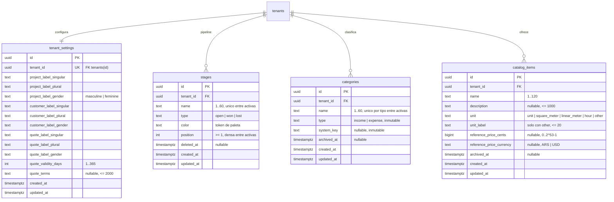

# Modelo de datos: Configuración por empresa

**Spec**: [`spec.md`](spec.md) · **Plan**: [`plan.md`](plan.md) · **ADR**: ADR-005, ADR-008, ADR-028, ADR-029
**Estado**: Aprobado (2026-10-23), junto con el plan.

DDL **conceptual**: define tablas, tipos, constraints, índices, políticas y privilegios. No es una
migración ejecutable: la migración goose la escribe quien implementa (T-002-B102), respetando esto.

Rigen las convenciones de [`data-model.md` de 001](../001-empresas-usuarios/data-model.md)
(esquema `app`, UUIDv7 con `DEFAULT uuidv7()`, `timestamptz` en UTC, textos con
`CHECK (char_length(…))`, enumerados como `text` + `CHECK`, sin triggers) y su **checklist para una
tabla de empresa nueva** (§6), que las cuatro tablas cumplen sin excepciones. Además:

- **Dinero** (ADR-029): `<nombre>_cents bigint` + `<nombre>_currency text`, ambos o ninguno, con
  `CHECK` de rango `[0, 2^53 − 1]` y moneda `IN ('ARS','USD')`.
- **Sin borrado físico** (ADR-028, INV-3): ningún rol de runtime tiene `DELETE` sobre estas tablas.
  Las etapas se eliminan con `deleted_at`; categorías e ítems se archivan con `archived_at`.
- **Privilegio `UPDATE` por columna**: el rol de empresa solo puede actualizar las columnas que
  cambian por diseño. `id`, `tenant_id` y `created_at` nunca (INV-5).
- **Textos**: el contrato y el servicio miden el largo máximo en caracteres (runas) sobre el valor
  **recibido**, como DD-43 (2) de 001; el servicio guarda el valor sin los espacios de los extremos
  y rechaza `NUL`. Por eso el valor guardado siempre cumple el `CHECK`. Un texto opcional vacío o
  solo con espacios se guarda `NULL`, nunca `''`.

---

## 1. Diagrama ER

Relaciones **previstas** de las specs siguientes (no se crean en 002; por eso cada tabla deja
`UNIQUE (tenant_id, id)` para que sus FK sean compuestas, INV-07 de 001):

| Desde (spec) | Hacia | FK |
|---|---|---|
| Proyecto y su historial de etapas (004) | `stages` | `(tenant_id, stage_id) → stages(tenant_id, id)` |
| Ítem de presupuesto (005) | `catalog_items` | `(tenant_id, catalog_item_id) → catalog_items(tenant_id, id)`, nullable |
| Movimiento de caja, compra, cargo (006, 007), regla de categorización (008) | `categories` | `(tenant_id, category_id) → categories(tenant_id, id)` |

---

## 2. Tablas

### 2.1 `app.tenant_settings` — Configuración de la empresa (`TenantSettings`)

Una fila por empresa (INV-1). Guarda los nombres personalizados (FR-002, DD-10) y los valores por
defecto de los presupuestos (FR-007).

| Columna | Tipo | Null | Constraint / default | Notas |
|---|---|:---:|---|---|
| `id` | `uuid` | no | PK, default `uuidv7()` | Los barridos genéricos de 001 (T-B110) identifican cada fila por `id` |
| `tenant_id` | `uuid` | no | FK → `tenants(id)`; `UNIQUE` (`tenant_settings_tenant_id_key`) | Una fila por empresa |
| `project_label_singular` | `text` | no | `char_length BETWEEN 1 AND 40` | Default sembrado: "Proyecto" |
| `project_label_plural` | `text` | no | `BETWEEN 1 AND 40` | "Proyectos" |
| `project_label_gender` | `text` | no | `IN ('masculine','feminine')` | `masculine` |
| `customer_label_singular` | `text` | no | `BETWEEN 1 AND 40` | "Cliente" |
| `customer_label_plural` | `text` | no | `BETWEEN 1 AND 40` | "Clientes" |
| `customer_label_gender` | `text` | no | `IN ('masculine','feminine')` | `masculine` |
| `quote_label_singular` | `text` | no | `BETWEEN 1 AND 40` | "Presupuesto" |
| `quote_label_plural` | `text` | no | `BETWEEN 1 AND 40` | "Presupuestos" |
| `quote_label_gender` | `text` | no | `IN ('masculine','feminine')` | `masculine` |
| `quote_validity_days` | `integer` | no | `BETWEEN 1 AND 365` | Validez por defecto de un presupuesto nuevo (005) |
| `quote_terms` | `text` | sí | `char_length BETWEEN 1 AND 2000` | Condiciones comerciales por defecto, **texto libre**; `NULL` = sin condiciones. Nunca `''`. Las condiciones de pago estructuradas (porcentajes) son de 005 |
| `created_at` | `timestamptz` | no | default `now()` | |
| `updated_at` | `timestamptz` | no | default `now()` | Lo escribe la query con el reloj inyectable (DD-18 de 001) |

**Lock**: `LockTenantSettings` (`SELECT … WHERE tenant_id = $1 FOR NO KEY UPDATE`) es la primera
sentencia de toda escritura de etapas, nombres o condiciones de una empresa (DD-5, DD-10): serializa
esas escrituras para que la regla del pipeline (INV-2) se evalúe sobre un estado estable. La fila no
es destino de FK, pero se usa el mismo modo que en el resto del sistema (INV-8).

### 2.2 `app.stages` — Etapa (`Stage`)

| Columna | Tipo | Null | Constraint / default | Notas |
|---|---|:---:|---|---|
| `id` | `uuid` | no | PK, default `uuidv7()` | |
| `tenant_id` | `uuid` | no | FK → `tenants(id)` | |
| `name` | `text` | no | `char_length BETWEEN 1 AND 60` | Único entre las activas, sin distinguir mayúsculas (índice abajo) |
| `type` | `text` | no | `IN ('open','won','lost')` | Abierta, cierre *ganado*, cierre *perdido*. Se puede cambiar (P-2) |
| `color` | `text` | no | `IN ('gray','blue','teal','green','yellow','orange','red','purple')` | Token de paleta (DD-7) |
| `position` | `integer` | no | `>= 1` | Entre las activas: `1..n` sin huecos (INV-2, lo sostiene el servicio). La de una etapa eliminada queda congelada y no significa nada |
| `deleted_at` | `timestamptz` | sí | | Borrado lógico (DD-6). Una etapa eliminada no se lista ni se modifica |
| `created_at` | `timestamptz` | no | default `now()` | |
| `updated_at` | `timestamptz` | no | default `now()` | |

Constraints e índices:

- `stages_tenant_id_id_key`: `UNIQUE (tenant_id, id)` — destino de las FK compuestas de 004. Su
  índice también sirve para filtrar por empresa.
- `stages_active_name_key`: índice **único parcial** `(tenant_id, lower(name)) WHERE deleted_at IS
  NULL` (INV-6). El servicio mapea su `23505` a `ErrNameTaken`.
- **Sin** índice único sobre la posición: PostgreSQL verifica un índice único no diferible fila por
  fila durante un `UPDATE`, así que reescribir posiciones (mover) fallaría a mitad de camino, y un
  índice parcial no puede ser diferible (DD-5, research R-5).

**Reglas que la base no sostiene** (las sostiene el servicio bajo `LockTenantSettings`, INV-2): la
etapa de posición 1 es `open`; al menos una activa es `won`; posiciones densas.

**Locks**: la fila es destino de FK (004), así que se bloquea solo con `FOR NO KEY UPDATE` (DD-40 de
001, INV-8). En 002 ninguna query la bloquea: el lock de `tenant_settings` ya serializa sus
escrituras.

### 2.3 `app.categories` — Categoría (`Category`)

| Columna | Tipo | Null | Constraint / default | Notas |
|---|---|:---:|---|---|
| `id` | `uuid` | no | PK, default `uuidv7()` | |
| `tenant_id` | `uuid` | no | FK → `tenants(id)` | |
| `name` | `text` | no | `char_length BETWEEN 1 AND 60` | Se puede renombrar, también la de sistema (Historia 3.3) |
| `type` | `text` | no | `IN ('income','expense')` | **Inmutable** (sin privilegio `UPDATE`, INV-5) |
| `system_key` | `text` | sí | `categories_system_key_chk`: `IN ('customer_receipts','partner_contributions','supplier_payments','employee_payments','partner_withdrawals')` | `NULL` = categoría de la empresa. **Inmutable**. Las specs siguientes agregan valores (ADR-028; p. ej. `cash_count_adjustment` en 006) |
| `archived_at` | `timestamptz` | sí | | Archivada: no se ofrece, se conserva para el historial |
| `created_at` | `timestamptz` | no | default `now()` | |
| `updated_at` | `timestamptz` | no | default `now()` | |

Constraints e índices:

- `categories_tenant_id_id_key`: `UNIQUE (tenant_id, id)`.
- `categories_system_type_chk`: `system_key IS NULL OR (system_key IN ('customer_receipts',
  'partner_contributions') AND type = 'income') OR (system_key IN ('supplier_payments',
  'employee_payments', 'partner_withdrawals') AND type = 'expense')`.
- `categories_system_not_archived_chk`: `system_key IS NULL OR archived_at IS NULL` — una categoría
  de sistema nunca se archiva, aunque el servicio se equivoque (INV-4).
- `categories_system_key_key`: índice único parcial `(tenant_id, system_key) WHERE system_key IS NOT
  NULL` — como mucho una por clave y empresa.
- `categories_active_name_key`: índice único parcial `(tenant_id, type, lower(name)) WHERE
  archived_at IS NULL` (INV-6). Un nombre puede repetirse entre tipos ("Otros" de ingreso y de
  egreso) y con una archivada.

**Locks**: `LockCategory` (`FOR NO KEY UPDATE`) antes de renombrar, archivar o restaurar. Destino
de FK (006 a 009): nunca `FOR UPDATE` (INV-8).

### 2.4 `app.catalog_items` — Ítem de catálogo (`CatalogItem`)

| Columna | Tipo | Null | Constraint / default | Notas |
|---|---|:---:|---|---|
| `id` | `uuid` | no | PK, default `uuidv7()` | |
| `tenant_id` | `uuid` | no | FK → `tenants(id)` | |
| `name` | `text` | no | `char_length BETWEEN 1 AND 120` | No único (DD-9) |
| `description` | `text` | sí | `char_length BETWEEN 1 AND 1000` | `NULL` = sin descripción; nunca `''` |
| `unit` | `text` | no | `IN ('unit','square_meter','linear_meter','hour','other')` | "unidad, m², metro lineal, hora, otra" (Historia 4.1). 005 calcula superficie y longitud con `square_meter` y `linear_meter` |
| `unit_label` | `text` | sí | `char_length BETWEEN 1 AND 20` | Nombre de la unidad cuando `unit = 'other'` (p. ej. "jornada") |
| `reference_price_cents` | `bigint` | sí | `BETWEEN 0 AND 9007199254740991` | Precio de referencia en centavos (ADR-029). Opcional (P-9) |
| `reference_price_currency` | `text` | sí | `IN ('ARS','USD')` | Moneda del precio |
| `archived_at` | `timestamptz` | sí | | Archivado: no se ofrece en presupuestos nuevos (005) |
| `created_at` | `timestamptz` | no | default `now()` | |
| `updated_at` | `timestamptz` | no | default `now()` | |

Constraints:

- `catalog_items_tenant_id_id_key`: `UNIQUE (tenant_id, id)`.
- `catalog_items_unit_label_chk`: `(unit = 'other') = (unit_label IS NOT NULL)`.
- `catalog_items_reference_price_pair_chk`: `(reference_price_cents IS NULL) =
  (reference_price_currency IS NULL)` (INV-7).

**Por qué el precio no se convierte ni se historiza**: 005 copia el precio al ítem del presupuesto
(Historia 4.2: cambiar el precio no altera presupuestos existentes). El catálogo guarda solo el
precio vigente.

**Locks**: `LockCatalogItem` (`FOR NO KEY UPDATE`) antes de editar, archivar o restaurar. Destino de
FK (005): nunca `FOR UPDATE`.

---

## 3. Seguridad a nivel de base

### 3.1 Políticas

Las cuatro tablas: `ENABLE` + `FORCE ROW LEVEL SECURITY` y la política estándar `tenant_isolation`
(`FOR ALL TO PUBLIC`, `USING` y `WITH CHECK` `tenant_id = (SELECT app.current_tenant_id())`). Ninguna
política adicional: ningún rol de sistema las lee.

### 3.2 Privilegios

`SELECT, INSERT` para `crm_tenant` llegan por los privilegios por defecto (migración `00001`).
`UPDATE` se concede **por columna**; `DELETE`, nunca.

| Tabla | `UPDATE` de `crm_tenant` (columnas) | `DELETE` | Roles de sistema |
|---|---|:---:|---|
| `tenant_settings` | las 9 columnas de nombres, `quote_validity_days`, `quote_terms`, `updated_at` | — | ninguno |
| `stages` | `name`, `type`, `color`, `position`, `deleted_at`, `updated_at` | — | ninguno |
| `categories` | `name`, `archived_at`, `updated_at` | — | ninguno |
| `catalog_items` | `name`, `description`, `unit`, `unit_label`, `reference_price_cents`, `reference_price_currency`, `archived_at`, `updated_at` | — | ninguno |

Notas:

- `FOR NO KEY UPDATE` exige `UPDATE` sobre al menos una columna: las cuatro tablas lo tienen.
- El test T-B109 de 001 (privilegios exactos de los roles de sistema) no cambia: sigue esperando
  que `crm_auth`, `crm_worker` y `crm_signup` no tengan nada sobre estas tablas.
- El barrido T-B110 de 001 descubre las tablas solas (todas tienen `tenant_id`), exige un
  *inserter* en `fixture.CompanyInserters` y verifica que `tablesWithCompanyDelete` siga vacía y que
  ninguna esté en `tablesWithoutCompanyUpdate` (todas tienen algún `UPDATE` por columna).

---

## 4. Sembrado y *backfill*

### 4.1 Sembrado en el registro (`settings.TemplateSeeder`, DD-3, INV-10)

Corre dentro de la transacción de registro de 001, después de crear al primer Administrador, como
el rol de la empresa nueva. **Exactamente cuatro sentencias**, cada una por conjuntos (los valores
viajan como arrays paralelos; ninguna sentencia por fila):

| # | Query (`settings/store/seed.sql`) | Inserta | Parámetros |
|---|---|---|---|
| 1 | `SeedTenantSettings` | 1 fila de `tenant_settings` | `tenant_id`, los 9 valores de nombres, `quote_validity_days`, `quote_terms` (nullable), `now` |
| 2 | `SeedStages` | Las etapas de la plantilla con `position` = su orden (1..n) | `tenant_id`, arrays `names`, `types`, `colors`; `now` |
| 3 | `SeedCategories` | Las 5 de sistema + las de la plantilla | `tenant_id`, arrays `names`, `types`, `system_keys` (texto vacío = `NULL`); `now` |
| 4 | `SeedCatalogItems` | Los ítems de ejemplo (sin precio) | `tenant_id`, arrays `names`, `descriptions`, `units`, `unit_labels` (vacío = `NULL`); `now` |

Un array vacío inserta cero filas y no cambia la cuenta de sentencias. Supuesto S-3 (a verificar al
implementar): sqlc genera los parámetros de arrays; si no, `:copyfrom` (COPY), también por conjuntos.

**Categorías de sistema** (iguales para toda plantilla; las define `settings`, DD-2):

| `system_key` | `type` | Nombre inicial |
|---|---|---|
| `customer_receipts` | `income` | Cobros de clientes |
| `partner_contributions` | `income` | Aportes de socios |
| `supplier_payments` | `expense` | Pagos a proveedores |
| `employee_payments` | `expense` | Pagos a empleados |
| `partner_withdrawals` | `expense` | Retiros de socios |

El contenido de cada plantilla está en "Plantillas de rubro" de [`spec.md`](spec.md) y en
`internal/industrytemplate/catalog.json` (versión 2).

### 4.2 *Backfill* de las empresas previas (migración `00010`, DD-4)

Para cada empresa que existe al migrar (registrada con la versión 1 de la plantilla, sin
configuración). Pasos, todos en la transacción de la migración (ADR-004 §6):

1. Crear las cuatro tablas con sus constraints, índices, RLS, políticas y privilegios.
2. `ALTER TABLE … NO FORCE ROW LEVEL SECURITY` sobre `app.tenants` (para que el dueño pueda **leer**
   las empresas: con `FORCE`, la política de `tenants` no le devuelve ninguna fila a `crm_owner`) y
   sobre las cuatro tablas nuevas (para insertar).
3. Insertar, por conjuntos y solo para empresas sin fila en `tenant_settings`:
   - la fila de `tenant_settings`: nombres por defecto (Proyecto/Proyectos, Cliente/Clientes,
     Presupuesto/Presupuestos, todos `masculine`), `quote_validity_days = 15`, `quote_terms = NULL`;
   - las 5 categorías de sistema de §4.1;
   - las 5 etapas de la plantilla "Genérico" (spec, "Plantillas de rubro"), posiciones 1 a 5.
4. `ALTER TABLE … FORCE ROW LEVEL SECURITY` sobre las cinco tablas. T-B107 de 001 falla si alguna
   queda sin `FORCE`.

`tenants.industry_template_version` no se toca: queda en 1, que desde 002 significa "registrada
antes del contenido de las plantillas". El `Down` borra las cuatro tablas (se pierde la
configuración: aceptable, es la reversión de la spec).

---

## 5. Mapeo a Go

| Tabla | Tipo de dominio | Paquete | Notas de sqlc |
|---|---|---|---|
| `tenant_settings` | `settings.Labels`, `settings.QuoteDefaults` | `internal/settings` | `uuid` → `github.com/google/uuid.UUID` (override de 001) |
| `stages` | `settings.Stage` | `internal/settings` | `type`, `color` → `string` |
| `categories` | `settings.Category` | `internal/settings` | `system_key` → `pgtype.Text` |
| `catalog_items` | `settings.CatalogItem` | `internal/settings` | `reference_price_cents` → `pgtype.Int8`, `reference_price_currency` → `pgtype.Text` |

Los enumerados **no** usan *overrides* de sqlc hacia tipos de `settings` (a diferencia de
`users.role` → `authz.Role` en 001): `settings/store` importaría `settings`, que importa
`settings/store`, y Go no admite ciclos de import. El servicio convierte y valida al leer.

Los structs de `store` no salen del módulo: el servicio los convierte a tipos de dominio y el
handler a DTOs del contrato.

---

## 6. Auditoría (catálogo de acciones de 002)

Mismas reglas que `data-model.md` §2.6 de 001: `data` lleva **exactamente** estas claves (lo
verifica el test de cada operación) y solo valores que arma el servidor; nunca nombres,
descripciones, etiquetas ni condiciones (INV-12, DD-37 (5) de 001). Ninguna clave choca con la
política de credenciales de DD-37.

| `action` | Actor | Target | `data` |
|---|---|---|---|
| `stage.created` | admin | `stage` | `{type, position}` |
| `stage.updated` | admin | `stage` | `{fields}`: los que cambiaron, en el orden `name`, `type`, `color` |
| `stage.moved` | admin | `stage` | `{from, to}`: posiciones (enteros) |
| `stage.deleted` | admin | `stage` | `{}` |
| `category.created` | admin | `category` | `{type}` |
| `category.renamed` | admin | `category` | `{}` |
| `category.archived` | admin | `category` | `{}` |
| `category.restored` | admin | `category` | `{}` |
| `catalog_item.created` | admin | `catalog_item` | `{unit}` |
| `catalog_item.updated` | admin | `catalog_item` | `{fields}`: en el orden `name`, `description`, `unit`, `unit_label`, `reference_price` |
| `catalog_item.archived` | admin | `catalog_item` | `{}` |
| `catalog_item.restored` | admin | `catalog_item` | `{}` |
| `settings.labels_updated` | admin | `tenant` | `{entities}`: los que cambiaron, en el orden `project`, `customer`, `quote` |
| `settings.quote_defaults_updated` | admin | `tenant` | `{fields}`: en el orden `validity_days`, `terms` |

Sin cambios reales no hay fila (INV-13). El sembrado no audita: el registro ya deja
`tenant.registered {industry_template_code}`.

---

## 7. Datos personales y sensibles

Ninguno. La configuración es información comercial de la empresa: nombres de etapas, categorías,
productos y condiciones. Se aísla por empresa (RLS) y la API la sirve con `Cache-Control: no-store`
(DD-28 de 001). Los textos los escribe un Administrador y se muestran a usuarios de la misma empresa
y, desde 005, a sus clientes (PDF): se tratan como no confiables al mostrarlos (S-8 del plan).

---

## 8. Migraciones de 002

| # | Archivo goose | Contenido | Tarea |
|---|---|---|---|
| 10 | `00010_company_configuration.sql` | Las cuatro tablas (§2), RLS y privilegios (§3), *backfill* (§4.2); `Down` las borra | T-002-B102 |

Una sola migración: las tablas nacen juntas y el *backfill* necesita las cuatro. Las specs
siguientes que agreguen una categoría de sistema lo hacen con su propia migración: amplían
`categories_system_key_chk` y `categories_system_type_chk`, y siembran la fila en toda empresa con
el mismo patrón `NO FORCE` → `INSERT` → `FORCE` (ADR-028), además de sumar la clave al sembrado del
registro.
