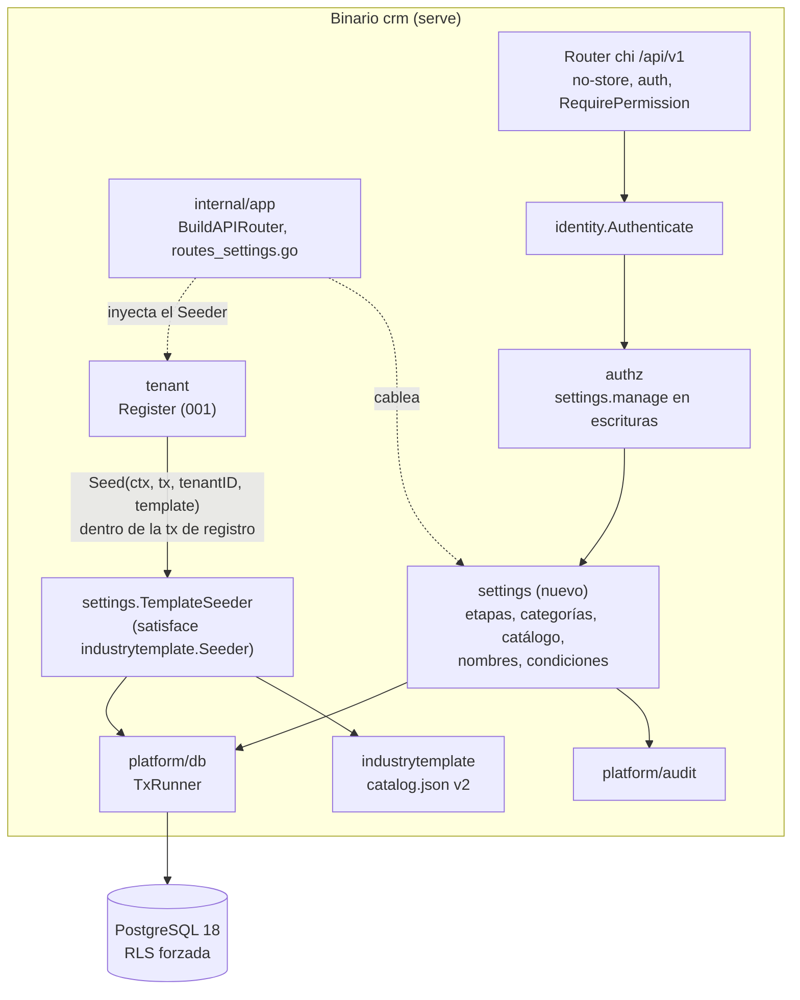
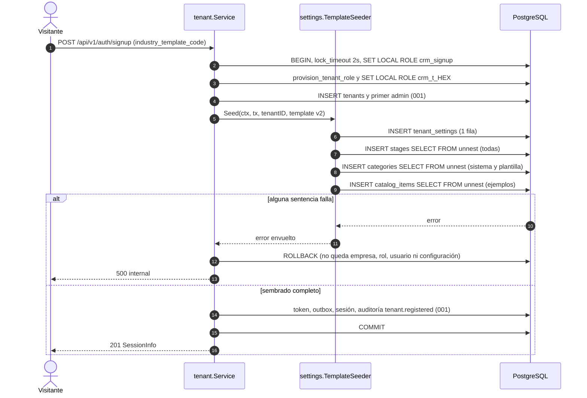
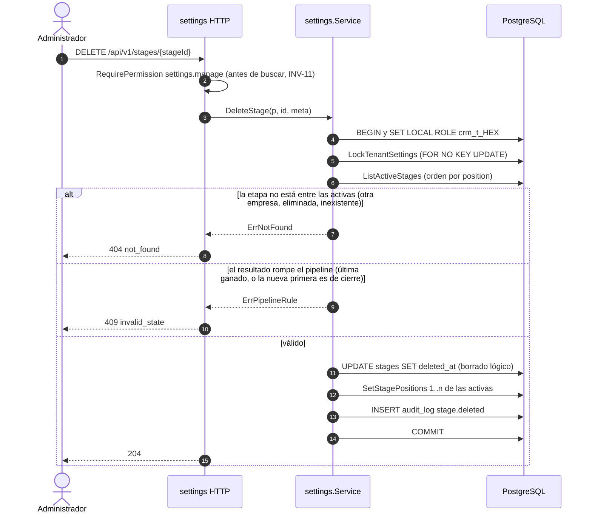
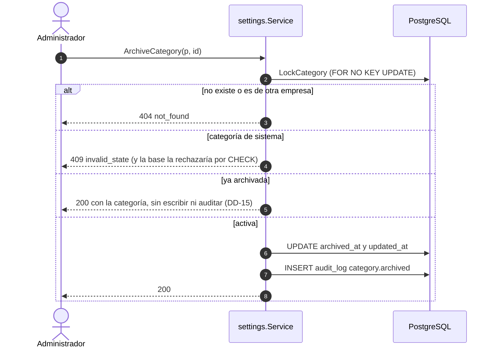
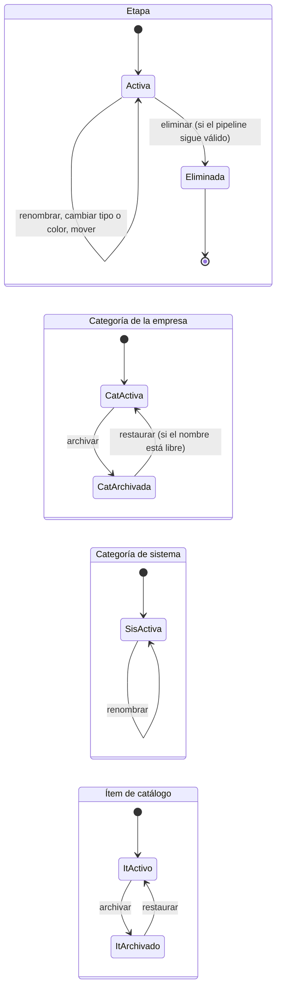

# Plan técnico (backend): Configuración por empresa

**Spec**: [`spec.md`](spec.md) (Borrador) · **Fecha**: 2026-10-23 · **Autor**: `backend-architect`
**Estado**: **Propuesto, pendiente de aprobación.** El plan asume las opciones recomendadas de las
preguntas P-1 a P-10 (§14.2, y la propuesta al final de `spec.md`). Ninguna fase se implementa hasta
que el usuario apruebe la spec (CLAUDE.md, constitución V) y este plan.

Artefactos de esta spec:

| Archivo | Contenido |
|---|---|
| `plan.md` (este) | Contexto técnico, Constitution Check, arquitectura, invariantes, decisiones `DD-n`, errores, seguridad, paquetes, operación |
| [`research.md`](research.md) | Alternativas evaluadas por decisión |
| [`data-model.md`](data-model.md) | Tablas, DDL conceptual, RLS, privilegios, ER, sembrado y *backfill*, auditoría |
| [`contracts/openapi.yaml`](contracts/openapi.yaml) | Contrato HTTP **canónico** de 002 (OpenAPI 3.1, `$ref` a los componentes compartidos de 001) |
| [`tasks.md`](tasks.md) | Plan TDD: sección Backend (este arquitecto) y lugar de la sección Frontend (`frontend-architect`) |
| `ui.md` | Lo escribe el `frontend-architect` (no existe todavía) |
| [`docs/adr/028`](../../docs/adr/028-configuracion-referenciable-sin-borrado-fisico.md) | Configuración referenciable: sin borrado físico, claves de sistema estables, alta por migración (*Proposed*) |
| [`docs/adr/029`](../../docs/adr/029-representacion-del-dinero.md) | Representación del dinero en base y API (*Proposed*) |

Convención de identificadores (DD-17): en este plan `DD-n`, `INV-n`, `S-n`, `R-n` y `P-n` son de
**002**. Las de 001 se citan con su spec ("DD-40 de 001", "INV-14 de 001"). En el código, los
comentarios citan `002/DD-5`, `002/INV-2` y las tareas `T-002-Bnnn`.

---

## 1. Contexto técnico

**Brownfield.** La spec 001 está completa en backend y frontend (`main`). 002 agrega un módulo de
dominio nuevo y completa una pieza que 001 dejó preparada: el puerto `industrytemplate.Seeder`, que
hoy es `NoopSeeder` (DD-3 de 001).

**Validación del stack**: detecté Go 1.27 (`toolchain go1.27.3`), chi v5.3.2, sqlc + pgx v5,
goose embebido, PostgreSQL 18 con un rol por empresa y RLS forzada, tests con `testing` nativo (sin
testify) y `make check` como checkpoint. Diseño sobre eso. **002 no agrega dependencias.**

| Aspecto | Decisión en 002 | Fuente |
|---|---|---|
| Módulo nuevo | `internal/settings` (el nombre que ya anticipa ADR-001) | DD-1, ADR-001 |
| Persistencia | 4 tablas de empresa nuevas en `app`, migración `00010` | `data-model.md` |
| Aislamiento | Checklist de `data-model.md` §6 de 001, sin excepciones; sin queries de sistema | ADR-005, INV-01/04/07 de 001 |
| Plantillas | Contenido versionado en `internal/industrytemplate/catalog.json` (versión 2), sembrado dentro de la transacción de registro | DD-2, DD-3, DD-33 R-c de 001 |
| Dinero | Precio de referencia en centavos `bigint` + moneda, objeto `Money` en la API | ADR-029 |
| Contrato | Archivo propio de 002 con `$ref` a 001; 001 pasa a v0.6.0 (`name_taken`, `Money`) | DD-12, DD-13, DD-17 de 001 |
| Errores | RFC 9457 existente; un `code` nuevo (`name_taken`) | DD-12, ADR-009 |
| Autorización | Matriz estática existente: escritura `settings.manage`, lectura cualquier rol | DD-11, ADR-013 |

**Arquetipo**: API / servicio de recursos (CRUD de configuración con reglas), más una participación
en una transacción ajena (el registro de 001). No hay worker, ni integración externa, ni archivos.

**Escala supuesta**: la de S-3 de 001 (~1.000 empresas, < 20 req/s, una instancia). Por empresa,
configuración chica (S-1): decenas de etapas y categorías, hasta ~1.000 ítems de catálogo.

---

## 2. Constitution Check

| Principio | Estado | Cómo se cumple / justificación |
|---|:---:|---|
| **I. Simplicidad primero** | ✅ | Cuatro tablas y un módulo. Cada operación es un request y una pantalla. Las reglas se reducen a una por entidad (una función pura para el pipeline, DD-5). Sin paginación, sin caché, sin colas. Se descarta lo que la spec no pide: reaplicar plantillas, plantillas propias, campos personalizados, colores libres (DD-7). |
| **II. Genérico por configuración** | ✅ | Es el corazón de esta spec. Las diferencias entre rubros son **datos** (`catalog.json` v2). INV-9: ningún código de producción ramifica por código de plantilla (un test lo vigila). SC-001 se demuestra con un escenario "herrería" armado solo por la API (T-002-B801). |
| **III. Aislamiento entre empresas** | ✅ | Las 4 tablas siguen el checklist de 001: `tenant_id NOT NULL` con FK, RLS habilitada y forzada, `tenant_isolation`, `UNIQUE (tenant_id, id)` para las FK compuestas futuras, sin `DELETE`. Los barridos de catálogo y aislamiento de 001 (T-B107..T-B110) las cubren solos; cada ruta nueva entra en el barrido HTTP (T-B801 de 001). No hay queries de sistema nuevas (§4.4 de 001 no cambia). |
| **IV. Integridad del dinero** | ✅ | El precio de referencia es `bigint` de centavos + moneda ISO 4217, ambos o ninguno (INV-7, ADR-029). No hay conversión ni tipo de cambio en 002. No es un movimiento: es un dato de referencia que 005 **copia** (no referencia) al armar un presupuesto, así que cambiarlo no altera presupuestos existentes (Historia 4.2). Cada operación es una transacción. La auditoría registra cada escritura de configuración (DD-14). |
| **V. Spec Driven Development** | ⚠️ | `spec.md` está en **Borrador**. Este plan asume las respuestas recomendadas de P-1 a P-10 y queda **bloqueado para implementar** hasta su aprobación. Las preguntas no bloquean el diseño: cada una tiene default. |
| **VI. Tests primero** | ✅ | Todas las fases son TDD con `[T]` antes del código. El contrato se valida en cada test HTTP con el validador de 001, extendido a varios contratos (T-002-B203). |
| **VII. Mobile-first** | ✅ | Payloads chicos; mover una etapa es un request con una posición (DD-18), apto para arrastrar en el celular. Ninguna decisión del backend depende de la UI actual (colores por token, DD-7, por el rediseño visual previsto). |
| **Stack** | ✅ | Go, PostgreSQL, OpenAPI, monolito modular. Sin dependencias nuevas. |
| **Convenciones** | ✅ | Documentación en español; tablas, columnas, rutas e identificadores en inglés con nombres del glosario (`Stage`, `Category`, `CatalogItem`, `IndustryTemplate`). Términos nuevos propuestos en §17. Fechas `timestamptz` en UTC. |

La única marca ⚠️ es el estado de la spec, que es exactamente lo que este plan pide resolver.

---

## 3. Resumen ejecutivo

Un módulo nuevo, `settings`, es dueño de cuatro tablas: `tenant_settings` (una fila por empresa con
los nombres personalizados y las condiciones comerciales por defecto), `stages`, `categories` y
`catalog_items`. Las plantillas de rubro dejan de ser solo un código: `catalog.json` pasa a la
versión 2 con su contenido, y `settings.TemplateSeeder` lo siembra **dentro** de la transacción de
registro de 001 con cuatro sentencias por conjuntos, sujeto a una compuerta de medición sobre el
presupuesto del lock de registro (DD-33 R-c de 001). Las reglas del pipeline (la primera etapa es
abierta y hay al menos una de cierre *ganado*) se evalúan con una sola función pura sobre el
resultado de cada operación, serializada por un lock de la fila de `tenant_settings`. Nada de la
configuración se borra físicamente: etapas eliminadas, categorías e ítems archivados siguen siendo
referenciables por las specs 004 a 010 (ADR-028). Leer la configuración puede cualquier usuario de la
empresa; modificarla, solo el Administrador.

---

## 4. Arquitectura

### 4.1 Componentes



**Reglas de dependencia** (se agregan a `depguard`, T-002-B103):

- `settings` importa `platform/*`, `authz` e `industrytemplate`. **No** importa `identity`, `tenant`
  ni `app`, ni el `store` de otro módulo.
- `tenant` **no** importa `settings`: recibe el sembrado por el puerto `industrytemplate.Seeder`
  que ya declara 001, y `internal/app` (y `cmd/crm/serve.go`) le pasa `settings.TemplateSeeder`.
- `identity`, `tenant`, `platform/*`, `authz` e `industrytemplate` no importan `settings` ni
  `settings/store`.
- `settings` declara su propio `RequestMeta{IP, UserAgent}` en lugar de importar
  `identity.RequestMeta` (DD-1): así la configuración no depende del módulo de identidad por un tipo.

### 4.2 Registro con sembrado (001 Historia 1.1, FR-006; DD-3, INV-10)

El flujo de 001 no cambia salvo el paso del `Seeder`, que deja de ser un no-op.



Exactamente cuatro sentencias, sin una por fila ni E/S de red (INV-10). La compuerta de T-002-B307
mide su costo dentro de la retención del lock de `GRANT crm_tenant` (DD-33 R-b y R-c de 001).

### 4.3 Eliminar una etapa (Historia 1.3, P-2; DD-5, DD-6, INV-2)



Crear, cambiar el tipo y mover siguen el mismo esqueleto: lock → lista → función pura sobre la lista
resultante → escritura → auditoría. Cuando exista 004, la eliminación de una etapa con proyectos
agrega el paso "mover los proyectos" en esta misma transacción (§4.6).

### 4.4 Archivar una categoría (Historia 3.2 y 3.3; DD-8, INV-4)



Restaurar es simétrico; si otra categoría activa del mismo tipo ya usa ese nombre, la base responde
`23505` sobre `categories_active_name_key` y el servicio devuelve `ErrNameTaken` (`409 name_taken`).

### 4.5 Ciclo de vida



Una etapa eliminada no se restaura (P-2): para recuperarla se crea otra. Queda en la tabla para
que el historial de etapas de 004 la siga resolviendo por id.

### 4.6 Relación con las specs siguientes (que todavía no existen)

002 no construye puertos para specs que no existen (YAGNI). Solo deja el modelo listo para ellas y
registra qué les queda. Cada plan futuro decide su lado.

| Spec | Qué consume de 002 | Cómo, previsto (lo confirma su plan) | Qué le queda a esa spec |
|---|---|---|---|
| 004 Proyectos | Etapa inicial, tipo de cada etapa, orden, nombres personalizados | FK compuesta `(tenant_id, stage_id) → stages(tenant_id, id)` desde proyectos y su historial; lectura por una interfaz chica que **declara `project`** y satisface `*settings.Service` | "Cerrado" se **deriva** del tipo de la etapa actual (P-2): cambiar el tipo de una etapa cierra o reabre sus proyectos sin escribirlos. Eliminar una etapa con proyectos: 004 agrega el destino (`move_to_stage_id`) a `DELETE /stages/{id}` y el `409` si falta; la interfaz `StageUsage` la declara `settings` y la satisface `project`, en la misma transacción (ADR-001 §4). El tablero muestra las etapas eliminadas que aparezcan en el historial como "(eliminada)" |
| 005 Presupuestos | Catálogo, nombres personalizados (PDF), condiciones y validez por defecto | FK compuesta nullable `quote_items.catalog_item_id → catalog_items(tenant_id, id)`; el ítem **copia** nombre, descripción, unidad y precio (Historia 4.2 de 002) | Los PDF usan los nombres personalizados (P-3). Si 005 necesita porcentajes estructurados para precargar el plan de cobros (005 Historia 4.3), los define 005: 002 guarda texto libre. Un ítem sin precio de referencia se agrega con precio vacío |
| 006 Cuentas de dinero | Categorías y categorías de sistema; cuenta inicial (P-1) | FK compuesta de los movimientos a `categories(tenant_id, id)`; búsqueda por `system_key`. Agrega `cash_count_adjustment` ("Ajuste de arqueo") con una migración que altera el `CHECK` y siembra la fila en todas las empresas (ADR-028). Para la cuenta inicial suma su propio sembrado al registro: `internal/app` compone los dos `Seeder` (un tipo `industrytemplate.Seeders` que corre cada uno en orden; se agrega en 006, no ahora) | Si las categorías de sistema se ofrecen o no en las cargas manuales |
| 007 Cuentas corrientes | Las 5 categorías de sistema de FR-004 | Búsqueda por `system_key` | FR-007 de 007 (sugerir la categoría del pago) |
| 008, 009, 010 | Categorías (también archivadas) | Por id; 010 agrega sus claves de sistema con el mismo mecanismo si las necesita | — |

---

## 5. Invariantes

### 5.1 Invariantes de 001 que este diseño toca

| De 001 | Qué garantiza | Cómo lo toca 002 | Efecto |
|---|---|---|---|
| INV-01, INV-07, checklist de `data-model.md` §6 | RLS forzada y `tenant_isolation` en toda tabla; FK compuestas entre tablas de empresa | Las 4 tablas cumplen el checklist; dejan `UNIQUE (tenant_id, id)` para las FK compuestas de 004 a 010 | Preserva |
| INV-04 | Toda query filtra por `tenant_id` además de la RLS | Ninguna query de sistema nueva; T-B112 recorre `settings/store/*.sql` sin excepciones | Preserva |
| INV-12 | Permiso antes de buscar; ajeno → `404` | Escrituras en un grupo con `RequirePermission(settings.manage)`; ids ajenos → `404` | Preserva |
| INV-14 | El registro es atómico, **incluida la configuración de la plantilla** | El sembrado corre en la misma transacción; su error deshace todo | Preserva (y por primera vez hay configuración real que deshacer) |
| INV-26 y DD-33 R-b/R-c | Sin E/S de red después de aprovisionar; retención del lock p95 < 140 ms; el `Seeder` solo con SQL por conjuntos y dentro de ese presupuesto | Cuatro sentencias por conjuntos (INV-10) y compuerta medida (T-002-B307) con salida definida si no entra (DD-3) | Preserva, con medición |
| DD-40 | `tenants` y `users` solo con `FOR NO KEY UPDATE`; nada de `FOR UPDATE` sobre destinos de FK | `settings` nunca bloquea `tenants` ni `users`; las tablas nuevas que serán destino de FK también solo con `FOR NO KEY UPDATE` (la regla de `rowlocks_test` se extiende, T-002-B103) | Preserva y extiende |
| INV-15, INV-32 | Auditoría append-only; `data` sin credenciales ni texto libre del usuario (DD-37 (5)) | Acciones nuevas con `data` de enumerados y listas de campos (INV-12 de 002) | Preserva |
| INV-21, INV-22 | `no-store` en toda la API; `/api/` nunca llega a la SPA | Las rutas nuevas viven en el router chi existente | Preserva |
| DD-17 | Los componentes compartidos viven en el contrato de 001 | `name_taken` y `Money` se agregan al contrato de 001, que pasa a **v0.6.0** (*minor*) | **Altera el contrato de 001** (decisión registrada en DD-12/DD-13) |
| DD-3 | El `Seeder` de 001 no precarga nada; 002 lo completa | `settings.TemplateSeeder` reemplaza a `NoopSeeder` en `serve.go`; `NoopSeeder` queda para los tests de 001 | Completa |
| Contrato `GET /industry-templates` | Devuelve `code` y `name` | El contenido nuevo de la plantilla no se expone por esa ruta | Preserva |

### 5.2 Invariantes nuevas

Se rompen sin que falle la compilación; cada una tiene un test que la vigila.

| ID | Invariante | Dónde vive | Test |
|---|---|---|---|
| INV-1 | Toda empresa tiene **exactamente una** fila en `tenant_settings`: desde el `COMMIT` de su registro, o desde la migración `00010` para las previas | Sembrado + migración (`UNIQUE (tenant_id)`) | T-002-B101, T-002-B305 |
| INV-2 | Entre transacciones confirmadas, las etapas **activas** de una empresa tienen posiciones `1..n` sin huecos, la de posición 1 es `open` y al menos una es `won`. Toda mutación de etapas corre bajo `LockTenantSettings` y valida la lista resultante con la misma función pura. La base **no** lo impide por sí sola | `settings` (servicio) | T-002-B301 (función), T-002-B401 (incluida concurrencia) |
| INV-3 | Ninguna fila de `tenant_settings`, `stages`, `categories` ni `catalog_items` se borra físicamente: ningún rol de runtime tiene `DELETE` (ADR-028) | Migración | Barrido de T-B110 de 001 (`tablesWithCompanyDelete` vacía), T-002-B101 |
| INV-4 | Cada empresa tiene exactamente una categoría por cada `system_key` vigente, nunca archivada, con el tipo que le corresponde | `CHECK` + índice único parcial + sembrado + *backfill* | T-002-B101, T-002-B305 |
| INV-5 | `id`, `tenant_id` y `created_at` de las 4 tablas, y `type` y `system_key` de `categories`, no se pueden actualizar con el rol de empresa (privilegio por columna) | Migración | T-002-B101 |
| INV-6 | Los nombres activos son únicos sin distinguir mayúsculas: etapas por empresa, categorías por empresa y tipo. Lo garantiza un índice único parcial, no el servicio | Migración | T-002-B101, T-002-B401, T-002-B501 |
| INV-7 | Un precio de referencia es un par (centavos `int64` en `[0, 2^53 − 1]`, `ARS`\|`USD`) o ninguno. Ninguna capa usa punto flotante | `CHECK`, `settings.Money`, contrato | T-002-B101, T-002-B301, T-002-B603 |
| INV-8 | Las filas de `stages`, `categories` y `catalog_items` solo se bloquean con `FOR NO KEY UPDATE`. `settings` nunca bloquea `tenants` ni `users`. Orden de locks: `tenant_settings` → filas propias → inserciones (auditoría) | `settings/store` | Regla de `rowlocks_test` extendida (T-002-B103) |
| INV-9 | Toda plantilla del catálogo embebido cumple las mismas reglas que la API. Ningún archivo `.go` de producción (fuera de los tests y de `internal/testsupport`) contiene un código de plantilla (`generic`, `aluminum_carpentry`) | `industrytemplate`, `settings` | T-002-B303 |
| INV-10 | El sembrado corre dentro de la transacción de registro, como el rol de la empresa nueva, con **exactamente cuatro** sentencias, sin E/S de red; su error deshace el registro completo | `settings.TemplateSeeder` | T-002-B305 (cuenta sentencias), T-002-B307 (costo) |
| INV-11 | Las escrituras exigen `settings.manage` **antes** de buscar el recurso (y el servicio lo vuelve a verificar); las lecturas, una sesión válida de cualquier rol; un recurso de otra empresa responde `404` | `internal/app`, `settings` | T-002-B403, T-002-B503, T-002-B603, T-002-B703 y el barrido HTTP de T-B801 de 001 |
| INV-12 | El `data` de las acciones de auditoría de configuración solo lleva enumerados y listas de nombres de campos: nunca nombres, descripciones, etiquetas ni condiciones escritas por el usuario | `settings` | Claves exactas en cada test de operación (DD-37 (5) de 001) |
| INV-13 | Una escritura sin cambios reales no hace `UPDATE`, no audita y no mueve `updated_at` (archivar lo archivado, restaurar lo activo, `PATCH`/`PUT` con los mismos valores) | `settings` | T-002-B401, T-002-B501, T-002-B601, T-002-B701 |

---

## 6. Decisiones locales (`DD-n`)

Las estructurales están en ADR-028 (configuración referenciable) y ADR-029 (dinero). Alternativas
completas en `research.md`.

| ID | Decisión | Por qué | Trade-off |
|---|---|---|---|
| **DD-1** | **Módulo `settings`** dueño de las 4 tablas. Importa `platform/*`, `authz` e `industrytemplate`; no importa `identity` (declara su `RequestMeta{IP, UserAgent}`; el `request_id` de la auditoría ya sale del contexto) ni `tenant`. Sus rutas las monta `internal/app` dentro del grupo con `identity.Authenticate` (`routes_settings.go`, igual que `routes_tenant.go`). `BuildAPIRouter` suma un parámetro `*settings.Service`. | ADR-001 anticipa el nombre. Un módulo que no depende de identidad se prueba solo y no crea ciclos con 004 a 010, que lo van a consumir. | Un `RequestMeta` de dos campos repetido; cambian las llamadas a `BuildAPIRouter` (tests y `serve.go`) y el texto de una mutación del guard de `crm serve` (`serve_router_mutations_test.go`), sin cambiar sus reglas. |
| **DD-2** | **Plantillas como datos versionados.** `industrytemplate.Template` suma `labels`, `stages`, `categories`, `catalog_items` y `quote_defaults`; las dos plantillas pasan a `version: 2` con el contenido de P-4. Los valores enumerados son *strings* en `industrytemplate` (no conoce los tipos de `settings`); `settings` las valida con sus propias reglas en un test (INV-9). Las **categorías de sistema no son de la plantilla**: las define `settings` (tabla `systemCategories`) y se siembran en toda empresa. `GET /industry-templates` no cambia. | Principio II: un rubro nuevo es una entrada en `catalog.json`. La versión 2 distingue en `tenants.industry_template_version` a las empresas registradas antes de 002 (versión 1, sin contenido). Validar con las reglas reales evita una plantilla que la API rechazaría. | Dos lugares con texto en español semilla (`catalog.json` y la tabla de categorías de sistema de `settings`), más la copia del *backfill* (DD-4). |
| **DD-3** | **Sembrado dentro de la transacción de registro, por conjuntos**: `settings.TemplateSeeder.Seed` ejecuta exactamente cuatro sentencias (`tenant_settings`, `stages`, `categories`, `catalog_items`), cada una un `INSERT … SELECT FROM unnest(arrays)`; las listas vacías insertan cero filas sin cambiar la cuenta. **Compuerta** (T-002-B307, harness de T-B910 con 10.000 roles): se mantiene si el sembrado tiene p95 ≤ 10 ms **y** la retención p95 con sembrado supera a la sin sembrado en ≤ 10 ms. Si la retención absoluta pasa los 140 ms aunque el delta cumpla, se informa al usuario (R-b de 001 estaría en riesgo con o sin 002). **Si no cumple**, se aplica la salida de R-c: la empresa nace con "configuración pendiente" y el sembrado corre idempotente después del `COMMIT` (diseño de respaldo en `research.md` R-3). | Cumple INV-14 de 001 sin agregar estados: una empresa nunca existe sin configuración. Cuatro sentencias de costo constante (no dependen de la cantidad de roles, a diferencia del `GRANT`). | La transacción que retiene el lock de `GRANT crm_tenant` crece unos pocos milisegundos (a medir). Supuesto S-3 (sqlc genera los parámetros de arrays). |
| **DD-4** | ***Backfill* en la migración `00010`** para las empresas que ya existen: una fila de `tenant_settings` con los nombres por defecto, validez 15 días y sin condiciones; las 5 categorías de sistema; las 5 etapas de la plantilla "Genérico". Sin categorías propias ni catálogo. `industry_template_version` queda como está (1). Desactiva `FORCE ROW LEVEL SECURITY` solo dentro de la migración (ADR-004 §6). | Sin esto, una empresa previa rompe INV-1, INV-2 e INV-4 (y el primer `GET /settings/labels` sería un `500`). No hay empresas reales en producción (S-2), así que alcanza el mínimo. | El SQL de la migración repite textos del sembrado (una vez, versionado). |
| **DD-5** | **Reglas del pipeline**: la **etapa inicial es la primera** por posición y debe ser `open`; tiene que haber al menos una `won`; `lost` es opcional (P-6). Una única función pura `validatePipeline([]Stage) error` se evalúa sobre la lista **resultante** de cada operación (crear, cambiar tipo, mover, eliminar). Toda mutación de etapas toma primero `LockTenantSettings` (`FOR NO KEY UPDATE` de la fila de `tenant_settings`) y reescribe las posiciones densas `1..n` de las activas en una sola sentencia. Sin índice único sobre la posición. | Una sola regla, probada una vez, evita la combinatoria de casos por operación. El lock por empresa impide que dos bajas concurrentes de las dos etapas `won` dejen cero. Un índice único no diferible sobre la posición fallaría a mitad de un reordenamiento (PostgreSQL verifica por fila) y uno parcial no puede ser diferible. | Todas las escrituras de etapas (y las de nombres y condiciones, que usan la misma fila) de una empresa se serializan: son acciones raras de un Administrador. La densidad de posiciones la vigila un test, no la base. |
| **DD-6** | **Eliminar una etapa es lógico** (`deleted_at`) y **no se restaura**. En 002 no hay proyectos, así que no hay nada que mover (P-2); 004 agrega el destino y su `409`. Una etapa eliminada no aparece en `GET /stages` ni se puede modificar (`404`), y su nombre queda libre. | El historial de 004 referencia etapas por id ("renombrar no altera datos históricos", casos borde de la spec): un `DELETE` físico rompería esas FK. Sin restaurar, el usuario ve "eliminar" (spec) y no un concepto nuevo. | 004 tendrá que mostrar "(eliminada)" y desambiguar nombres repetidos en el historial (R-8). |
| **DD-7** | **Color de etapa por token** de una paleta cerrada: `gray`, `blue`, `teal`, `green`, `yellow`, `orange`, `red`, `purple` (P-7). La UI decide el color real de cada token. | Con el rediseño visual previsto, un hex guardado ata los datos al estilo actual (contraste, modo oscuro). Ocho tokens alcanzan para distinguir un pipeline. | Sin colores arbitrarios; agregar un token es una migración trivial (`CHECK`) y un cambio de contrato *minor*. |
| **DD-8** | **Categorías**: se **archivan y restauran**, nunca se borran (P-8). `type` y `system_key` son inmutables por privilegio de columna (INV-5). Las de sistema llevan `system_key` (`customer_receipts`, `partner_contributions`: ingreso; `supplier_payments`, `employee_payments`, `partner_withdrawals`: egreso); dos `CHECK` impiden archivarlas y les fijan el tipo; un índice único parcial asegura una por clave. Nombre único por empresa y tipo entre las no archivadas (índice parcial `categories_active_name_key`). | "Solo se puede archivar si tiene movimientos" exige saber si tiene movimientos, que no existen hasta 006: archivar siempre es una regla y no dos. Que la base sostenga lo de sistema protege a 006/007, que van a buscar estas filas por clave. | No se puede borrar una categoría creada por error (se archiva). Las specs siguientes que necesiten otra categoría de sistema alteran el `CHECK` y siembran la fila (ADR-028). |
| **DD-9** | **Catálogo**: precio de referencia **opcional**, como `Money` (par centavos + moneda) o nada (P-9, ADR-029). `unit` ∈ `unit`, `square_meter`, `linear_meter`, `hour`, `other`; con `other` es obligatorio `unit_label` (≤ 20 caracteres); con otra unidad se descarta. Nombres no únicos. `PATCH` lee con `LockCatalogItem` (`FOR NO KEY UPDATE`), mezcla, compara y escribe (como DD-43 de 001): distingue ausente de `null` con `settings.Patch[T]`. Archivar y restaurar. | Un precio vacío modela "a cotizar" sin inventar un 0 con significado oculto, y deja a las plantillas sin precios que envejecen con la inflación ni dependencia de la moneda base. El lock evita que dos `PATCH` concurrentes se pisen un campo (medido en 001 para `tenants`). | 0 es un precio válido, nunca "sin precio". 005 tiene que tratar el ítem sin precio. |
| **DD-10** | **Nombres personalizados y condiciones comerciales** en `tenant_settings`, con `PUT` completo (`/settings/labels`, `/settings/quote-defaults`). Cada nombre tiene singular, plural y **género gramatical** (`masculine`\|`feminine`) (P-3). Condiciones: texto opcional ≤ 2.000 caracteres (vacío o solo espacios → `null`, como DD-43 de 001) y validez de 1 a 365 días (P-10). Usan el mismo lock que las etapas. | La pantalla edita todo junto: un `PUT` no necesita la semántica de ausente/`null`. Sin género, la UI escribe "Nuevo Obra" o "Proyectos abiertos" → "Obras abiertos". | Un campo más que el Administrador elige al renombrar. |
| **DD-11** | **Permisos**: escrituras con `settings.manage` (fila "Configuración y usuarios" de FR-007), aplicado en el grupo de rutas y verificado otra vez en el servicio (como `tenant.Update`); **lecturas** para cualquier usuario autenticado de la empresa (P-5). Sin revalidación del actor bajo lock: estas operaciones no conceden ni restauran autoridad (regla de DD-44 de 001). | El Operador necesita leer etapas (004), catálogo y condiciones (005) y nombres (toda la UI). Leer la configuración no expone importes ni saldos. | Un Operador ve los nombres de las categorías de egreso (p. ej. "Retiros de socios"), sin importes. |
| **DD-12** | **Errores**: un `code` nuevo, `name_taken` (`409`), para un nombre activo repetido (análogo a `email_taken`). Las reglas del pipeline y archivar una categoría de sistema reusan `invalid_state` (`409`) con **un solo significado por endpoint** (tabla en §8.3). Las validaciones reusan los códigos de campo existentes (`required`, `too_long`, `invalid_value`, `invalid_format`). | Un código por endpoint alcanza para que la UI muestre el texto correcto; agregar un valor al enum compartido obliga a tocar el mapa exhaustivo del frontend, así que se agrega uno solo. `name_taken` sí merece código propio: aparece en seis endpoints y la UI lo muestra junto al campo. | El texto de `invalid_state` depende del endpoint en la UI (ya pasa en 001: reactivar vs. cambiar rol). |
| **DD-13** | **Contratos**: 002 tiene su archivo canónico (`specs/002-configuracion/contracts/openapi.yaml`) con `$ref` externos a los componentes de 001 (DD-17 de 001; `openapi-typescript` ya los resuelve, S-F1 de `ui.md` de 001). `name_taken` y `Money` se agregan al contrato de 001 (**v0.6.0**, *minor*) en T-002-B202, junto con `httpx.CodeNameTaken`. El validador de tests (`internal/testsupport/contract`) carga una **lista explícita** de contratos (001 y 002) y resuelve los `$ref` entre archivos (S-4). El test de rutas contra el contrato (T-B801 de 001) admite una lista `pendingOperations` de `operationId` de 002 todavía no implementados, que cada fase vacía y la Fase 8 deja en cero. | Un archivo por spec mantiene el contrato revisable por spec; los componentes compartidos siguen en un solo lugar. La lista explícita evita que el contrato de una spec en diseño rompa `make check`. | Editar el contrato de 001 desde otra spec; un paso más al agregar una spec (una línea en la lista). Hasta T-002-B202, el `$ref` a `Money` del contrato de 002 apunta a un componente que todavía no existe en 001 (a propósito: no se edita el contrato de 001 antes de cambiar el código que lo verifica). |
| **DD-14** | **Auditoría de toda escritura de configuración** (catálogo de acciones en `data-model.md` §6), con `data` limitado a enumerados y listas de campos (INV-12). | Varias personas administran; renombrar una categoría cambia cómo se leen los reportes (009). Cuesta un `INSERT` por operación. | Más filas en `audit_log` (volumen despreciable). |
| **DD-15** | **Sin cambios, sin escritura** (INV-13): `PATCH`/`PUT` con los mismos valores normalizados, archivar lo archivado y restaurar lo activo responden `200` con el recurso, sin `UPDATE` ni auditoría. | Idempotencia útil para reintentos del cliente y sin ruido en la auditoría (mismo criterio que DD-43 (4) de 001). | El intento no deja rastro en la auditoría (sí en el log de request). |
| **DD-16** | **Listados sin paginación** y con orden estable: etapas por `position`; categorías por `type`, sistema primero, `lower(name)`, `id`; catálogo por `lower(name)`, `id`. Filtros: `include_archived` (default `false`) y, en categorías, `type`. `GET /catalog-items/{id}` existe (la pantalla de edición se puede recargar); etapas y categorías no tienen `GET` por id. | S-1: volúmenes chicos. El orden estable hace deterministas los tests y la UI. | Si un catálogo supera ~1.000 ítems, 005 agrega búsqueda o paginación. |
| **DD-17** | **Identificadores con prefijo de spec**: tareas `T-002-Bnnn` (y `T-002-Fnnn` para el frontend); en los comentarios del código, `002/DD-n` y `002/INV-n`. | `T-B101` o `INV-04` ya existen en 001 y aparecen en comentarios del código: sin prefijo, una cita sería ambigua. | Identificadores más largos. |
| **DD-18** | **Mover una etapa** con `POST /stages/{stageId}/move {position}` (una etapa por pedido) en lugar de reemplazar el orden completo. Crear acepta `position` opcional (default: al final). | Arrastrar una etapa en el celular es un pedido; no hay que comparar conjuntos ni resolver listas viejas de otro cliente; evita una ruta `/stages/order` que comparte prefijo con `/stages/{stageId}`. | Reordenar varias etapas son varios pedidos (raro). |

---

## 7. Modelo de datos (resumen)

Detalle, DDL conceptual, privilegios y ER en [`data-model.md`](data-model.md).

| Tabla | Qué guarda | Borrado | Destino de FK futura |
|---|---|---|---|
| `tenant_settings` | Una fila por empresa: nombres personalizados (singular, plural, género) de Proyecto, Cliente y Presupuesto; validez y condiciones por defecto de los presupuestos | Nunca | No |
| `stages` | Etapas: nombre, tipo, color, posición; `deleted_at` | Lógico (`deleted_at`) | Sí (004) |
| `categories` | Categorías de ingreso/egreso; `system_key` para las de sistema; `archived_at` | Archivado | Sí (006 a 009) |
| `catalog_items` | Productos y servicios: nombre, descripción, unidad, precio de referencia opcional (`Money`); `archived_at` | Archivado | Sí (005) |

---

## 8. Contrato de API

### 8.1 Canónico

[`contracts/openapi.yaml`](contracts/openapi.yaml) (OpenAPI 3.1, **v0.1.0**). Los tipos del cliente
se derivan de él; los handlers Go se escriben a mano y los tests validan cada request y response
(ADR-014). Si este plan y el YAML se contradicen, **manda el YAML**. Las reglas globales de 001 valen
igual (base `/api/v1`, `no-store`, `405` con `Allow`, `403` por CSRF, `413` con body JSON > 64 KiB,
`5XX`).

| Método | Ruta | Propósito | Permiso | Éxito | Errores propios |
|---|---|---|---|---|---|
| GET | `/stages` | Etapas activas en orden | sesión | 200 | — |
| POST | `/stages` | Crear (posición opcional) | `settings.manage` | 201 | 409 `name_taken` / `invalid_state`, 422 |
| PATCH | `/stages/{stageId}` | Renombrar, cambiar tipo o color | `settings.manage` | 200 | 404, 409 `name_taken` / `invalid_state`, 422 |
| DELETE | `/stages/{stageId}` | Eliminar (lógico) | `settings.manage` | 204 | 404, 409 `invalid_state` |
| POST | `/stages/{stageId}/move` | Mover a una posición | `settings.manage` | 200 (lista) | 404, 409 `invalid_state`, 422 |
| GET | `/categories` | Categorías (`type`, `include_archived`) | sesión | 200 | 400 (query inválida) |
| POST | `/categories` | Crear | `settings.manage` | 201 | 409 `name_taken`, 422 |
| PATCH | `/categories/{categoryId}` | Renombrar (también las de sistema) | `settings.manage` | 200 | 404, 409 `name_taken`, 422 |
| POST | `/categories/{categoryId}/archive` | Archivar | `settings.manage` | 200 | 404, 409 `invalid_state` |
| POST | `/categories/{categoryId}/restore` | Restaurar | `settings.manage` | 200 | 404, 409 `name_taken` |
| GET | `/catalog-items` | Catálogo (`include_archived`) | sesión | 200 | 400 (query inválida) |
| POST | `/catalog-items` | Crear | `settings.manage` | 201 | 422 |
| GET | `/catalog-items/{catalogItemId}` | Un ítem | sesión | 200 | 404 |
| PATCH | `/catalog-items/{catalogItemId}` | Editar (parcial, `null` borra opcionales) | `settings.manage` | 200 | 404, 422 |
| POST | `/catalog-items/{catalogItemId}/archive` | Archivar | `settings.manage` | 200 | 404 |
| POST | `/catalog-items/{catalogItemId}/restore` | Restaurar | `settings.manage` | 200 | 404 |
| GET | `/settings/labels` | Nombres personalizados | sesión | 200 | — |
| PUT | `/settings/labels` | Reemplazar nombres | `settings.manage` | 200 | 422 |
| GET | `/settings/quote-defaults` | Validez y condiciones por defecto | sesión | 200 | — |
| PUT | `/settings/quote-defaults` | Reemplazarlas | `settings.manage` | 200 | 422 |

Comunes a todas: `401`; en escrituras, `403` (permiso o CSRF); con body JSON, `400
malformed_request`, `413` y `415`. Un `{id}` que no es UUID responde `404` (como 001).

### 8.2 Cambio en el contrato de 001 (v0.6.0, *minor*) — lo aplica T-002-B202

En `specs/001-empresas-usuarios/contracts/openapi.yaml`:

```yaml
# info.version: 0.6.0
# Historial, línea nueva:
#   - 0.6.0: spec 002. `name_taken` agregado a `ErrorCode` (409: ya existe una etapa activa, o una
#     categoría activa del mismo tipo, con ese nombre). Componente compartido `Money` (ADR-029).
#     Es *minor* porque agrega un valor a un enum.
components:
  schemas:
    ErrorCode:
      enum:
        # … los 20 valores actuales, y además:
        - name_taken
    Money:
      type: object
      description: |
        Importe en la unidad mínima de la moneda (centavos), con su moneda (ADR-029). Nunca punto
        flotante. El máximo es 2^53 − 1 para que el cliente JavaScript lo represente exacto
        (ADR-023).
      required: [amount_cents, currency]
      additionalProperties: false
      properties:
        amount_cents:
          type: integer
          format: int64
          minimum: 0
          maximum: 9007199254740991
        currency:
          $ref: '#/components/schemas/Currency'
```

`Money.amount_cents` lleva `minimum: 0` porque todos sus usos previstos son importes sin signo (el
sentido lo da la operación, 006). Una spec que necesite un saldo con signo define su propio esquema.

### 8.3 Significado de `invalid_state` por endpoint (DD-12)

| Endpoint | `invalid_state` significa |
|---|---|
| `POST /stages`, `PATCH /stages/{id}`, `DELETE /stages/{id}`, `POST /stages/{id}/move` | El resultado dejaría el pipeline sin una primera etapa abierta o sin ninguna de cierre *ganado* |
| `POST /categories/{id}/archive` | Es una categoría de sistema: no se archiva |

---

## 9. Modelo de errores

### 9.1 Taxonomía (agrega a §9.1 de 001)

| `code` | HTTP | Tipo | Cuándo | ¿Reintentar? |
|---|---|---|---|---|
| `name_taken` | 409 | Rechazo definitivo | Crear, renombrar o restaurar con un nombre que ya usa otra etapa activa, o otra categoría activa del mismo tipo | No; otro nombre |
| `invalid_state` | 409 | Rechazo definitivo | §8.3 | No |
| `validation_failed` | 422 | Rechazo definitivo | Campos inválidos (tabla de códigos de campo en el contrato) | No, corregir |
| `malformed_request` | 400 | Rechazo definitivo | JSON inválido, campo desconocido, tipo equivocado (incluido `null` donde no se admite, un número con decimales en `amount_cents`), `PATCH` vacío, query con valor inválido | No |
| `not_found` | 404 | Rechazo definitivo | No existe, es de otra empresa o la etapa está eliminada | No |
| `service_unavailable` | 503 | **Recuperable** | Base no disponible o `lock_timeout`/`statement_timeout` (sin cambios respecto de 001) | Sí, con backoff |
| `internal` | 500 | Bug | Violación de un `CHECK` que el servicio debió atajar antes (defensa en profundidad), RLS (INV-19 de 001) | No |

Ninguna operación de 002 es parcialmente aplicada: cada una es una transacción; un `5xx` deja el
estado como estaba.

### 9.2 Propagación

```
store (sqlc/pgx) ──► db.MapError ──────────────► errores de settings ──► settings/http.go ──► httpx
  pgx.ErrNoRows      db.ErrNotFound               settings.ErrNotFound        404 not_found
  23505 + índice     db.ErrUniqueViolation        settings.ErrNameTaken       409 name_taken
   (stages_active_name_key, categories_active_name_key)
  —                  —                            settings.ErrPipelineRule    409 invalid_state
  —                  —                            settings.ErrSystemCategory  409 invalid_state
  —                  —                            settings.FieldErrors        422 validation_failed
  23514 (CHECK)      (sin mapeo)                  (no se traduce)             500 internal
  resto              como en 001                                              como en 001
```

- El mapeo de `23505` mira el nombre del índice en `db.ConstraintError` (los dos índices de nombre
  activo). Cualquier otro `23505` es un bug (`500`).
- El servicio verifica las reglas **antes** de escribir; los `CHECK` y los índices son la red.

### 9.3 Errores centinela (firmas)

```go
// internal/settings
var (
    ErrNotFound         = errors.New("settings: not found")                          // 404 (también de otra empresa o eliminada)
    ErrNameTaken        = errors.New("settings: name taken")                         // 409 name_taken
    ErrPipelineRule     = errors.New("settings: pipeline rule violated")             // 409 invalid_state
    ErrSystemCategory   = errors.New("settings: system category cannot be archived") // 409 invalid_state
    ErrMalformedChanges = errors.New("settings: malformed changes")                  // 400 malformed_request
)

// FieldErrors: campo del request → código de campo del contrato. Nunca incluye el valor.
type FieldErrors map[string]string

func (FieldErrors) Error() string

// internal/platform/httpx (T-002-B202)
const CodeNameTaken Code = "name_taken" // 409
```

---

## 10. Seguridad

- **Autenticación**: la de 001 (sesión en cookie, `identity.Authenticate`).
- **Autorización** (A01): permiso en el grupo de rutas antes de leer el body o buscar el recurso;
  el servicio lo repite; ids ajenos → `404` por RLS y filtro explícito. El barrido de T-B801/T-B802
  de 001 cubre cada ruta nueva (cross-tenant y Operador).
- **Validación de entrada**: contrato con `additionalProperties: false`; largos máximos medidos en
  runas sobre el valor recibido (como DD-43 (2) de 001) y guardado sin espacios en los extremos
  (`data-model.md`, convenciones); `NUL` rechazado; enumerados cerrados; `amount_cents` entero de 0 a
  2^53 − 1 (un número con decimales no decodifica en `int64` → `400`).
- **Inyección** (A03): solo sqlc, sin SQL dinámico; el sembrado pasa arrays como parámetros.
- **Diseño** (A04): las reglas que importan a otras specs (categorías de sistema, sin borrado,
  inmutabilidad del tipo) las sostiene la base, no solo el servicio (INV-3, INV-4, INV-5).
- **Logs y auditoría** (A09): toda escritura auditada con actor, IP y user agent (normalizado,
  DD-38 de 001); `data` sin texto libre (INV-12). Ningún nombre, descripción ni condición en los
  logs.
- **Contenido almacenado**: nombres, descripciones y condiciones son texto del usuario que se va a
  mostrar en la SPA (React escapa) y en los PDF y mensajes de WhatsApp de 005, que deben tratarlo
  como no confiable (supuesto S-8 para 005).
- **Datos personales**: ninguno nuevo. La configuración es información comercial de la empresa,
  aislada por empresa y con `Cache-Control: no-store`.

---

## 11. Estructura de paquetes

```
internal/
├── settings/                    # módulo nuevo (DD-1)
│   ├── doc.go
│   ├── text.go                  # normalización de textos y límites (puro)
│   ├── pipeline.go              # Stage, StageType, Color, validatePipeline, cálculo de posiciones (puro)
│   ├── stages.go                # casos de uso de etapas
│   ├── categories.go            # Category, CategoryType, SystemKey, systemCategories y casos de uso
│   ├── catalog.go               # CatalogItem, Unit, Money, Patch[T] y casos de uso
│   ├── preferences.go           # Labels, EntityLabel, Gender, QuoteDefaults y casos de uso
│   ├── seeder.go                # TemplateSeeder (satisface industrytemplate.Seeder)
│   ├── service.go               # Service, NewService, RequestMeta, errores centinela, FieldErrors
│   ├── http.go                  # RegisterRoutes, DTOs, decodificación y mapeo de errores
│   └── store/
│       ├── queries.sql          # lecturas, locks y escrituras de los casos de uso
│       ├── seed.sql             # las cuatro sentencias del sembrado
│       └── (código generado por sqlc)
├── industrytemplate/            # catalog.json v2 y Template con contenido (DD-2)
├── app/
│   ├── api.go                   # BuildAPIRouter(+ *settings.Service)
│   └── routes_settings.go       # grupo con identity.Authenticate → settings.RegisterRoutes
└── testsupport/contract/        # carga 001 y 002 (DD-13)
db/migrations/00010_company_configuration.sql
```

Por qué así en Go:

- **Un paquete por dominio** con lo puro (`text.go`, `pipeline.go`) separado por archivo y no por
  paquete: las funciones puras quedan sin exportar y se prueban con tests del mismo paquete.
- **`Patch[T]` genérico** para distinguir "campo ausente" de "`null`" en un `PATCH`: es el caso de
  uso típico de los genéricos de Go (un contenedor que no depende del tipo). 001 lo resolvía con
  `map[string]*string`, que sirve para un solo tipo de valor; el catálogo mezcla textos, enumerados
  y un objeto `Money`.
- **El puerto lo declara quien lo consume**: `industrytemplate.Seeder` lo declaró 001 para `tenant`;
  `settings` lo satisface sin que `tenant` sepa que existe, y `internal/app` los conecta.
- **`Money` con `int64`**: el tipo dice que no hay decimales; la conversión a texto la hace la capa
  que muestra (la SPA), nunca el servidor con aritmética de punto flotante.

### 11.1 Interfaces y tipos que definen las fronteras (firmas)

```go
// ---------- internal/industrytemplate (DD-2) ----------
type Template struct {
    Code          string                `json:"code"`
    Name          string                `json:"name"`
    Version       int                   `json:"version"`
    Labels        TemplateLabels        `json:"labels"`
    Stages        []TemplateStage       `json:"stages"`
    Categories    []TemplateCategory    `json:"categories"`     // solo las de la empresa; las de sistema las agrega settings
    CatalogItems  []TemplateCatalogItem `json:"catalog_items"`
    QuoteDefaults TemplateQuoteDefaults `json:"quote_defaults"`
}
type TemplateLabel struct {
    Singular string `json:"singular"`
    Plural   string `json:"plural"`
    Gender   string `json:"gender"` // "masculine" | "feminine"; lo valida settings (INV-9)
}
type TemplateLabels struct{ Project, Customer, Quote TemplateLabel } // claves json: project, customer, quote
type TemplateStage struct{ Name, Type, Color string }                // type: open|won|lost
type TemplateCategory struct{ Name, Type string }                    // type: income|expense
type TemplateCatalogItem struct {
    Name        string `json:"name"`
    Description string `json:"description"` // "" = sin descripción
    Unit        string `json:"unit"`
    UnitLabel   string `json:"unit_label"`  // solo con unit "other"
}
type TemplateQuoteDefaults struct {
    ValidityDays int    `json:"validity_days"`
    Terms        string `json:"terms"` // "" = sin condiciones
}
// Seeder no cambia de firma (001):
type Seeder interface {
    Seed(ctx context.Context, tx db.Tx, tenantID uuid.UUID, template Template) error
}

// ---------- internal/settings ----------
type RequestMeta struct {
    IP        netip.Addr // httpx.ClientIPFrom
    UserAgent string     // r.UserAgent(); audit.Recorder lo normaliza (DD-38 de 001)
}

type StageType string // "open" | "won" | "lost"
type Color string     // "gray" | "blue" | "teal" | "green" | "yellow" | "orange" | "red" | "purple"

type Stage struct {
    ID       uuid.UUID
    Name     string
    Type     StageType
    Color    Color
    Position int // 1..n entre las activas
}
type NewStage struct {
    Name     string
    Type     StageType
    Color    Color
    Position *int // nil = al final; 1..n+1
}
type StageChanges struct { // PATCH: nil = ausente; null no se admite en ningún campo
    Name  *string
    Type  *StageType
    Color *Color
}

type CategoryType string // "income" | "expense"
type SystemKey string    // customer_receipts | partner_contributions | supplier_payments | employee_payments | partner_withdrawals
type Category struct {
    ID        uuid.UUID
    Name      string
    Type      CategoryType
    SystemKey *SystemKey // nil = categoría de la empresa
    Archived  bool
}
type CategoryFilter struct {
    Type            *CategoryType
    IncludeArchived bool
}

type Unit string // "unit" | "square_meter" | "linear_meter" | "hour" | "other"

// Money: centavos + moneda (ADR-029). AmountCents en [0, MaxAmountCents].
type Money struct {
    AmountCents int64
    Currency    string // "ARS" | "USD"
}
const MaxAmountCents int64 = 1<<53 - 1

// Patch distingue un campo ausente (Set == false) de uno presente, incluido null.
type Patch[T any] struct {
    Set   bool
    Value T
}

type CatalogItem struct {
    ID             uuid.UUID
    Name           string
    Description    *string
    Unit           Unit
    UnitLabel      *string
    ReferencePrice *Money
    Archived       bool
    CreatedAt      time.Time
    UpdatedAt      time.Time
}
type NewCatalogItem struct {
    Name           string
    Description    *string
    Unit           Unit
    UnitLabel      *string
    ReferencePrice *Money
}
type CatalogItemChanges struct {
    Name           Patch[string]  // null → ErrMalformedChanges
    Description    Patch[*string] // null o "" → sin descripción
    Unit           Patch[Unit]    // null → ErrMalformedChanges
    UnitLabel      Patch[*string]
    ReferencePrice Patch[*Money]  // null → sin precio
}

type Gender string // "masculine" | "feminine"
type EntityLabel struct {
    Singular string
    Plural   string
    Gender   Gender
}
type Labels struct{ Project, Customer, Quote EntityLabel }
type QuoteDefaults struct {
    ValidityDays int     // 1..365
    Terms        *string // nil = sin condiciones
}

type Service struct{ /* runner db.TxRunner, audit audit.Recorder, clock clock.Clock, logger *slog.Logger */ }

// NewService entra en pánico con una dependencia nil (como tenant.NewService).
func NewService(runner db.TxRunner, recorder audit.Recorder, c clock.Clock, logger *slog.Logger) *Service

// Lecturas: cualquier rol (DD-11). Escrituras: authz.ErrForbidden sin settings.manage.
func (s *Service) ListStages(ctx context.Context, p authz.Principal) ([]Stage, error)
func (s *Service) CreateStage(ctx context.Context, p authz.Principal, in NewStage, meta RequestMeta) (Stage, error)
func (s *Service) UpdateStage(ctx context.Context, p authz.Principal, id uuid.UUID, ch StageChanges, meta RequestMeta) (Stage, error)
func (s *Service) DeleteStage(ctx context.Context, p authz.Principal, id uuid.UUID, meta RequestMeta) error
func (s *Service) MoveStage(ctx context.Context, p authz.Principal, id uuid.UUID, position int, meta RequestMeta) ([]Stage, error)

func (s *Service) ListCategories(ctx context.Context, p authz.Principal, f CategoryFilter) ([]Category, error)
func (s *Service) CreateCategory(ctx context.Context, p authz.Principal, name string, t CategoryType, meta RequestMeta) (Category, error)
func (s *Service) RenameCategory(ctx context.Context, p authz.Principal, id uuid.UUID, name string, meta RequestMeta) (Category, error)
func (s *Service) ArchiveCategory(ctx context.Context, p authz.Principal, id uuid.UUID, meta RequestMeta) (Category, error)
func (s *Service) RestoreCategory(ctx context.Context, p authz.Principal, id uuid.UUID, meta RequestMeta) (Category, error)

func (s *Service) ListCatalogItems(ctx context.Context, p authz.Principal, includeArchived bool) ([]CatalogItem, error)
func (s *Service) GetCatalogItem(ctx context.Context, p authz.Principal, id uuid.UUID) (CatalogItem, error)
func (s *Service) CreateCatalogItem(ctx context.Context, p authz.Principal, in NewCatalogItem, meta RequestMeta) (CatalogItem, error)
func (s *Service) UpdateCatalogItem(ctx context.Context, p authz.Principal, id uuid.UUID, ch CatalogItemChanges, meta RequestMeta) (CatalogItem, error)
func (s *Service) ArchiveCatalogItem(ctx context.Context, p authz.Principal, id uuid.UUID, meta RequestMeta) (CatalogItem, error)
func (s *Service) RestoreCatalogItem(ctx context.Context, p authz.Principal, id uuid.UUID, meta RequestMeta) (CatalogItem, error)

func (s *Service) GetLabels(ctx context.Context, p authz.Principal) (Labels, error)
func (s *Service) ReplaceLabels(ctx context.Context, p authz.Principal, l Labels, meta RequestMeta) (Labels, error)
func (s *Service) GetQuoteDefaults(ctx context.Context, p authz.Principal) (QuoteDefaults, error)
func (s *Service) ReplaceQuoteDefaults(ctx context.Context, p authz.Principal, q QuoteDefaults, meta RequestMeta) (QuoteDefaults, error)

// TemplateSeeder satisface industrytemplate.Seeder (DD-3, INV-10). Recibe el tx del registro ya
// cambiado al rol de la empresa nueva; no abre transacciones, no audita, no hace E/S de red.
type TemplateSeeder struct{ /* clock clock.Clock */ }
func NewTemplateSeeder(c clock.Clock) TemplateSeeder
func (TemplateSeeder) Seed(ctx context.Context, tx db.Tx, tenantID uuid.UUID, t industrytemplate.Template) error

// RegisterRoutes registra las rutas de §8.1. Lo llama internal/app dentro de un grupo que ya tiene
// identity.Authenticate; RegisterRoutes agrupa las escrituras con authz.RequirePermission(SettingsManage).
func RegisterRoutes(r chi.Router, s *Service, logger *slog.Logger)

// ---------- internal/app ----------
func BuildAPIRouter(users *identity.Service, companies *tenant.Service, configuration *settings.Service,
    c clock.Clock, logger *slog.Logger) chi.Router
func RegisterSettingsRoutes(r chi.Router, users *identity.Service, configuration *settings.Service, logger *slog.Logger)

// ---------- internal/testsupport/contract (DD-13) ----------
// Documents: contratos canónicos que validan los tests, relativos a la raíz del módulo. Agregar una
// spec = una línea. Load falla si dos contratos declaran la misma ruta y método.
var Documents = []string{
    "specs/001-empresas-usuarios/contracts/openapi.yaml",
    "specs/002-configuracion/contracts/openapi.yaml",
}
func Load() (*Validator, error)                 // resuelve los $ref entre archivos (S-4)
func (v *Validator) Operations() []Operation    // unión de todos los contratos
```

Queries con lock (todas con `tenant_id` explícito, INV-04 de 001):

| Query | Archivo | Modo | Uso |
|---|---|---|---|
| `LockTenantSettings` | `settings/store/queries.sql` | `FOR NO KEY UPDATE` sobre `tenant_settings` | Primera sentencia de toda escritura de etapas, nombres y condiciones (DD-5, DD-10) |
| `LockCategory` | ídem | `FOR NO KEY UPDATE` | Renombrar, archivar, restaurar |
| `LockCatalogItem` | ídem | `FOR NO KEY UPDATE` | `PATCH`, archivar, restaurar |

---

## 12. Observabilidad y operación

### 12.1 Qué se registra

- **Logs de request**: los de 001 (`route` con el patrón chi, `status`, `duration_ms`, `tenant_id`,
  `user_id`). No se agregan líneas de log por operación: la traza de negocio es la auditoría.
- **Auditoría**: cada escritura (catálogo en `data-model.md` §6).
- **Métricas**: ninguna nueva. El costo del sembrado se observa en la duración de
  `POST /auth/signup` y en `signup_lock_timeout_total` (001).

### 12.2 Runbook: señal → qué mirar primero

| Señal | Causa probable | Qué mirar / hacer |
|---|---|---|
| `500` en `GET /settings/labels` o en cualquier escritura de etapas de **una** empresa, con `ErrNotFound` envuelto de `LockTenantSettings` en el log | La empresa no tiene fila en `tenant_settings` (INV-1): base sin la migración `00010` o creada con un binario anterior | `crm migrate status`; `/readyz` ya da `503` si la versión no coincide. Si la versión es la correcta, es un bug del sembrado: revisar T-002-B305 |
| Sube la duración de `POST /auth/signup` o aparece `signup_lock_timeout_total` > 0 después de desplegar 002 | El sembrado alargó la retención del lock de registro (DD-3) | Comparar con el resultado de T-002-B307; si la retención p95 pasa los 140 ms, aplicar la salida de R-c (DD-3) |
| Un `500` con `23514` (CHECK) en una escritura de configuración | El servicio dejó pasar algo que la base rechaza (bug): p. ej. archivar una categoría de sistema | Log del request (`err` con el nombre del `CHECK`); test que falta en la fase correspondiente |
| Un `409 invalid_state` reiterado al eliminar etapas | Comportamiento esperado (INV-2): el usuario intenta dejar el pipeline sin etapa ganada o con una de cierre primera | Nada; la UI lo explica |

### 12.3 Operación

No hay tareas periódicas, archivos, roles ni configuración nuevos. La migración `00010` incluye el
*backfill* (DD-4): en una base con muchas empresas es una inserción por conjuntos por tabla, dentro
de la transacción de goose.

---

## 13. Performance

| Operación | Target (servidor, p95) | Cómo |
|---|---|---|
| Lecturas (`GET` de configuración) | < 50 ms | Una query por índice que empieza por `tenant_id`; tablas chicas por empresa |
| Escrituras | < 100 ms | Una transacción corta; un lock de fila por empresa (o por ítem) |
| Sembrado en el registro | p95 ≤ 10 ms y ≤ 10 ms de aumento de la retención del lock de registro (con 10.000 roles) | DD-3; compuerta T-002-B307 |
| Retención del lock de registro (R-b de 001) | p95 < 140 ms sin contención con 10.000 roles (sin cambios) | Si no se cumple con 002, salida de R-c (DD-3) |

Los dos primeros targets no se miden con un bench propio (tablas de decenas de filas por empresa);
los vigila el log de request (`duration_ms`).

---

## 14. Supuestos y preguntas

### 14.1 Supuestos

| ID | Supuesto | Impacto si es falso |
|---|---|---|
| S-1 | Por empresa: ≤ ~30 etapas, ≤ ~200 categorías, ≤ ~1.000 ítems de catálogo | Agregar búsqueda o paginación al catálogo (lo decidiría 005) |
| S-2 | No hay empresas reales en producción (P-1 de 001 abierta; nota de DD-43 de 001) | El *backfill* mínimo de DD-4 dejaría a esas empresas con la plantilla "Genérico" aunque hubieran elegido otra; habría que sembrar por código de plantilla |
| S-3 | sqlc genera parámetros de tipo array para `INSERT … SELECT FROM unnest(@x::text[], …)` con pgx v5 (**supuesto a validar** en Red de T-002-B305; no lo verifiqué en la documentación de sqlc) | Respaldo: `:copyfrom` de sqlc (COPY de pgx), que también es por conjuntos; la cuenta de sentencias de INV-10 se ajusta |
| S-4 | libopenapi resuelve `$ref` a archivos locales con la configuración del documento (`BasePath`, `AllowFileReferences`; la documentación de *rolodex* lo menciona) y libopenapi-validator valida con esas referencias resueltas (**a validar** en T-002-B203) | Respaldo: el helper fusiona en memoria los componentes de 001 en el documento de 002 reescribiendo los `$ref` externos a internos (los nombres no chocan) |
| S-5 | Comparar nombres con `lower()` de PostgreSQL alcanza: "Instalación" e "Instalacion" son distintos | Normalizar acentos con `unaccent` (extensión) en el índice |
| S-6 | Los datos sembrados van en español (ADR-023, un solo idioma) | Plantillas por idioma |
| S-7 | La plantilla se aplica solo al registrarse; no se reaplica ni se cambia de rubro después | Una operación nueva de "reaplicar" (con decisiones sobre qué pisar) |
| S-8 | 005 trata los textos de la configuración como no confiables al armar el PDF y el mensaje de WhatsApp | Inyección de contenido en el PDF |

### 14.2 Preguntas (pendientes de aprobación; el plan asume la opción recomendada)

Las cinco primeras cambian el alcance o el modelo. Las cinco siguientes son defaults que se pueden
aprobar en bloque. El texto completo, con la redacción propuesta para `spec.md`, está al final de
[`spec.md`](spec.md).

| ID | Pregunta | Recomendada | Por qué |
|---|---|---|---|
| **P-1** | La Historia 5 (cuentas de dinero iniciales y monedas) depende de 006, que no existe | **Sacarla de 002 y moverla a 006**: 006 siembra "Caja efectivo" en la moneda base al registrarse (y a las empresas previas). No hay configuración de monedas: ARS y USD están siempre disponibles y la moneda base se fija al registrarse (DD-15 de 001) | 002 no puede crear una cuenta sin la tabla de cuentas; "Caja efectivo ARS" fija sería incorrecta para una empresa con moneda base USD |
| **P-2** | ¿Qué pasa con los proyectos al eliminar una etapa o al cambiar su tipo? | **Cambiar el tipo**: se permite si respeta las reglas del pipeline; "cerrado" se deriva del tipo de la etapa actual, así que afecta a sus proyectos al instante, sin escribirlos. **Eliminar**: en 002 se elimina (borrado lógico, sin restaurar); "mover los proyectos antes de eliminar" (escenario 1.3) se implementa y se verifica en 004 | En 002 no hay proyectos; derivar "cerrado" evita sincronizar dos datos |
| **P-3** | Alcance de los nombres personalizados (UI, PDF que todavía no existen) | **UI desde 002; PDF desde 005** (criterio de aceptación de 005); los emails del sistema no los usan. Cada nombre incluye **género gramatical** (masculino/femenino) además de singular y plural | Sin género, "Nuevo Obra"; los PDF no existen hasta 005 |
| **P-4** | ¿Qué datos tiene cada plantilla de rubro? | Las tablas de contenido de la propuesta de `spec.md` (P-4): "Genérico" y "Carpintería de aluminio", versión 2. Ítems de catálogo de ejemplo **sin precio**. Nombres por defecto (Proyecto, Cliente, Presupuesto) en las dos. La plantilla se aplica solo al registrarse | Datos concretos para implementar y probar; precios de ejemplo envejecen con la inflación |
| **P-5** | ¿El Operador puede leer la configuración? | **Sí, leer**: etapas, categorías, catálogo, nombres y condiciones. **Modificar**: solo el Administrador (`settings.manage`) | 004 y 005 (que el Operador usa) necesitan leerla |
| **P-6** | Reglas de etapas | Etapa inicial = la **primera**, que tiene que ser abierta; al menos una de cierre *ganado*; *perdido* opcional; nombres únicos entre las activas (sin distinguir mayúsculas) | Una regla simple y verificable |
| **P-7** | Color de etapa | **Paleta cerrada de 8 colores** con nombre (token), no un color libre | Rediseño visual previsto |
| **P-8** | Categorías | **Solo archivar y restaurar** (nunca borrar); el tipo no cambia después de crearla; nombres únicos por tipo entre las no archivadas; las de sistema son las 5 de FR-004 y las specs siguientes agregan las suyas (p. ej. "Ajuste de arqueo" en 006) | Una regla en vez de dos (archivar siempre) |
| **P-9** | Catálogo | **Precio de referencia opcional** (importe y moneda juntos); unidad "otra" con un texto corto obligatorio; archivar y restaurar; nombres repetidos permitidos | "A cotizar" sin un 0 con significado oculto |
| **P-10** | FR-007 (condiciones y validez por defecto) no tiene historia | **Historia 6 nueva (P2)**: texto opcional de hasta 2.000 caracteres y validez de 1 a 365 días; la plantilla define los valores iniciales; los usa 005 | Todo FR necesita un criterio de aceptación |

---

## 15. Riesgos

| ID | Riesgo | Prob. | Impacto | Mitigación |
|---|---|:---:|:---:|---|
| R-1 | El sembrado alarga la retención del lock de registro por encima del presupuesto de R-b de 001 (la medición de T-B910 ya dio p95 de 96–134 ms contra un target de 140) | Media | Medio | Compuerta T-002-B307 con regla de decisión fija; salida de R-c definida (DD-3, research R-3) |
| R-2 | El cambio del contrato de 001 (v0.6.0, `name_taken`) rompe la compilación del mapa exhaustivo de mensajes del frontend | Alta (a propósito) | Bajo | Fila de coordinación en `tasks.md`; el `frontend-architect` agrega el texto |
| R-3 | El validador no resuelve `$ref` entre archivos (S-4) | Media | Bajo | Respaldo de fusión en memoria definido; se resuelve en T-002-B203 antes de cualquier test HTTP de 002 |
| R-4 | sqlc no genera los parámetros de arrays (S-3) | Baja | Bajo | `:copyfrom` |
| R-5 | El género gramatical no alcanza para todos los textos de la UI | Media | Bajo | El `frontend-architect` arma los textos con singular, plural y género; si un texto no cierra, se redacta sin artículo |
| R-6 | El *backfill* siembra "Genérico" a una empresa previa que había elegido "Carpintería de aluminio" | Baja (S-2) | Bajo | Solo entornos de desarrollo; el Administrador puede ajustar la configuración |
| R-7 | Cambios mecánicos en muchos archivos de test (`BuildAPIRouter`, `NewService`) y en el texto de una mutación del guard de `crm serve` | Alta | Bajo | Una sola tarea los concentra (T-002-B205) con `make check` como verificación; las reglas del guard no cambian |
| R-8 | Con borrado lógico y nombres reutilizables, el historial de 004 puede mostrar dos etapas con el mismo nombre | Media | Bajo | 004 muestra "(eliminada)" (§4.6) |
| R-9 | Un `operationId` queda en `pendingOperations` y la ruta nunca se implementa | Baja | Medio | La Fase 8 exige la lista vacía (T-002-B801) |

---

## 16. Matriz de mantenimiento (documentación viva)

La actualización de la documentación va **en el mismo cambio** que el código.

| Cuando cambies… | También tenés que actualizar… |
|---|---|
| Un endpoint de configuración (ruta, payload, código) | `contracts/openapi.yaml` de 002 (versión) + §8 + la fila de aislamiento y de permisos (T-B801/T-B802 de 001) + `ui.md` de 002 |
| `ErrorCode` o `Money` | Contrato de 001 (versión *minor* si se agrega un valor) + `httpx` (`TestProblemCodesMatchContract`) + §8.2/§9 + mapa de mensajes del frontend + ADR-029 si cambia `Money` |
| El significado de `invalid_state` en un endpoint de 002 | §8.3 + descripción en el contrato + `ui.md` |
| Una regla del pipeline (inicial, ganado, perdido) | P-6 / spec + DD-5 + INV-2 + `validatePipeline` y su tabla (T-002-B301) + plantillas (INV-9) + *backfill* si afecta empresas existentes |
| La paleta de colores, las unidades, los tipos o las claves de sistema | `CHECK` (migración nueva) + tipos de `settings` + contrato (enum, *minor*) + `data-model.md` + plantillas + ADR-028 si es una clave de sistema |
| El contenido de una plantilla | `catalog.json` (versión nueva de esa plantilla) + tabla de P-4 en la spec + T-002-B303 (contenido esperado) |
| Una plantilla nueva | `catalog.json` + FR-002 de 001 / FR-006 de 002 (con aprobación) + T-002-B303 |
| Lo que hace el sembrado (tablas, cantidad de sentencias) | DD-3 + INV-10 + T-002-B305 (cuenta) + volver a correr T-002-B307 + DD-33 R-c de 001 |
| El modelo de datos de configuración | `data-model.md` + migración nueva + fixture (`fixture.CompanyInserters`) + listas de T-B107/T-B108 de 001 |
| Un lock nuevo sobre tablas de configuración | INV-8 + DD-5/DD-9 + regla de `rowlocks_test` |
| El catálogo de acciones de auditoría | `data-model.md` §6 + INV-12 + el test de la operación (claves exactas) |
| La lista de contratos que valida el backend | `contract.Documents` + DD-13 + `web/redocly.yaml` (frontend) |
| Una spec que consume configuración (004 a 010) | §4.6 de este plan (marcar como resuelto) + su propio plan |
| Un término nuevo | `docs/glosario.md` |

---

## 17. Términos propuestos para el glosario

Se agregan a `docs/glosario.md` al aprobar este plan (T-002-B802).

| Término (ES) | Código (EN) | Definición |
|---|---|---|
| Configuración de la empresa | `TenantSettings` | Nombres personalizados y valores por defecto de los presupuestos de una empresa. |
| Nombre personalizado | `EntityLabel` | Singular, plural y género con que la empresa llama a Proyecto, Cliente o Presupuesto (ej. "Obra", "Obras", femenino). |
| Etapa inicial | — | La primera etapa del pipeline; siempre abierta. Los proyectos nuevos empiezan ahí. |
| Etapa de cierre | — | Etapa de tipo *ganado* o *perdido*; un proyecto en ella está cerrado. |
| Categoría de sistema | `SystemCategory` (`Category` con `system_key`) | Categoría que usan las operaciones automáticas (ej. "Cobros de clientes"); se puede renombrar, no archivar. |
| Archivar | `Archive` | Dejar de ofrecer una categoría o un ítem de catálogo sin borrarlo; se puede restaurar. |
| Condiciones comerciales por defecto | `QuoteDefaults` | Texto y validez en días que se proponen al crear un presupuesto. |

---

## 18. Hallazgos al leer el repositorio

Documentación que no coincide con el código o con otras specs (no bloquean 002):

1. El pedido de diseño menciona 28 ADR; en `docs/adr/` hay 27 (001 a 027). Los nuevos son 028 y 029.
2. `spec.md` de 002, Historia 5: "Caja efectivo ARS" fija no sirve para una empresa con moneda base
   USD (P-1).
3. Spec 006 (Historia 6) usa una categoría "Ajuste de arqueo" que no está entre las de sistema de
   FR-004 de 002 (P-8: la agrega 006).
4. Spec 005 (Historia 4.3) precarga el plan de cobros "desde las condiciones comerciales si estas
   indican porcentajes", pero FR-007 de 002 las define como texto libre: 005 tendrá que decidir si
   pide porcentajes estructurados (§4.6).
5. Spec 002, Historia 1, prueba independiente: "verlas reflejadas en el tablero de proyectos" — el
   tablero es de 004 (propuesta de redacción en `spec.md`).
