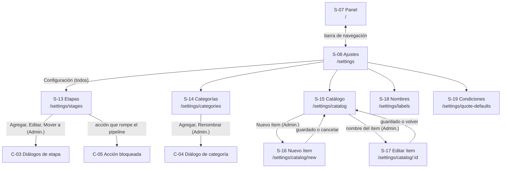
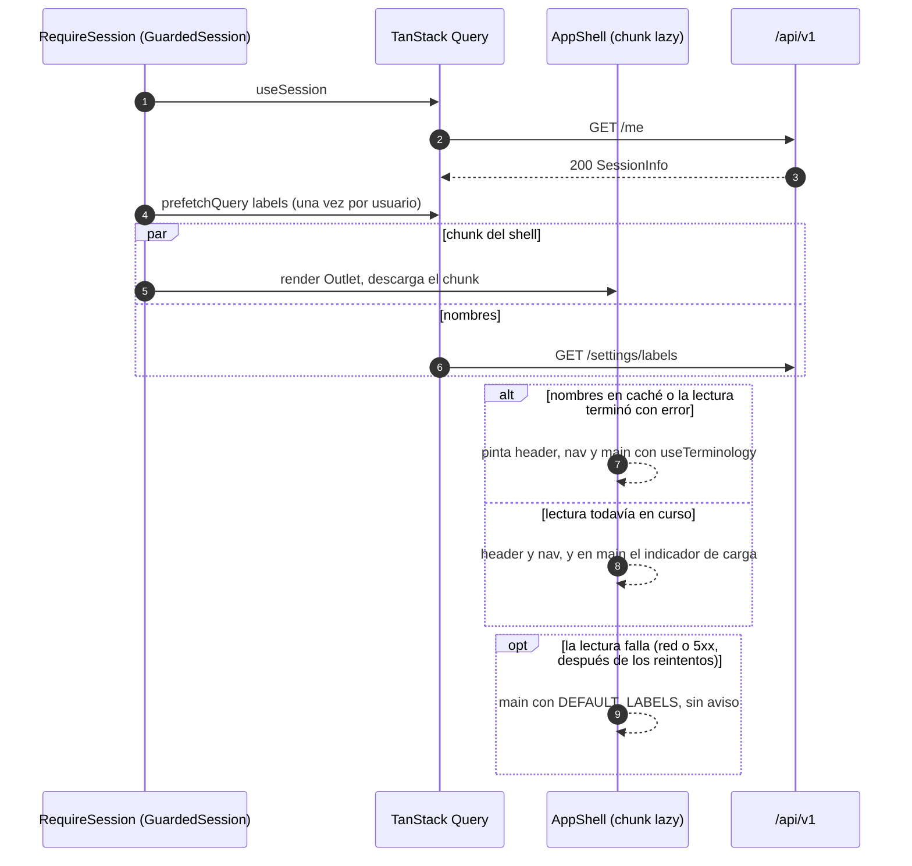
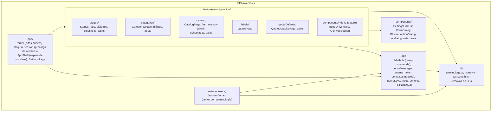
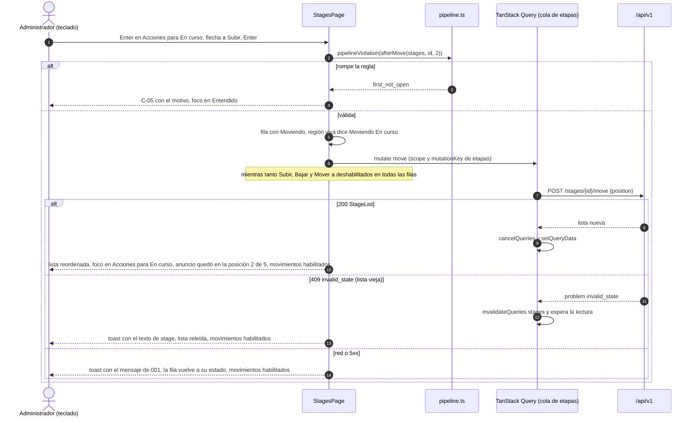
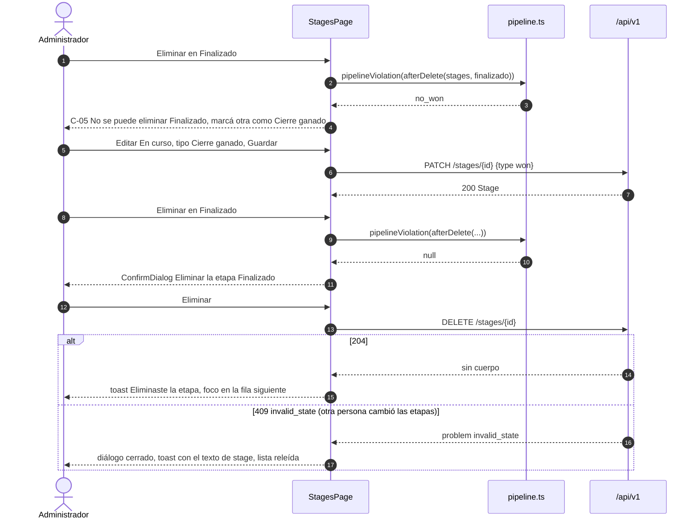
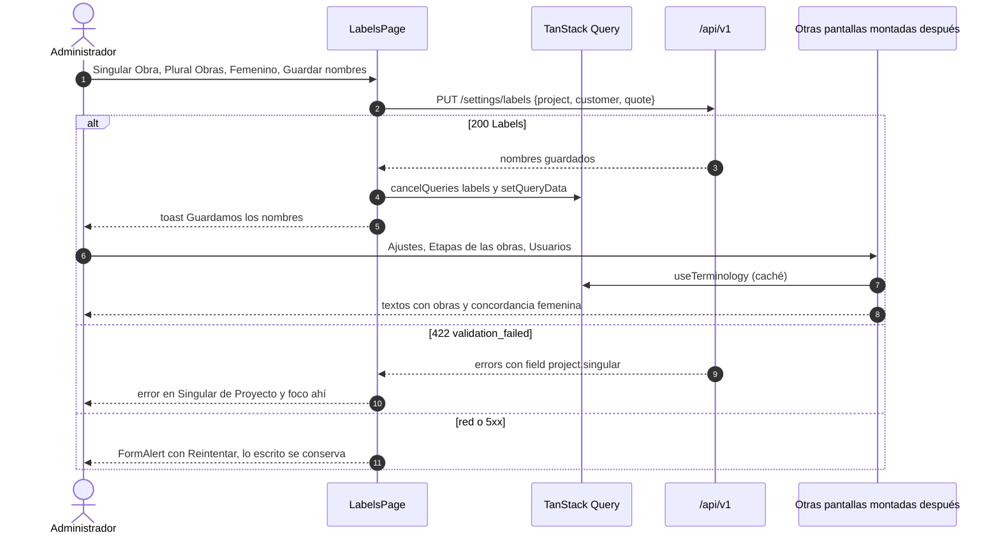

# UI (frontend): Configuración por empresa

**Spec**: [`spec.md`](spec.md) (Aprobada 2026-10-23) · **Plan backend**: [`plan.md`](plan.md) (Aprobado
2026-10-23) · **Fecha**: 2026-10-23 · **Autor**: `frontend-architect`
**Estado**: **Aprobado (2026-10-26).** El usuario aprobó el diseño con las opciones recomendadas de
P-F1 a P-F4 ("ok sigamos con la recomendacion", 2026-10-26; registro en §24). ADR-030 pasó a
*Accepted* el mismo día. H-1 quedó resuelto del lado del backend (§25).
**Contrato consumido**: [`contracts/openapi.yaml`](contracts/openapi.yaml) **v0.1.0** (canónico de 002)
y el de 001 en **v0.6.0** (`name_taken`, `Money`; lo sube T-002-B202). Si este documento y los YAML
difieren, mandan los YAML.

**Convención de identificadores** (plan DD-17): en este documento `DD-F`, `INV-F`, `BR-F`, `NFR-F`,
`S-F`, `P-F`, `H-` y `RF-` son **de 002**; los de 001 se citan con su spec ("INV-F01 de 001",
"NFR-F07 de 001"). En el código, los comentarios citan `002/DD-F3`, `002/INV-F2`, y las tareas
`T-002-Fnnn`. Las pantallas siguen la numeración del producto: 001 llegó a S-12, 002 empieza en S-13.

| Archivo | Contenido |
|---|---|
| `ui.md` (este) | Pantallas, rutas, terminología, modelo de estado, matriz de estados, errores, componentes, accesibilidad, `DD-F` |
| [`tasks.md`](tasks.md) §Frontend | Plan TDD del frontend (`T-002-F…`) |
| [`docs/adr/030`](../../docs/adr/030-terminologia-configurable-en-la-interfaz.md) | Terminología configurable en la interfaz (*Accepted*, 2026-10-26) |
| [`ui.md` de 001](../001-empresas-usuarios/ui.md) | Base que este documento no repite: sesión, guards, cliente HTTP, mapa de errores, tokens, PWA, distribución |

Las alternativas de cada decisión están en la columna "Descartado" de §22 (no se abre una sección
de `research.md` para el frontend de 002).

### Registro de aprobación

| Fecha | Qué se aprobó |
|---|---|
| 2026-10-26 | El diseño completo, con P-F1 a P-F4 en la opción recomendada (§24): reordenar sin arrastre (P-F1); corregir en los componentes compartidos, dentro de T-002-F103, los hallazgos 1, 2 y 3 de T-F705 de 001 (P-F2); mantener NFR-F07 de 001 con separación ≥ 8 px en las listas nuevas y en Ajustes (P-F3); los datos sembrados no se renombran solos (P-F4). ADR-030 pasa a *Accepted*. |

**Cambios posteriores a la aprobación** (no cambian lo aprobado):

| Fecha | Origen | Cambio |
|---|---|---|
| 2026-10-26 | Revisión 1 de Codex del PR #49 | **DD-F14, BR-F14 e INV-F11**: mientras hay una escritura de etapas pendiente, ninguna acción calcula una posición nueva ("Subir", "Bajar", "Mover a otra posición…" y el envío de "Nueva etapa" quedan deshabilitados hasta la respuesta). Antes, dos movimientos seguidos en filas distintas mandaban el segundo con una posición calculada sobre la lista vieja. Reordenar sigue siendo por menú y sin arrastre (P-F1 sin cambios). Se corrige además el texto de H-1 (§25): el checkpoint de la Fase 2 exige `make check-all`. |

---

## 0. Contexto y validación del stack

**Brownfield.** El frontend de 001 está completo (Fases F0 a F7 en `main`, PR #45). Detecté en
`web/package.json`: React 19.3.1, React Router 8.4.0 (modo *data*, sin loaders), TanStack Query
5.104.3, openapi-fetch 0.17.0 con tipos de openapi-typescript 7.13.0, React Hook Form 7.90.0 + Zod
4.6.7, shadcn/ui sobre `radix-ui` 1.8.1, Tailwind CSS 4.3.3, sonner 2.0.8, Vitest 5.0.5 + Testing
Library + MSW 3.0.3, Playwright 1.64.1 y TypeScript 5.9.3. Checkpoint: `npm run check` (en `web/`) y
`make check-all`. **Diseño sobre eso, sin dependencias nuevas**: los componentes de shadcn que faltan
(`dialog`, `textarea`) los genera su CLI sobre el paquete `radix-ui` que ya está instalado.

Lo que 002 reutiliza tal cual de 001 (no se repite acá): `RequireSession`, `RequirePermission` y la
salida de sesión (§6.4 de 001), el cliente `api` y `ApiError` (§11.3 de 001), `messageForError` y
`fieldErrorMessage` (§12 de 001, que 002 amplía), `useUnsavedChangesGuard` (DD-F32 de 001),
`ConfirmDialog`, `FormAlert`, `LiveRegion`, `ErrorState`, `EmptyState`, `PageHeader`,
`SubmitButton`, la cola de mutaciones con `scope` (DD-F33 de 001) y los tokens de §19 de 001.

**Arquetipo**: *SPA con sesión*, pantallas de configuración tipo "lista con acciones" (etapas,
categorías, catálogo) y dos formularios de una sola entidad (nombres, condiciones). Lo transversal
es la **terminología** (§9): a partir de 002, toda pantalla con sesión nombra a Proyecto, Cliente y
Presupuesto como los llama la empresa.

**Rediseño visual previsto.** El usuario va a rediseñar el aspecto de toda la app al final. Este
documento diseña **comportamiento, semántica, foco, estados y textos**; el aspecto queda en los
tokens y componentes existentes (§19). Los wireframes son estructurales: dicen qué hay y en qué
orden, no cómo se ve. Ninguna decisión de esta spec depende de un color, una tipografía o un
espaciado salvo los mínimos de accesibilidad (objetivos de 44 px, contraste).

---

## 1. Resumen ejecutivo

Cinco pantallas nuevas debajo de Ajustes (etapas, categorías, catálogo, nombres personalizados y
condiciones de los presupuestos), legibles por cualquier rol y editables solo por el Administrador:
el Operador ve las mismas pantallas en solo lectura, nunca "Sin permiso" (FR-008). Todo dato vive
en la caché de TanStack Query; los cambios de etapas salen en cola, como los de la empresa en 001,
porque el servidor reordena posiciones, y mientras uno está pendiente ninguna acción calcula una
posición nueva (DD-F14). Las reglas del pipeline se replican en una función pura
para **explicar antes** por qué un cambio no se puede hacer; el servidor sigue decidiendo. Reordenar
se hace con acciones de menú ("Subir", "Bajar", "Mover a…"), operables con teclado y lector de
pantalla, sin arrastre. Los nombres personalizados se aplican en toda la interfaz con un hook de
terminología que resuelve género, artículos y minúsculas (ADR-030), y reemplazan los textos de 001
que nombraban clientes, proyectos y presupuestos. El precio de referencia del catálogo es el primer
importe del sistema: entra `lib/money.ts` (ADR-023), sin punto flotante. El nuevo `name_taken` del
contrato de 001 v0.6.0 rompe a propósito el mapa exhaustivo de errores: su texto entra en la misma
rama que el cambio de contrato (T-002-F001).

---

## 2. Constitution Check (frontend)

| Principio | Estado | Cómo se cumple |
|---|:---:|---|
| **I. Simplicidad** | ✅ | Una pantalla por recurso; altas y renombres de etapas y categorías en un diálogo de la misma pantalla. Sin arrastre, sin librería nueva, sin store. El tipo de una categoría lo da el botón de su sección (un campo menos). Mensajes en lenguaje de negocio ("Tiene que quedar al menos una etapa de cierre ganado"). |
| **II. Genérico por configuración** | ✅ | Ninguna pantalla tiene texto de un rubro. Los sustantivos Proyecto, Cliente y Presupuesto salen de la configuración de la empresa (§9, INV-F1). La UI nunca ramifica por `system_key` ni por código de plantilla (INV-F7). |
| **III. Aislamiento** | ✅ (N/A cliente) | Las claves nuevas de la caché caen con el `clear()` de la salida de sesión (INV-F03 y DD-F35 de 001). |
| **IV. Integridad del dinero** | ✅ | El precio de referencia se carga y se muestra con `parseMoneyInput` y `formatMoney` por manipulación de texto (ADR-023), con el tope 2^53 − 1 de ADR-029. Nunca `parseFloat` ni división por 100 (INV-F5). "Sin precio" es `null`, nunca 0. |
| **V. SDD** | ✅ | Derivado de la spec aprobada, el plan y el contrato. Cada escenario Dado/Cuando/Entonces tiene su fila `[T]` en `tasks.md`. |
| **VI. Tests primero** | ✅ | Todas las fases TDD; las reglas del pipeline del cliente se prueban con la misma tabla que T-002-B301 del backend. |
| **VII. Mobile-first** | ✅ | Diseño base 360×640, mínimo 320 px; listas de tarjetas; menús y diálogos dentro del viewport (NFR-F4); objetivos ≥ 44 px, también en enlaces con aspecto de botón (NFR-F3). |

---

## 3. Usuarios, contexto y lenguaje

| Perfil | Situación | Consecuencia |
|---|---|---|
| Administrador que arma la configuración | Una vez al empezar (desde la plantilla) y retoques esporádicos; celular o PC | Listas cortas, acciones en un menú por fila, explicación antes de un cambio imposible |
| Operador | Necesita leer etapas, catálogo y condiciones para trabajar (004 y 005) | Las mismas pantallas, sin controles de edición, con un aviso que dice quién puede cambiarlas |
| Cualquiera, en toda la app | Lee "Obras" donde la empresa dice "Obras" | Terminología resuelta en un solo lugar (§9) |

### Lenguaje de la interfaz (alineado con `docs/glosario.md` y plan §17)

| Concepto | Texto en la UI | No usar |
|---|---|---|
| Etapa (`Stage`) | "etapa"; la lista: "etapas de {los proyectos}" | "pipeline" en textos visibles (sí en documentos), "estado" |
| Tipo `open` / `won` / `lost` | "Abierta" / "Cierre ganado" / "Cierre perdido" | "ganada", "cerrada" sola |
| Etapa inicial | "Etapa inicial" (marca de la primera) | "por defecto" |
| Categoría `income` / `expense` | "Ingreso" / "Egreso"; secciones "Ingresos" / "Egresos" | "debe/haber", "rubro contable" |
| Categoría de sistema | "Del sistema" | "protegida", "bloqueada" |
| Archivar / Restaurar | "Archivar" / "Restaurar"; sección "Archivadas" (categorías) y "Archivados" (ítems) | "borrar", "desactivar" |
| Ítem de catálogo (`CatalogItem`) | "ítem"; la pantalla: "Catálogo" | "producto" solo |
| Precio de referencia | "Precio de referencia"; vacío: "Sin precio de referencia" | "precio 0", "a cotizar" como dato |
| Unidad `unit` / `square_meter` / `linear_meter` / `hour` / `other` | "Unidad" / "m²" / "Metro lineal" / "Hora" / "Otra" | |
| Nombres personalizados (`Labels`) | "Nombres personalizados" | "etiquetas", "labels" |
| Condiciones por defecto (`QuoteDefaults`) | "Condiciones de {los presupuestos}": "Validez" y "Condiciones comerciales" | "términos" |

---

## 4. Inventario de pantallas

| ID | Pantalla | Ruta | Acceso | Propósito | Historia |
|---|---|---|---|---|---|
| S-08 *(cambia)* | Ajustes | `/settings` | Sesión | Suma la sección "Configuración", visible para todos los roles | FR-008 |
| S-13 | Etapas | `/settings/stages` | Sesión (escribe: `settings.manage`) | Ver el pipeline; agregar, editar (nombre, tipo, color), mover y eliminar etapas | Historia 1, FR-001 |
| S-14 | Categorías | `/settings/categories` | Sesión (escribe: `settings.manage`) | Ver ingresos y egresos; agregar, renombrar, archivar y restaurar | Historia 3, FR-003, FR-004 |
| S-15 | Catálogo | `/settings/catalog` | Sesión (escribe: `settings.manage`) | Ver los ítems activos y archivados; entrar a crear o editar | Historia 4, FR-005 |
| S-16 | Nuevo ítem | `/settings/catalog/new` | Sesión + `settings.manage` | Crear un ítem | Historia 4.1 |
| S-17 | Editar ítem | `/settings/catalog/:catalogItemId` | Sesión + `settings.manage` | Editar, archivar o restaurar un ítem | Historia 4.1, 4.3 |
| S-18 | Nombres personalizados | `/settings/labels` | Sesión (escribe: `settings.manage`) | Cómo llama la empresa a Proyecto, Cliente y Presupuesto | Historia 2, FR-002 |
| S-19 | Condiciones de los presupuestos | `/settings/quote-defaults` | Sesión (escribe: `settings.manage`) | Validez y condiciones comerciales por defecto | Historia 6, FR-007 |
| C-03 | Diálogos de etapa | — (en S-13) | Administrador | Nueva etapa, editar etapa, mover a otra posición | Historia 1 |
| C-04 | Diálogo de categoría | — (en S-14) | Administrador | Nueva categoría (de ingreso o de egreso), renombrar | Historia 3 |
| C-05 | Explicación de acción bloqueada | — (en S-13) | Administrador | Dice por qué no se puede eliminar, mover o cambiar el tipo, y qué hacer antes | Historia 1.4 |

"Solo lectura" no es una ruta ni un estado de guard: es la misma pantalla sin controles de edición,
calculada con `useCan('settings.manage')` (BR-F1).

**No se hace en 002** (non-goals): arrastrar para reordenar (P-F1), buscar o filtrar el catálogo
(plan DD-16: lo decide 005 si el catálogo crece), mostrar en el registro qué trae cada plantilla,
pasos nuevos en "Primeros pasos" del panel, mover proyectos al eliminar una etapa (004).

---

## 5. Mapa de navegación



**Botón atrás del navegador**: todas las pantallas son rutas reales. Los diálogos no son rutas: atrás
con un diálogo abierto vuelve a la pantalla anterior y el diálogo se descarta sin aviso (sus
formularios tienen 1 a 4 campos; DD-F6). S-16 y S-17 con cambios sin guardar piden confirmación al
salir (`useUnsavedChangesGuard`, DD-F32 de 001), igual que S-18 y S-19. Tras crear un ítem, S-16
navega a S-15 con `replace` (atrás no vuelve al formulario vacío).

---

## 6. Rutas

### 6.1 Árbol (agrega a §6.1 de 001)

```text
[RequireSession] → AppShell
├── settings                         SettingsPage           (cambia: sección "Configuración")
├── settings/stages                  StagesPage             (lectura para todos; escritura con settings.manage)
├── settings/categories              CategoriesPage         (ídem)
├── settings/catalog                 CatalogPage            (ídem)
├── settings/labels                  LabelsPage             (ídem)
├── settings/quote-defaults          QuoteDefaultsPage      (ídem)
└── [RequirePermission settings.manage]
    ├── settings/catalog/new             CatalogItemNewPage
    └── settings/catalog/:catalogItemId  CatalogItemEditPage
```

- Las cinco pantallas de lectura van **fuera** de `RequirePermission` (FR-008, P-5): el Operador las
  abre y ve solo lectura. Las dos de escritura del catálogo van dentro, como las de 001.
- `:catalogItemId` no se valida en el cliente: un id que no es UUID o de otra empresa responde `404`
  y la pantalla muestra su estado "No encontrado" (§14.5).
- Cada pantalla es un chunk propio cargado con `lazy` (grupo 3 de §23 de 001).

### 6.2 Guards

Sin cambios de comportamiento en los guards de 001. Un solo agregado en `RequireSession`: con la
sesión presente, precarga los nombres personalizados (§9.3, DD-F2). La precarga vive en la parte
interna (`GuardedSession`), que no existe durante una salida de sesión, así que no rompe INV-F22 de
001.

> **La autorización real la hace el servidor** (ADR-013, INV-11 del plan). Ocultar "Agregar etapa" a
> un Operador es UX: si un cliente manipulado lo intenta, el servidor responde `403` y la UI lo
> maneja (§13.1).

---

## 7. Reglas de UI (`BR-F`)

| ID | Regla | Fuente |
|---|---|---|
| BR-F1 | Con `settings.manage`, S-13 a S-19 muestran los controles de edición. Sin él, las mismas pantallas en solo lectura: sin botones de agregar, sin menús de acciones, formularios como texto, y un aviso informativo "Solo un administrador puede cambiar {esto}." (`FormAlert` `info`, sin anuncio). Nunca "Sin permiso" en esas rutas. | FR-008, P-5, plan DD-11 |
| BR-F2 | La primera etapa lleva la marca "Etapa inicial". Cada etapa muestra su tipo en texto ("Abierta", "Cierre ganado", "Cierre perdido") y su color con el nombre del color en texto en los selectores; el color nunca es el único dato. | Historia 1.4, P-6, P-7 |
| BR-F3 | Antes de enviar crear, cambiar el tipo, mover o eliminar una etapa, la UI evalúa las reglas del pipeline sobre la lista **resultante** (`pipelineViolation`, §16.4). Si se rompen, no manda nada: en el diálogo de edición o de alta, error en el campo; en "Eliminar" o "Subir/Bajar/Mover a", el diálogo C-05 con el motivo y qué hacer antes. Es UX: si la lista estaba vieja, el servidor responde `409 invalid_state` y la UI lo explica y refresca (§13.2). | Historia 1.4, plan DD-5, INV-2 |
| BR-F4 | "Subir" no se ofrece en la primera etapa ni "Bajar" en la última (no hay nada que explicar: no existe el lugar). "Mover a otra posición…" se ofrece siempre que haya al menos dos etapas. | Historia 1.1 |
| BR-F5 | Eliminar una etapa pide confirmación y dice que no se puede recuperar. | Historia 1.3, P-2 |
| BR-F6 | Las categorías "Del sistema" se pueden renombrar y nunca muestran "Archivar". La UI lo decide con `category.system`, nunca con el valor de `system_key` (INV-F7). | Historia 3.3, FR-004 |
| BR-F7 | El tipo de una categoría lo fija el botón de su sección ("Agregar" en Ingresos crea un ingreso); el diálogo dice "El tipo no se puede cambiar después." y no ofrece cambiarlo. | Historia 3.1 |
| BR-F8 | Archivar una categoría o un ítem no pide confirmación (se puede restaurar); el resultado lo confirma un toast que dice dónde quedó ("La encontrás en Archivadas."). | Historia 3.2, 4.3 |
| BR-F9 | En un ítem, el precio de referencia es opcional: importe vacío = sin precio (`null`), y entonces la moneda no se envía. `0,00` es un precio válido y se muestra como tal. La moneda propuesta es la moneda base de la empresa. | Historia 4.1, P-9, plan DD-9 |
| BR-F10 | Con la unidad "Otra", aparece "Nombre de la unidad" (obligatorio, hasta 20 caracteres); con otra unidad no se muestra ni se envía. | Historia 4.1, P-9 |
| BR-F11 | Los textos de toda pantalla con sesión que nombran a Proyecto, Cliente o Presupuesto usan los nombres personalizados con su concordancia (§9). Los **datos** que contienen esas palabras (la etapa "Presupuesto", la categoría "Cobros de clientes") no cambian solos: los renombra el Administrador (P-F4, aprobada). | Historia 2, P-3, ADR-030 |
| BR-F12 | Todo botón de envío queda deshabilitado con texto de progreso mientras la operación está en curso; las acciones de una fila se deshabilitan mientras esa fila tiene una operación pendiente. | BR-F10 de 001 |
| BR-F13 | Salir de S-16, S-17, S-18 o S-19 con cambios sin guardar pide confirmación (textos del aviso de S-11 de 001). Los diálogos de etapa y categoría no la piden. | DD-F32 de 001, DD-F6 |
| BR-F14 | Mientras hay una escritura de etapas pendiente (crear, editar, mover o eliminar), "Subir", "Bajar" y "Mover a otra posición…" de **todas** las filas, y el botón de envío del diálogo "Nueva etapa", quedan deshabilitados; vuelven cuando la respuesta se escribió en la lista. "Editar" y "Eliminar" de las demás filas siguen disponibles (identifican la etapa por id y esperan en la cola). La región viva de la pantalla dice qué se está esperando ("Moviendo «{nombre}»…"). | DD-F14, revisión 1 de Codex del PR #49 |

---

## 8. Requisitos no funcionales (`NFR-F`)

Siguen vigentes los NFR-F01 a NFR-F13 de 001. Además:

| ID | Requisito | Valor | Cómo se mide |
|---|---|---|---|
| NFR-F1 | Presupuesto de JS | Cada chunk de S-13 a S-19 ≤ 40 KB gzip (como las pantallas de Ajustes de 001). **Objetivo** | Reporte de `vite build`, T-002-F604 |
| NFR-F2 | LCP con la espera de nombres | `/` sigue ≤ 2,5 s p75 (NFR-F03 de 001; hoy 2052 ms) con la precarga y la espera de §9.3 | Lighthouse como T-F704 de 001, T-002-F604 |
| NFR-F3 | Objetivos táctiles | ≥ 44×44 CSS px en **todo** control, incluidos los enlaces con aspecto de botón ("+ Nuevo ítem") y los enlaces sueltos ("← Ajustes"). En los grupos de opciones (tipo, color, unidad, género) el objetivo es la tarjeta `<label>` entera, no el círculo del radio. En las listas de enlaces y de tarjetas (Ajustes y las listas de 002), los objetivos vecinos quedan separados ≥ 8 px (NFR-F07 de 001 sin cambios, P-F3) | E2E con aserción de tamaño (T-002-F602) + T-002-F603 |
| NFR-F4 | Reflow | Sin scroll horizontal a 320 px; los menús de acciones y los diálogos caben en el viewport y su texto salta de línea (WCAG 1.4.10) | E2E a 320 y 375 px (T-002-F602) |
| NFR-F5 | Largos | Los máximos del cliente se cuentan en *code points* (`Array.from(texto).length`), como el servidor cuenta runas: un emoji cuenta 1 | Unitarios (T-002-F101) |
| NFR-F6 | Volumen | Listas sin paginación ni virtualización hasta los volúmenes de S-1 del plan (30 etapas, 200 categorías, 1.000 ítems); con 1.000 ítems, la lista del catálogo se pinta en ≤ 500 ms en un Android de gama media. **Objetivo, no medición** | Prueba manual con un *fixture* de 1.000 ítems (T-002-F604) |
| NFR-F7 | Respuesta a mover | "Moviendo…" aparece en el mismo cuadro del toque (INP ≤ 200 ms); el orden nuevo, al llegar la respuesta | Inspección manual (T-002-F603) |

---

## 9. Terminología: nombres personalizados en toda la interfaz (Historia 2, P-3, ADR-030)

### 9.1 Qué resuelve

La empresa elige singular, plural y género de Proyecto, Cliente y Presupuesto. La interfaz tiene que
decir "Nueva obra", "Las obras abiertas", "Etapas de las obras", "Se usan en los PDF de tus
cotizaciones", sin que cada pantalla reimplemente la concordancia.

### 9.2 Mecanismo

```ts
// src/lib/terminology.ts — puro (sin red, sin React)
import type { Labels, GrammaticalGender } from '@/api/types';

export type TermEntity = 'project' | 'customer' | 'quote';

export interface EntityTerm {
  singular: string;                 // tal como lo escribió el Administrador: "Obra" (inicio de frase, títulos)
  plural: string;                   // "Obras"
  gender: GrammaticalGender;        // 'masculine' | 'feminine'
  lower: { singular: string; plural: string };   // medio de frase: "obra", "obras" (midSentence)
  article: {
    the: 'el' | 'la';               // el proyecto / la obra
    theP: 'los' | 'las';            // los proyectos / las obras
    a: 'un' | 'una';                // un presupuesto / una cotización
    ofThe: 'del' | 'de la';         // del proyecto / de la obra
    toThe: 'al' | 'a la';           // al cliente / a la comitente
  };
}
export type Terminology = Record<TermEntity, EntityTerm>;

/** Los nombres de las plantillas (spec, "Plantillas de rubro"): Proyecto/Proyectos, Cliente/Clientes,
 *  Presupuesto/Presupuestos, todos masculinos. Respaldo si la lectura falla (DD-F2). */
export const DEFAULT_LABELS: Labels;

/** Primera letra en minúscula solo si el resto de la primera palabra ya está en minúscula:
 *  "Obra" → "obra"; "Orden de trabajo" → "orden de trabajo"; "OT", "PyME" y "obra" quedan iguales. */
export function midSentence(text: string): string;

/** Elige la forma concordante: byGender(t.project.gender, { masculine: 'Nuevo', feminine: 'Nueva' }). */
export function byGender<T>(gender: GrammaticalGender, forms: { masculine: T; feminine: T }): T;

export function terminologyFrom(labels: Labels): Terminology;
```

```ts
// src/api/labels.ts — query compartida (la usan el shell y todas las features; §9.1 de 001, P-F19 de 001)
export const labelsQuery: ReturnType<typeof queryOptions<Labels>>;   // ['settings','labels'], GET /settings/labels, staleTime 5 min
export function useLabels(): UseQueryResult<Labels, ApiError>;
/** Siempre devuelve una terminología: la de la caché si hay datos; si la lectura falló, la de
 *  DEFAULT_LABELS. Solo se usa debajo de AppShell, que no pinta <main> hasta que la lectura terminó
 *  (DD-F2), así que nunca devuelve los nombres por defecto "mientras carga". */
export function useTerminology(): Terminology;
```

Uso en un componente (el texto vive en el componente, como pide ADR-023):

```ts
const t = useTerminology();
const title = `Etapas de ${t.project.article.theP} ${t.project.lower.plural}`;      // "Etapas de las obras"
const closed = byGender(t.project.gender, { masculine: 'cerrados', feminine: 'cerradas' });
```

### 9.3 Carga (DD-F2)



- El shell pinta el encabezado y la navegación de inmediato; solo `<main>` espera, con el mismo
  indicador de carga de la pantalla de arranque (`role="status"`, nombre accesible "Cargando").
  Desde 004 la navegación también usará nombres: entonces la espera incluirá la barra (lo decide
  004; hoy la barra solo dice "Inicio" y "Ajustes").
- `staleTime` 5 min y `refetchOnWindowFocus` por defecto: un cambio hecho por otro Administrador se
  ve al volver a la pestaña. `PUT /settings/labels` escribe la respuesta en la caché y toda la
  interfaz cambia sin recargar.
- Un `401` en la lectura dispara la salida de sesión de 001 como cualquier query (§12.4 de 001).

### 9.4 Textos de 001 que pasan a usar la terminología

Relevado en `web/src` el 2026-10-23 (grep de "proyecto", "cliente" y "presupuesto"):

| Dónde | Texto actual | Texto con terminología (ejemplo "Obra", "Comitente" masc., "Cotización" fem.) |
|---|---|---|
| S-09 Usuarios, estado vacío (dos lugares en `features/users/pages.tsx`) | "Invitá a alguien de tu equipo para que cargue clientes y proyectos." | "…para que cargue `{customer.lower.plural}` y `{project.lower.plural}`." → "…comitentes y obras." |
| S-10 Invitar, descripción del rol Operador | "Carga clientes, proyectos, presupuestos y cobros. No ve finanzas ni ajustes." | "Carga comitentes, obras, cotizaciones y cobros. No ve finanzas ni ajustes." |
| S-11 Datos de la empresa, bajada (`CompanyPage` y `CompanyEditor`) | "Se usan en los PDF de tus presupuestos." | "Se usan en los PDF de tus cotizaciones." |

No los usan: las pantallas públicas (S-01 a S-06, sin sesión), los mensajes de error de
`errorMessages.ts` (ninguno nombra esas entidades) ni los emails (P-3). El wireframe de S-07 en
`ui.md` de 001 dice "Completá los datos de tu empresa (para los presupuestos)", pero el código dice
"Completá los datos de tu empresa": el documento de 001 quedó desactualizado (hallazgo de
documentación, sin cambio de código).

**Vigilancia** (INV-F1): `terminologyLiterals.test.ts` recorre `src/**/*.tsx` fuera de `*.test.*`,
`features/auth/` (pantallas públicas) y `features/configuration/labels/LabelsPage.tsx` (que nombra
los conceptos que se renombran), y falla si un literal de texto contiene
`/\b(proyecto|cliente|presupuesto)s?\b/i`.

---

## 10. Arquitectura

### 10.1 Capas y módulos (agrega a §9.1 de 001)



Reglas de dependencia (las de §9.1 de 001, que vigila `importBoundaries.test.ts`):

- `features/configuration/*` no importa otras features salvo `features/auth/session`. Lo que use una
  segunda feature (004 consumirá etapas; 005, catálogo y condiciones; 006, categorías) se mueve a
  `api/` cuando esa spec lo necesite (P-F19 de 001), no antes.
- Los nombres personalizados ya son compartidos (shell, users, tenant, configuration): su query vive
  en `api/labels.ts` desde el principio; la lógica pura, en `lib/terminology.ts`.
- `components/` no importa `api/`: los componentes de presentación reciben los textos ya armados con
  la terminología.

### 10.2 Invariantes del diseño (`INV-F`)

Propiedades que se rompen **sin que falle la compilación**. Cada una tiene su test.

| ID | Invariante | Test |
|---|---|---|
| INV-F1 | Ningún texto visible de una pantalla con sesión escribe "proyecto(s)", "cliente(s)" ni "presupuesto(s)": los arma con `useTerminology()` (§9.4). Se rompe si alguien escribe el literal | `terminologyLiterals.test.ts` (T-002-F501) |
| INV-F2 | `<main>` del shell no pinta su contenido hasta que la lectura de nombres terminó (con datos o con error), y `useTerminology()` nunca devuelve los nombres por defecto mientras hay una lectura en curso sin datos. Se rompe si el shell deja de esperar o si el hook devuelve el respaldo durante `isPending` | `terminologyLoading.test.tsx` (T-002-F501) |
| INV-F3 | Las mutaciones de etapas (crear, editar, mover, eliminar) comparten la cola `STAGE_CHANGES_SCOPE` y la clave de mutación `STAGE_MUTATION_KEY`: cada una sale cuando terminó la anterior. Toda escritura de una respuesta en `['settings','stages']` cancela antes las lecturas en vuelo de esa clave (como DD-F33 de 001). Se rompe si una mutación de etapas pierde el `scope` o la clave, o escribe sin cancelar | `StagesOrder.test.tsx` (T-002-F202) |
| INV-F4 | Las reglas del pipeline del cliente (`pipelineViolation` y las funciones `after*`) dan el mismo resultado que la tabla de T-002-B301 del backend para cada fila de esa tabla. Un cliente más estricto que el servidor impediría cambios válidos; uno más laxo solo produce un `409` explicado | `pipeline.test.ts` (T-002-F201) |
| INV-F5 | Ningún importe pasa por punto flotante: el texto del usuario se convierte a centavos solo con `parseMoneyInput`, y los centavos se muestran solo con `formatMoney` y `formatMoneyInput` (`lib/money.ts`). Ningún archivo fuera de `lib/money.ts` llama a `parseFloat`, `Number()` ni divide por 100 sobre un importe | `money.test.ts` (2^53 − 1 exacto, T-002-F102) + revisión |
| INV-F6 | Cuando el elemento con el foco desaparece por una acción del usuario (eliminar una etapa, archivar o restaurar una categoría o un ítem), el foco va a un destino definido: el disparador de acciones de la fila siguiente de la misma lista, o el de la anterior, o el botón de agregar de la sección (o el `<h1>` si no hay). Nunca queda en `<body>`. Al mover una etapa, el foco vuelve al disparador de esa misma etapa en su lugar nuevo, salvo que el usuario ya lo haya llevado a otro control mientras esperaba (no se le roba el foco) | `removalFocus.test.ts` + tests de pantalla (T-002-F202, T-002-F302) |
| INV-F7 | La UI nunca ramifica por el valor de `system_key` ni por el código de plantilla: solo por `category.system`. Una clave de sistema nueva (006) no necesita cambios en el cliente | `CategoriesPage.test.tsx` (fila con una clave desconocida para el cliente) (T-002-F302) |
| INV-F8 | En las rutas de lectura de 002 el Operador nunca ve "Sin permiso": ve la pantalla en solo lectura. Un `403 forbidden` en una escritura deja la pantalla montada, refresca la sesión (manejador global de 001) y, si el permiso se perdió, la pantalla pasa a solo lectura | Tests de pantalla con sesión de Operador (T-002-F202, F302, F402, F502) |
| INV-F9 | Un `PATCH` de etapa o de ítem lleva solo las claves que cambiaron, y nunca `null` en `name`, `type`, `color` ni `unit`; si nada cambió, no sale ningún request (el contrato responde `400` a `{}` y a esos `null`) | `stageChanges` y `catalogItemChanges` (T-002-F201, T-002-F401) |
| INV-F10 | Los largos máximos del cliente se cuentan en *code points* (`countCodePoints`) y coinciden con los del contrato (etapa y categoría 60, ítem 120, descripción 1.000, unidad 20, nombres 40, condiciones 2.000) | `textLength.test.ts`, `schemas.test.ts` (T-002-F101, F401, F501) |
| INV-F11 | Toda posición que la pantalla de etapas envía (`move` o `position` al crear) se calculó con la lista que dejó la **última escritura confirmada**: mientras `useStageWritePending()` es verdadero, "Subir", "Bajar", "Mover a otra posición…" y el envío de "Nueva etapa" están deshabilitados, así ninguna posición se calcula sobre una lista que la cola todavía va a cambiar (DD-F14). Se rompe sin que falle la compilación si alguna de esas acciones se habilita con una escritura pendiente o si una mutación de etapas deja de llevar `STAGE_MUTATION_KEY` | `StagesOrder.test.tsx` (T-002-F202): dos movimientos seguidos en filas distintas, con su mutación |

---

## 11. Modelo de estado

### 11.1 Clasificación de cada pieza nueva

| Pieza | Categoría | Dónde vive | Notas |
|---|---|---|---|
| Etapas activas (`Stage[]`) | Server state | `['settings','stages']` (`GET /stages`) | Orden del servidor (`position`) |
| Categorías, activas y archivadas (`Category[]`) | Server state | `['settings','categories']` (`GET /categories?include_archived=true`) | Una sola lectura; la pantalla separa por tipo y por `archived` (derivado). DD-F7 |
| Ítems, activos y archivados (`CatalogItem[]`) | Server state | `['settings','catalog-items']` (`include_archived=true`) | Ídem |
| Un ítem (`CatalogItem`) | Server state | `['settings','catalog-items', id]` (`GET /catalog-items/{id}`) | S-17 se puede recargar; con la lista en caché, se siembra con `initialData` del ítem de la lista |
| Nombres personalizados (`Labels`) | Server state | `['settings','labels']` (`api/labels.ts`) | Precarga (§9.3) |
| Condiciones por defecto (`QuoteDefaults`) | Server state | `['settings','quote-defaults']` | |
| Terminología (`Terminology`) | Derivado | `useTerminology()` sobre `['settings','labels']` | No se guarda |
| ¿La acción rompe el pipeline? | Derivado | `pipelineViolation(after…(stages, …))` | No se guarda |
| ¿Hay una escritura de etapas pendiente? | Derivado | `useStageWritePending()` = `useIsMutating({ mutationKey: STAGE_MUTATION_KEY }) > 0` | No se guarda; decide BR-F14 (DD-F14) |
| ¿Puede editar? | Derivado | `useCan('settings.manage')` | |
| Diálogo abierto (alta, edición, mover, eliminar, explicación) y fila de origen | Client local | `useState` de `StagesPage` / `CategoriesPage` | La fila de origen sirve para devolver el foco (INV-F6) |
| Sección "Archivadas" abierta | Client local | `ArchivedSection` | Se cierra al salir de la pantalla |
| Valores de formularios y errores | Client local | React Hook Form | Valores iniciales copiados de la caché (permitido por INV-F01 de 001) |
| Texto de la región viva de S-13 ("Moviendo «…»…" y el resultado) | Client local | Texto de la `LiveRegion` de S-13 | Cambia al empezar y al terminar cada movimiento (INV-F19 de 001) |

Sin store ni Context nuevo. Ningún dato de configuración se copia fuera de la caché (INV-F01 de 001).

### 11.2 Configuración de las queries

| Query | `staleTime` | Por qué |
|---|---|---|
| `['settings','labels']` | 5 min | Cambia solo desde S-18, que escribe la caché |
| `['settings','stages']`, `['settings','categories']`, `['settings','catalog-items']`, `['settings','catalog-items', id]`, `['settings','quote-defaults']` | 30 s (el de 001) | Otro Administrador puede cambiarlas; el refetch al enfocar las trae |

Reintentos, `networkMode` y manejadores globales: los de §10.2 de 001, sin cambios.

### 11.3 Claves e invalidación

```ts
// src/api/queryKeys.ts — se agrega
settings: {
  all: ['settings'] as const,
  stages: ['settings', 'stages'] as const,
  categories: ['settings', 'categories'] as const,
  catalogItems: ['settings', 'catalog-items'] as const,
  catalogItem: (id: string) => ['settings', 'catalog-items', id] as const,
  labels: ['settings', 'labels'] as const,
  quoteDefaults: ['settings', 'quote-defaults'] as const,
},
```

| Mutación | Endpoint | Efecto en la caché |
|---|---|---|
| Crear etapa | `POST /stages` | Cola de etapas. `invalidateQueries(stages)` y se espera (las posiciones de las demás cambiaron; la respuesta trae solo la nueva) |
| Editar etapa | `PATCH /stages/{id}` | Cola. `cancelQueries(stages)` y reemplaza la etapa en la lista con la respuesta (no cambia posiciones) |
| Mover etapa | `POST /stages/{id}/move` | Cola. `cancelQueries(stages)` y `setQueryData(stages, respuesta.items)` |
| Eliminar etapa | `DELETE /stages/{id}` | Cola. `invalidateQueries(stages)` y se espera |
| `404` o `409 invalid_state` en etapas | — | `invalidateQueries(stages)` (la lista estaba vieja) |
| `409 name_taken` (etapa o categoría) | — | `invalidateQueries` de la lista (otra persona pudo haber creado ese nombre) |
| Crear, renombrar, archivar o restaurar categoría | `POST /categories`, `PATCH …`, `…/archive`, `…/restore` | `invalidateQueries(categories)` (el orden lo decide el servidor: tipo, sistema, nombre; no se reordena en el cliente) |
| `404` en categorías | — | `invalidateQueries(categories)` |
| Crear ítem | `POST /catalog-items` | `invalidateQueries(catalogItems)`; `setQueryData(catalogItem(id), respuesta)` |
| Editar, archivar o restaurar ítem | `PATCH …`, `…/archive`, `…/restore` | `setQueryData(catalogItem(id), respuesta)` + `invalidateQueries(catalogItems)` |
| `404` en un ítem | — | `removeQueries(catalogItem(id))` + `invalidateQueries(catalogItems)` |
| Guardar nombres | `PUT /settings/labels` | `cancelQueries(labels)` y `setQueryData(labels, respuesta)`: toda la interfaz cambia |
| Guardar condiciones | `PUT /settings/quote-defaults` | `cancelQueries(quoteDefaults)` y `setQueryData` |

Las cuatro mutaciones de etapas esperan su `invalidateQueries` o hacen su `setQueryData` dentro de la
mutación, así `useStageWritePending()` vuelve a falso recién cuando la lista que se ve es la
confirmada por esa escritura (INV-F11).

### 11.4 Concurrencia

- **Entre pestañas o Administradores**: el contrato no tiene versión ni `ETag` en la configuración.
  El servidor serializa (lock por empresa en etapas, nombres y condiciones; por fila en categorías e
  ítems) y cada respuesta es el estado confirmado. La UI muestra siempre lo que respondió el
  servidor: si moví "En curso" a la posición 1 con una lista vieja, la lista que vuelve dice dónde
  quedó cada etapa y el anuncio usa esa respuesta ("quedó en la posición 1 de 6"). Un renombre
  simultáneo de la misma etapa: gana el último (aceptado, RF-3).
- **Nombres personalizados**: `PUT` completo. Si dos Administradores guardan a la vez, el segundo
  pisa lo que el primero cambió en otra entidad (RF-3; raro, sin `If-Match` en el contrato).
- **Dentro de la pestaña**: las escrituras de etapas salen en cola (INV-F3), así una respuesta vieja
  de "mover" no pisa una lista más nueva. La cola ordena las respuestas, pero no conserva la
  intención de un movimiento calculado sobre una lista que todavía va a cambiar: por eso, mientras
  hay una escritura de etapas pendiente, ninguna acción calcula una posición (DD-F14, INV-F11).
  "Editar" y "Eliminar" usan el id de la etapa y pueden esperar en la cola. Las de categorías y del
  catálogo no necesitan cola: cada una termina con una invalidación, y la última lectura gana.
- **Doble toque**: botones deshabilitados mientras la mutación está pendiente (BR-F12).

---

## 12. Contrato de consumo del API

### 12.1 Endpoints consumidos

| Método | Ruta (`/api/v1`) | Pantallas | Hook | Respuesta | Fase del backend |
|---|---|---|---|---|---|
| GET | `/stages` | S-13 | `useStages` | `StageList` → `Stage[]` | 4 |
| POST | `/stages` | C-03 | `useCreateStage` | `Stage` (201) | 4 |
| PATCH | `/stages/{stageId}` | C-03 | `useUpdateStage` | `Stage` | 4 |
| DELETE | `/stages/{stageId}` | S-13 | `useDeleteStage` | — (204) | 4 |
| POST | `/stages/{stageId}/move` | S-13, C-03 | `useMoveStage` | `StageList` → `Stage[]` | 4 |
| GET | `/categories?include_archived=true` | S-14 | `useCategories` | `CategoryList` → `Category[]` | 5 |
| POST | `/categories` | C-04 | `useCreateCategory` | `Category` (201) | 5 |
| PATCH | `/categories/{categoryId}` | C-04 | `useRenameCategory` | `Category` | 5 |
| POST | `/categories/{categoryId}/archive` | S-14 | `useArchiveCategory` | `Category` | 5 |
| POST | `/categories/{categoryId}/restore` | S-14 | `useRestoreCategory` | `Category` | 5 |
| GET | `/catalog-items?include_archived=true` | S-15 | `useCatalogItems` | `CatalogItemList` → `CatalogItem[]` | 6 |
| POST | `/catalog-items` | S-16 | `useCreateCatalogItem` | `CatalogItem` (201) | 6 |
| GET | `/catalog-items/{catalogItemId}` | S-17 | `useCatalogItem` | `CatalogItem` | 6 |
| PATCH | `/catalog-items/{catalogItemId}` | S-17 | `useUpdateCatalogItem` | `CatalogItem` | 6 |
| POST | `/catalog-items/{catalogItemId}/archive` | S-17 | `useArchiveCatalogItem` | `CatalogItem` | 6 |
| POST | `/catalog-items/{catalogItemId}/restore` | S-15, S-17 | `useRestoreCatalogItem` | `CatalogItem` | 6 |
| GET | `/settings/labels` | Shell (todas), S-18 | `useLabels`, `useTerminology` | `Labels` | 7 |
| PUT | `/settings/labels` | S-18 | `useReplaceLabels` | `Labels` | 7 |
| GET | `/settings/quote-defaults` | S-19 | `useQuoteDefaults` | `QuoteDefaults` | 7 |
| PUT | `/settings/quote-defaults` | S-19 | `useReplaceQuoteDefaults` | `QuoteDefaults` | 7 |

"Fase del backend": una ruta solo se consume en `main` después de mergeada esa fase (tabla de
coordinación de `tasks.md`). Los tests con MSW no la necesitan.

**¿El API manda algo que el cliente no debería ver?** Revisado: la configuración no trae importes de
movimientos, saldos ni datos personales. El Operador ve los nombres de las categorías de egreso
("Retiros de socios"), sin importes: aceptado por el plan (DD-11). Sin hallazgos de filtración.

### 12.2 Tipos derivados

```ts
// src/api/types.ts — se agrega (alias de los tipos generados; nunca escritos a mano)
import type { components as C002 } from './generated/002';
type S2 = C002['schemas'];

export type Money = Schemas['Money'];                 // de generated/001 (v0.6.0)
export type Stage = S2['Stage'];
export type StageType = S2['StageType'];              // 'open' | 'won' | 'lost'
export type StageColor = S2['StageColor'];            // 8 tokens
export type StageCreate = S2['StageCreate'];
export type StageUpdate = S2['StageUpdate'];
export type Category = S2['Category'];
export type CategoryType = S2['CategoryType'];        // 'income' | 'expense'
export type CategoryCreate = S2['CategoryCreate'];
export type CatalogItem = S2['CatalogItem'];
export type CatalogUnit = S2['CatalogUnit'];
export type CatalogItemCreate = S2['CatalogItemCreate'];
export type CatalogItemUpdate = S2['CatalogItemUpdate'];
export type GrammaticalGender = S2['GrammaticalGender'];
export type EntityLabel = S2['EntityLabel'];
export type Labels = S2['Labels'];
export type QuoteDefaults = S2['QuoteDefaults'];
```

Formas (el valor es el tipo):

```json
{ "id": "string (uuid)", "name": "string (1..60)", "type": "open | won | lost",
  "color": "gray | blue | teal | green | yellow | orange | red | purple", "position": "integer (1..n)" }

{ "id": "string (uuid)", "name": "string (1..120)", "description": "string (..1000) | null",
  "unit": "unit | square_meter | linear_meter | hour | other", "unit_label": "string (..20) | null",
  "reference_price": { "amount_cents": "integer (0..2^53-1)", "currency": "ARS | USD" },
  "archived": "boolean", "created_at": "ISO-8601 string", "updated_at": "ISO-8601 string" }

{ "project": { "singular": "string (1..40)", "plural": "string (1..40)", "gender": "masculine | feminine" },
  "customer": "EntityLabel", "quote": "EntityLabel" }
```

Los enumerados que la UI traduce a texto (`StageType`, `StageColor`, `CategoryType`, `CatalogUnit`,
`GrammaticalGender`) se mapean con `Record<Enum, …>`: un valor nuevo en el contrato **no compila**
hasta tener su texto (como `ErrorCode`, INV-F05 de 001). `SystemCategoryKey` **no** se mapea
(INV-F7).

### 12.3 Paso de *bundle* multi-spec (aplica §11.4 de 001 por primera vez)

1. `web/redocly.yaml` suma la entrada `'002'` (`root: ../specs/002-configuracion/contracts/openapi.yaml`,
   salida `./src/api/generated/002.ts`).
2. `src/api/schema.ts`: `export type paths = Paths001 & Paths002`.
3. `schema.test-d.ts` afirma que las rutas de 001 y 002 son disjuntas (`AssertDisjoint`) y que
   `components['schemas']['Money']` de 001 es el que usan `CatalogItem` y sus requests.
4. Requisito de orden (sección Backend de `tasks.md`, Fase 2): el contrato de 002 referencia `Money`
   de 001, que existe desde v0.6.0 (T-002-B202), y no se agrega a `web/redocly.yaml` hasta que el
   checkpoint de la Fase 2 del backend haya demostrado cero `$ref` sin resolver en el contrato de 002
   (T-002-B203). La generación de `002.ts` es de la fase F1 de 002, que se mergea después de ese
   checkpoint.

### 12.4 Cambio del contrato de 001 a v0.6.0 (T-002-B202)

| Cambio | Efecto en el frontend | Dónde |
|---|---|---|
| `name_taken` en `ErrorCode` | `errorMessages: Record<ErrorCode, …>` deja de compilar al regenerar `generated/001.ts` (a propósito, INV-F05 de 001) | **T-002-F001**, en la rama única de T-002-B201, T-002-B202 y T-002-F001 |
| `Money` en `components.schemas` | Tipo nuevo en `generated/001.ts`; ningún cambio de código hasta F4 | T-002-F001 regenera; T-002-F102 lo usa |
| Versión `0.6.0` | `npm run lint` compara los generados con el contrato (`scripts/check-generated.mjs`): sin regenerar, falla | T-002-F001 |

**Texto de `name_taken` (T-002-F001)**, por defecto y para cualquier contexto sin variante:
título "Ese nombre ya está en uso.", descripción "Elegí otro nombre.", `retryable: false`. Las
variantes por contexto entran con su pantalla (§13.1).

---

## 13. Errores

### 13.1 Contextos nuevos de `messageForError` y textos

`ErrorContext` suma: `'stage'` (escrituras de etapas y lectura de la lista), `'category'` (lista,
crear, renombrar y archivar), `'categoryRestore'`, `'catalogItem'` (lista, ítem, crear, editar,
archivar, restaurar) y `'configuration'` (nombres y condiciones). El resto del mapa de §12.2 de 001
no cambia.

| `code` | Contexto | Título / descripción | Comportamiento |
|---|---|---|---|
| `name_taken` | por defecto (T-002-F001) | "Ese nombre ya está en uso." / "Elegí otro nombre." | Error general |
| `name_taken` | `stage` | "Ya hay una etapa con ese nombre." / "Elegí otro nombre." | En C-03: error en el campo "Nombre" (`setError`, tipo `server`) y foco ahí; se invalida la lista |
| `name_taken` | `category` | "Ya hay otra categoría activa del mismo tipo con ese nombre." / "Elegí otro nombre." | En C-04: error en el campo "Nombre" y foco ahí; se invalida la lista |
| `name_taken` | `categoryRestore` | "No pudimos restaurarla: ya hay otra categoría activa del mismo tipo con ese nombre." / "Renombrá una de las dos y probá de nuevo." | Toast de error; la categoría sigue en Archivadas; se invalida la lista |
| `invalid_state` | `stage` | "No pudimos hacer ese cambio en las etapas." / "La primera etapa tiene que ser abierta y tiene que quedar al menos una de cierre ganado. Puede que otra persona las haya cambiado: actualizamos la lista." | Diálogo cerrado (si era eliminar o mover) o error general en C-03; `invalidateQueries(stages)`. Con BR-F3 solo aparece con una lista vieja |
| `invalid_state` | `category` | "Las categorías del sistema no se pueden archivar." | Toast; se invalida la lista. Con BR-F6 no debería ocurrir |
| `invalid_state` | `users`, `userAction` y por defecto | Sin cambios (texto de 001) | |
| `not_found` | `stage` | "Esa etapa ya no existe. Actualizamos la lista." | Diálogo cerrado, toast, `invalidateQueries(stages)` |
| `not_found` | `category`, `categoryRestore` | "Esa categoría ya no está. Actualizamos la lista." | Ídem con categorías |
| `not_found` | `catalogItem` | "Ese ítem ya no está en el catálogo." | S-17: estado "No encontrado" (§14.5); en acciones de lista, toast + invalidación |
| `validation_failed` | todos | "Revisá los datos marcados." | `applyServerFieldErrors` con el *scope* del formulario (§13.3); campos desconocidos (p. ej. `position`) → error general "No pudimos guardar el cambio." / "Actualizamos la lista: probá de nuevo." + invalidación |
| `forbidden` | todos | Texto de 001 | Manejador global (refresca la sesión); la pantalla pasa a solo lectura si el permiso se perdió (INV-F8). En S-16/S-17, el guard pasa a "Sin permiso" (001) |
| `malformed_request` | todos | Texto de 001, con `requestId` | Bug del cliente (p. ej. un `null` en `name` o un `PATCH` vacío: INV-F9 lo evita) |
| `service_unavailable`, `internal`, red | todos | Textos de 001 | Formularios y diálogos conservan lo cargado y ofrecen reenviar; acciones de fila: toast con el mensaje; listas: `ErrorState` con "Reintentar" |

Errores de carga de lista: título propio de la pantalla + descripción de `messageForError`:
"No pudimos cargar las etapas." / "…las categorías." / "…el catálogo." / "…los nombres
personalizados." / "…las condiciones de {los presupuestos}." con "Reintentar".

### 13.2 `invalid_state` en etapas: por qué un solo texto

El contrato usa `invalid_state` con un solo significado por endpoint (plan DD-12, §8.3) y no dice
cuál de las dos reglas se rompió. La UI ya explica la regla exacta **antes** de enviar (BR-F3, con
`pipelineViolation`), así que el `409` solo llega con una lista vieja (otra pestaña u otro
Administrador). En ese caso, el texto nombra las dos reglas y la lista se refresca: con la lista
nueva, el próximo intento ya muestra la explicación exacta de C-05. No hace falta otro código.

### 13.3 Errores de campo con *scope* (cambio de firma compatible)

En 001 `fieldErrorMessage(field, code)` toma los máximos por nombre de campo (`name` = 120). En 002
el mismo nombre de campo tiene otros máximos (etapa y categoría 60; ítem 120) y los campos tienen
rutas con punto (`project.singular`, `reference_price.amount_cents`). Se agrega un parámetro
opcional, sin tocar las llamadas de 001:

```ts
export type FieldScope = 'stage' | 'category' | 'catalogItem' | 'labels' | 'quoteDefaults';
export function fieldErrorMessage(field: string, code: FieldErrorCode, scope?: FieldScope): string;
export function applyServerFieldErrors<T extends FieldValues>(
  setError: UseFormSetError<T>, fieldErrors: FieldError[], knownFields: ReadonlyArray<Path<T>>, scope?: FieldScope,
): FieldError[];
```

| Scope | Campo | `required` | `too_long` | `invalid_value` |
|---|---|---|---|---|
| `stage`, `category` | `name` | "Escribí un nombre." | "Es demasiado largo (máximo 60 caracteres)." | "Revisá este dato." (caracteres no permitidos) |
| `stage` | `type` / `color` | — | — | "Elegí un tipo." / "Elegí un color." |
| `catalogItem` | `name` | "Escribí un nombre." | "…(máximo 120 caracteres)." | "Revisá este dato." |
| `catalogItem` | `description` | — | "…(máximo 1.000 caracteres)." | "Revisá este dato." |
| `catalogItem` | `unit_label` | "Escribí el nombre de la unidad, por ejemplo «jornada»." | "…(máximo 20 caracteres)." | "Revisá este dato." |
| `catalogItem` | `reference_price.amount_cents` | — | — | "El importe es demasiado grande." |
| `catalogItem` | `reference_price.currency` | "Elegí la moneda." | — | "Elegí la moneda." |
| `labels` | `{entidad}.singular`, `{entidad}.plural` | "Escribí el nombre." | "…(máximo 40 caracteres)." | "Revisá este dato." |
| `labels` | `{entidad}.gender` | — | — | "Elegí el género." |
| `quoteDefaults` | `validity_days` | "Escribí la cantidad de días." | — | "Tiene que ser un número de días entre 1 y 365." |
| `quoteDefaults` | `terms` | — | "Es demasiado largo (máximo 2.000 caracteres)." | "Revisá este dato." |

Los nombres de los campos de los formularios son las rutas del contrato (React Hook Form admite rutas
con punto), así los `FieldError.field` se aplican directo; el contrato de 002 documenta esas rutas
(H-2, resuelto). El cliente valida lo mismo antes de enviar, así que estos `422` solo aparecen si cliente y
servidor se desalinean.

---

## 14. Pantallas

Convenciones de 001 (§13 de 001): un `<h1>` por pantalla con foco al llegar, `document.title` =
"{h1} · {Empresa}", validación al enviar y después al cambiar, errores de campo con
`aria-describedby`, error general en `FormAlert` arriba del botón. Leyenda de los wireframes: `[___]`
campo, `( )`/`(•)` opción, `[ Botón ]`, `[⋮]` menú de acciones, `●` muestra de color, letras = zonas.
Los ejemplos usan una empresa que renombró Proyecto a "Obra" (femenino).

### 14.1 S-08 Ajustes (cambia)

```text
┌──────────────────────────────────┐
│ Ajustes                          │
│ ┌──────────────────────────────┐ │
│ │ Ana Pérez                    │ │
│ │ ana@… · Administrador        │ │
│ └──────────────────────────────┘ │
│ E  Tu empresa      (solo Admin.) │
│ [> Datos de la empresa         ] │
│ [> Usuarios                    ] │
│ C  Configuración   (todos)       │
│    Podés consultarla; solo un    │  ← solo Operador
│    administrador la cambia.      │
│ [> Etapas de las obras         ] │
│ [> Categorías de ingresos y    ] │
│ [  egresos                     ] │
│ [> Catálogo                    ] │
│ [> Nombres personalizados      ] │
│ [> Condiciones de las          ] │
│ [  cotizaciones                ] │
│ ──────────────────────────────── │
│ [  Cerrar sesión               ] │
└──────────────────────────────────┘
```

- C: `<section>` con `<h2>` "Configuración" y una lista de enlaces (`SettingsLinkList`), visible
  para todos los roles. Cada fase de 002 suma su enlace cuando su pantalla existe.
- E y C usan el mismo `SettingsLinkList`: cada enlace mide ≥ 44 px de alto y los enlaces vecinos
  quedan separados ≥ 8 px (P-F3, aprobada). Hoy E los dibuja pegados: esto corrige el hallazgo 5 de
  T-F705 de 001 (T-002-F103).

### 14.2 S-13 Etapas (`/settings/stages`) · Historia 1, FR-001

```text
┌──────────────────────────────────┐
│ ← Ajustes                        │
│ Etapas de las obras              │
│ El orden en que avanzan las      │
│ obras. Las nuevas empiezan en la │
│ etapa inicial.                   │
│ R [i Solo un administrador puede │  ← solo Operador
│     cambiar las etapas.        ] │
│ A [ + Agregar etapa ]            │  ← solo Administrador
│ L 1. ┌───────────────────────────┐│
│      │ ● Presupuesto         [⋮] ││
│      │ Abierta · Etapa inicial   ││
│      └───────────────────────────┘│
│   2. ┌───────────────────────────┐│
│      │ ● Aprobado            [⋮] ││
│      │ Abierta                   ││
│      └───────────────────────────┘│
│   4. ┌───────────────────────────┐│
│      │ ● Finalizado          [⋮] ││
│      │ Cierre ganado             ││
│      └───────────────────────────┘│
│   5. ┌───────────────────────────┐│
│      │ ● Perdido             [⋮] ││
│      │ Cierre perdido · Moviendo…││  ← fila con operación pendiente
│      └───────────────────────────┘│
│ V (región viva: "Moviendo        │
│    «Perdido»…" mientras espera)  │
└──────────────────────────────────┘
```

- L: `<ol>` (la posición es la del orden de la lista; el número también se ve). La muestra de color
  es decorativa (`aria-hidden`); el tipo va en texto (BR-F2). Nombres largos saltan de línea
  (`overflow-wrap: anywhere`), sin truncar.
- `[⋮]`: `DropdownMenu` con nombre accesible "Acciones para {nombre}". Ítems: "Editar", "Subir",
  "Bajar", "Mover a otra posición…", "Eliminar" (BR-F4). Los ítems tienen solo su texto (ningún
  motivo adentro) y el menú cabe en el viewport (NFR-F4). Los disparadores `[⋮]` nunca se
  deshabilitan (así el foco nunca se pierde); mientras hay una escritura de etapas pendiente, adentro
  del menú "Subir", "Bajar" y "Mover a otra posición…" aparecen deshabilitados (BR-F14).
- V: `LiveRegion` montada vacía con la pantalla (INV-F19 de 001). Al empezar un movimiento dice
  "Moviendo «{nombre}»…"; al terminar, "«{nombre}» quedó en la posición {n} de {total}." (sale de la
  respuesta del servidor). Ese primer anuncio es el motivo de que los movimientos estén
  deshabilitados mientras tanto.

**Acciones** (Administrador):

| Acción | Antes de enviar | Request | Éxito | Foco |
|---|---|---|---|---|
| Agregar etapa | Diálogo C-03 "Nueva etapa". El envío espera a que no haya una escritura de etapas pendiente (BR-F14) | `POST /stages` (con `position` si no es "Al final"), calculada con la lista confirmada | Toast "Agregaste la etapa «{nombre}»."; lista releída | Vuelve a "+ Agregar etapa" (INV-F10 de 001) |
| Editar | Diálogo C-03 "Editar etapa" con nombre, tipo y color actuales | `PATCH` con lo que cambió; si nada cambió, cierra sin request (INV-F9) | Toast "Guardamos la etapa «{nombre}»." | Vuelve al `[⋮]` de la fila |
| Subir / Bajar | Solo sin escrituras de etapas pendientes (BR-F14, DD-F14). `pipelineViolation(afterMove(…))`; si rompe → C-05 | `POST /stages/{id}/move` con `position ± 1`, calculada con la lista confirmada | Lista con la respuesta; "Moviendo…" en la fila y "Moviendo «{nombre}»…" en V mientras espera; resultado en V | Al `[⋮]` de la misma etapa en su lugar nuevo, si el foco seguía ahí o se perdió con el reordenamiento (INV-F6) |
| Mover a otra posición… | Solo sin escrituras de etapas pendientes (BR-F14). Diálogo C-03 "Mover «{nombre}»" con un selector de posición | Ídem con la posición elegida; la posición actual no manda nada | Ídem | Ídem |
| Eliminar | `pipelineViolation(afterDelete(…))`; si rompe → C-05; si no → `ConfirmDialog` | `DELETE /stages/{id}` (por id: si hay otra escritura pendiente, espera en la cola) | Toast "Eliminaste la etapa «{nombre}»."; lista releída | INV-F6: `[⋮]` de la fila siguiente, si no la anterior, si no "+ Agregar etapa" |

**Dos movimientos seguidos** (DD-F14). Con A, B y C abiertas y D de cierre ganado: "Subir" en D
manda la posición 3 y la fila de D dice "Moviendo…". Si antes de la respuesta se abre el menú de C,
"Subir", "Bajar" y "Mover a otra posición…" están deshabilitados y V ya dijo "Moviendo «D»…". Con la
respuesta, la lista queda A, B, D, C, V dice "«D» quedó en la posición 3 de 4." y los movimientos
vuelven a estar disponibles. Ahora "Subir" en C manda la posición 3 (calculada con la lista
confirmada) y el orden final es A, B, C, D. Sin esta regla, el segundo pedido salía con la posición 2,
calculada sobre la lista vieja, y C terminaba dos lugares más arriba de lo que pidió el usuario.

**C-03 Nueva etapa / Editar etapa** (`FormDialog`, §16.1):

```text
┌──────────────────────────────────┐
│ Nueva etapa                  [×] │
│ Nombre                           │
│ [____________________________]   │
│ Tipo                             │
│ (•) Abierta                      │
│     Las obras siguen en curso.   │
│ ( ) Cierre ganado                │
│     Las obras en esta etapa se   │
│     consideran cerradas: se      │
│     hicieron.                    │
│ ( ) Cierre perdido               │
│     Se consideran cerradas: no   │
│     se hicieron.                 │
│ Color                            │
│ (•) ● Azul    ( ) ● Verde azulado│
│ ( ) ● Verde   ( ) ● Amarillo     │
│ ( ) ● Naranja ( ) ● Rojo         │
│ ( ) ● Violeta ( ) ● Gris         │
│ Ubicación          (solo al crear)│
│ [ Antes de «Finalizado»       v] │
│ E [! error general ]             │
│ [ Agregar etapa ] [ Cancelar ]   │
└──────────────────────────────────┘
```

- Nombre: obligatorio, ≤ 60 *code points*, sin espacios en los extremos; repetido (sin distinguir
  mayúsculas) con otra etapa **de la lista en caché** → "Ya hay una etapa con ese nombre." antes de
  enviar (el servidor igual decide: `name_taken`).
- Tipo: `RadioGroup` con descripción por opción (texto con terminología). Si el tipo elegido rompe
  el pipeline (`afterTypeChange` o `afterCreate`), error en el grupo al enviar: "La primera etapa
  tiene que ser abierta: es donde empiezan las obras nuevas." o "Tiene que quedar al menos una etapa
  de cierre ganado." (BR-F3).
- Color: `RadioGroup` de 8 opciones, cada una con muestra y **nombre** ("Azul"). Al crear, el
  primero de la paleta que no usa ninguna etapa (`suggestStageColor`); si se usan todos, "Gris".
- Ubicación (solo al crear): `Select` con "Al final" y "Antes de «{nombre}»" por cada etapa. Por
  defecto, "Antes de «{primera etapa de cierre}»" si hay alguna; si no, "Al final".
- Botones: "Agregar etapa" / "Guardar etapa" (progreso "Agregando…" / "Guardando…") y "Cancelar".
  Foco inicial en "Nombre". Esc o "Cancelar" cierran sin request.
- Con una escritura de etapas pendiente (de otra fila), "Agregar etapa" queda deshabilitado y
  descrito (`aria-describedby`) por la línea "Esperá a que termine el cambio de orden." arriba del
  botón; lo escrito se conserva y el botón vuelve solo cuando la escritura termina (BR-F14). "Guardar
  etapa" (editar) no espera: no calcula posiciones.

**C-03 Mover a otra posición**: título "Mover «{nombre}»"; un `Select` "Posición" con "1 (al
principio)", "2 (después de «A»)", …, "{n} (al final)", con la actual marcada "(lugar actual)" y
seleccionada. Si la elegida rompe el pipeline, error en el campo con el texto de la regla. Botones
"Mover" / "Moviendo…" y "Cancelar".

**C-05 Explicación de acción bloqueada** (`BlockedActionDialog`): un `AlertDialog` con un solo botón
"Entendido" (foco inicial), que al cerrarse devuelve el foco al `[⋮]` de la fila.

| Acción | Regla rota | Título | Descripción |
|---|---|---|---|
| Eliminar | `no_won` | "No se puede eliminar «{nombre}»" | "Tiene que quedar al menos una etapa de cierre ganado. Antes, marcá otra etapa como «Cierre ganado»." |
| Eliminar | `first_not_open` | "No se puede eliminar «{nombre}»" | "Después de eliminarla, la primera etapa sería «{siguiente}», que es de cierre. La primera tiene que ser abierta: antes, mové una etapa abierta al principio." |
| Subir, Bajar, Mover | `first_not_open` | "No se puede mover «{nombre}» ahí" | "La primera etapa tiene que ser abierta: es donde empiezan {las obras} nuevas." |

(Mover nunca rompe `no_won`. En el diálogo "Mover a", la regla rota se muestra como error del campo,
no con C-05.)

**Eliminar** (`ConfirmDialog`): título "¿Eliminar la etapa «{nombre}»?"; descripción "Sale de la
lista y no se puede recuperar. Si después la necesitás, creá una nueva."; botones "Cancelar" (foco
inicial) y "Eliminar" (destructivo, "Eliminando…").

| Estado | Qué ve el usuario |
|---|---|
| Carga | `<section aria-busy="true">` con nombre accesible "Cargando las etapas" y 4 tarjetas *skeleton* |
| Vacío | No debería ocurrir (el backend garantiza al menos una etapa ganada, INV-2 del plan). Si llega `items: []`: `EmptyState` "Todavía no hay etapas." y, para el Administrador, "+ Agregar etapa" |
| Error de carga | `ErrorState` "No pudimos cargar las etapas." + descripción de `messageForError(error, 'stage')` + "Reintentar" |
| Refetch | La lista sigue visible (dato *stale*), sin indicador |
| Éxito (Administrador) | Como el wireframe, con "+ Agregar etapa" y `[⋮]` |
| Éxito (Operador) | Sin "+ Agregar etapa" ni `[⋮]`; con el aviso R |
| Operación pendiente | "Moviendo…", "Guardando…" o "Eliminando…" en la fila; sus acciones deshabilitadas. En **todas** las filas, "Subir", "Bajar" y "Mover a otra posición…" deshabilitados hasta la respuesta (BR-F14); "Editar" y "Eliminar" de las demás filas siguen usables y esperan en la cola (INV-F3). V dice qué se espera |
| Error de acción | §13.1 (`invalid_state`, `not_found`, `name_taken`, red, `5xx`); en un diálogo, `FormAlert` y lo cargado se conserva; en una acción de fila, toast. Los movimientos vuelven a estar disponibles |
| Sin permiso | N/A (ruta de lectura, INV-F8). Un `403` en una escritura: toast de 001 y la pantalla pasa a solo lectura |
| Sesión vencida | §12.4 de 001 |

### 14.3 S-14 Categorías (`/settings/categories`) · Historia 3, FR-003, FR-004

```text
┌──────────────────────────────────┐
│ ← Ajustes                        │
│ Categorías de ingresos y egresos │
│ Clasifican el dinero que entra y │
│ sale. Las «Del sistema» las usan │
│ los cobros y pagos que registra  │
│ la app: se pueden renombrar, no  │
│ archivar.                        │
│ I  Ingresos       [ + Agregar ]  │
│ ┌──────────────────────────────┐ │
│ │ Cobros de clientes       [⋮] │ │
│ │ Del sistema                  │ │
│ └──────────────────────────────┘ │
│ ┌──────────────────────────────┐ │
│ │ Otros ingresos           [⋮] │ │
│ └──────────────────────────────┘ │
│ G  Egresos        [ + Agregar ]  │
│ ┌──────────────────────────────┐ │
│ │ Pagos a proveedores      [⋮] │ │
│ │ Del sistema                  │ │
│ └──────────────────────────────┘ │
│ ┌──────────────────────────────┐ │
│ │ Materiales               [⋮] │ │
│ └──────────────────────────────┘ │
│ X [ Ver archivadas (2)       ▾ ] │
│ ┌──────────────────────────────┐ │
│ │ Alquiler                 [⋮] │ │
│ │ Egreso · Archivada           │ │
│ └──────────────────────────────┘ │
└──────────────────────────────────┘
```

- I y G: `<section>` con `<h2>` y `<ul>`, en el orden del servidor (sistema primero, después por
  nombre). "+ Agregar" tiene nombre accesible "Agregar categoría de ingreso" / "…de egreso" (incluye
  el texto visible, WCAG 2.5.3).
- `[⋮]` de una activa propia: "Renombrar", "Archivar". De una del sistema: solo "Renombrar"
  (BR-F6). De una archivada: "Restaurar", "Renombrar".
- X: `ArchivedSection`, botón con `aria-expanded` y `aria-controls`, cerrado al entrar; se oculta
  si no hay archivadas. Dentro, una `<ul>` con el tipo de cada una en texto.

**C-04 Nueva categoría / Renombrar**: `FormDialog` con un campo "Nombre" (obligatorio, ≤ 60). Al
crear, título "Nueva categoría de ingreso" (o egreso) y ayuda "El tipo no se puede cambiar
después." (BR-F7). Repetido con otra **activa del mismo tipo** en caché → "Ya hay otra categoría
activa del mismo tipo con ese nombre." antes de enviar. Botones "Agregar categoría" / "Guardar
nombre" y "Cancelar".

| Acción | Éxito | Foco |
|---|---|---|
| Agregar | Toast "Agregaste la categoría «{nombre}»." | Vuelve a "+ Agregar" de la sección |
| Renombrar | Toast "Cambiaste el nombre a «{nombre}»." | Vuelve al `[⋮]` de la fila (la fila puede cambiar de lugar por el orden; se refocaliza por id) |
| Archivar (sin confirmación, BR-F8) | Toast "Archivaste «{nombre}». La encontrás en Archivadas." | INV-F6 en la lista de su tipo |
| Restaurar | Toast "Restauraste «{nombre}»." | INV-F6 en la lista de archivadas; si queda vacía, "+ Agregar" de la sección de su tipo |

| Estado | Qué ve el usuario |
|---|---|
| Carga | "Cargando las categorías" con *skeletons* por sección |
| Vacío por tipo | No ocurre para los tipos con categorías de sistema (siempre hay al menos una). Si una sección queda sin filas: "Todavía no hay categorías de {ingreso}." |
| Error de carga | `ErrorState` "No pudimos cargar las categorías." + "Reintentar" |
| Éxito (Operador) | Sin "+ Agregar" ni `[⋮]`; aviso "Solo un administrador puede cambiar las categorías."; la sección de archivadas se ve igual (lectura) |
| Error de acción | `name_taken` (en el diálogo o, al restaurar, toast), `invalid_state` (archivar una de sistema con caché vieja), `not_found`, red, `5xx` (§13.1) |
| Sin permiso / Sesión vencida | Como S-13 |

### 14.4 S-15 Catálogo (`/settings/catalog`) · Historia 4, FR-005

```text
┌──────────────────────────────────┐
│ ← Ajustes                        │
│ Catálogo                         │
│ Productos y servicios que usás en│
│ tus cotizaciones. El precio es de│
│ referencia: cambiarlo no toca las│
│ cotizaciones ya hechas.          │
│ A [ + Nuevo ítem ]               │  ← enlace con aspecto de botón, ≥ 44 px
│ ┌──────────────────────────────┐ │
│ │ Ventana corrediza            │ │  ← el nombre es el enlace (Admin.)
│ │ Por m² · Sin precio de       │ │
│ │ referencia                   │ │
│ └──────────────────────────────┘ │
│ ┌──────────────────────────────┐ │
│ │ Portón corredizo             │ │
│ │ USD 4.500,00 por unidad      │ │
│ └──────────────────────────────┘ │
│ ┌──────────────────────────────┐ │
│ │ Soldadura                    │ │
│ │ ARS 25.000,00 por jornada    │ │
│ └──────────────────────────────┘ │
│ X [ Ver archivados (1)       ▾ ] │
└──────────────────────────────────┘
```

- `<ul>` en el orden del servidor (por nombre). Precio con `formatMoney` y unidad: "{precio} por
  {unidad}" ("por m²", "por metro lineal", "por hora", "por unidad", "por {unit_label}"); sin precio:
  "Por {unidad} · Sin precio de referencia".
- Administrador: el nombre es un enlace a S-17 (objetivo ≥ 44 px). Operador: sin enlaces; la tarjeta
  muestra además la descripción completa (salta de línea). Nombres repetidos están permitidos (P-9):
  dos tarjetas con el mismo nombre se distinguen por unidad, precio y descripción.
- X: archivados, con "Restaurar" como botón en la tarjeta (Administrador; nombre accesible
  "Restaurar {nombre}").

| Estado | Qué ve el usuario |
|---|---|
| Carga | "Cargando el catálogo" con 3 *skeletons* |
| Vacío (sin activos) | `EmptyState` "Todavía no hay ítems en el catálogo." / "Cargá los productos y servicios que más vendés para usarlos en tus cotizaciones." + "Nuevo ítem" (Administrador) |
| Error de carga | `ErrorState` "No pudimos cargar el catálogo." + "Reintentar" |
| Éxito (Operador) | Sin "+ Nuevo ítem", sin enlaces ni "Restaurar"; aviso "Solo un administrador puede cambiar el catálogo." |
| Restaurar en curso / error | "Restaurando…" en el botón / toast con §13.1 |

### 14.5 S-16 Nuevo ítem y S-17 Editar ítem · Historia 4.1, 4.3, P-9

```text
┌──────────────────────────────────┐
│ ← Catálogo                       │
│ Editar ítem                      │  ← "Nuevo ítem" en S-16
│ W [i Este ítem está archivado: no│  ← solo S-17 con archived = true
│     se ofrece en cotizaciones    │
│     nuevas.       [ Restaurar ]] │
│ Nombre *                         │
│ [____________________________]   │
│ Descripción                      │
│ [____________________________]   │
│ [____________________________]   │
│ Unidad                           │
│ (•) Unidad      ( ) m²           │
│ ( ) Metro lineal ( ) Hora        │
│ ( ) Otra                         │
│ Nombre de la unidad   (con Otra) │
│ [__________]                     │
│ Por ejemplo «jornada». Hasta 20  │
│ caracteres.                      │
│ P ── Precio de referencia ────── │
│    (opcional)                    │
│    Importe                       │
│    [__________]                  │
│    Moneda                        │
│    (•) Pesos (ARS) ( ) Dólares   │
│    Dejalo vacío si lo cotizás    │
│    cada vez. Usá coma para los   │
│    centavos: 4.500,50            │
│ E [! error general ]             │
│ [ Guardar ítem ]                 │
│ ──────────────────────────────── │
│ [ Archivar ítem ]   (solo S-17)  │
└──────────────────────────────────┘
```

| Campo | Propiedad del contrato (ruta del formulario) | Control | Reglas en el cliente |
|---|---|---|---|
| Nombre | `name` | `input` | Obligatorio, trim, 1–120 *code points* |
| Descripción | `description` | `textarea` | Opcional, ≤ 1.000; vacío → `null` |
| Unidad | `unit` | `RadioGroup` (5) | Obligatoria; por defecto "Unidad" |
| Nombre de la unidad | `unit_label` | `input` | Solo con "Otra": obligatorio, trim, ≤ 20 (BR-F10); con otra unidad no se envía (al crear) o va como `null` si antes era "Otra" (al editar) |
| Importe | `reference_price.amount_cents` (guarda el texto; Zod lo convierte) | `input` `inputmode="decimal"`, `autocomplete="off"` | Opcional; si tiene algo, `parseMoneyInput` (§17.2) |
| Moneda | `reference_price.currency` | `RadioGroup` | Por defecto, la moneda base (`session.tenant.base_currency`); solo se envía con importe (BR-F9) |

- **S-16**: `POST /catalog-items` con `reference_price` = `Money` o `null`. Éxito: `replace` a S-15 +
  toast "Agregaste «{nombre}» al catálogo."
- **S-17**: `PATCH` con las claves que cambiaron (`catalogItemChanges`, INV-F9): vaciar el importe
  manda `reference_price: null`; vaciar la descripción, `description: null`; pasar de "Otra" a otra
  unidad manda `unit` (el servidor descarta `unit_label`). Sin cambios, el botón no envía nada y
  muestra el toast "No hay cambios para guardar." Éxito: toast "Guardamos «{nombre}»." y se queda en
  la pantalla con los valores de la respuesta (el formulario se reinicia con ellos).
- **Archivar ítem** (S-17, sin confirmación, BR-F8): `POST …/archive` → toast "Archivaste
  «{nombre}». Lo encontrás en Archivados." y se queda en S-17 con el aviso W; el foco va a
  "Restaurar" de W. **Restaurar** (W): `POST …/restore` → toast "Restauraste «{nombre}»."; el foco va
  a "Archivar ítem". Un ítem archivado se puede editar (contrato).
- Cambios sin guardar: aviso de salida (BR-F13). Archivar o restaurar con cambios sin guardar no los
  descarta: el formulario conserva lo escrito (solo cambia `archived`).

| Estado | S-16 | S-17 |
|---|---|---|
| Carga | Formulario vacío de inmediato | Con la lista en caché, el formulario aparece de inmediato (sembrado del ítem); si no, *skeleton* "Cargando el ítem" |
| No encontrado (`404`) | N/A | `<h1>` "No encontramos ese ítem" + "Puede que lo hayan borrado de la lista o que el enlace esté mal." + enlace "Volver al catálogo" (≥ 44 px) |
| Error de carga | N/A | `ErrorState` "No pudimos cargar el ítem." + "Reintentar" |
| Enviando | "Guardando…"; campos de solo lectura | Ídem; "Archivando…" / "Restaurando…" en su botón |
| Error al guardar | `422` por campo (§13.3); red, `503`, `500`: `FormAlert` con "Reintentar" y lo cargado intacto | Ídem; `404` → estado "No encontrado" |
| Sin permiso | Guard de 001 ("Sin permiso", con la relectura de DD-F34 de 001) | Ídem |
| Sesión vencida | §12.4 de 001 (lo cargado se pierde, DD-F5 de 001; el formulario tiene 6 campos) | Ídem |

### 14.6 S-18 Nombres personalizados (`/settings/labels`) · Historia 2, FR-002, P-3

```text
┌──────────────────────────────────┐
│ ← Ajustes                        │
│ Nombres personalizados           │
│ Cómo llama tu empresa a lo que   │
│ hace. Los usamos en toda la app. │
│ Escribilos como van al principio │
│ de una frase («Obra»); en medio  │
│ de una frase los mostramos en    │
│ minúscula, salvo siglas («OT»).  │
│ P ── Proyecto ────────────────── │
│    Trabajo que hacés para un     │
│    cliente.                      │
│    Singular  [Obra_____________] │
│    Plural    [Obras____________] │
│    Género                        │
│    (•) Femenino (la, nueva)      │
│    ( ) Masculino (el, nuevo)     │
│    Así se va a ver: «Nueva obra»,│
│    «Las obras cerradas».         │
│ C ── Cliente ─────────────────── │
│    …                             │
│ Q ── Presupuesto ─────────────── │
│    …                             │
│ E [! error general ]             │
│ [ Guardar nombres ]              │
└──────────────────────────────────┘
```

- Tres `<fieldset>` con `<legend>` fija con el **concepto** ("Proyecto", "Cliente", "Presupuesto") y
  una ayuda que lo describe. Es el único archivo exceptuado de INV-F1.
- Debajo de la bajada, una línea aclara que los datos ya cargados no cambian solos (P-F4): "Los
  nombres de etapas y categorías que ya tenés (por ejemplo «Cobros de clientes») no cambian: si
  querés, renombralos en su pantalla."
- "Así se va a ver": texto calculado con `terminologyFrom` sobre los valores del formulario (no es
  región viva; se lee con el fieldset). Frases: proyecto «{Nuevo/Nueva} {singular}» y «{Los/Las}
  {plural} {cerrados/cerradas}»; cliente «{Nuevo/Nueva} {singular}» y «{plural} con saldo»; presupuesto
  «{Nuevo/Nueva} {singular}» y «{Los/Las} {plural} {vencidos/vencidas}».
- `PUT /settings/labels` con las tres entidades (contrato). Éxito: `setQueryData(labels)` → toda la
  interfaz cambia (el título de S-19 y los enlaces de S-08 incluidos); toast "Guardamos los
  nombres." y el formulario se reinicia con la respuesta.
- Operador: los tres conceptos como lista de definiciones ("Proyecto: Obra / Obras, femenino") y el
  aviso de solo lectura.

| Estado | Qué ve el usuario |
|---|---|
| Carga | Nunca se ve en una carga normal (los nombres ya están en caché por §9.3); si la lectura había fallado, *skeleton* "Cargando los nombres" mientras se reintenta |
| Error de carga | `ErrorState` "No pudimos cargar los nombres personalizados." + "Reintentar". (El resto de la app sigue con los nombres por defecto, DD-F2) |
| Enviando | "Guardando…" |
| Error al guardar | `422` por campo con rutas `project.singular`, etc. (§13.3); red/`5xx` con "Reintentar" |
| Cambios sin guardar | Aviso de salida (BR-F13) |
| Sin permiso / Sesión vencida | Solo lectura (INV-F8) / §12.4 de 001 |

### 14.7 S-19 Condiciones de los presupuestos (`/settings/quote-defaults`) · Historia 6, FR-007, P-10

```text
┌──────────────────────────────────┐
│ ← Ajustes                        │
│ Condiciones de las cotizaciones  │
│ Se proponen al crear una         │
│ cotización. Cambiarlas no toca   │
│ las que ya creaste.              │
│ Validez                          │
│ [15___] días                     │
│ Entre 1 y 365 días.              │
│ Condiciones comerciales          │
│ [____________________________]   │
│ [____________________________]   │
│ [____________________________]   │
│ Texto libre, hasta 2.000         │
│ caracteres. 54 de 2.000.         │
│ E [! error general ]             │
│ [ Guardar condiciones ]          │
└──────────────────────────────────┘
```

| Campo | Propiedad | Control | Reglas en el cliente |
|---|---|---|---|
| Validez | `validity_days` | `input` `inputmode="numeric"` (texto, no `type=number`), sufijo "días" en el `<label>` asociado | Obligatorio, entero de 1 a 365 |
| Condiciones comerciales | `terms` | `textarea` (crece con el contenido) | Opcional, ≤ 2.000 *code points*; vacío o solo espacios → `null`. Sin `maxlength` (cortaría un pegado sin avisar): el contador "{n} de 2.000." está en la ayuda (`aria-describedby`) y el exceso es un error al enviar |

- Título y bajada con la terminología del presupuesto.
- `PUT` con los dos campos. Éxito: toast "Guardamos las condiciones." Las condiciones de pago
  estructuradas son de 005 (spec, Historia 6): esta pantalla no interpreta el texto.
- Operador: "Validez: 15 días" y el texto de las condiciones con sus saltos de línea, o "Sin
  condiciones por defecto."

Estados: como S-18 (carga con *skeleton* "Cargando las condiciones", error de carga con
"Reintentar", envío, `422` por campo, cambios sin guardar, solo lectura).

---

## 15. Secuencias

### 15.1 Mover una etapa con el teclado (Historia 1.1)



### 15.2 Eliminar la única etapa ganada (Historia 1.3 y 1.4)



### 15.3 Renombrar Proyecto a Obra y verlo en toda la app (Historia 2)



---

## 16. Componentes

Presentación (sin red, todo por props) en `components/` o en `features/configuration/*/components/`;
contenedores (páginas) en cada subcarpeta. Los textos con terminología los arma el contenedor.

### 16.1 Presentación compartida (nueva)

```ts
// src/components/SettingsLinkList.tsx — S-08 (E y C). <ul> de enlaces; cada uno ≥ 44 px; vecinos separados ≥ 8 px (P-F3)
export interface SettingsLinkListProps {
  items: ReadonlyArray<{ to: string; label: string }>;
}

// src/components/FormDialog.tsx — Dialog de shadcn con un <form>; controlado desde afuera (C-03, C-04)
export interface FormDialogProps {
  open: boolean;
  onOpenChange: (open: boolean) => void;  // al cerrar, Radix devuelve el foco al disparador (INV-F10 de 001)
  title: string;
  description?: string;
  submitLabel: string;                     // "Agregar etapa"
  pendingLabel: string;                    // "Agregando…"
  pending: boolean;                        // deshabilita enviar y cancelar; Esc no cierra mientras tanto
  submitBlockedReason?: string;            // con texto, el envío queda deshabilitado y descrito por esta línea; cancelar y Esc siguen (BR-F14)
  onSubmit: React.FormEventHandler<HTMLFormElement>;
  children: React.ReactNode;               // campos + FormAlert de error general
  initialFocusRef?: React.RefObject<HTMLElement | null>;  // por defecto, el primer campo
}

// src/components/BlockedActionDialog.tsx — C-05: AlertDialog con un solo botón "Entendido" (foco inicial)
export interface BlockedActionDialogProps {
  open: boolean;
  onOpenChange: (open: boolean) => void;
  title: string;
  description: string;
}

// src/components/ArchivedSection.tsx — disclosure: <button aria-expanded aria-controls> + región; estado interno abierto/cerrado
export interface ArchivedSectionProps {
  label: string;                           // "Ver archivadas" / "Ver archivados"
  count: number;                           // se muestra "(n)"; con 0 no se renderiza nada
  children: React.ReactNode;               // la <ul> de archivados
}

// src/components/ReadOnlyNotice.tsx — FormAlert variant="info" announce={false}
export interface ReadOnlyNoticeProps {
  text: string;                            // "Solo un administrador puede cambiar las etapas."
}
```

`components/ui/dialog.tsx` y `components/ui/textarea.tsx` los genera el CLI de shadcn, tal cual.

### 16.2 Etapas

```ts
// features/configuration/stages/components/StageListItem.tsx
export interface StageListItemProps {
  stage: Stage;
  isInitial: boolean;                      // posición 1 → "Etapa inicial"
  typeLabel: string;                       // de stageTypeLabels
  canManage: boolean;                      // sin acciones si es false
  isFirst: boolean;                        // sin "Subir"
  isLast: boolean;                         // sin "Bajar"
  pending: 'update' | 'move' | 'delete' | null;   // operación pendiente de ESTA fila
  movesBlocked: boolean;                   // BR-F14: hay una escritura de etapas pendiente (de cualquier fila)
  onAction: (action: StageAction, trigger: HTMLButtonElement) => void;
  triggerRef?: React.Ref<HTMLButtonElement>;   // para devolver el foco por id (INV-F6)
}
export type StageAction = 'edit' | 'moveUp' | 'moveDown' | 'moveTo' | 'delete';

// features/configuration/stages/components/StageForm.tsx — campos de C-03 (dentro de FormDialog)
export interface StageFormValues { name: string; type: StageType; color: StageColor; position: number | 'end' }
export interface StageFormProps {
  mode: 'create' | 'edit';
  stages: Stage[];                         // para nombres repetidos, reglas y opciones de ubicación
  stageId?: string;                        // en edición
  typeDescriptions: Record<StageType, string>;   // armadas con la terminología
  form: UseFormReturn<StageFormValues>;
}

// features/configuration/stages/components/StageColorOption.tsx — muestra (aria-hidden) + nombre en texto
export interface StageColorOptionProps { color: StageColor }

// features/configuration/stages/labels.ts
export const stageTypeLabels: Record<StageType, string>;    // Abierta, Cierre ganado, Cierre perdido
export const stageColorNames: Record<StageColor, string>;   // Gris, Azul, Verde azulado, Verde, Amarillo, Naranja, Rojo, Violeta
```

### 16.3 Categorías, catálogo, nombres y condiciones

```ts
// features/configuration/categories/components/CategoryListItem.tsx
export interface CategoryListItemProps {
  category: Category;
  canManage: boolean;
  pending: 'rename' | 'archive' | 'restore' | null;
  onAction: (action: 'rename' | 'archive' | 'restore', trigger: HTMLButtonElement) => void;
}
export const categoryTypeLabels: Record<CategoryType, { one: string; section: string }>; // Ingreso/Ingresos, Egreso/Egresos

// features/configuration/catalog/components/CatalogListItem.tsx
export interface CatalogListItemProps {
  item: CatalogItem;
  canManage: boolean;                      // nombre como enlace a /settings/catalog/{id}; sin descripción
  restorePending?: boolean;
  onRestore?: (trigger: HTMLButtonElement) => void;   // solo en archivados
}
export const catalogUnitLabels: Record<CatalogUnit, { option: string; per: string }>;  // { option: 'm²', per: 'm²' }…; other usa unit_label
/** "USD 4.500,00 por unidad" / "Por m² · Sin precio de referencia". */
export function describeCatalogPrice(item: Pick<CatalogItem, 'unit' | 'unit_label' | 'reference_price'>): string;

// features/configuration/catalog/components/CatalogItemForm.tsx
export interface CatalogItemFormValues {
  name: string;
  description: string;
  unit: CatalogUnit;
  unit_label: string;
  reference_price: { amount_cents: string; currency: Currency };   // amount_cents guarda el TEXTO del usuario (§13.3)
}
export interface CatalogItemFormProps {
  defaultValues: CatalogItemFormValues;
  submitLabel: string;
  pending: boolean;
  generalError: UserMessage | null;
  onSubmit: (values: CatalogItemFormValues) => void;
  onRetry?: () => void;
}

// features/configuration/labels/components/EntityLabelFieldset.tsx
export interface EntityLabelFieldsetProps {
  entity: TermEntity;                      // nombre de los campos: `${entity}.singular`, etc.
  legend: string;                          // "Proyecto"
  help: string;                            // "Trabajo que hacés para un cliente."
  preview: string;                         // "Así se va a ver: «Nueva obra», «Las obras cerradas»."
}
```

### 16.4 Hooks y funciones (firmas)

```ts
// features/configuration/stages/pipeline.ts — puras; misma tabla que T-002-B301 (INV-F4)
export type PipelineViolation = 'first_not_open' | 'no_won';
type StageLike = Pick<Stage, 'id' | 'type'>;
export function pipelineViolation(stages: ReadonlyArray<Pick<Stage, 'type'>>): PipelineViolation | null; // [] → 'no_won'
export function afterCreate<T extends StageLike>(stages: readonly T[], draft: T, position: number | 'end'): T[];
export function afterMove<T extends StageLike>(stages: readonly T[], stageId: string, position: number): T[];
export function afterDelete<T extends StageLike>(stages: readonly T[], stageId: string): T[];
export function afterTypeChange<T extends StageLike>(stages: readonly T[], stageId: string, type: StageType): T[];
export function suggestStageColor(stages: ReadonlyArray<Pick<Stage, 'color'>>): StageColor;
export function moveOptions(stages: ReadonlyArray<Pick<Stage, 'id' | 'name'>>, stageId: string): Array<{ position: number; label: string; current: boolean }>;
/** Solo las claves que cambiaron; {} si nada (INV-F9). */
export function stageChanges(initial: Pick<Stage, 'name' | 'type' | 'color'>, values: Pick<StageFormValues, 'name' | 'type' | 'color'>): StageUpdate | Record<string, never>;

// features/configuration/stages/api.ts
export const STAGE_CHANGES_SCOPE: { id: string };            // cola de las escrituras de etapas (INV-F3)
export const STAGE_MUTATION_KEY: readonly ['settings', 'stages', 'write'];   // la llevan las cuatro mutaciones (INV-F11)
/** true mientras alguna de las cuatro mutaciones de etapas está pendiente (en vuelo o esperando en la cola).
 *  useIsMutating({ mutationKey: STAGE_MUTATION_KEY }) > 0. Decide BR-F14 (DD-F14). */
export function useStageWritePending(): boolean;
export function useStages(): UseQueryResult<Stage[], ApiError>;
export function useCreateStage(): UseMutationResult<Stage, ApiError, StageCreate>;                      // scope STAGE_CHANGES_SCOPE, mutationKey STAGE_MUTATION_KEY
export function useUpdateStage(): UseMutationResult<Stage, ApiError, { stageId: string; changes: StageUpdate }>;
export function useMoveStage(): UseMutationResult<Stage[], ApiError, { stageId: string; position: number }>;
export function useDeleteStage(): UseMutationResult<void, ApiError, { stageId: string }>;

// features/configuration/categories/api.ts
export function useCategories(): UseQueryResult<Category[], ApiError>;   // include_archived=true
export function useCreateCategory(): UseMutationResult<Category, ApiError, CategoryCreate>;
export function useRenameCategory(): UseMutationResult<Category, ApiError, { categoryId: string; name: string }>;
export function useArchiveCategory(): UseMutationResult<Category, ApiError, { categoryId: string }>;
export function useRestoreCategory(): UseMutationResult<Category, ApiError, { categoryId: string }>;

// features/configuration/catalog/api.ts
export function useCatalogItems(): UseQueryResult<CatalogItem[], ApiError>;   // include_archived=true
export function useCatalogItem(id: string): UseQueryResult<CatalogItem, ApiError>;  // initialData desde la lista si está
export function useCreateCatalogItem(): UseMutationResult<CatalogItem, ApiError, CatalogItemCreate>;
export function useUpdateCatalogItem(): UseMutationResult<CatalogItem, ApiError, { id: string; changes: CatalogItemUpdate }>;
export function useArchiveCatalogItem(): UseMutationResult<CatalogItem, ApiError, { id: string }>;
export function useRestoreCatalogItem(): UseMutationResult<CatalogItem, ApiError, { id: string }>;

// features/configuration/catalog/schemas.ts
export function catalogItemSchema(): z.ZodType<CatalogItemFormValues>;     // reglas de §14.5 con parseMoneyInput
export function toCatalogItemCreate(values: CatalogItemFormValues): CatalogItemCreate;
export function catalogItemChanges(initial: CatalogItem, values: CatalogItemFormValues): CatalogItemUpdate | Record<string, never>;
export function catalogItemFormValues(item: CatalogItem | null, baseCurrency: Currency): CatalogItemFormValues;

// features/configuration/labels/api.ts — useLabels y useTerminology viven en api/labels.ts (§9.2)
export function useReplaceLabels(): UseMutationResult<Labels, ApiError, Labels>;

// features/configuration/quoteDefaults/api.ts
export function useQuoteDefaults(): UseQueryResult<QuoteDefaults, ApiError>;
export function useReplaceQuoteDefaults(): UseMutationResult<QuoteDefaults, ApiError, QuoteDefaults>;

// lib/money.ts — ADR-023, ADR-029, INV-F5
export const MAX_AMOUNT_CENTS = 9007199254740991;   // Number.MAX_SAFE_INTEGER
/** "ARS 4.500,00": centavos → string decimal exacto por texto → Intl.NumberFormat('es-AR', { style: 'currency', currency, currencyDisplay: 'code' }). */
export function formatMoney(amountCents: number, currency: Currency): string;
/** Para precargar un campo: "4.500,00" (sin moneda). */
export function formatMoneyInput(amountCents: number): string;
export function parseMoneyInput(text: string):
  | { ok: true; amountCents: number }
  | { ok: false; reason: 'empty' | 'format' | 'too_large' };

// lib/textLength.ts — NFR-F5, INV-F10
export function countCodePoints(text: string): number;   // Array.from(text).length

// lib/removalFocus.ts — INV-F6 (pura)
/** Id de la fila que recibe el foco cuando desaparece `removedId`: la siguiente, si no la anterior, si no null. */
export function focusTargetAfterRemoval(orderedIds: readonly string[], removedId: string): string | null;

// api/errorMessages.ts — cambia
export type ErrorContext = /* los de 001 */ | 'stage' | 'category' | 'categoryRestore' | 'catalogItem' | 'configuration';
export function fieldErrorMessage(field: string, code: FieldErrorCode, scope?: FieldScope): string;   // §13.3
```

---

## 17. Formularios y validación

### 17.1 Principio

La validación del cliente es UX inmediata y replica el contrato; **la del servidor es la autoridad**.
Ninguna regla vive solo en el cliente:

| Formulario | Reglas del cliente | Solo el servidor decide |
|---|---|---|
| Etapa (C-03) | Nombre 1–60, no repetido en la lista en caché; tipo y color del enum; reglas del pipeline sobre la lista resultante (BR-F3) | Nombre repetido con datos nuevos (`name_taken`), pipeline con datos nuevos (`invalid_state`), posición válida (`422 position`) |
| Categoría (C-04) | Nombre 1–60, no repetido entre las activas del mismo tipo en caché | `name_taken` (también al restaurar) |
| Ítem (S-16/S-17) | Nombre 1–120; descripción ≤ 1.000; unidad del enum; `unit_label` 1–20 con "Otra"; importe con `parseMoneyInput` | Rango del importe (`422`), consistencia unidad/etiqueta |
| Nombres (S-18) | Singular y plural 1–40; género del enum | Todo lo anterior |
| Condiciones (S-19) | Validez entera 1–365; texto ≤ 2.000 | Ídem |

Esquemas Zod por formulario declarados contra el tipo del contrato (`satisfies`), como §16 de 001.
Textos con `trim` antes de enviar; opcionales vacíos → `null`. Cuándo se valida: al enviar y, tras el
primer intento, al cambiar (ADR-021). Largos en *code points* (NFR-F5).

### 17.2 Importes (`parseMoneyInput`, DD-F8)

Entrada en formato es-AR, por manipulación de texto, sin `parseFloat` (ADR-023):

| Texto | Resultado |
|---|---|
| `""`, `"   "` | `{ ok: false, reason: 'empty' }` → el formulario lo trata como "sin precio" (`null`) |
| `"4500"`, `"4.500"`, `"4500,5"`, `"4.500,50"`, `"0"`, `"0,00"` | 450000, 450000, 450050, 450050, 0, 0 |
| `"4500.50"`, `"1.5"` (un solo punto seguido de 1 o 2 dígitos, sin coma) | 450050, 150 (teclados que solo ofrecen punto decimal) |
| `"1.50.000"`, `"4,500.50"`, `"4.50,00"`, `"1,234"`, `"-5"`, `"$ 100"`, `"1e3"` | `format` → "Escribí el importe con coma para los centavos, por ejemplo 4.500,50." |
| `"90.071.992.547.409,91"` (2^53 − 1 centavos) / un centavo más | 9007199254740991 / `too_large` → "El importe es demasiado grande." |

Reglas: se quitan espacios en los extremos; grupos de miles con punto (de 3 dígitos, el primero de 1
a 3); decimales con coma (1 o 2 dígitos); los dígitos se concatenan y se convierten con
`Number.parseInt` sobre la cadena de enteros, y el resultado se compara con `MAX_AMOUNT_CENTS` como
texto de largo fijo antes de convertir (sin pasar por un número mayor que 2^53 − 1).

---

## 18. Accesibilidad (WCAG 2.2 AA)

Rige §18 de 001. Lo propio de 002:

| Tema | Decisión | Criterio |
|---|---|---|
| Reordenar sin arrastre | "Subir", "Bajar" y "Mover a otra posición…" en el menú de cada etapa; operables con Enter, flechas y Esc. No hay gesto obligatorio (DD-F4, P-F1 aprobada) | 2.1.1, 2.5.7 |
| Resultado de mover | `LiveRegion` de la pantalla (vacía desde el montaje): "Moviendo «{nombre}»…" al empezar y "«{nombre}» quedó en la posición {n} de {total}." al terminar | 4.1.3 |
| Movimientos seguidos (BR-F14) | Mientras hay una escritura de etapas pendiente, los ítems "Subir", "Bajar" y "Mover a otra posición…" de todos los menús quedan deshabilitados (`disabled` de Radix: `aria-disabled` y sin activación), con su texto de siempre; el motivo lo da el anuncio "Moviendo «{nombre}»…" y el "Moviendo…" visible en la fila. Los disparadores `[⋮]` nunca se deshabilitan, así el foco no se pierde. La espera dura una respuesta del servidor (NFR-F7) | 3.3.2, 4.1.2 |
| Foco tras mover o quitar | INV-F6: al disparador de la misma etapa en su lugar nuevo (si el foco seguía ahí o se perdió con el reordenamiento; nunca se le quita a otro control que el usuario eligió mientras esperaba); tras eliminar, archivar o restaurar, al de la fila vecina o al botón de agregar. Mover un nodo del DOM puede quitarle el foco: se vuelve a enfocar por id después de pintar la lista nueva | 2.4.3 |
| Posición | `<ol>` para etapas: el lector anuncia "1 de 5" | 1.3.1 |
| Color | Nunca es el único dato: el tipo va en texto; en los selectores, cada color con su nombre | 1.4.1 |
| Muestras de color | Contraste ≥ 3:1 contra el fondo de la tarjeta (§19.2) aunque sean decorativas | 1.4.11 (buena práctica) |
| Grupos de opciones | Tipo, color, unidad, moneda y género: `RadioGroup` con `<legend>`/etiqueta; el objetivo táctil es la tarjeta `<label>` completa (≥ 44 px), el círculo conserva su forma (P-F2: corregido en el componente compartido, T-002-F103) | 1.3.1, 2.5.8 |
| Acciones bloqueadas | No se deshabilitan sin motivo: el ítem del menú sigue activo y abre C-05 con el motivo y qué hacer. Ningún motivo largo dentro de un menú (evita el desborde del hallazgo 3 de T-F705 de 001). La única excepción es la espera de BR-F14, que dura una respuesta y se anuncia en la región viva | 3.3.3, 1.4.10 |
| Menús | Ancho máximo = el disponible en el viewport; el texto salta de línea (P-F2: corregido en el componente compartido) | 1.4.10 |
| Enlaces con aspecto de botón | "+ Nuevo ítem", "Volver al catálogo": ≥ 44 px como los botones (hallazgo 1 de T-F705 de 001; P-F2: corregido en la regla compartida) | 2.5.8 |
| Enlaces sueltos | "← Ajustes", "← Catálogo" con el patrón `inline-flex min-h-11` de 001 (hallazgo 4); en 002 no hay enlaces dentro de frases | 2.5.8 |
| Separación | Listas de enlaces y tarjetas con objetivos vecinos separados ≥ 8 px (P-F3, aprobada) | 2.5.8 (supera) |
| Nombre accesible = texto visible | "+ Agregar" → "Agregar categoría de ingreso" (contiene el visible) | 2.5.3 |
| Diálogos de formulario | Foco inicial en el primer campo; Esc cierra (salvo mientras envía); el foco vuelve al disparador; errores de campo con `aria-describedby`; error general `role="alert"`. Un envío bloqueado por BR-F14 queda descrito por su motivo (`submitBlockedReason`) | 2.4.3, 3.3.1 |
| Contador de caracteres | En la ayuda del campo (`aria-describedby`), no en una región viva: no interrumpe al tipear | 3.3.2, 4.1.3 |
| Disclosure de archivadas | `<button aria-expanded aria-controls>`; el contenido se agrega después del botón en el orden de lectura | 4.1.2 |
| Solo lectura | Las vistas del Operador son texto (listas de definiciones), no campos deshabilitados | 1.3.1 |
| Movimiento | Sin animaciones de reordenamiento; `prefers-reduced-motion` como en 001 | 2.3.3 |

**Lo que no se garantiza solo**: axe en E2E por pantalla (T-002-F602) y la verificación manual de
T-002-F603 (teclado de punta a punta en S-13 y S-14, VoiceOver o NVDA en mover, eliminar y archivar,
incluidos dos movimientos seguidos con los ítems deshabilitados, 320 px y zoom 200 %). Nada de 002
queda por debajo de AA a sabiendas. De los hallazgos de T-F705 de
001, T-002-F103 corrige el 1, el 2 y el 3 (P-F2) y el 5 en Ajustes (P-F3); el 4 (enlaces sueltos de
17–18 px en pantallas de 001) queda para el rediseño, y las pantallas nuevas no lo repiten.

---

## 19. Sistema visual: qué se diseña ahora y qué deja el rediseño

### 19.1 Separación

| Ahora (comportamiento, no cambia con el rediseño) | El rediseño (aspecto, sin tocar la lógica) |
|---|---|
| Estructura de cada pantalla, orden de lectura, jerarquía de encabezados | Disposición visual, densidad, tarjetas vs. filas |
| Textos, estados y mensajes | Tipografía, pesos, tamaños de texto |
| Foco, teclado, regiones vivas, roles | Colores reales de cada token (incluidos los de etapa) |
| Mínimos: objetivos ≥ 44 px separados ≥ 8 px en listas, contraste AA (texto 4,5:1; muestras y bordes 3:1) | Íconos, sombras, radios, espaciados por encima de los mínimos |
| Qué componentes se usan (`RadioGroup`, `Dialog`, `DropdownMenu`, `FormAlert`…) | Cómo se ven esos componentes (se cambian en `components/ui/` y en los tokens) |

Ninguna pantalla nueva usa clases de la paleta de Tailwind (`blue-600`): solo tokens (INV-F23 de 001).
No se invierte en decisiones solo estéticas: los wireframes usan los tokens y componentes existentes.

### 19.2 Tokens nuevos: colores de etapa

El contrato guarda **tokens**, no colores (plan DD-7). La UI asigna a cada token una variable CSS
propia, así el rediseño los cambia sin migrar datos. Valores provisorios (los del rediseño los
reemplazan), elegidos para ≥ 3:1 sobre `--card` (#FFFFFF), a verificar con herramienta en T-002-F603:

| Token del contrato | Variable | Valor provisorio | Nombre en la UI | Contraste aprox. sobre blanco |
|---|---|---|---|---|
| `gray` | `--stage-gray` | `#4B5563` | Gris | 7,6:1 |
| `blue` | `--stage-blue` | `#2563EB` | Azul | 5,2:1 |
| `teal` | `--stage-teal` | `#0D9488` | Verde azulado | 3,7:1 |
| `green` | `--stage-green` | `#16A34A` | Verde | 3,3:1 |
| `yellow` | `--stage-yellow` | `#A16207` | Amarillo | 4,9:1 |
| `orange` | `--stage-orange` | `#EA580C` | Naranja | 3,6:1 |
| `red` | `--stage-red` | `#DC2626` | Rojo | 4,8:1 |
| `purple` | `--stage-purple` | `#9333EA` | Violeta | 5,4:1 |

Se exponen como colores de Tailwind (`bg-stage-blue`), como `--success`; el mapa
`Record<StageColor, …>` en `stages/labels.ts` hace que un token nuevo del contrato no compile sin su
color y su nombre. `colorTokens.test.ts` (001) los incluye.

---

## 20. Estructura de carpetas (lo que se agrega)

```text
web/
├── redocly.yaml                         # + entrada '002'
└── src/
    ├── api/
    │   ├── generated/002.ts             # derivado (no se edita)
    │   ├── labels.ts                    # labelsQuery, useLabels, useTerminology (compartida, §9)
    │   ├── errorMessages.ts             # + name_taken, contextos y FieldScope (§13)
    │   ├── queryKeys.ts                 # + settings.*
    │   ├── schema.ts                    # paths = Paths001 & Paths002
    │   └── types.ts                     # + alias de 002 y Money
    ├── app/
    │   ├── router.tsx                   # rutas de §6.1
    │   ├── guards/routeGuards.tsx       # precarga de nombres en GuardedSession
    │   ├── AppShell.tsx                 # <main> espera los nombres
    │   └── SettingsPage.tsx             # sección Configuración con SettingsLinkList
    ├── components/
    │   ├── SettingsLinkList.tsx, FormDialog.tsx, BlockedActionDialog.tsx,
    │   │   ArchivedSection.tsx, ReadOnlyNotice.tsx
    │   └── ui/dialog.tsx, ui/textarea.tsx   # CLI de shadcn
    ├── features/configuration/          # configuración por empresa (spec 002)
    │   ├── stages/                      # StagesPage, pipeline.ts, labels.ts, api.ts, components/
    │   ├── categories/                  # CategoriesPage, rules.ts, labels.ts, api.ts, components/
    │   ├── catalog/                     # CatalogPage, CatalogItemNewPage, CatalogItemEditPage, schemas.ts, labels.ts, api.ts, components/
    │   ├── labels/                      # LabelsPage, schemas.ts, api.ts, components/
    │   └── quoteDefaults/               # QuoteDefaultsPage, schemas.ts, api.ts
    ├── lib/
    │   ├── terminology.ts               # §9.2 (puro)
    │   ├── money.ts                     # ADR-023 (puro)
    │   ├── textLength.ts                # countCodePoints
    │   └── removalFocus.ts              # INV-F6
    └── test/
        ├── configuration.ts             # handlers MSW y fixtures de 002 (datos ficticios, tipos generados)
        └── terminologyLiterals.test.ts  # INV-F1
```

Las subcarpetas de `features/configuration/` usan los recursos del contrato (etapas, categorías,
catálogo, nombres, condiciones). Cuando 004, 005 o 006 necesiten una query o un componente de acá,
se mueve a `api/` o `components/` (P-F19 de 001). `test/msw/handlers.ts` suma el `GET
/settings/labels` por defecto (los nombres de la plantilla): sin él, cada test que monta el shell
fallaría con `onUnhandledRequest: 'error'`.

---

## 21. Performance

- **Code splitting**: un chunk por pantalla (S-13 a S-19). `Dialog` de Radix ya entra con el shell
  (dependencia de `AlertDialog`, §23 de 001); `RadioGroup` ya existe (registro). Ninguna dependencia
  nueva. NFR-F1 lo mide.
- **Arranque**: la lectura de nombres sale en paralelo con el chunk del shell (§9.3); NFR-F2 mide que
  el LCP de `/` siga en presupuesto. Si no entra, la salida es no esperar en `/` (el panel no usa
  nombres en 002) y esperar solo en las pantallas que los usan (RF-1).
- **Listas**: sin virtualización ni memoización especial hasta los volúmenes de S-1 (NFR-F6). La
  lista del catálogo es la única que puede llegar a 1.000 filas; si no cumple NFR-F6, se pagina en
  el cliente (lo decide 005 junto con la búsqueda).
- **Sin trabajo extra en el render**: `terminologyFrom` se memoiza por referencia de `Labels` (la
  caché devuelve el mismo objeto entre renders).

---

## 22. Decisiones locales (`DD-F`)

| ID | Decisión | Por qué | Descartado | Trade-off |
|---|---|---|---|---|
| **DD-F1** | Las cinco pantallas de lectura van fuera de `RequirePermission` y muestran solo lectura sin `settings.manage` (BR-F1, INV-F8); S-16 y S-17 van dentro | FR-008: el Operador lee la configuración; "Sin permiso" sería falso | (a) Todo detrás de `RequirePermission` (el Operador no podría consultar el catálogo ni las etapas); (b) campos deshabilitados para el Operador (se ven como un formulario roto y el lector anuncia "atenuado" en cada campo) | Cada pantalla tiene dos vistas (edición y lectura) |
| **DD-F2** | Nombres personalizados: precarga en `GuardedSession` y `<main>` del shell espera la lectura; si falla, nombres por defecto (ADR-030, §9.3) | Evita el parpadeo "Proyectos → Obras"; la app nunca se bloquea por un dato cosmético | (a) No esperar y usar los nombres por defecto mientras carga (parpadeo); (b) bloquear con error (app inutilizable por un dato cosmético); (c) pedirlos dentro de `/me` (cambio de contrato de 001 para un dato de 002); (d) copiarlos a un Context (INV-F01 de 001) | Una lectura más al arrancar, en paralelo; si el LCP de `/` se pasa, RF-1 |
| **DD-F3** | Terminología con una función pura y un hook: artículos, contracciones y minúscula de mitad de frase resueltos en `lib/terminology.ts`; los textos siguen en los componentes (ADR-030) | Un solo lugar para concordancia; API chica para 003 a 010 | Librería de i18n con ICU `select`; frases armadas por el servidor; campo extra de minúscula (ver ADR-030) | La regla de minúsculas falla con un nombre propio de una palabra |
| **DD-F4** | Reordenar etapas con "Subir", "Bajar" y "Mover a otra posición…" del menú de cada fila; sin arrastre en 002 (P-F1, aprobada) | Accesible con teclado y lector sin trabajo extra; cubre listas de hasta ~30; el contrato mueve de a una (plan DD-18) | (a) Arrastrar con una librería (`@dnd-kit` u otra): dependencia nueva y su accesibilidad hay que verificarla; (b) arrastre nativo HTML5 (no funciona con el tacto en iOS sin código extra); (c) botones "Subir/Bajar" visibles en cada fila (en 375 px dejan poco lugar al nombre: tres objetivos de 44 px por fila) | Reordenar mucho es más lento que arrastrar; un toque más (abrir el menú). Si se quiere arrastre, lo evalúa el rediseño |
| **DD-F5** | Las reglas del pipeline se replican en `pipeline.ts` y se evalúan **antes** de enviar; una acción que las rompe abre C-05 o marca el campo (BR-F3) | El usuario entiende el motivo exacto y qué hacer; el contrato no dice qué regla rompió el `409` (§13.2) | (a) Enviar y explicar el `409` (texto genérico, el usuario no sabe qué hacer); (b) deshabilitar las acciones con el motivo en el menú (el motivo largo desborda el menú a 375 px, hallazgo 3 de T-F705 de 001); (c) pedir al backend un código por regla (más códigos para lo que la UI ya sabe) | Dos implementaciones de la regla: INV-F4 las ata a la misma tabla |
| **DD-F6** | Altas y edición de etapas y categorías en diálogos de la misma pantalla; ítems del catálogo en páginas (S-16, S-17); los diálogos no piden confirmación al descartar | Formularios de 1 a 4 campos: un diálogo mantiene la lista a la vista y no hace falta `GET` por id (el contrato no lo tiene para etapas ni categorías). El ítem tiene 6 campos, se puede recargar (`GET` por id) y merece el aviso de cambios sin guardar | (a) Páginas para todo (como Invitar en 001, DD-F6 de 001: sin `GET` por id habría que leer de la lista y la recarga dependería de ella); (b) edición en línea en la fila (más estados por fila, peor en el celular) | Perder lo escrito en un diálogo con Atrás (≤ 4 campos) |
| **DD-F7** | Una sola lectura por lista con `include_archived=true`; la pantalla separa activas y archivadas | Una clave de caché, una invalidación, sin un segundo request al abrir "Archivadas" | (a) Dos queries (activas y archivadas): dos invalidaciones por acción; (b) filtrar por tipo en el servidor (`?type=`): dos lecturas para una pantalla | Se trae lo archivado aunque no se mire (volumen chico, S-1) |
| **DD-F8** | `parseMoneyInput` en formato es-AR con una excepción: un solo punto seguido de 1 o 2 dígitos y sin coma es decimal (§17.2). `formatMoney` con el código ISO ("ARS 4.500,00", "USD 4.500,00") | Teclados numéricos que solo ofrecen punto; el código evita la ambigüedad de "$" entre pesos y dólares en Argentina (constitución: nunca confundir monedas) | (a) Solo coma (rechaza "4500.50" de un teclado sin coma); (b) aceptar punto o coma como decimal según la posición (ambigüedad "1.500"); (c) "$" y "US$" (el "$" se lee como pesos y como dólares) | "1.50" es 1,50 y no 150: documentado y probado |
| **DD-F9** | Archivar categorías e ítems sin confirmación; el toast dice dónde quedaron. Sin "Deshacer" en el toast | Es reversible (spec); confirmar algo reversible agrega un paso | (a) Confirmación (un toque más sin protección real); (b) "Deshacer" en el toast (los toasts desaparecen: con teclado o lector puede no alcanzarse a tiempo, WCAG 2.2.1) | Un archivado por error se restaura desde "Archivadas" |
| **DD-F10** | Escrituras de etapas en una cola (`STAGE_CHANGES_SCOPE`) y cancelación de lecturas antes de escribir (INV-F3), como DD-F33 de 001 | Mover y crear cambian posiciones de otras etapas: una respuesta vieja no debe pisar una lista nueva | (a) Sin cola (respuestas fuera de orden); (b) actualización optimista (el servidor puede rechazar por las reglas y habría que revertir) | Un segundo movimiento espera al primero ("Moviendo…" desde el toque). La cola ordena respuestas pero no conserva la intención de un movimiento calculado sobre una lista vieja: eso lo resuelve DD-F14 |
| **DD-F11** | `fieldErrorMessage` con un `scope` opcional (§13.3) y nombres de campo iguales a las rutas del contrato (`reference_price.amount_cents` guarda el texto del importe) | Las llamadas de 001 no cambian; los `422` se aplican directo | (a) Una función de mensajes por formulario (repite las reglas comunes); (b) un mapa de alias de campos (otra pieza para algo que React Hook Form ya resuelve con rutas) | Un campo de formulario que no tiene el tipo del contrato (texto en `amount_cents`), comentado en el esquema |
| **DD-F12** | `SettingsLinkList` compartido para S-08: todas las secciones de Ajustes con el mismo patrón de enlaces, ≥ 44 px y separados ≥ 8 px (P-F3, aprobada) | Un solo lugar para el tamaño y la separación de los objetivos | (a) Agregar la sección nueva con su propio patrón (dos patrones en la misma pantalla); (b) relajar NFR-F07 de 001 a lo que pide WCAG 2.5.8 (P-F3, opción descartada) | Toca la sección "Tu empresa" de 001 (solo su estructura de lista) |
| **DD-F13** | Las correcciones de los hallazgos 1, 2 y 3 de T-F705 de 001 se hacen en los componentes compartidos dentro de T-002-F103 (P-F2, aprobada): el radio no hereda el mínimo de 44 px (su objetivo es la tarjeta), los enlaces con aspecto de botón miden 44 px y el menú de acciones no pasa del ancho disponible | Las pantallas nuevas usan esos mismos componentes; corregirlos en un solo lugar no repite el defecto y arregla también las pantallas de 001 | (a) Variantes propias solo para 002 (dos versiones de cada componente hasta el rediseño); (b) dejarlo para el rediseño (las pantallas nuevas repetirían los defectos) | Cambia pantallas de 001 sin que sea su spec: T-002-F103 suma aserciones E2E sobre ellas (RF-7) |
| **DD-F14** | *(Revisión 1 de Codex del PR #49, 2026-10-26)* **Ninguna posición se calcula sobre una lista que todavía va a cambiar.** Mientras hay una escritura de etapas pendiente (`useStageWritePending()`, sobre `STAGE_MUTATION_KEY`), "Subir", "Bajar" y "Mover a otra posición…" de todas las filas y el envío de "Nueva etapa" quedan deshabilitados; vuelven cuando la respuesta (o la relectura que la mutación espera) ya está en la lista. "Editar" y "Eliminar" siguen disponibles: usan el id y esperan en la cola. Los disparadores de los menús no se deshabilitan (el foco no se pierde); la región viva dice "Moviendo «{nombre}»…" al empezar y el resultado al terminar (BR-F14, INV-F11) | Con A, B, C y D, "Subir" en D manda la posición 3; si antes de la respuesta se pulsa "Subir" en C, se calculaba la posición 2 con la lista vieja y, en serie, C saltaba dos lugares. La cola (DD-F10) evita que una respuesta vieja pise a una nueva, pero no puede saber qué quiso decir una posición absoluta calculada antes. Deshabilitar es lo más simple y robusto: no hay intenciones guardadas, ni un segundo chequeo de las reglas del pipeline al ejecutar, ni una explicación C-05 que aparezca tarde; la espera dura una respuesta del servidor (NFR-F7: el servidor responde en < 100 ms p95, plan §13) | (b) Encolar acciones relativas ("subir una") y recalcular la posición con la lista confirmada al ejecutarlas: reordenar rápido sería más fluido, pero cada acción encolada necesita volver a evaluar las reglas del pipeline al salir, mostrar C-05 o un error después de que el usuario ya siguió con otra cosa, y anunciar varios resultados seguidos; "Mover a…" con una posición elegida sobre la lista vieja tendría el mismo problema. (c) Actualización optimista de la lista (el servidor puede rechazar por las reglas y habría que revertir varias). (d) Deshabilitar los disparadores de los menús (el foco quedaría sobre un botón deshabilitado y algunos navegadores lo pierden) | Reordenar rápido pide esperar una respuesta entre movimiento y movimiento; dos ítems deshabilitados sin motivo escrito en el menú durante ese lapso (lo dice la región viva; S-F6). No cambia P-F1: el reordenamiento sigue por menú, sin arrastre |

---

## 23. Supuestos (`S-F`)

| ID | Supuesto | Si es falso |
|---|---|---|
| S-F1 | openapi-typescript resuelve los `$ref` del contrato de 002 hacia el de 001 (validado en F0 de 001 con un contrato de prueba, S-F1 de 001) | Respaldo de §11.4 de 001: `redocly bundle` previo |
| S-F2 | `Intl.NumberFormat('es-AR', { style: 'currency', currency, currencyDisplay: 'code' })` acepta un string decimal y da "ARS 4.500,00" con un espacio (posiblemente no separable) entre código e importe en los navegadores del piso de NFR-F02 de 001 (**a validar** en T-002-F102 con el motor de Node del CI y en E2E con Chromium y WebKit) | Los tests comparan contra el mismo `Intl` como oráculo para el símbolo y fijan solo la parte numérica |
| S-F3 | La regla del pipeline del backend es exactamente la de T-002-B301 (plan DD-5) | Si el backend cambia la tabla, INV-F4 obliga a cambiar `pipeline.ts` en el mismo PR (matriz §27) |
| S-F4 | El servidor cuenta los largos en runas (*code points*), como dice el plan (§10, DD-43 de 001) | El cliente aceptaría un texto que el servidor rechaza: `422` por campo |
| S-F5 | La regla de minúsculas de §9.2 cubre los nombres que van a usar las empresas (sustantivos comunes y siglas) | Se pide el campo de minúscula al backend (ADR-030, alternativa) |
| S-F6 | Un ítem `disabled` del `DropdownMenu` de Radix se muestra con su texto, lleva `aria-disabled` y no se activa; si el recorrido con flechas lo incluye o lo saltea depende de la librería (**a validar** en T-002-F603 con un lector de pantalla) | En los dos casos el usuario escucha "Moviendo «{nombre}»…" y los ítems vuelven al terminar; si el lector no anuncia el estado, se agrega el motivo corto "(esperá)" al texto del ítem mientras dura la espera |
| S-F7 | `useIsMutating` cuenta también las mutaciones que esperan en la cola de un `scope` (están `pending` desde el `mutate`, como en DD-F33 de 001) (**a validar** en T-002-F202) | `useStageWritePending()` se calcula con el estado de las cuatro mutaciones de la pantalla en lugar de `useIsMutating` |

---

## 24. Decisiones del usuario (`P-F`)

**Aprobadas por el usuario el 2026-10-26** con las opciones recomendadas ("ok sigamos con la
recomendacion"). Ya están incorporadas al cuerpo del documento.

| ID | Pregunta | Decisión aprobada | Descartado | Dónde se aplica |
|---|---|---|---|---|
| **P-F1** | ¿Reordenar etapas arrastrando? | **A**: no en 002; "Subir", "Bajar" y "Mover a otra posición…" desde el menú de la etapa. Si se quiere arrastre, lo evalúa el rediseño | B: arrastre con una librería (dependencia nueva, más tests de accesibilidad); C: decidirlo recién en el rediseño | DD-F4, §14.2, §18. DD-F14 (posterior) no la cambia: solo ordena dos movimientos seguidos |
| **P-F2** | ¿Corregir ahora, en los componentes compartidos, los hallazgos 1, 2 y 3 de T-F705 de 001 (enlaces-botón de 36 px, radios deformados por la regla de 44 px, menú que desborda a 375 px)? | **A**: sí, en el componente compartido, dentro de T-002-F103 (también arregla las pantallas de 001) | B: variantes solo para las pantallas nuevas; C: dejarlo para el rediseño | DD-F13, §18, T-002-F103 |
| **P-F3** | ¿Qué rige para la separación de objetivos en las listas nuevas (NFR-F07 de 001 frente al hallazgo 5 de T-F705)? | **A**: se mantiene NFR-F07: listas de enlaces y tarjetas con objetivos vecinos separados ≥ 8 px, también en Ajustes (`SettingsLinkList`); los menús quedan como están | B: relajar NFR-F07 a lo que pide WCAG 2.5.8 (24 px, sin separación) | NFR-F3, DD-F12, §14.1, T-002-F103 |
| **P-F4** | ¿Los datos sembrados con esas palabras (la etapa "Presupuesto", la categoría "Cobros de clientes") cambian solos al renombrar? | **A**: no: son datos que la empresa edita; S-18 lo aclara | B: renombrarlos automáticamente (una regla nueva en el backend sobre datos del usuario) | BR-F11, §14.6, ADR-030 |

---

## 25. Hallazgos para el `backend-architect`

| ID | Hallazgo | Opción recomendada | Estado |
|---|---|---|---|
| **H-1** | T-002-B202 cambia el contrato de 001 y rompe el mapa exhaustivo de errores del frontend; con `make check-all` verde como checkpoint de la Fase 2, no se podía mergear sin el frontend. | T-002-B202 nombra a **T-002-F001** como tarea de la misma rama y el checkpoint de la Fase 2 exige el typecheck del frontend | **Resuelto (2026-10-26).** Verificado en la sección Backend de `tasks.md`: T-002-B201, T-002-B202 y T-002-F001 van en una sola rama (convenciones y "Orden y dependencias" de la Fase 2); T-002-B202 dice "En la misma rama va T-002-F001"; T-002-B201 suma la fila del typecheck del frontend (`make web-check`); el punto 1 del checkpoint de la Fase 2 exige `make check-all` (`make check` del backend y `make web-check`), "incluido el typecheck y los tests del frontend" con T-002-F001. `make check` solo corre el backend ("Comandos de validación" de la sección Backend); la fila de coordinación y la trazabilidad lo nombran |
| **H-2** | El contrato no documenta las rutas con punto de `FieldError.field` que el plan sí usa (`reference_price.amount_cents`, `reference_price.currency`, `project.singular`, `customer.gender`…). La descripción de `FieldError.field` en 001 dice "nombre del campo del request (snake_case)". La UI depende de esas rutas para poner el error en su campo (§13.3) | Documentarlas en el contrato de 002 (en la descripción de `PUT /settings/labels` y de los requests del catálogo) o ampliar la descripción de `FieldError.field` en 001 ("ruta con punto para campos anidados"). Sin cambio de esquema | **Resuelto (2026-10-27)**: el contrato de 002 documenta en `info.description` la convención (ruta desde la raíz del body, unida con `.`; sin índices porque ningún body tiene arreglos) y los valores exactos de `field` en `createCatalogItem`, `updateCatalogItem` y `replaceLabels`. Sin cambio de esquema ni del contrato de 001 |

No encontré endpoints, campos ni códigos faltantes para estas pantallas. Observaciones sin acción:
`POST /stages` devuelve solo la etapa creada y `DELETE` responde `204`, así que la UI relee la lista
tras crear o eliminar (un `GET` más, aceptable); no hay versión ni `ETag` en la configuración, así
que dos Administradores simultáneos se pisan (RF-3, aceptado por el volumen y la frecuencia).

**Hallazgos de documentación** (no son del backend): el wireframe de S-07 en `ui.md` de 001 dice
"(para los presupuestos)" y el código no (§9.4); ADR-023 sigue *Proposed* aunque 001 y 002 lo
aplican.

---

## 26. Riesgos

| ID | Riesgo | Prob. | Impacto | Mitigación |
|---|---|:---:|:---:|---|
| RF-1 | La espera de nombres empeora el LCP de `/` por encima de NFR-F03 de 001 | Baja | Medio | Precarga en paralelo con el chunk del shell; medición en T-002-F604; salida: no esperar en `/` (el panel no usa nombres en 002) |
| RF-2 | `pipeline.ts` diverge de `validatePipeline` del backend | Media | Medio | INV-F4: misma tabla que T-002-B301; matriz §27 |
| RF-3 | Dos Administradores editan a la vez: el último pisa (renombre de etapa, `PUT` de nombres completo) | Baja | Bajo | Aceptado (configuración rara vez concurrente). Si aparece, pedir `If-Match` al backend |
| RF-4 | La regla de minúsculas se equivoca con algún nombre ("Fiat" → "fiat") | Baja | Bajo | Ayuda en S-18 y vista previa; salida en ADR-030 (campo de minúscula) |
| RF-5 | Los tests de 001 que montan el shell fallan por el `GET /settings/labels` no interceptado | Alta (a propósito) | Bajo | Handler por defecto en `test/msw/handlers.ts` en T-002-F501, antes de la espera del shell |
| RF-6 | Un formato de `Intl` distinto entre Node (CI) y los navegadores rompe tests de `formatMoney` | Media | Bajo | S-F2: tests con `Intl` como oráculo para el símbolo y la parte numérica fijada |
| RF-7 | Corregir componentes compartidos (P-F2, DD-F13) cambia pantallas de 001 sin que nadie lo note | Media | Bajo | T-002-F103 suma aserciones de tamaño en E2E de 001 (radios, enlaces-botón, menú a 375 px, Ajustes) |
| RF-8 | La lista del catálogo con 1.000 ítems es lenta en un Android medio | Baja | Medio | NFR-F6 se mide; salida: paginar en el cliente (decisión de 005) |
| RF-9 | Con una red lenta, la espera de BR-F14 entre dos movimientos se nota (cada uno espera su respuesta) | Media | Bajo | "Moviendo…" desde el toque y el anuncio en la región viva; "Mover a otra posición…" resuelve en un solo pedido lo que serían varios "Subir". Si molesta en la práctica, la alternativa (b) de DD-F14 queda documentada |

---

## 27. Matriz de mantenimiento (documentación viva)

La actualización va **en el mismo cambio** que el código.

| Cuando cambies… | También tenés que actualizar… |
|---|---|
| Un endpoint de 002 (ruta, payload, código) | `contracts/openapi.yaml` de 002 → `npm run gen:api` → §12 + la matriz de estados de la pantalla (§14) + los handlers de `test/configuration.ts` |
| `ErrorCode`, `Money` o un enum que la UI traduce (`StageType`, `StageColor`, `CatalogUnit`, `CategoryType`, `GrammaticalGender`) | El `Record` correspondiente (no compila sin él) + §13 o §16 + §19.2 si es un color |
| La regla del pipeline en el backend (plan DD-5, T-002-B301) | `pipeline.ts` y su tabla (INV-F4) + textos de C-05 (§14.2) |
| Un largo máximo del contrato | Esquemas Zod + `FieldScope` (§13.3) + INV-F10 |
| Un texto con Proyecto, Cliente o Presupuesto | Armarlo con `useTerminology()` (INV-F1); si es una frase nueva con concordancia, `byGender` |
| La forma de `Labels` o la regla de minúsculas | `lib/terminology.ts` y su test + un ADR nuevo que reemplace a ADR-030 (*Accepted*: no se edita) + §9 |
| Una pantalla o ruta de 002 | §4, §5, §6 + `SettingsLinkList` de S-08 |
| Dónde vive una pieza de estado o una clave de caché | §11 + INV-F3 |
| Una mutación nueva de etapas o una acción que calcula posiciones | `STAGE_CHANGES_SCOPE` y `STAGE_MUTATION_KEY` (INV-F3, INV-F11) + BR-F14 + la cola de T-002-F202 |
| La versión de TanStack Query | Revisar DD-F10, DD-F14, INV-F3 e INV-F11 con la nota de DD-F33 de 001 sobre `cancelQueries` y S-F7 sobre `useIsMutating` |
| Un token de color de etapa | §19.2 + `colorTokens.test.ts` |
| Una feature de 003 a 010 que consume configuración | Mover la query o el componente a `api/` o `components/` (§10.1) y actualizar §20 |
| Un hallazgo de T-F705 de 001 que se corrige | `tasks.md` de 001 (estado de T-F705) + §18 de este documento |
